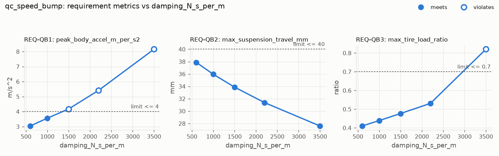
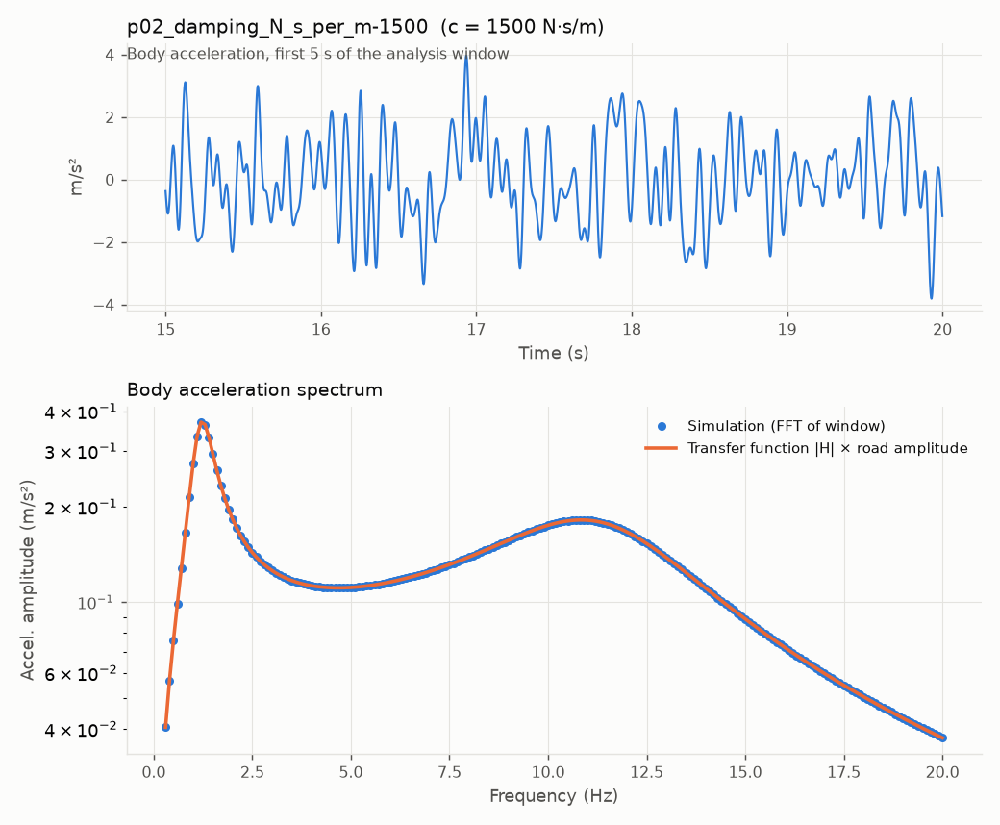
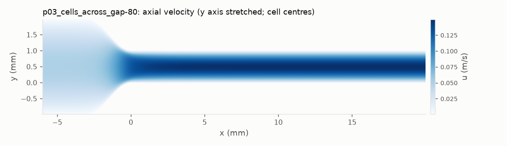
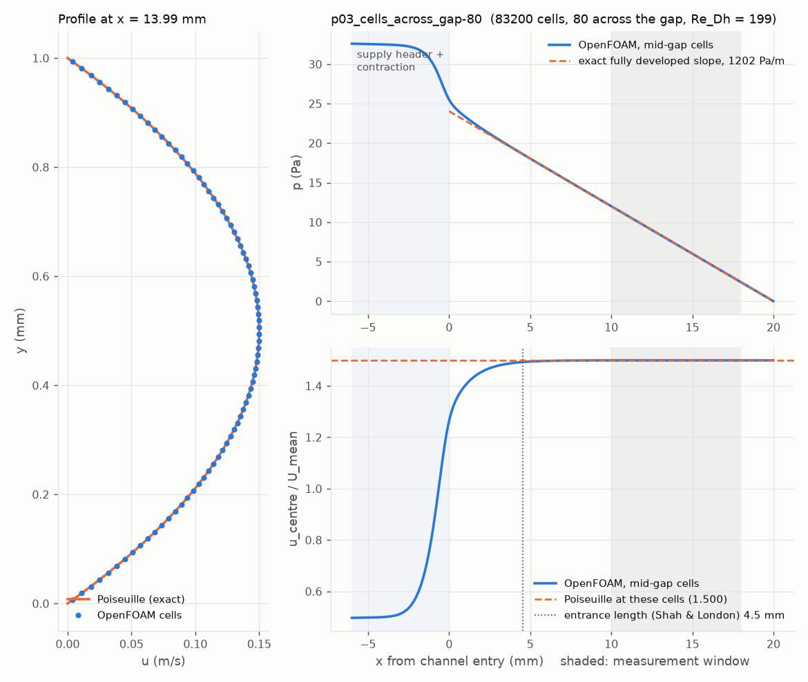
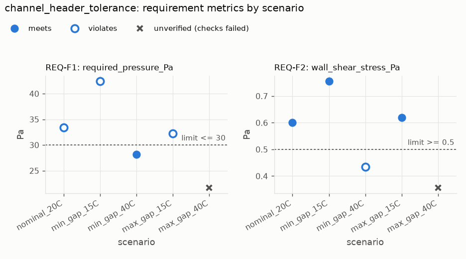
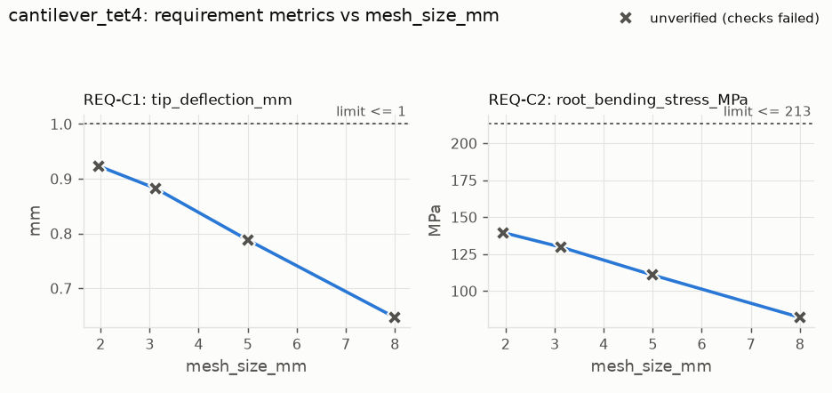

# Engineering modeling portfolio

Requirements-driven simulation with independent verification, built on open-source tools and driven by an AI coding agent. Each example turns written requirements into a model, runs a parameter sweep, checks every result against an independent reference, and produces a traceable review report. Model failures and invalid assumptions are reported, not hidden.

All examples use synthetic, public-domain problems. Every number below links to a committed evidence run that can be reproduced from its saved inputs.

## Examples

| # | Problem | Tools | Independent verification | Result |
|---|---|---|---|---|
| 1 | [Quarter-car ride and road holding](#1-quarter-car-ride-and-road-holding) | SciPy, OpenModelica (MSL) | Matrix-exponential solution; closed-form transfer-function RMS; energy balance; SciPy vs Modelica cross-check | Damper window found; validity check caught wheel lift-off |
| 2 | [Coolant channel pressure budget, CFD](#2-coolant-channel-pressure-budget-cfd) | OpenFOAM (in WSL) | Exact Poiseuille solution; force balance; mass conservation; header + Shah & London estimate; Grid Convergence Index; tolerance corners | Design fails its pressure budget; requirements conflict across the tolerance band |
| 3 | [Cantilever, 3D solid FEA](#3-cantilever-3d-solid-fea-mesh-convergence) | FreeCAD, Gmsh, CalculiX | Timoshenko beam theory; reaction equilibrium; Grid Convergence Index | Converged to 0.02 % discretization uncertainty; linear-tet stiffness error exposed |
| 4 | [Parametric mounting plate](#4-parametric-mounting-plate-geometry-automation) | CadQuery (OpenCASCADE) | Closed-form volume; geometry measured back from the B-rep; STEP round trip | One hole size meets all design rules |
| 5 | [Mass-spring-damper baseline](#5-mass-spring-damper-baseline) | SciPy, OpenModelica | Closed-form step response; energy balance; cross-tool check | 72 / 72 checks pass; tools agree to 2.5e-6 |

## Workflow

```
case file (TOML)          model under test           independent reference
requirements, units,  ->  SciPy / Modelica /    vs   closed form, state space,
tolerances (fixed         FreeCAD+CalculiX /         beam theory, conservation,
before the first run)     CadQuery / OpenFOAM        convergence, second tool
        |                         |                           |
        +----------> runs/<id>/  inputs (hashed), environment, logs, results,
                     checks, figures, requirement -> result -> check -> evidence report
```

- **Tolerances are written before the first run.** Changing one needs a written reason and a new run.
- **Two kinds of check.** *Numerical* checks ask whether the equations were solved correctly. *Validity* checks ask whether the model's assumptions hold for the result (wheel stays on the road, stress below yield, small deflection). Either kind failing marks the requirement verdicts *unverified*.
- **Reproducible.** Saved inputs and model sources are hashed; `python -m harness rerun` reproduces a run and compares every result column (bit-identical on the same machine).
- **Agent skills.** `run-case`, `verify-against-reference`, and `requirements-report` ([.claude/skills/](.claude/skills/)) let Claude Code drive the workflow without improvising: they never loosen tolerances or accept a design.

## 1. Quarter-car ride and road holding

Linear 2-DOF quarter car (C-segment front-corner wheel rates). The damper rate is swept from 600 to 3500 N·s/m against comfort, suspension-travel, and dynamic-tire-load requirements.

**Speed bump, 40 mm × 1 m at 18 km/h** ([report](runs/20261119-085019_qc_speed_bump/report.md), 30 / 30 checks pass). Damper rates of 600–1000 N·s/m meet all three requirements; 1500 just misses the comfort limit (4.18 vs 4.0 m/s²); 3500 fails tire load. The same case built from Modelica Standard Library components and solved in OpenModelica agrees with SciPy to 1.2e-6 of peak displacement ([report](runs/20261119-085040_qc_speed_bump_modelica/report.md)).



**ISO 8608 class C road at 72 km/h** ([report](runs/20261119-084926_qc_iso_road/report.md)). Simulated RMS values match the closed-form transfer-function prediction to 1e-10. No damper rate meets the 1.0 m/s² comfort target, and travel and tire load need at least ~1500 N·s/m: the conflict calls for a spring-rate change, not a damper change. At 600 N·s/m the wheel briefly lifts off, so that point is marked unverified.



**What the checks caught.** The first bump case (same bump at 36 km/h, [report](runs/20261119-084857_qc_bump/report.md)) passed every numerical check, but the `no_wheel_lift` validity check failed at every damper rate: dynamic tire load reached 1.5–1.7× static. A linear tire model cannot represent lift-off, so every requirement verdict was withheld. The case was kept as evidence and a documented revision at 18 km/h was added.

## 2. Coolant channel pressure budget, CFD

**Question.** A cold-plate passage (1 mm gap between parallel plates, 20 mm long, water at 1.0e-4 m²/s per unit width, about 0.1 m/s) must stay within a 30 Pa share of the pump budget and keep at least 0.5 Pa wall shear stress (a fouling criterion). Does it, across the gap tolerance (±0.05 mm) and coolant temperature range (15-40 °C)?

**Answer.** No. At nominal conditions the passage needs **33.4 Pa** of supply pressure (numerical uncertainty ±0.01 Pa), so it misses the budget by 11 %. Across the tolerance band the required pressure spans 28-42 Pa, and warm coolant pushes wall shear down to 0.43 Pa. No gap satisfies both requirements at this flow rate: scaling from the CFD results, the 30 Pa budget at 15 °C needs a gap of at least about 1.08 mm, while 0.5 Pa wall shear at 40 °C needs at most 0.885 mm. Resolving it is a design decision: limit the coolant temperature range, raise the pressure budget, change the flow split, or revisit the shear criterion. The scaling estimates would be confirmed with a follow-up run.

**Model.** Steady laminar 2D flow in OpenFOAM 14: a supply header with a fully developed inlet profile at the exact flow rate, a smooth contraction, and the channel. A Python writer generates every OpenFOAM dictionary, and results are read straight from OpenFOAM's field files. Required supply pressure is the flux-weighted total pressure at the inlet minus the outlet static pressure. That counts the outlet dynamic head as lost in the outlet header (exit-loss coefficient 1, conservative); the dynamic head is 7.7 Pa of the 33.4 Pa.

| Uncertainty source (nominal required pressure, 33.4 Pa) | Size | Evidence |
|---|---|---|
| Numerical: mesh | ±0.04 % | GCI over 20/40/80 cells across the gap; observed order 1.95 (design order 2) |
| Numerical: iterative, conservation | residuals < 1e-6; mass conserved to 1e-8; force balance to 2e-5 | per-point checks |
| Model form | CFD vs independent estimate (lubrication theory in the header + Shah & London channel correlation): 0.04 %, at most 0.3 % across the tolerance corners | per-point check. Assumptions: 2D channel (to confirm against the real width), no recovery in the outlet header (conservative) |
| Inputs: gap ±0.05 mm, 15-40 °C | −16 % / +27 % | verified tolerance corners at 80 cells across the gap |

Reports: [mesh study](runs/20261119-200042_channel_header_mesh/report.md) (fully developed velocity profile, pressure gradient, and wall shear match the exact Poiseuille solution to 0.02 %), [tolerance study](runs/20261119-200202_channel_header_tolerance/report.md).







**What the checks caught.**
- The first model imposed a uniform velocity at the channel entry, a common simplification ([report](runs/20261119-191916_channel_mesh/report.md)). Its fully developed results were exact, but the pressure drop kept rising with mesh refinement: it converged at order 0.5, the signature of a singular corner where the uniform inlet meets the no-slip wall. The mesh-convergence check failed (3.5 % against 2 %) and the pressure requirement was marked unverified. That idealized model also said the channel passed (28.6 Pa). Modelling the supply header fixed the convergence (order 1.95, 0.04 %) and, with the exit loss included, reversed the verdict.
- In the warm, wide-gap corner (Re ≈ 300) the flow is still developing slightly where the fully developed quantities are measured (0.13 % change against a 0.1 % limit). That point is marked unverified rather than used; the conclusion rests on the verified corners.

## 3. Cantilever, 3D solid FEA, mesh convergence

Steel cantilever 200 × 20 × 20 mm, 1 kN tip load. FreeCAD builds geometry, material, constraints, and a Gmsh tetrahedral mesh; CalculiX solves; results are parsed directly from the CalculiX output files. The sweep is a mesh-refinement study (8 → 1.95 mm, ratio 1.6). The native `.FCStd` model and CalculiX deck are kept with each run.

**Quadratic tets, TET10** ([report](runs/20261119-085818_cantilever_tet10/report.md), 22 / 22 checks pass). Tip deflection converges monotonically (observed order 2.04) to 0.953 mm, between Euler-Bernoulli (0.952) and Timoshenko (0.960) as expected for a fully clamped 3D solid. Discretization uncertainty (GCI, Celik 2008 / ASME V&V 20): 0.02 %. Reactions balance the load to 1e-11. Root bending stress, extrapolated from the top fibre away from the singular clamp corners, is 150.0 MPa against 150 MPa from beam theory; the raw peak von Mises stress at the corner grows from 150 to 217 MPa with refinement, which is why it is not used for the requirement.


**What the checks caught.** The same study with linear tets (TET4, [report](runs/20261119-090004_cantilever_tet4/report.md)) under-predicts deflection by 4–33 % and root stress by 7–45 %. That would make the stiffness requirement look comfortably met; the beam-theory and GCI checks fail instead and the verdicts are marked unverified.



## 4. Parametric mounting plate, geometry automation

CadQuery builds a 120 × 80 × 6 mm aluminium plate with R8 corners and a 3 × 2 hole grid; the hole diameter is swept over M5–M12 clearance sizes. Every metric is measured back from the B-rep rather than taken from the design intent: volume, bounding box, and each hole's centre and diameter. The STEP export is re-imported and compared ([report](runs/20261119-090540_mounting_plate/report.md), 40 / 40 checks pass; volume matches the closed form to 1e-16).

Mass (≤ 150 g) needs large holes; edge distance (≥ 2 d) needs small ones. Only the 9 mm (M8) hole meets both.


## 5. Mass-spring-damper baseline

The first harness example: a 1-DOF step response with a damping-ratio sweep, checked against the closed-form solution, an energy balance, steady state, and solver convergence ([SciPy report](runs/20261118-200205_msd_step/report.md)). The same system built from MSL components in OpenModelica agrees with SciPy to 2.5e-6 of the static deflection ([Modelica report](runs/20261118-213145_msd_step_modelica/report.md)).

While integrating OpenModelica, the harness's output-grid check revealed that OpenModelica 1.26 silently ignores experiment settings passed through `-override`; the backend now uses the dedicated flags.

## Reproduce

```powershell
py -3.14 -m venv .venv
.venv\Scripts\python.exe -m pip install -r requirements-lock.txt
.venv\Scripts\python.exe -m harness pipeline cases\qc_speed_bump.toml   # run + verify + report
.venv\Scripts\python.exe -m harness rerun runs\<run_id>                 # reproduce a run
.venv\Scripts\python.exe -m pytest -q                                   # 53 tests
```

Tool versions: Python 3.14.10, NumPy 2.5.5, SciPy 1.18.1, OpenModelica 1.26.3 with MSL 4.1.0, FreeCAD 1.1.4 with CalculiX 2.22 and Gmsh, CadQuery 2.8.0, OpenFOAM 14 (openfoam.org package 20261008) in WSL Ubuntu 22.04. Every run records the exact versions, platform, and git commit in its manifest.

## Limitations

- Synthetic parameters throughout; nothing is calibrated to a real product.
- The checks establish numerical verification and model-validity limits. Physical validation needs test data, which these examples do not have.
- Comfort metrics are unweighted (no ISO 2631 frequency weighting).
- The CFD example is 2D, isothermal, and laminar; heat transfer is not modelled.
- Engineering acceptance is left to human review; reports end with "Pending human review" by design.
