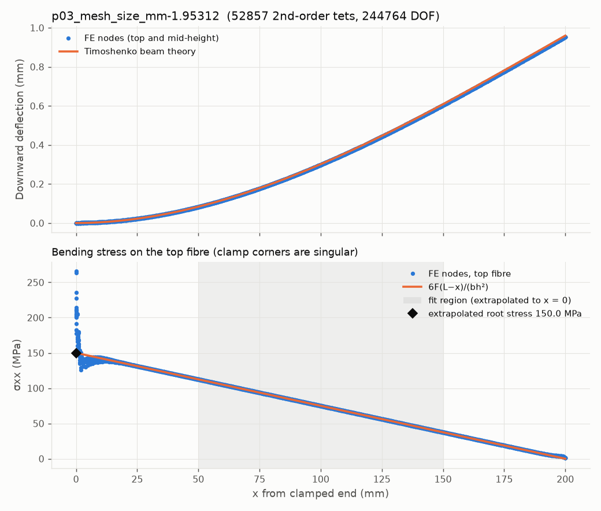
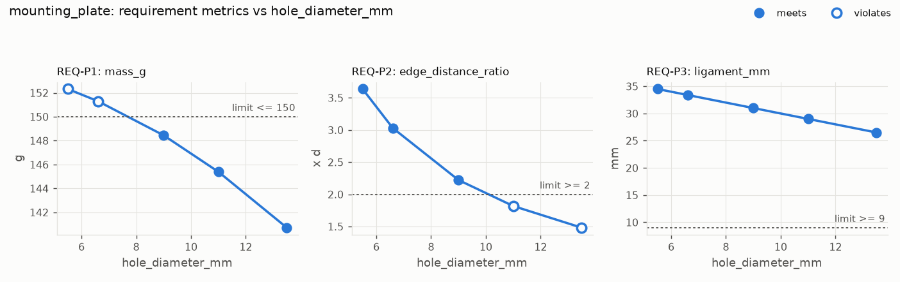

# Engineering Modeling Portfolio

These five worked examples show how I approach a modeling job. Each one starts from a written question and measurable requirements, builds a model to answer it, and then checks the result against something independent: an exact solution, a conservation law, a second tool, or a mesh-convergence study. Every example ends with a clear answer and a statement of how sure that answer is.

I also show what the checks caught along the way. In several examples the first version of the model gave an answer that looked reasonable and was wrong, and the checks are what exposed it. I think that matters more than a clean result.

All of the problems are synthetic, so no client data is involved. Every number on this page comes from a saved run that can be reproduced from its recorded inputs, and the reports are linked in each section.

## At a glance

| Example | The question | The answer | Tools |
|---|---|---|---|
| [1. Coolant channel pressure budget](#1-coolant-channel-pressure-budget) | Does a cold-plate passage stay within its pump budget across manufacturing tolerance and coolant temperature? | No. It needs 33.4 Pa against a 30 Pa budget, and no gap size satisfies both requirements. | OpenFOAM (computational fluid dynamics) |
| [2. Quarter-car ride and road holding](#2-quarter-car-ride-and-road-holding) | Which damper rates meet comfort, suspension travel, and tire-load targets? | 600 to 1000 N·s/m over a speed bump. On a rough road, the spring rate has to change too. | Python (SciPy) and OpenModelica |
| [3. Cantilever bracket, 3D finite elements](#3-cantilever-bracket-3d-finite-elements) | Does a steel cantilever meet its stiffness and stress limits, and how accurate is the model? | Yes: 0.953 mm deflection and 150 MPa root stress, with mesh uncertainty of 0.02 %. | FreeCAD, Gmsh, CalculiX |
| [4. Parametric mounting plate](#4-parametric-mounting-plate) | Which hole size keeps an aluminium plate light enough while keeping enough material around each hole? | Only the 9 mm (M8 clearance) hole meets both rules. | CadQuery |
| [5. Mass-spring-damper baseline](#5-mass-spring-damper-baseline) | Can the workflow reproduce a textbook result exactly, in two different tools? | Yes. All 72 checks pass, and the two tools agree to a few parts per million. | Python (SciPy) and OpenModelica |

## How I work

1. **I write the requirements and the acceptance tolerances before running anything.** That way a passing result can't be the product of moving the goalposts. If a tolerance or a requirement has to change later, the reason is written down and the earlier run is kept.
2. **I check every reported number against an independent reference.** That might be an exact solution, a conservation law, a published correlation, or the same model built in a second tool.
3. **I check that the model is valid for each case, not just that it solved.** For example: does the wheel stay on the road, is the stress below yield, is the flow still laminar? If an assumption breaks, the result is marked unverified rather than reported as a pass or fail.
4. **I measure how much the answer depends on the mesh or time step,** and I report that uncertainty next to the answer.
5. **I keep the evidence.** Inputs, tool versions, logs, results, figures, and a report that traces each requirement to its result and its checks. Any run can be repeated, and it reproduces exactly on the same machine.

The workflow is driven by an AI coding agent working through fixed, documented procedures. Those procedures are written as reusable skills, and they never loosen a tolerance or accept a design on their own. Engineering acceptance is always left to a person.

---

## 1. Coolant channel pressure budget

**The question.** A cold-plate passage is a 1 mm gap between two plates, 20 mm long, carrying water at about 0.1 m/s. It has to stay within a 30 Pa share of the pump's pressure budget. It also needs at least 0.5 Pa of shear stress on the walls, a common guideline for limiting fouling. Does it meet both, when the gap can vary by plus or minus 0.05 mm and the coolant runs anywhere from 15 to 40 °C?

**The answer: no.** At nominal conditions the passage needs 33.4 Pa, which is 11 % over budget. Across the tolerance range it needs anywhere from 28 to 42 Pa, and warm coolant drops the wall shear to 0.43 Pa.

The two requirements pull in opposite directions. To stay within the pressure budget with cold coolant, the gap has to be at least 1.078 mm. To keep enough wall shear with warm coolant, it can be at most 0.885 mm. No gap does both. I predicted those two limits before running them, and the confirmation runs came back at 30.02 Pa and 0.500 Pa, right on target.

So this is a design decision rather than a modeling one. The options are to narrow the coolant temperature range, raise the pressure budget, change how the flow is split between channels, or revisit the shear guideline.

**How I know it's right.**

- **The model.** It's a steady, two-dimensional flow simulation in OpenFOAM. It includes a supply header feeding the channel through a smooth contraction, because a simpler model with flow forced straight into the channel turned out to be unreliable (see below). The pressure the pump has to supply counts the flow's kinetic energy at the exit as lost, which is the conservative and usual assumption. That exit loss is 7.7 Pa of the 33.4 Pa.
- **Against exact solutions.** Where the flow has settled into its final shape, the velocity profile, pressure gradient, and wall shear all match the textbook exact solution to within 0.02 %.
- **Conservation.** Mass is conserved to about one part in a hundred million. The wall friction balances the pressure force to within a few parts in a hundred thousand.
- **Mesh dependence.** Refining the mesh from 20 to 80 cells across the gap changes the answer in a way that converges at exactly the rate the method is designed for. The remaining mesh uncertainty is 0.04 %.
- **Against an independent estimate.** A hand calculation combining lubrication theory for the header with the Shah and London correlation for the channel agrees with the simulation to within 0.3 % in every case.
- **The two-dimensional assumption.** I checked it with a separate 3D model that includes the channel's side walls, assuming a 20 mm wide channel. The side walls raise the friction by 3.2 %; the exact solution for a rectangular duct says 3.25 %. That adds about 0.8 Pa, which makes the nominal case about 34.2 Pa, so the conclusion only gets firmer.

| Where the uncertainty comes from | How big it is |
|---|---|
| The mesh | 0.04 % |
| Iteration and conservation | Negligible: well under one part in ten thousand |
| The model's simplifications | 0.3 % or less against the independent estimate. The side walls add about 3 %. |
| Manufacturing tolerance and coolant temperature | 16 % lower to 27 % higher than nominal. This dominates everything else. |

**What the checks caught.**

- **The simple inlet hid a problem, and gave the wrong verdict.** My first model forced a perfectly uniform flow straight into the channel, a common shortcut. It said the channel passed, at 28.6 Pa. But the pressure kept creeping up as the mesh got finer and never settled. That is the signature of a sharp corner the solver can't resolve, here where the uniform inflow meets the wall. The mesh-convergence check failed, so that answer was never reported as verified. Modeling the supply header fixed the convergence. Counting the exit loss then turned the verdict from pass to fail.
- **One tolerance case wasn't fully developed.** With warm water and the widest gap, the flow was still settling slightly where the measurements are taken. That case is marked unverified, and the conclusion rests on the other four.
- **A meshing mistake in the 3D check.** In my first 3D run the mesh was coarsest exactly where it needed to be finest, next to the side walls. The overall friction still looked fine on the finer meshes, but a point-by-point comparison of the whole velocity field against the exact solution failed every time, always next to the side wall. An average result can hide a local error, so I check the full field as well.

**Evidence:** [mesh study](runs/20261119-200042_channel_header_mesh/report.md), [tolerance study](runs/20261119-200202_channel_header_tolerance/report.md), [gap-limit confirmation](runs/20261119-201615_channel_header_gap_limits/report.md), [3D side-wall check](runs/20261119-204111_duct_side_walls/report.md), [first model, uniform inlet](runs/20261119-191916_channel_mesh/report.md), [first 3D run, meshing error](runs/20261119-202956_duct_side_walls/report.md).

---

## 2. Quarter-car ride and road holding

**The question.** For a compact-car front corner, which damper rates between 600 and 3500 N·s/m meet the targets for ride comfort, suspension travel, and tire load? I tested it over a speed bump and over a rough road.

**The answer.**

- **Over a 40 mm speed bump at 18 km/h,** damper rates from 600 to 1000 N·s/m meet all three targets. At 1500 the car just misses the comfort limit, 4.18 against 4.0 m/s². At 3500 the tire load goes over its limit.
- **On a rough road at 72 km/h** (class C in the ISO 8608 road-roughness standard), no damper rate meets the comfort target. Meanwhile travel and tire load need at least about 1500. Those two demands conflict, so the fix is a spring-rate change, not a different damper.

**How I know it's right.**

- **Speed bump.** The simulation matches an independent exact solution of the same equations. Energy into the system balances the energy stored and dissipated. All 30 checks pass. I also built the same car from standard library components in a second tool, OpenModelica, and it agrees with the Python model to about one part in a million.
- **Rough road.** The simulated vibration levels match the prediction from the system's frequency response to within one part in ten billion.

**What the checks caught.** I first ran the bump at 36 km/h. Every numerical check passed, but the check on whether the wheel stays on the road failed at every damper rate: the tire load swung to as much as 1.7 times its static value. A linear tire model can't represent a wheel leaving the ground, so none of those results could be trusted, and none were reported as pass or fail. I kept that run as evidence and added a documented case at 18 km/h. Also, at 600 N·s/m on the rough road the wheel briefly lifts off, so that one point is marked unverified.

**Evidence:** [speed bump](runs/20261119-085019_qc_speed_bump/report.md), [same case in OpenModelica](runs/20261119-085040_qc_speed_bump_modelica/report.md), [rough road](runs/20261119-084926_qc_iso_road/report.md), [first bump case, wheel lift-off](runs/20261119-084857_qc_bump/report.md).

---

## 3. Cantilever bracket, 3D finite elements

**The question.** A steel bracket, 200 mm long with a 20 by 20 mm section, carries a 1 kN load at its tip. Does it stay within a 1.0 mm deflection limit and a 213 MPa stress limit? And how accurate is the model?

**The answer: yes, with margin.** The tip deflects 0.953 mm and the bending stress at the root is 150 MPa. The mesh uncertainty is 0.02 %.

**How I know it's right.**

- **The model.** FreeCAD builds the geometry, material, supports, and mesh; CalculiX solves it; and I read the results straight from the solver's output files. The original FreeCAD model is kept with every run.
- **Against beam theory.** The deflection lands between the two standard beam-theory results, 0.952 and 0.960 mm, which is where a fully clamped solid block should be.
- **Equilibrium.** The support reactions balance the applied load to within rounding error.
- **Mesh refinement.** As the mesh gets finer, the result converges at the rate the elements are designed for, which gives the 0.02 % uncertainty.
- **The stress I report.** The peak stress right at the clamped corner keeps growing as the mesh is refined, from 150 to 217 MPa. That's a known artifact of a perfectly sharp corner, so I don't use it. The stress I report is extrapolated from the smooth part of the beam, and it matches beam theory at 150 MPa.

**What the checks caught.** I ran the same study with the simplest element type, linear tetrahedra. It made the bracket look 4 to 33 % stiffer than it is, and understated the stress by 7 to 45 %. Taken at face value, the bracket would have looked comfortably within its limits. The beam-theory and mesh checks failed instead, and every one of those results was marked unverified.

**Evidence:** [quadratic elements](runs/20261119-085818_cantilever_tet10/report.md), [linear elements](runs/20261119-090004_cantilever_tet4/report.md).

---

## 4. Parametric mounting plate

**The question.** An aluminium plate, 120 by 80 by 6 mm, has a grid of six holes. Which clearance-hole size, from M5 up to M12, keeps the plate at or under 150 g while leaving at least twice the hole diameter between each hole and the edge?

**The answer.** Only the 9 mm hole, the M8 clearance size, meets both. Bigger holes save weight but eat into the edge distance; smaller holes do the opposite.

**How I know it's right.** The plate is generated in code with CadQuery, and every number is measured back from the finished solid rather than taken from the design inputs: the volume, the overall size, and the position and diameter of each hole. The volume matches a hand calculation to the limit of the computer's arithmetic. I also export each plate as a STEP file, read it back in, and confirm nothing changed. All 40 checks pass.

**Evidence:** [report](runs/20261119-090540_mounting_plate/report.md).

---

## 5. Mass-spring-damper baseline

This was the first example, used to prove the workflow on a problem with a known answer. It's a single mass on a spring and damper, pushed by a step force, at six different damping levels. The results are checked against the exact textbook solution, an energy balance, the final resting position, and the solver's own convergence. All 72 checks pass. The same system built in OpenModelica agrees with the Python version to a few parts per million.

**What the checks caught.** While I was connecting OpenModelica, the check that results land on the requested time points failed. It turned out OpenModelica was silently ignoring some of the simulation settings I was passing it. I changed how the settings are passed, and the check has guarded against it since.

**Evidence:** [Python version](runs/20261118-200205_msd_step/report.md), [OpenModelica version](runs/20261118-213145_msd_step_modelica/report.md).

---

## Limits of these examples

- The parameters and requirement limits are synthetic. Nothing here is calibrated to a real product.
- The checks show the equations were solved correctly and the models were used within their valid range. Showing that a model matches real hardware needs test data, which these examples don't have.
- The ride-comfort figures are unweighted. A production study would apply the ISO 2631 human-sensitivity weighting.
- The coolant-channel model covers flow and pressure, not heat transfer.
- Every report ends with "pending human review". Accepting a design is an engineering decision, and it stays with a person.

## Reproducing the work

Each run records its exact inputs, tool versions, and code version, and can be repeated with one command. The commands and setup are in the [README](README.md). Tool versions used: Python 3.14 with NumPy and SciPy, OpenModelica 1.26.3, FreeCAD 1.1.4 with CalculiX 2.22 and Gmsh, CadQuery 2.8, and OpenFOAM 14 running under Linux on Windows.
