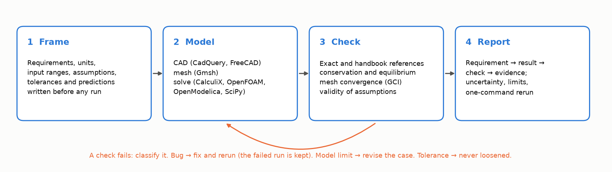

# Engineering Modeling Portfolio

Worked case studies in structural analysis, contact, vibration, fatigue, pressure equipment, fluids and heat transfer, vehicle dynamics, and CAD automation. Each one starts from a written question and measurable requirements, builds a model to answer it, and checks the result against something independent: an exact solution, a conservation law, a handbook value, a second tool, or a mesh-convergence study. Each ends with a clear answer and a statement of how sure that answer is.

I also show what the checks caught along the way. In several studies the first version of the model gave an answer that looked reasonable and was wrong, and the checks are what exposed it.

All problems are synthetic, so no client data is involved. Every number comes from a saved run that can be reproduced from its recorded inputs.

## Capabilities

| Capability | Tools | Shown in |
|---|---|---|
| Structural finite element analysis: 3D solids and plane stress, mesh convergence, stress-concentration and singularity judgement | FreeCAD, Gmsh, CalculiX | [1](portfolio/01-cantilever-bracket.md), [2](portfolio/02-strap-cable-hole.md) |
| Contact: nonlinear surface-to-surface contact, contact pressure and subsurface stress, verified against Hertz; friction contact and bolted joints against VDI 2230; hyperelastic rubber seals with penalty contact (O-ring squeeze against Lindley and Parker's measured bands) | Gmsh, CalculiX | [10](portfolio/10-roller-contact.md), [16](portfolio/16-bolted-joint-slip.md), [25](portfolio/25-oring-face-seal.md) |
| Stability and nonlinear material: eigenvalue and imperfect-strut buckling, plasticity with residual stress | CalculiX | [13](portfolio/13-strut-buckling.md), [14](portfolio/14-strap-proof-plasticity.md) |
| Pressure equipment, design by analysis: stress linearisation on classification lines, membrane and bending limits, design by analysis against a pressure-area rule | CadQuery, Gmsh, CalculiX | [18](portfolio/18-pressure-vessel-nozzle.md) |
| Vibration: modal analysis, mode identification, frequency targets against engine orders; random vibration by modal superposition (3-sigma stress, hot-spot extrapolation); rotordynamics (Campbell diagram, critical speeds, API 684 unbalance response) | CadQuery, Gmsh, CalculiX, ROSS, Python | [4](portfolio/04-bracket-modal.md), [21](portfolio/21-bracket-random-vibration.md), [23](portfolio/23-fan-rotor-critical-speeds.md) |
| Fatigue: notch factors, mean-stress correction, S-N curves from published test data, life ratings; spectral fatigue under random loading (Dirlik, Steinberg); fracture mechanics and crack growth (K by energy release and crack opening, BS 7910 growth law, critical crack, inspection interval); shaft fatigue at a shoulder fillet by Shigley's stress-life method with FE stress concentration factors, and sizing the step that passes | Gmsh, CalculiX, Python | [3](portfolio/03-strap-fatigue.md), [21](portfolio/21-bracket-random-vibration.md), [24](portfolio/24-cracked-plate-growth.md), [26](portfolio/26-shaft-shoulder-fatigue.md) |
| Scripted CAD-to-analysis pipelines: parametric geometry, STEP exchange, meshing, solving; an optimiser driving the pipeline | CadQuery, Gmsh, CalculiX, SciPy | [2](portfolio/02-strap-cable-hole.md), [4](portfolio/04-bracket-modal.md), [8](portfolio/08-mounting-plate.md), [12](portfolio/12-bracket-optimisation.md), [18](portfolio/18-pressure-vessel-nozzle.md) |
| Computational fluid dynamics: internal laminar flow, pressure budgets, 2D and 3D; turbulent RANS (k-omega SST) validated against measured-data correlations, wall treatments compared | OpenFOAM | [5](portfolio/05-coolant-channel.md), [19](portfolio/19-turbulent-pipe-friction.md) |
| Heat transfer: conduction with surface convection; conjugate heat transfer coupling CFD and solid conduction, then thermal stress; natural convection with surface radiation in a sealed electronics enclosure, and sizing its cooling path | CalculiX, OpenFOAM | [6](portfolio/06-heat-sink-fin.md), [15](portfolio/15-cold-plate-thermal-chain.md), [27](portfolio/27-sealed-enclosure-thermal.md) |
| Electric machines: a production motor rebuilt from published drawings, open-circuit and loaded magnetostatics, efficiency maps from dq tables, a coupled thermal network with a continuous rating, rotor stress at overspeed, blind validation protocol, then a client-data model diagnosed without calibrating (an independent second solver, ElmerFEM) | Pyleecan, FEMM, CalculiX, Gmsh, Python | [20](portfolio/20-prius-traction-motor.md) (draft) |
| Fluid-structure interaction: partitioned coupling, each participant verified on its own first | OpenFOAM, CalculiX, preCICE | [17](portfolio/17-fsi-flag-turek-hron.md) (draft) |
| Vehicle and system dynamics: ride, road holding, frequency response | Python (SciPy), OpenModelica | [7](portfolio/07-quarter-car.md), [9](portfolio/09-mass-spring-damper.md) |
| Presentation renders: FE results and CAD parts rendered in Blender, with legend colours and geometry checked automatically | Blender (Cycles), Python | [1](portfolio/01-cantilever-bracket.md), [2](portfolio/02-strap-cable-hole.md), [4](portfolio/04-bracket-modal.md), [6](portfolio/06-heat-sink-fin.md), [8](portfolio/08-mounting-plate.md) |
| Verification and uncertainty: exact and handbook references, Grid Convergence Index, tolerance and sensitivity studies; probabilistic uncertainty (Monte Carlo, Sobol indices, FORM, importance sampling) | Python | All; [22](portfolio/22-bracket-random-uncertainty.md) |

## Sample deliverable

[Technical memo: cold-plate coolant passage](portfolio/deliverables/coolant-channel-memo.md). This is what a client receives at the end of a study: the answer and a recommendation on page one, then the requirements, inputs, method, verification, results, uncertainty, the design options with their numbers, and next steps, all traced to the evidence.

## Evaluation tasks

[Five engineering tasks with reference solutions and automated graders](tasks/README.md), written the way an AI-training or assessment pipeline needs them: a problem statement with a required answer format, a verified reference solution, a grader that scores an answer criterion by criterion, and the traps each task is built to expose, such as assuming fully developed flow, reporting a mesh singularity as a design stress, using the wrong modulus in Hertz contact, or averaging von Mises stress through a pressure-vessel wall. The graders are tested too: each one gives the reference full marks and fails every trap answer on the criterion that trap should break.

## Case studies

### Structures and vibration

| | Question | Answer |
|---|---|---|
| [1. Cantilever bracket, 3D finite elements](portfolio/01-cantilever-bracket.md) | Does a steel cantilever meet its stiffness and stress limits, and how accurate is the model? | Yes: 0.953 mm deflection and 150 MPa root stress, with 0.02 % mesh uncertainty. |
| [2. Cable hole in a strap, CAD to FEA](portfolio/02-strap-cable-hole.md) | How large can a cable hole in an aluminium strap be before the stress at its edge exceeds the allowable? | About 16.7 mm. A 16 mm hole passes at 117 MPa; 18 mm fails at 125 MPa. |
| [3. Strap fatigue life, chained analysis](portfolio/03-strap-fatigue.md) | Does the strap survive ten million service cycles, and what cyclic load can it be rated for? | Yes, by a wide margin; rated to about 7.8 kN cyclic for 3 × 10⁷ cycles. |
| [4. Bracket arm vibration, modal analysis](portfolio/04-bracket-modal.md) | How thin can an engine-mounted bracket arm be and keep its first mode above 250 Hz within a mass budget? | 7 mm: 261.7 Hz at 206 g. |
| [10. Roller-on-plate contact](portfolio/10-roller-contact.md) | Does a track roller's contact stay within its pressure and subsurface-shear limits at 500 N/mm? | Yes: 609 MPa against 650, and 184 MPa shear against 200. Matches Hertz to 0.4 %. |
| [12. Bracket optimisation loop, machined clevis](portfolio/12-bracket-optimisation.md) | Which lug and gusset dimensions make a machined clevis bracket lightest while its peak stress stays under 100 MPa and its pin moves at most 0.1 mm? | 371.9 g, 4.1 % under the start, at 98.3 MPa. It took three optimisation runs: the checks caught a margin too small for a fillet peak, a mesh study that never refined the fillet, and an optimiser stalled in mesh noise. |
| [13. Strut buckling, with an imperfect strut](portfolio/13-strut-buckling.md) | How long can a pinned aluminium strut be and still reach 16 kN before any fibre yields, allowing for a bow of L/1000? | About 587 mm. The bow costs 4 to 7 % against the elastic buckling load. |
| [14. Strap proof test, plasticity](portfolio/14-strap-proof-plasticity.md) | Does a 15 kN proof test keep the hole edge within 1 % strain, and does it leave a helpful residual stress? | Yes: 0.58 % strain and −77 MPa of compressive residual stress at the hole edge. |
| [16. Bolted joint, slip and opening](portfolio/16-bolted-joint-slip.md) | Does a preloaded M8 joint carry a 2.5 kN side load by friction after it settles, and stay closed under 10 kN? | No: it slips at 2.39 kN, 4.4 % short; a 15.6 kN preload fixes it. It stays closed to 13.1 kN. |
| [18. Pressure vessel nozzle, design by analysis](portfolio/18-pressure-vessel-nozzle.md) | Can a 200 mm nozzle with a 12 mm wall go into a 16 mm shell at 3.5 MPa without a reinforcing pad, and how thin can the head be? | It depends on the classification line: at the weld-fillet toes it passes by 0.9 % (205.1 MPa against 207; about 11.7 mm needed), through the crotch it fails by 24 % (256.7 MPa; about 20 mm needed); a simplified pressure-area rule asks for about 16. Recommended for review: judge the opening by the crotch line (about 21 mm, or a pad). The hemispherical head can be about 6.5 mm (its membrane governs, not the junction). |
| [21. Bracket arm under random vibration](portfolio/21-bracket-random-vibration.md) | Does study 4's steel arm survive a random-vibration qualification, one hour per axis at 0.04 g²/Hz (20-2000 Hz)? | Yes, with wide margins: 3-sigma root stress 38.6 MPa against 236.7, fatigue damage 0.0024 against 0.5, tip 0.345 mm against a 1 mm clearance (the closest margin). |
| [22. Bracket arm under random vibration: how robust is the PASS?](portfolio/22-bracket-random-uncertainty.md) | With damping, test level, fatigue strength and thickness uncertain, how likely is study 21's arm to fail, and what should be measured first? | Failure probability about 2e-6 against a 1e-3 limit; the tip clearance governs (reliability index 4.55); damping drives 71 % of the damage variance: measure it first. Synthetic distributions. |
| [23. Fan rotor: critical speeds and unbalance response](portfolio/23-fan-rotor-critical-speeds.md) | Does a fan rotor running 1000-3000 rpm keep its critical speeds 15 % clear of the range for any bearing stiffness, and which shaft diameter does? | 50 mm fails (critical inside the range); 60 mm fails on soft bearings; 65 mm passes with at least 23.8 % margin and under 5 µm response. |
| [24. Cracked steel plate: critical crack and fatigue crack growth](portfolio/24-cracked-plate-growth.md) | How long does a 2 mm edge crack in a 100 mm S355 plate take to grow to failure under 150 MPa cyclic tension, and how often must it be inspected? | Critical crack 37.0 mm; about 92,000 cycles from 2 mm, so inspect at least every 46,000 cycles. K within 0.66 % of the handbook. |
| [25. O-ring face seal across its tolerance stack](portfolio/25-oring-face-seal.md) | Does a 3.53 mm NBR 70 O-ring in a cover's face groove stay within its squeeze range, seal 3 bar with margin, close within the bolts' budget and fit its groove at every corner of the tolerance stack? | Passes every requirement at every corner: loosest peak contact pressure 1.50 MPa (2.5 x the 0.6 needed), tightest closing force 5.94 N/mm (2.0 x under 12), fill at most 80.4 % (limit 85). Checked against Hertz (1.6 %), Lindley's force-squeeze relation (within 10.6 %) and Parker's measured load band; mesh uncertainty 1.1 % or less. The squeezed ring grows in diameter, so the groove wall is modelled. |
| [26. Gearbox shaft shoulder: fatigue at the fillet](portfolio/26-shaft-shoulder-fatigue.md) | Does a 42CrMo4 gearbox shaft's 40 -> 32 mm shoulder with a 1.6 mm fillet survive rotating bending and steady torque with a fatigue safety of 1.5 and a 1.5 x overload with a yield safety of 2.0, and if not, what step does? | Fails both: fatigue safety 1.19 (1.15 at the fillet's lower tolerance), yield safety 1.83; no fillet under the 4 mm shoulder reaches 1.5 (1.47 at 3.9 mm). The smallest passing seat is 35.1 mm: a 36 mm seat with a 45 mm shoulder gives 1.62 and 2.52. Kt and Kts from a CalculiX half model (equilibrium 1e-7, beam theory 0.6 %, published fits 1.5-6.7 %), Shigley's method checked against the textbook's worked values; mesh convergence judged against a measured noise floor. |

### Thermal and fluids

| | Question | Answer |
|---|---|---|
| [5. Coolant channel pressure budget](portfolio/05-coolant-channel.md) | Does a cold-plate passage stay within its pump budget across manufacturing tolerance and coolant temperature? | No. It needs 33.4 Pa against a 30 Pa budget, and no gap size satisfies both requirements. |
| [6. Heat-sink fin temperature](portfolio/06-heat-sink-fin.md) | Does the tip of an aluminium heat-sink fin stay above 60 °C, and what would make it fail? | Yes, at 73.2 °C. Even with every input at its worst it stays at 65.9 °C. |
| [11. Cold-plate channel heat transfer](portfolio/11-cold-plate-heat-transfer.md) | Does a heated coolant passage keep its wall at or under 45 °C, and what heat flux can it take? | Yes, verified: wall 44.03 °C (limit 45, uncertainty 0.23 %), coolant rise 7.2 K. Rated about 31 kW/m². |
| [19. Turbulent pipe friction, RANS against measured data](portfolio/19-turbulent-pipe-friction.md) | Can our OpenFOAM RANS setup be trusted for turbulent pressure-drop budgets to 5 %? | Yes with the sublayer resolved: 2.4 % above Prandtl's smooth-pipe law when mesh-converged (verified, mesh uncertainty 0.5 %) (single meshes read −0.9 % and +0.7 %). Wall functions sit about 5 % low whatever the mesh: not usable to 5 %. Part 2, separated flow behind a step, scored once against measurements: reattachment (+2.3 %) and skin friction (7 % rms) pass; pressure recovery fails by 0.0027 against 0.02 (2D: no tunnel side walls). |
| [15. Cold plate, full thermal chain](portfolio/15-cold-plate-thermal-chain.md) | With the plate's own conduction and thermal stress included, does the cold plate keep its component at or under 45 °C, its coolant rise under 10 K and its stress under 60 MPa? | Yes: 40.99 °C, 7.20 K and 46.8 MPa, with mesh uncertainty 0.035 % or less. |
| [27. Sealed electronics enclosure, convection and radiation](portfolio/27-sealed-enclosure-thermal.md) | Does a sealed aluminium box keep its 5 W component at or under 85 C and its air at or under 60 C at 40 C ambient, for a bare or a painted interior, and if not, what fixes it? | No: component 94-163 C, air 67-84 C. A 5 W/mK conduction path to the lid brings the component to 70-76 C for either finish; the air limit still fails (61-66 C) and needs a path for the board's heat. |

### Electric machines and coupled problems (drafts, in progress)

| | Question | Answer so far |
|---|---|---|
| [20. Prius traction motor, blind, then on client data (closed)](portfolio/20-prius-traction-motor.md) | Can an open-source toolchain predict a production traction motor well enough for design screening, before seeing the test data? | Blind comparison with ORNL's measurements, run once against limits agreed in advance: back-EMF +23.5 %, torque +7 to +24 %, efficiency about 5 points high: all three fail. One fault, about 24 % too much magnet flux, explains most of it. Calibrated afterwards on routine data (magnet remanence, chosen on the static inductances): the efficiency gap narrows from 5.2 to 4.5 points, then to 4.05 with each test point's measured winding temperature (a no-load spin-loss test showed the no-load loss was already right; most of the rest is torque per ampere), and the rated-power verdict flips to a fail, and the continuous rating falls from 30.2 to 28.1 kW (25 required; fails at the loosest housing fit). Open-circuit voltage at top speed, recomputed: 856 V against ORNL's measured 850 V, still a fail against the 500 V bus. Then run as a client project, uncalibrated, on the client's own data (revision 5): the magnet-driven flux is still about 18 % high in back-EMF and torque alike (solver, steel and end effects ruled out; ORNL's measured air-gap field is the model's scaled uniformly by 1.148, so the magnets' magnetisation level is the explanation, to be settled by a fluxmeter test); efficiency 4.4 points high against ORNL at the median; rated power passes (55.9 kW cold), continuous rating 27.7 kW, rotor bridges 415 MPa at overspeed against 335 (fail). |
| [17. Flexible flag, fluid-structure interaction](portfolio/17-fsi-flag-turek-hron.md) | Does a coupled OpenFOAM-CalculiX model reproduce the Turek-Hron benchmark, each half verified first? | Solid and fluid stages verified against the benchmark; the steady coupled case reproduces it within 1 % on every quantity (drag and lift verified; the tip displacement's mesh uncertainty not estimable). The periodic cases oscillate on their own. FSI3, three meshes: every requirement passes on the finest, frequency and mean drag verified, the tip amplitude extrapolating to 0.02 % from the benchmark. FSI2: the finest mesh's crash fixed (mesh motion); every requirement passes on three meshes, the frequency converges, the amplitudes do not (mesh verification fails, reported). |

### Vehicle and system dynamics

| | Question | Answer |
|---|---|---|
| [7. Quarter-car ride and road holding](portfolio/07-quarter-car.md) | Which damper rates meet comfort, suspension travel, and tire-load targets? | 600 to 1000 N·s/m over a speed bump at 18 km/h. At 36 km/h the wheel leaves the road and nothing passes. On a rough road, the spring rate has to change too. |

### Geometry automation

| | Question | Answer |
|---|---|---|
| [8. Parametric mounting plate](portfolio/08-mounting-plate.md) | Which hole size keeps an aluminium plate light enough while keeping enough material around each hole? | Only the 9 mm (M8 clearance) hole meets both rules. |

### Workflow validation

| | Question | Answer |
|---|---|---|
| [9. Mass-spring-damper baseline](portfolio/09-mass-spring-damper.md) | Can the workflow reproduce a textbook result exactly, in two different tools? | Yes. All 72 checks pass, and the two tools agree to a few parts per million. |

## Highlights: what the checks caught

- **A model that converged cleanly to the wrong answer** ([strap](portfolio/02-strap-cable-hole.md)). A textbook-perfect mesh study settled 2 % off the handbook. Running an exact case through the same pipeline exposed a solver formulation issue that no amount of mesh refinement would have shown.
- **An idealized inlet that reversed the verdict** ([coolant channel](portfolio/05-coolant-channel.md)). The simple model said the channel passed. It never converged at the inlet corner, and the realistic model fails the budget.
- **A wheel that left the road** ([quarter car](portfolio/07-quarter-car.md)). Every numerical check passed, but the model's assumptions didn't hold, so no verdict was reported. The model that check called for, a tire that can lift off, then showed that the linear model had overstated peak body acceleration by up to 29 %.
- **Reading the wrong output** ([roller contact](portfolio/10-roller-contact.md)). Contact pressure taken from the element stresses read 3.5 to 6.5 % high; the solver's own contact output matched the exact Hertz solution to 0.2 % on the same mesh.
- **Elements that made the bracket look too stiff** ([cantilever](portfolio/01-cantilever-bracket.md)). The simplest element type overstated stiffness by up to a third; the checks withheld every result.

## How I work

1. **I write the requirements and the acceptance tolerances before running anything.** That way a passing result can't be the product of moving the goalposts. If a tolerance or a requirement has to change later, the reason is written down and the earlier run is kept.
2. **I check every reported number against an independent reference.** That might be an exact solution, a conservation law, a published correlation, or the same model built in a second tool.
3. **I check that the model is valid for each case, not just that it solved.** For example: does the wheel stay on the road, is the stress below yield, is the flow still laminar? If an assumption breaks, the result is marked unverified rather than reported as a pass or fail.
4. **I measure how much the answer depends on the mesh or time step,** and I report that uncertainty next to the answer.
5. **I keep the evidence.** Inputs, tool versions, logs, results, figures, and a report that traces each requirement to its result and its checks. Any run can be repeated, and it reproduces exactly on the same machine.

The workflow is driven by an AI coding agent working through fixed, documented procedures. Those procedures are written as reusable skills, and they never loosen a tolerance or accept a design on their own. Engineering acceptance is always left to a person.

## What every study delivers

- A case file with the requirements, assumptions, and acceptance tolerances, written before the first run.
- The model source, saved and hashed with each run, and the native solver files (CAD, mesh, solver input).
- A report that traces each requirement to its result, the checks behind it, and the evidence files, ending with "pending human review".
- Figures comparing the model with its references, and the mesh or time-step uncertainty.
- One command to reproduce the run; it reproduces exactly on the same machine.
- Presentation renders of the result on the 3D part. Two automated checks guard them. The rendered surface must enclose the part's design volume, which proves no faces are missing or flipped. Every coloured pixel must be a legend colour, which proves the lighting and tone mapping haven't shifted the contours. A render that fails either check isn't published.

## Limits of these examples

- The parameters and requirement limits are synthetic. Nothing here is calibrated to a real product.
- The checks show the equations were solved correctly and the models were used within their valid range. Showing that a model matches real hardware needs test data, which these examples don't have.
- The coolant-channel model covers flow and pressure, not heat transfer. The fin model takes the air-side heat-transfer coefficient as an input rather than computing the airflow.
- Every report ends with "pending human review". Accepting a design is an engineering decision, and it stays with a person.

## Reproducing the work

Each run records its exact inputs, tool versions, and code version. Setup and commands are in the [README](README.md), and the tool stack and versions are in [CAD-TOOLS.md](CAD-TOOLS.md).
