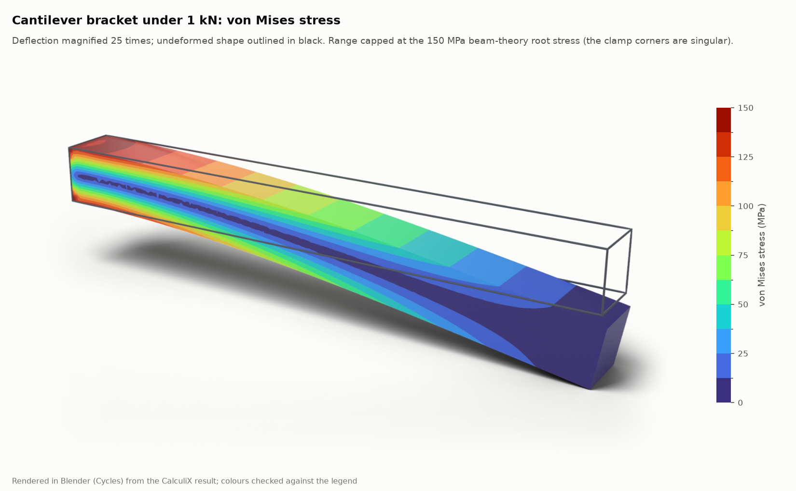
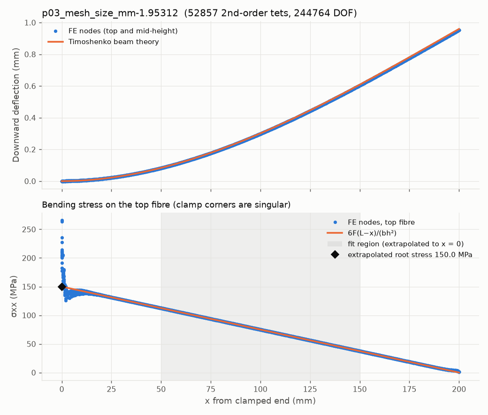
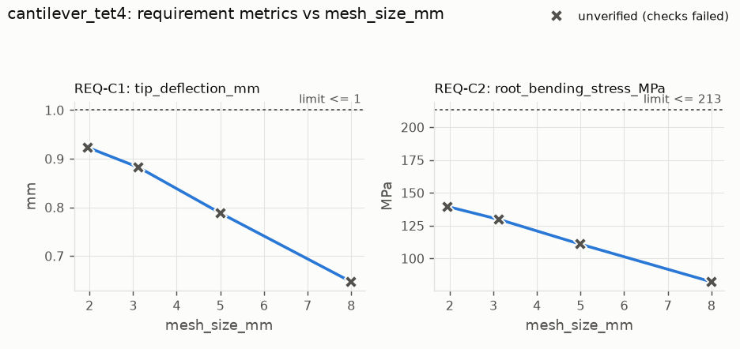

# Cantilever bracket, 3D finite elements

[Portfolio index](../PORTFOLIO.md) · Structures and vibration

| | |
|---|---|
| **Answer** | Yes. 0.953 mm deflection and 150 MPa root stress, with 0.02 % mesh uncertainty. |
| **Discipline** | Structures and vibration |
| **Tools** | FreeCAD 1.1, Gmsh, CalculiX 2.22 |
| **Methods** | 3D solid FEA (quadratic tetrahedra), mesh refinement with the Grid Convergence Index, beam theory, equilibrium |

## The question

A steel bracket, 200 mm long with a 20 by 20 mm section, carries a 1 kN load at its tip. Does it stay within a 1.0 mm deflection limit and a 213 MPa stress limit? And how accurate is the model?

## The answer

**Yes, with margin.** The tip deflects 0.953 mm and the bending stress at the root is 150 MPa. The mesh uncertainty is 0.02 %.

## How I know it's right

- **The model.** FreeCAD builds the geometry, material, supports, and mesh; CalculiX solves it; and I read the results straight from the solver's output files. The original FreeCAD model is kept with every run.
- **Against beam theory.** The deflection lands between the two standard beam-theory results, 0.952 and 0.960 mm, which is where a fully clamped solid block should be.
- **Equilibrium.** The support reactions balance the applied load to within rounding error.
- **Mesh refinement.** As the mesh gets finer, the result converges at the rate the elements are designed for, which gives the 0.02 % uncertainty.
- **The stress I report.** The peak stress right at the clamped corner keeps growing as the mesh is refined, from 150 to 217 MPa. That's a known artifact of a perfectly sharp corner, so I don't use it. The stress I report is extrapolated from the smooth part of the beam, and it matches beam theory at 150 MPa.

## What the checks caught

I ran the same study with the simplest element type, linear tetrahedra. It made the bracket look 4 to 33 % stiffer than it is, and understated the stress by 7 to 45 %. Taken at face value, the bracket would have looked comfortably within its limits. The beam-theory and mesh checks failed instead, and every one of those results was marked unverified.

## Limits

- The clamp is ideally rigid; a real bolted or welded root is softer and would add deflection.
- The peak stress at the sharp clamp corner is a modelling artifact and is not used for any requirement.
- Synthetic geometry, load, and limits.

## Evidence

Each report traces every requirement to its result, the checks behind it, and the saved inputs that reproduce it.

- [quadratic elements](../runs/20261119-085818_cantilever_tet10/report.md)
- [linear elements](../runs/20261119-090004_cantilever_tet4/report.md)
