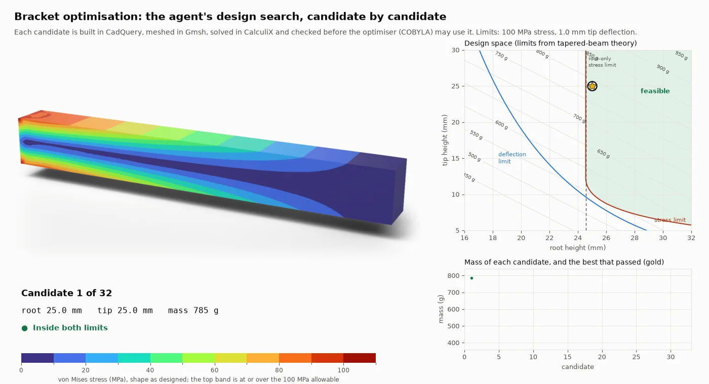
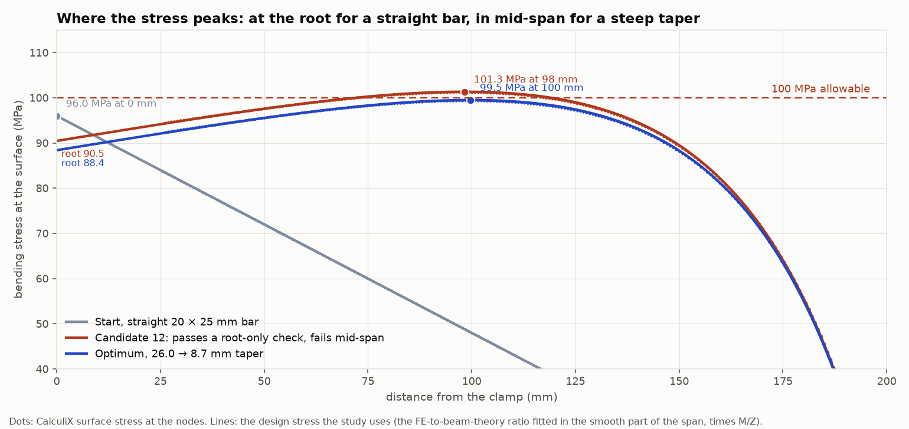

# The same cantilever, optimised

[Portfolio index](../PORTFOLIO.md) · Structures and vibration · follows [study 1](01-cantilever-bracket.md)

| | |
|---|---|
| **Answer** | A linear taper from 26.0 mm at the root to 8.7 mm at the tip, 546 g: 30 % lighter than the lightest straight bar that meets both limits (20 × 25 mm, 785 g). Peak stress 99.5 MPa against 100; tip 0.917 mm against 1.0. |
| **Discipline** | Structures, design automation |
| **Tools** | CadQuery, Gmsh, CalculiX, SciPy (COBYLA), Python |
| **Methods** | Derivative-free optimisation driving a CAD-to-FEA pipeline, checks on every candidate, a mesh study at the optimum, an independent beam-theory optimum |

## The question

Study 1's steel bracket (200 mm long, 20 mm wide, 1 kN at the tip) goes into a vibrating assembly, so its bending stress is limited to 100 MPa for fatigue instead of 213 MPa. The tip may still move at most 1.0 mm. Study 1's 20 × 20 mm bar reaches 150 MPa at the root, so it no longer passes. The width is fixed by the mounting. Which linear taper (root and tip heights) is lightest?

## The answer

- **546 g**, root 26.0 mm, tip 8.7 mm. The lightest straight bar that passes is 20 × 25 mm at 785 g, so the taper saves 30 %.
- **Stress governs**, and it peaks partway along the span (99.5 MPa), not at the root (88 MPa). Deflection, 0.917 mm, has margin.
- **Mesh error is covered.** Going from 4.5 to 2 mm elements moves the peak stress by 0.013 MPa; the optimiser worked to a 0.5 % margin, and the converged stress sits 0.49 % under the limit.

## How it works

COBYLA proposes a root and tip height. For each candidate the harness builds the solid in CadQuery, meshes it with quadratic tetrahedra in Gmsh, solves it in CalculiX and runs every check of the study. A candidate that fails any check counts as infeasible, so a result the checks rejected can't steer the search. It converged in 32 candidates. [Study 12](12-bracket-optimisation.md) takes the same loop to a 3D machined clevis bracket.

## How I know it's right

- **Every candidate is checked.** The CAD volume against the closed form; the applied load and tip area read back from the mesh; the reactions balance. The tip deflection matches tapered Timoshenko beam theory within 0.6 %, and the FE surface stress matches M/Z along the span within 0.7 % as a fit and 1.5 % point by point.
- **Mesh study at the optimum** (4.5 / 3 / 2 mm): uncertainty 0.005 % on the stress and 0.016 % on the deflection; the requirement holds with it added.
- **An independent optimum.** Optimising the same problem with beam theory, same limits and margin, gives 545.2 g against the FE optimum's 546.0 g (0.13 %), with the heights within 0.7 %.
- **Predictions written before the run** (heights, mass, which limit governs, where the stress peaks); all held.

## Why measuring the stress properly matters

Once the taper is steeper than 2 to 1, the bending stress peaks inside the span. Candidate 12 shows the trap: 90 MPa at the root but 101 MPa partway along. An optimiser that checked only the root would have kept thinning the tip. The clamped-corner peak can't be used either (it grows without limit as the mesh is refined, the trap from study 1), so the study measures the surface stress against M/Z in the smooth part of the span and takes the peak along the whole length.

## Caught along the way

- Candidate 8 stepped to a 390 g design that deflected 2.7 mm (1.35 % of the span), past the small-deflection limit of a linear analysis. The checks rejected it and the optimiser stepped back.
- The optimiser drives the stress onto the limit at whatever mesh it uses, so the 0.5 % margin was set before the run; the confirmation measured the actual mesh error at 0.005 %.

## Limits

A linear taper only; a curved profile would be lighter still. The root joint needs its own assessment, and there's no lateral-torsional buckling check.

## Evidence

- [Optimisation run](../runs/20261120-225322_bracket_opt/report.md)
- [Confirmation: mesh study at the optimum and the beam-theory spot check](../runs/20261120-225744_bracket_opt_confirm/report.md)
- The dashboard's 3D render uses the confirmation run's 2 mm mesh, generated again from the run's saved CAD file and Gmsh script (`scripts/make_study_renders.py --cantilever`); the regenerated mesh reproduces every node of the saved results.
