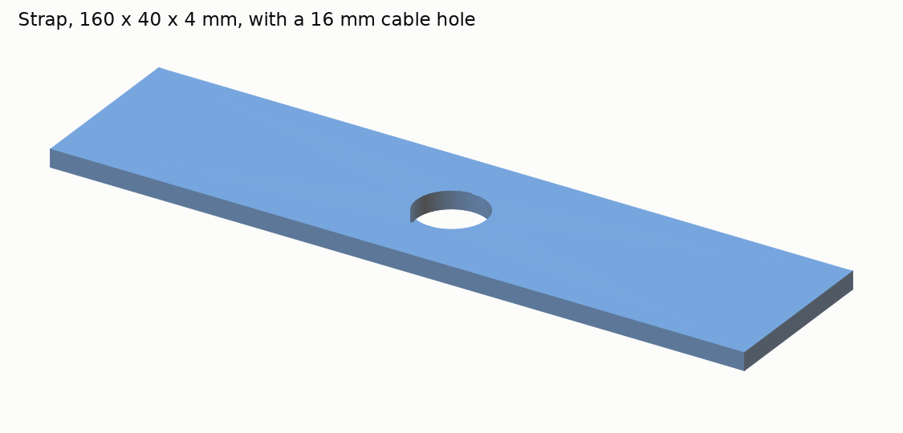
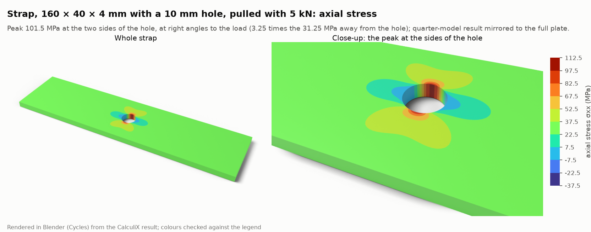
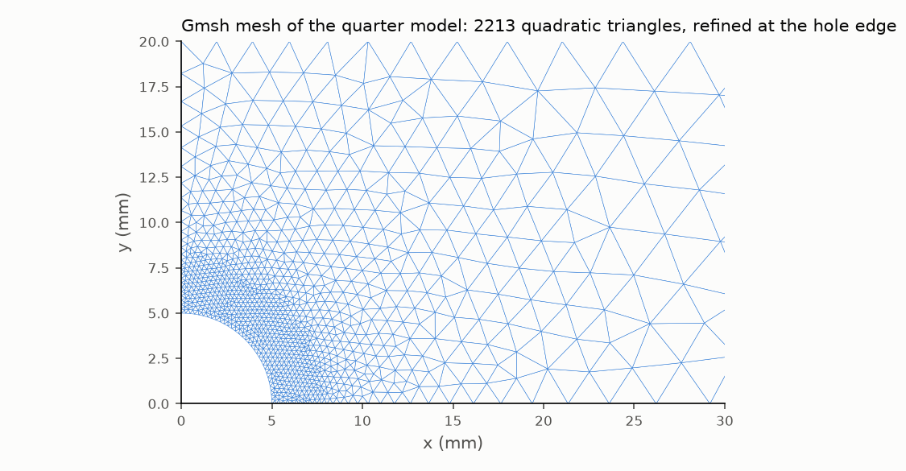
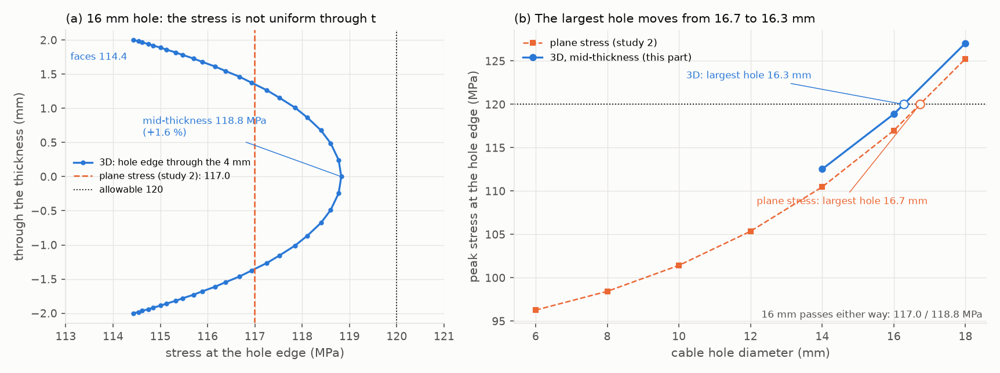

# Cable hole in a strap, CAD to FEA

[Portfolio index](../PORTFOLIO.md) · Structures and vibration

| | |
|---|---|
| **Answer** | About 16.7 mm. A 16 mm hole passes at 117 MPa; 18 mm fails at 125 MPa. **Part 2, through the thickness:** a 3D model puts the peak at mid-thickness 1.5 % higher (118.8 MPa at 16 mm), so the largest hole is **about 16.3 mm**. **16 mm still passes**, by 1 % instead of 2.6 %. |
| **Discipline** | Structures and vibration |
| **Tools** | CadQuery 2.8, Gmsh 4.15, CalculiX 2.22 |
| **Methods** | Scripted CAD-to-mesh-to-solver pipeline, plane-stress FEA, Peterson stress concentration factors, an exact limiting case, mesh refinement; part 2: 3D solid FEA through the thickness (20-node bricks), the thin-plate limit as its reference |

## The question

A 6061 aluminium strap, 40 mm wide and 4 mm thick, carries a 5 kN pull. A cable has to pass through a hole drilled in the middle of it. How large can that hole be before the stress at its edge goes over a 120 MPa fatigue allowable?

## The answer

**About 16.7 mm.** A 16 mm hole passes at 117 MPa, and an 18 mm hole fails at 125 MPa. I'd specify 16 mm, or 14 mm if the allowable carries any doubt, since that gives 8 % margin.

This example also makes a point the cantilever's stress trap couldn't: the peak stress at a smooth hole edge is a real, finite number that settles down as the mesh is refined. The peak at a sharp corner never does. Knowing which kind of peak you're looking at is most of the judgement in a stress check.

## How I know it's right

- **The tool chain.** CadQuery builds the geometry and exports it as a STEP file. Gmsh meshes it, with fine elements around the hole. CalculiX solves it. Each step is scripted, so a new hole size is a one-line change.
- **Against the handbook.** The stress concentration factor converges to 2.436, within 0.6 % of the value from Peterson's Stress Concentration Factors. Across all seven hole sizes, the results landed within about 0.6 % of the values I wrote down before running.
- **Against an exact solution.** The whole pipeline reproduces the exact textbook result for a hole in a very wide plate, a peak of exactly three times the remote stress, to within 0.1 %. That check now runs as an automatic test.
- **Equilibrium.** The support reactions balance the load exactly, and the stress integrated across the section beside the hole carries the full load to within 0.2 %.
- **Mesh dependence.** Refining the hole-edge elements from 1 mm to 0.125 mm converges at the designed rate, with 0.08 % uncertainty left.

## What the checks caught

- **The model converged cleanly to the wrong answer.** My first version converged beautifully, at the textbook rate and with tiny mesh uncertainty, to a value 2 % above the handbook. Refining the mesh further changed nothing. So I ran the exact wide-plate case through the same pipeline, and it came out 1.5 % high when it should have been exact. The cause was the solver's "plane stress" elements: for a plate this thick, they behave partly as a 3D slab. Analysing a thin slice with the load scaled to match fixed it, and the exact case now comes out right. A clean convergence study only tells you the mesh is fine, not that the model is.
- **Three pipeline traps in the first trial run.** The solver input had number formatting it couldn't read, the CAD face pointed the wrong way so the solver rejected every element, and a remeshed model still pointed at the old mesh's node numbers. That last one would have run and balanced its forces anyway, which is why the deck is now always rebuilt from the mesh it uses.

## Limits

- Plane stress. In the real 4 mm plate the peak at mid-thickness is 1.5 % higher: measured in part 2, below.
- A smooth, central hole: no surface finish, burrs, or residual stress.
- The 120 MPa allowable is synthetic.

## Part 2: the hole through the thickness, in 3D

### The question

Part 1's model is plane stress: it assumes the stress at the hole edge is the same all the way through the 4 mm
plate. It isn't, and part 1's own limits said so ("a few percent higher at mid-thickness"), against a margin of only
2.6 % at the recommended 16 mm hole. Under the standing rule for this portfolio (a simple model first, then a fuller
one wherever the margin is as small as the simplification's likely error), that needed measuring. Does 16 mm still
pass when the thickness is modelled?

### The answer

**Yes, but by 1 %, not 2.6 %.** At mid-thickness the hole edge sees **118.8 MPa** against the 120 MPa allowable,
1.5 % above plane stress (117.0 MPa); at the faces it sees 114.4 MPa, 2.2 % below. The largest hole that passes moves
from about 16.7 mm to **about 16.3 mm**.

| Hole | Plane stress (part 1) | 3D, mid-thickness | 3D, faces | Verdict (120 MPa) |
|---|---|---|---|---|
| 14 mm | 110.5 MPa | 112.5 MPa (+1.9 %) | 107.6 MPa | passes, 6.2 % margin |
| 16 mm | 117.0 MPa | 118.8 MPa (+1.6 %) | 114.4 MPa | passes, 1.0 % margin |
| 18 mm | 125.3 MPa | 127.1 MPa (+1.4 %) | 122.9 MPa | fails |

The recommendation stands: specify 16 mm, or 14 mm if the allowable carries any doubt, which now leaves 6 % rather
than 8 %. With a 1 % margin, anything that adds stress at the hole (a rough drilled finish, a burr, a hole slightly
off centre) takes 16 mm over; 14 mm is the safer call.

### How it works

- **The same geometry.** Part 1's CadQuery quarter face is extruded through half the thickness in Gmsh: an eighth
  of the strap, symmetric about both centre lines and the mid-plane. The face mesh is all quadrilaterals, refined at
  the hole as part 1's triangles were, so the solid is made of 20-node bricks in layers, thinner towards the free
  face, where the stress changes fastest through the thickness.
- **The same load and allowable.** 5 kN as a uniform traction on the end face; the peak is read on the hole edge at
  the section across the strap, at every node through the thickness.

### How I know it's right

- **The thin-plate limit.** Run through the same pipeline at 0.04 mm thickness (load scaled with it), the 3D
  model must become plane stress: it gives 117.15 MPa at mid-thickness and 117.14 at the face, within 0.13 % of
  part 1's 116.99.
- **Equilibrium.** The reaction on the symmetry plane balances the load exactly, and the stress integrated over the
  section beside the hole carries it within 0.1 %.
- **Mesh refinement.** Three meshes (hole-edge elements 0.4, 0.27 and 0.18 mm, with 5, 7 and 11 layers through half
  the thickness) give 118.96, 118.88 and 118.83 MPa: mesh uncertainty 0.11 %, extrapolated 118.72 MPa. The 1 %
  margin is ten times the uncertainty.
- **Predictions held.** Written before the runs from three scratch trials: 118.96 / 118.87 / 118.82 MPa on the three
  meshes, 16 mm passing by about 1 %, the largest hole about 16.3 mm.

### What the checks caught

- **A reference I stated wrongly.** I first wrote that the stress averaged through the thickness equals plane
  stress exactly. It doesn't: averaged stresses satisfy plane-stress equilibrium exactly, but not its stress-strain
  law, because the through-thickness stress averages to zero without vanishing inside the plate. The trials showed a
  0.4 % difference that did not go away with the mesh. The model's reference became the thin-plate limit, where the
  statement is true, and the 0.4 % is reported as what it is, a thickness effect of order (t/r)².
- **A validity check that does not apply in a limit.** The check "the peak is at mid-thickness" failed on the
  thin-plate run: there the stress is uniform to 1 part in 10⁴, and the largest value falls on whichever node the
  stress recovery favours. The failure stays on record with its tolerance unchanged; the thin-plate checks it was
  run for pass.

### The strap as a part

The strap is delivered as a part ([`models/cad/strap.py`](../models/cad/strap.py), [STEP](cad/strap_d16.step)):
160 x 40 x 4 mm with the recommended 16 mm cable hole (a 14 mm design, the cautious alternative, is in the same
builder), smooth and unchamfered as analysed, and a 10.5 mm pin hole 15 mm from each end, for which the studies'
uniform end traction stands in, 65 mm from the cable hole. Its volume matches the hand formula to 10⁻¹⁶.

### Limits (part 2)

- Linear elastic, a smooth and straight hole, as part 1: no drilling finish, burr, chamfer or residual stress.
- The allowable (synthetic, 120 MPa) is compared with the largest stress anywhere on the hole edge, at
  mid-thickness. A fatigue allowable from smooth specimens is a surface quantity; whether mid-thickness or the face
  governs a real crack start is a materials question this does not settle.

## Evidence

The fatigue life of this strap is worked out in [case study 3](03-strap-fatigue.md).

Each report traces every requirement to its result, the checks behind it, and the saved inputs that reproduce it.

- [mesh study](../runs/20261119-235201_strap_hole_mesh/report.md)
- [hole-size sweep](../runs/20261119-235211_strap_hole_size/report.md)
- Part 2: [3D mesh study](../runs/20261127-151911_strap_3d_mesh/report.md) (PASS),
  [3D hole sizes](../runs/20261127-152203_strap_3d_size/report.md) (PASS),
  [thin-plate limit](../runs/20261127-151903_strap_3d_thin/report.md) (one validity check failed, above); cases
  `cases/strap_3d_*.toml`; code `models/fea/strap_3d.py`, `studies/strap_3d.py` (tests `tests/test_strap_3d.py`),
  figure `scripts/make_strap_3d_figure.py`
