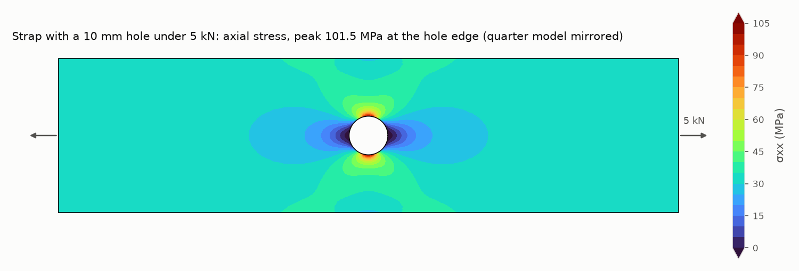
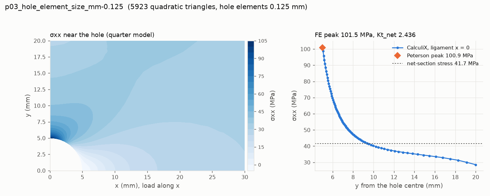
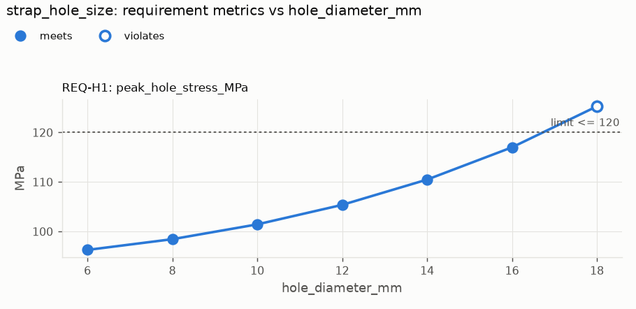

# Cable hole in a strap, CAD to FEA

[Portfolio index](../PORTFOLIO.md) · Structures and vibration

| | |
|---|---|
| **Answer** | About 16.7 mm. A 16 mm hole passes at 117 MPa; 18 mm fails at 125 MPa. |
| **Discipline** | Structures and vibration |
| **Tools** | CadQuery 2.8, Gmsh 4.15, CalculiX 2.22 |
| **Methods** | Scripted CAD-to-mesh-to-solver pipeline, plane-stress FEA, Peterson stress concentration factors, an exact limiting case, mesh refinement |

## The question

A 6061 aluminium strap, 40 mm wide and 4 mm thick, carries a 5 kN pull. A cable has to pass through a hole drilled in the middle of it. How large can that hole be before the stress at its edge goes over a 120 MPa fatigue allowable?

## The answer

**About 16.7 mm.** A 16 mm hole passes at 117 MPa, and an 18 mm hole fails at 125 MPa. I'd specify 16 mm, or 14 mm if the allowable carries any doubt, since that gives 8 % margin.

This example also makes a point the cantilever's stress trap couldn't: the peak stress at a smooth hole edge is a real, finite number that settles down as the mesh is refined. The peak at a sharp corner never does. Knowing which kind of peak you're looking at is most of the judgement in a stress check.

## How I know it's right

- **The tool chain.** CadQuery builds the geometry and exports it as a STEP file. Gmsh meshes it, with fine elements around the hole. CalculiX solves it. Each step is scripted, so a new hole size is a one-line change.
- **Against the handbook.** The stress concentration factor converges to 2.436, within 0.6 % of the value from Peterson's Stress Concentration Factors. Across all seven hole sizes, the results landed within about 0.6 % of the values I wrote down before running.
- **Against an exact solution.** The whole pipeline reproduces the exact textbook result for a hole in a very wide plate, a peak of exactly three times the remote stress, to within 0.1 %. That check now runs as an automatic test.
- **Equilibrium.** The support reactions balance the load exactly, and the stress integrated across the section beside the hole carries the full load to within 0.2 %.
- **Mesh dependence.** Refining the hole-edge elements from 1 mm to 0.125 mm converges at the designed rate, with 0.08 % uncertainty left.

## What the checks caught

- **The model converged cleanly to the wrong answer.** My first version converged beautifully, at the textbook rate and with tiny mesh uncertainty, to a value 2 % above the handbook. Refining the mesh further changed nothing. So I ran the exact wide-plate case through the same pipeline, and it came out 1.5 % high when it should have been exact. The cause was the solver's "plane stress" elements: for a plate this thick, they behave partly as a 3D slab. Analysing a thin slice with the load scaled to match fixed it, and the exact case now comes out right. A clean convergence study only tells you the mesh is fine, not that the model is.
- **Three pipeline traps in the first trial run.** The solver input had number formatting it couldn't read, the CAD face pointed the wrong way so the solver rejected every element, and a remeshed model still pointed at the old mesh's node numbers. That last one would have run and balanced its forces anyway, which is why the deck is now always rebuilt from the mesh it uses.

## Limits

- Plane stress. In the real 4 mm plate the peak at mid-thickness runs a few percent higher.
- A smooth, central hole: no surface finish, burrs, or residual stress.
- The 120 MPa allowable is synthetic.

## Evidence

The fatigue life of this strap is worked out in [case study 3](03-strap-fatigue.md).

Each report traces every requirement to its result, the checks behind it, and the saved inputs that reproduce it.

- [mesh study](../runs/20261119-235201_strap_hole_mesh/report.md)
- [hole-size sweep](../runs/20261119-235211_strap_hole_size/report.md)
