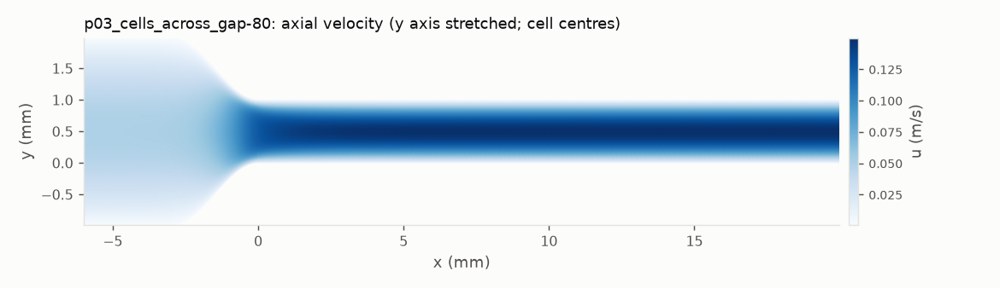
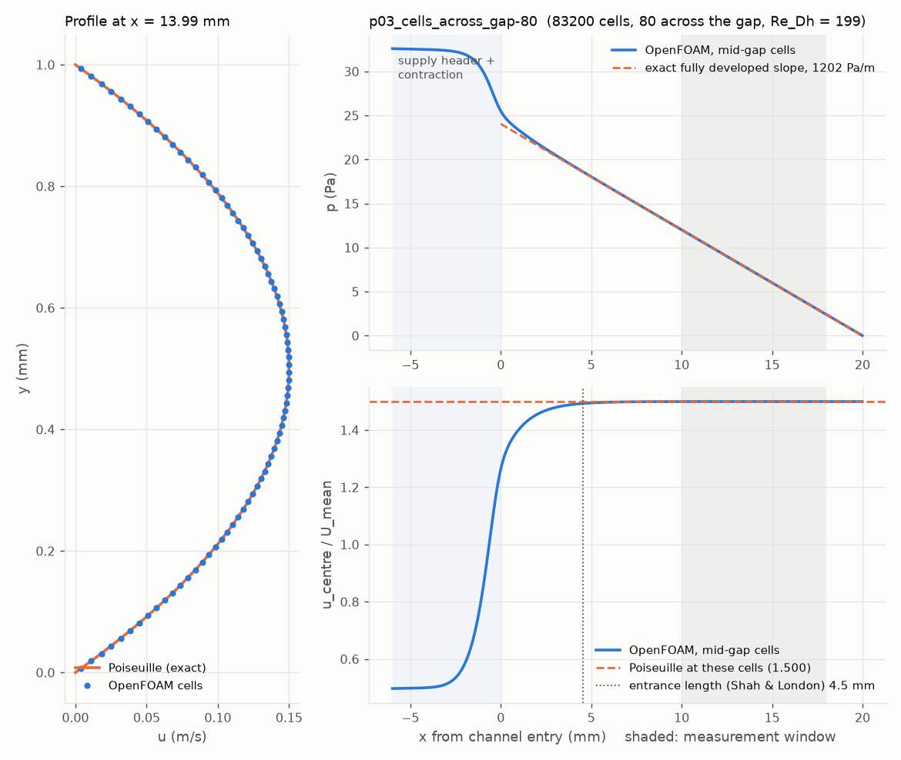
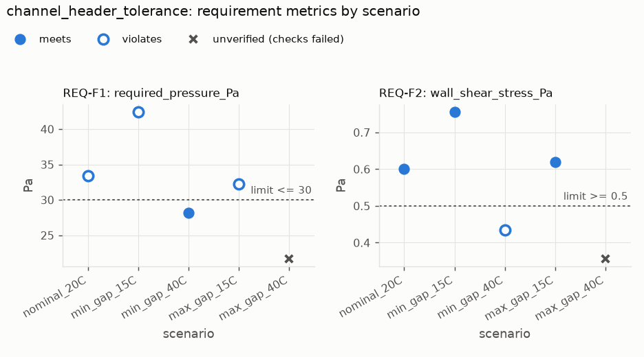

# Coolant channel pressure budget

[Portfolio index](../PORTFOLIO.md) · Thermal and fluids

| | |
|---|---|
| **Answer** | No. It needs 33.4 Pa against a 30 Pa budget, and no gap size satisfies both requirements. |
| **Discipline** | Thermal and fluids |
| **Tools** | OpenFOAM 14 (in WSL), Python |
| **Methods** | Laminar CFD with a supply header, exact Poiseuille and rectangular-duct solutions, mesh refinement, tolerance corners, a 3D side-wall check |

## The question

A cold-plate passage is a 1 mm gap between two plates, 20 mm long, carrying water at about 0.1 m/s. It has to stay within a 30 Pa share of the pump's pressure budget. It also needs at least 0.5 Pa of shear stress on the walls, a common guideline for limiting fouling. Does it meet both, when the gap can vary by plus or minus 0.05 mm and the coolant runs anywhere from 15 to 40 °C?

## The answer

**No.** At nominal conditions the passage needs 33.4 Pa, which is 11 % over budget. Across the tolerance range it needs anywhere from 28 to 42 Pa, and warm coolant drops the wall shear to 0.43 Pa.

The two requirements pull in opposite directions. To stay within the pressure budget with cold coolant, the gap has to be at least 1.078 mm. To keep enough wall shear with warm coolant, it can be at most 0.885 mm. No gap does both. I predicted those two limits before running them, and the confirmation runs came back at 30.02 Pa and 0.500 Pa, right on target.

So this is a design decision rather than a modeling one. The options are to narrow the coolant temperature range, raise the pressure budget, change how the flow is split between channels, or revisit the shear guideline.

## How I know it's right

- **The model.** It's a steady, two-dimensional flow simulation in OpenFOAM. It includes a supply header feeding the channel through a smooth contraction, because a simpler model with flow forced straight into the channel turned out to be unreliable (see below). The pressure the pump has to supply counts the flow's kinetic energy at the exit as lost, which is the conservative and usual assumption. That exit loss is 7.7 Pa of the 33.4 Pa.
- **Against exact solutions.** Where the flow has settled into its final shape, the velocity profile, pressure gradient, and wall shear all match the textbook exact solution to within 0.02 %.
- **Conservation.** Mass is conserved to about one part in a hundred million. The wall friction balances the pressure force to within a few parts in a hundred thousand.
- **Mesh dependence.** Refining the mesh from 20 to 80 cells across the gap changes the answer in a way that converges at exactly the rate the method is designed for. The remaining mesh uncertainty is 0.04 %.
- **Against an independent estimate.** A hand calculation combining lubrication theory for the header with the Shah and London correlation for the channel agrees with the simulation to within 0.3 % in every case.
- **The two-dimensional assumption.** I checked it with a separate 3D model that includes the channel's side walls, assuming a 20 mm wide channel. The side walls raise the friction by 3.2 %; the exact solution for a rectangular duct says 3.25 %. That adds about 0.8 Pa, which makes the nominal case about 34.2 Pa, so the conclusion only gets firmer.

| Where the uncertainty comes from | How big it is |
|---|---|
| The mesh | 0.04 % |
| Iteration and conservation | Negligible: well under one part in ten thousand |
| The model's simplifications | 0.3 % or less against the independent estimate. The side walls add about 3 %. |
| Manufacturing tolerance and coolant temperature | 16 % lower to 27 % higher than nominal. This dominates everything else. |

## What the checks caught

- **The simple inlet hid a problem, and gave the wrong verdict.** My first model forced a perfectly uniform flow straight into the channel, a common shortcut. It said the channel passed, at 28.6 Pa. But the pressure kept creeping up as the mesh got finer and never settled. That is the signature of a sharp corner the solver can't resolve, here where the uniform inflow meets the wall. The mesh-convergence check failed, so that answer was never reported as verified. Modeling the supply header fixed the convergence. Counting the exit loss then turned the verdict from pass to fail.
- **One tolerance case wasn't fully developed.** With warm water and the widest gap, the flow was still settling slightly where the measurements are taken. That case is marked unverified, and the conclusion rests on the other four.
- **A meshing mistake in the 3D check.** In my first 3D run the mesh was coarsest exactly where it needed to be finest, next to the side walls. The overall friction still looked fine on the finer meshes, but a point-by-point comparison of the whole velocity field against the exact solution failed every time, always next to the side wall. An average result can hide a local error, so I check the full field as well.

## Limits

- Isothermal, laminar flow; heat transfer is not modelled.
- The channel width (20 mm) used for the 3D check is assumed; the side-wall effect scales roughly with gap over width.
- The outlet's dynamic head is counted as lost, which is conservative.
- Synthetic budget and shear criterion.

## Evidence

Each report traces every requirement to its result, the checks behind it, and the saved inputs that reproduce it.

- [mesh study](../runs/20261119-200042_channel_header_mesh/report.md)
- [tolerance study](../runs/20261119-200202_channel_header_tolerance/report.md)
- [gap-limit confirmation](../runs/20261119-201615_channel_header_gap_limits/report.md)
- [3D side-wall check](../runs/20261119-204111_duct_side_walls/report.md)
- [first model, uniform inlet](../runs/20261119-191916_channel_mesh/report.md)
- [first 3D run, meshing error](../runs/20261119-202956_duct_side_walls/report.md)
