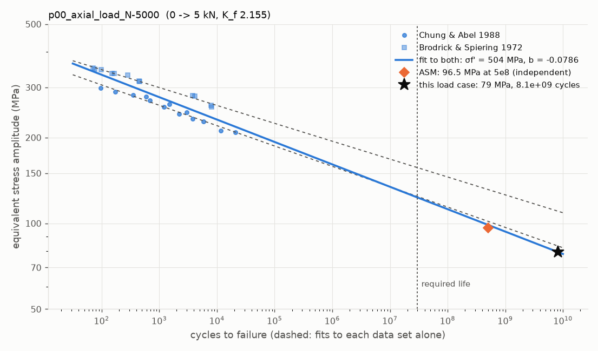
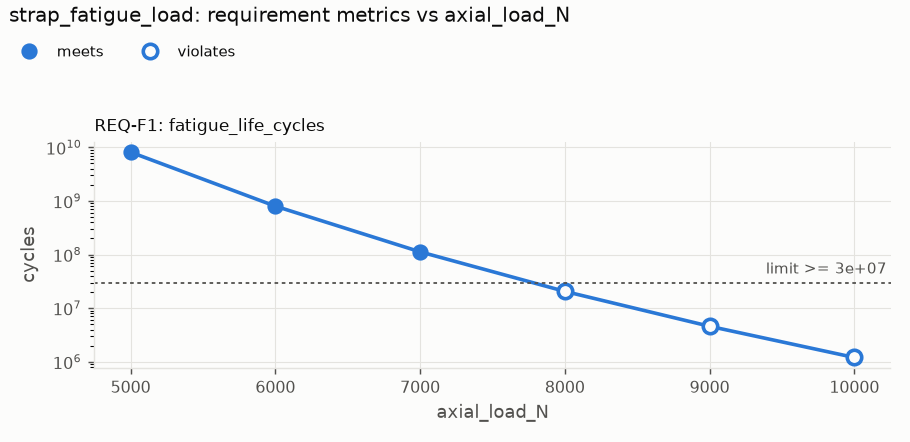

# Strap fatigue life, chained analysis

[Portfolio index](../PORTFOLIO.md) · Structures and vibration

| | |
|---|---|
| **Answer** | The 0 to 5 kN service cycle gives a life of about 8 × 10⁹ cycles, far beyond the 3 × 10⁷ needed. The strap can be rated to about 7.8 kN cyclic. |
| **Discipline** | Structures and vibration |
| **Tools** | CadQuery 2.8, Gmsh 4.15, CalculiX 2.22, Python |
| **Methods** | Verified FE stress at the hole, Peterson notch sensitivity, Smith-Watson-Topper mean-stress correction, a Basquin S-N curve fitted to published test data and cross-checked against an independent long-life value |

## The question

The strap from the [cable hole study](02-strap-cable-hole.md), with its 16 mm hole, is loaded from zero to 5 kN and back about ten million times over the product's life. With a scatter factor of 3 on life, does it last? And what is the highest cyclic load it can be rated for?

## The answer

**It lasts, by a wide margin.** At the 0 to 5 kN service cycle the predicted life is about 8 × 10⁹ cycles, roughly 270 times what's needed. The highest cyclic load that still gives 3 × 10⁷ cycles is about **7.8 kN**.

That rating depends on which published test data you trust. Fitting either data set alone gives 7.8 kN or 9.9 kN. I'd quote 7.8 kN, the conservative end, and say so.

## How I know it's right

- **A chained analysis.** Every load case reruns the verified strap model for the stress at the hole edge, and carries that model's own checks along: equilibrium, and agreement with the handbook stress concentration to 0.5 %. Notch sensitivity then gives the fatigue notch factor of 2.15. The mean-stress correction accounts for the load never reversing, and the S-N curve gives the life.
- **Material data with a source.** The S-N curve is fitted to 25 published 6061-T6 test points from two studies (Chung and Abel, 1988; Brodrick and Spiering, 1972), taken from the University of Waterloo fatigue database. It isn't a number copied from a table.
- **An independent check on the extrapolation.** All the test points are short-life, under 50,000 reversals, so a 10-million-cycle life is an extrapolation. The fitted curve, extended to 10⁹ reversals, lands within 2.4 % of ASM's separately published value of 96.5 MPa at 5 × 10⁸ cycles.
- **The arithmetic.** Every life is inverted back to its stress amplitude exactly, and the notch stays elastic at every load (at most 81 % of yield), so no plasticity correction is needed.

## What the checks caught

**How much the answer depends on the material data.** At the service load, the two published data sets predict lives that differ by a factor of about 100. That's normal for fatigue, where a 10 % change in stress moves life by a factor of about 3.4. But it means a single life number would be misleading, so the result is quoted as a rating with its data spread.

## Limits

- Smooth, machined hole; no surface treatment, corrosion, or fretting at the hole.
- The S-N data are for smooth specimens, extrapolated to long life and cross-checked at one point only.
- Constant-amplitude loading; a real load spectrum would need cycle counting and damage summation.
- Synthetic load and life requirement; no fatigue test of the part itself.

## Evidence

Each report traces every requirement to its result, the checks behind it, and the saved inputs that reproduce it.

- [load sweep](../runs/20261120-011347_strap_fatigue_load/report.md)
- Material data: [University of Waterloo FDE, AA6061-T6](https://fde.uwaterloo.ca/Fde/Materials/Alum/AA6xxx/aa6061merged.html)
