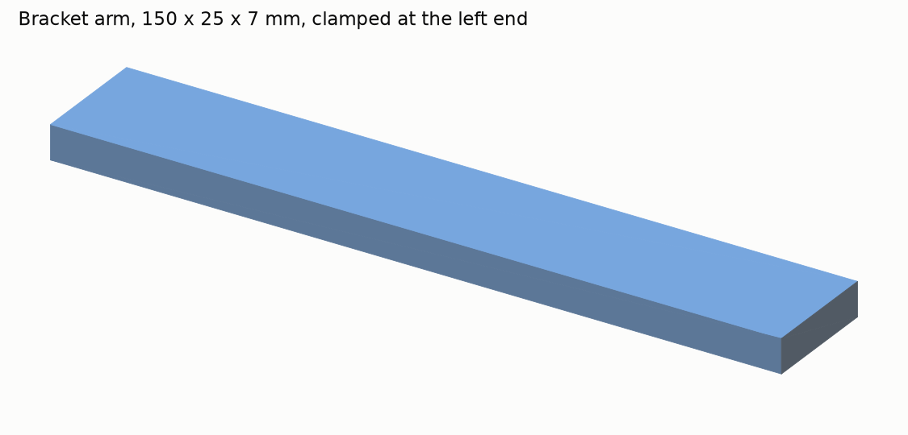
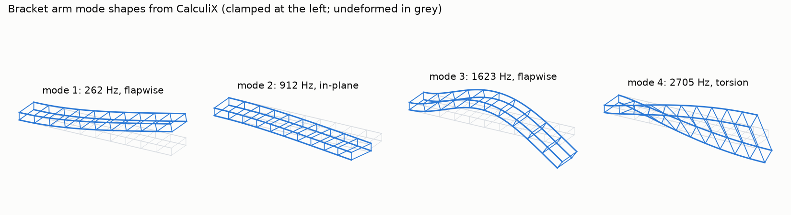
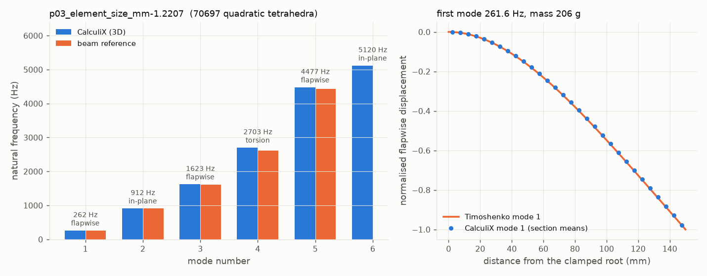
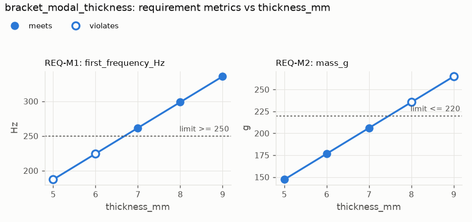

# Bracket arm vibration, modal analysis

[Portfolio index](../PORTFOLIO.md) · Structures and vibration

| | |
|---|---|
| **Answer** | 7 mm thick. The first mode is 261.7 Hz against a 250 Hz minimum, at 206 g against a 220 g budget. |
| **Discipline** | Structures and vibration |
| **Tools** | CadQuery 2.8, Gmsh 4.15, CalculiX 2.22 |
| **Methods** | 3D modal analysis (quadratic tetrahedra), a 1D Timoshenko beam model as an independent reference, effective modal mass, mode-shape correlation (MAC), mesh refinement |

## The question

A steel bracket arm, 150 by 25 mm, is bolted near an engine and carries a light component. The engine's 2nd order reaches 200 Hz at 6000 rpm, so the arm's first natural frequency has to stay above 250 Hz, which gives 25 % separation. The arm also has a 220 g mass budget. How thin can it be?

## The answer

**7 mm.** The first mode sits at 261.7 Hz and the arm weighs 206 g. At 6 mm the first mode drops to 224 Hz, inside the danger band. At 8 mm it's 299 Hz, but the arm weighs 236 g, over budget. So 7 mm is the only whole-millimetre thickness that meets both.

## How I know it's right

- **The tool chain.** CadQuery builds the arm, Gmsh meshes it with quadratic tetrahedra, and CalculiX extracts the first six modes. Each mode is classified automatically from how its mass moves, as flapwise bending, in-plane bending or torsion, rather than assuming the order.
- **Against an independent beam model.** I built a separate 1D Timoshenko beam model, which includes shear deformation and rotary inertia, and tested it against the exact textbook frequencies first. The 3D flapwise modes agree with it to within 0.9 %, and the in-plane mode to within 0.4 %. The 3D arm is slightly stiffer, as a wide, fully clamped solid should be.
- **Mode shape and mass.** The first mode's shape along the arm matches the beam model almost exactly (modal assurance criterion 0.99999). Its effective mass is within 0.002 of the textbook 61.4 % of the arm's mass.
- **Torsion.** The torsion mode is 3.3 % above the simple twisting formula. That's expected, because the clamp stops the root from warping, and I predicted it before running.
- **Mesh dependence.** Refining from 5 mm to 1.2 mm elements leaves 0.03 % uncertainty on the first frequency. Every thickness landed within 0.7 to 0.9 % of the values I wrote down before running.

## What the checks caught

**A prediction that was wrong, and why it didn't matter.** I expected the frequencies to converge at the textbook rate for these elements. They converged more slowly, because the sharp corners where the arm meets the rigid clamp are singular and slow the convergence everywhere. Slower-than-expected convergence still gives an honest uncertainty estimate (0.03 % here), so the answer stands. A rate far faster than the textbook one would have been the warning sign, and the checks now flag that automatically.

## Limits

- The clamp is ideally rigid. A real bolted joint is softer and lowers the frequencies, which is the main risk to the 4.7 % margin; the joint stiffness is worth measuring or modelling.
- No attached component mass, damping, or prestress.
- Synthetic geometry, excitation, and mass budget.

## Evidence

Each report traces every requirement to its result, the checks behind it, and the saved inputs that reproduce it.

- [mesh study](../runs/20261120-010318_bracket_modal_mesh/report.md)
- [thickness sweep](../runs/20261120-010521_bracket_modal_thickness/report.md)
