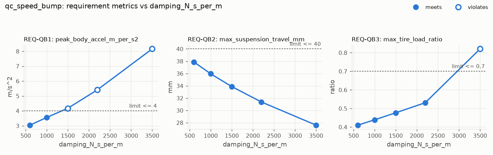
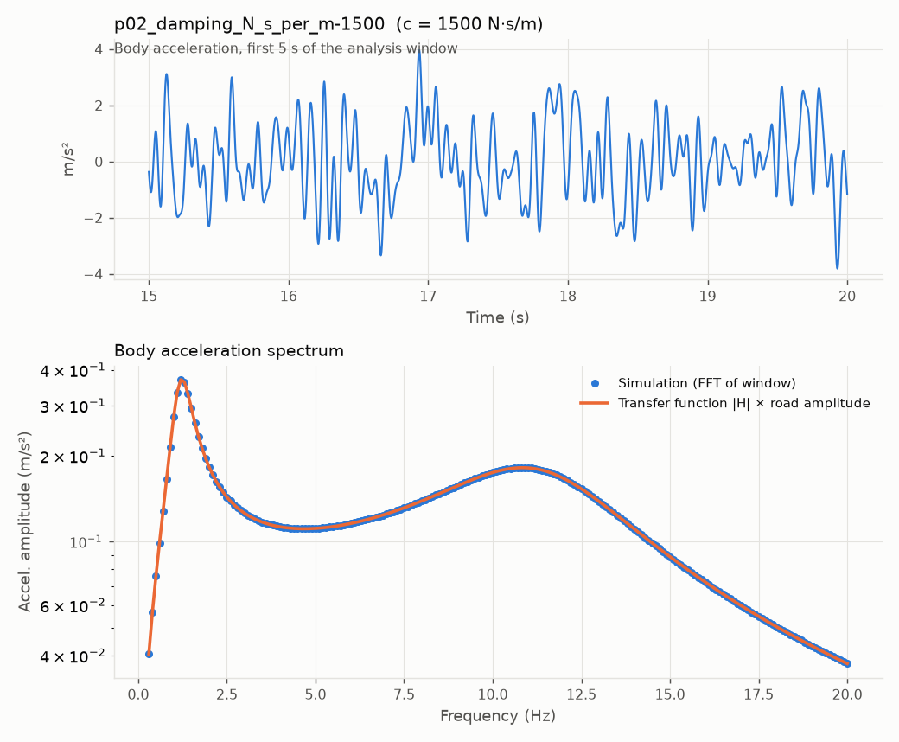

# Quarter-car ride and road holding

[Portfolio index](../PORTFOLIO.md) · Vehicle and system dynamics

| | |
|---|---|
| **Answer** | 600 to 1000 N·s/m over a speed bump. On a rough road, the spring rate has to change too. |
| **Discipline** | Vehicle and system dynamics |
| **Tools** | Python (SciPy), OpenModelica 1.26 with the Modelica Standard Library |
| **Methods** | Two-degree-of-freedom ride model, exact state-space solution, frequency-response prediction, energy balance, a second tool as cross-check |

## The question

For a compact-car front corner, which damper rates between 600 and 3500 N·s/m meet the targets for ride comfort, suspension travel, and tire load? I tested it over a speed bump and over a rough road.

## The answer

- **Over a 40 mm speed bump at 18 km/h,** damper rates from 600 to 1000 N·s/m meet all three targets. At 1500 the car just misses the comfort limit, 4.18 against 4.0 m/s². At 3500 the tire load goes over its limit.
- **On a rough road at 72 km/h** (class C in the ISO 8608 road-roughness standard), no damper rate meets the comfort target. Meanwhile travel and tire load need at least about 1500. Those two demands conflict, so the fix is a spring-rate change, not a different damper.

## How I know it's right

- **Speed bump.** The simulation matches an independent exact solution of the same equations. Energy into the system balances the energy stored and dissipated. All 30 checks pass. I also built the same car from standard library components in a second tool, OpenModelica, and it agrees with the Python model to about one part in a million.
- **Rough road.** The simulated vibration levels match the prediction from the system's frequency response to within one part in ten billion.

## What the checks caught

I first ran the bump at 36 km/h. Every numerical check passed, but the check on whether the wheel stays on the road failed at every damper rate: the tire load swung to as much as 1.7 times its static value. A linear tire model can't represent a wheel leaving the ground, so none of those results could be trusted, and none were reported as pass or fail. I kept that run as evidence and added a documented case at 18 km/h. Also, at 600 N·s/m on the rough road the wheel briefly lifts off, so that one point is marked unverified.

## Limits

- Linear tire: a wheel leaving the road cannot be represented, so those cases are withheld.
- Comfort is unweighted; a production study would apply ISO 2631 weighting.
- Synthetic vehicle parameters.

## Evidence

Each report traces every requirement to its result, the checks behind it, and the saved inputs that reproduce it.

- [speed bump](../runs/20261119-085019_qc_speed_bump/report.md)
- [same case in OpenModelica](../runs/20261119-085040_qc_speed_bump_modelica/report.md)
- [rough road](../runs/20261119-084926_qc_iso_road/report.md)
- [first bump case, wheel lift-off](../runs/20261119-084857_qc_bump/report.md)
