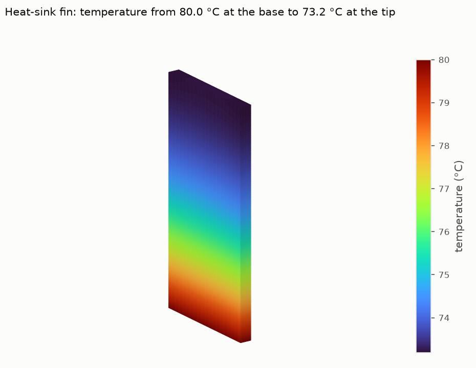
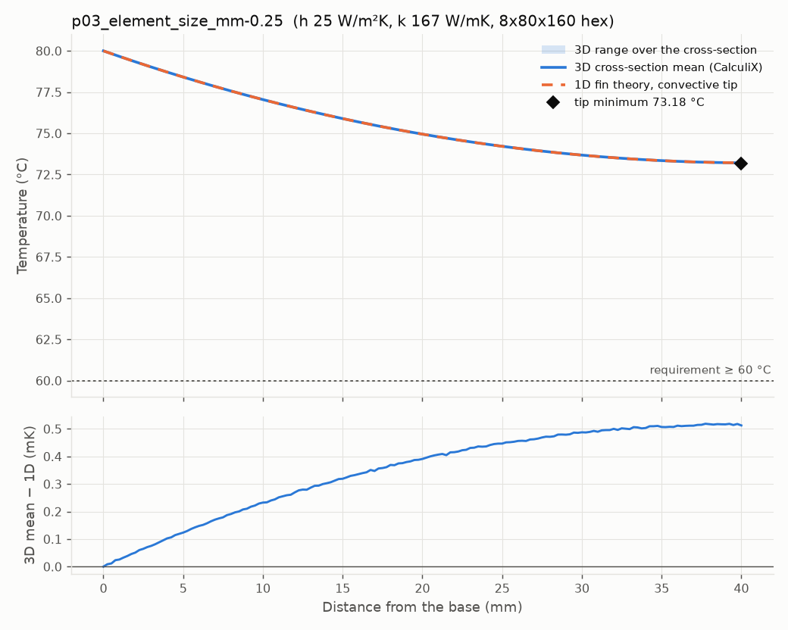
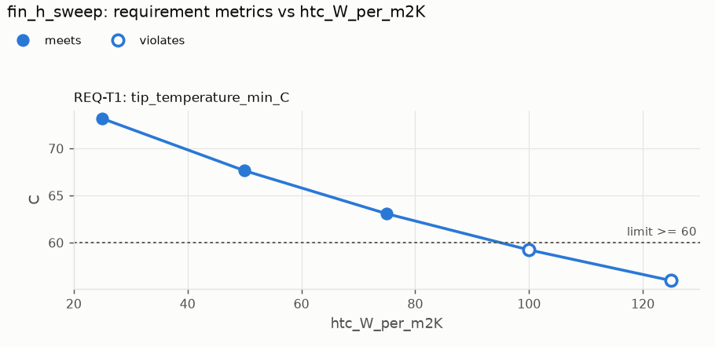

# Heat-sink fin temperature

[Portfolio index](../PORTFOLIO.md) · Thermal and fluids

| | |
|---|---|
| **Answer** | Yes, at 73.2 °C. Even with every input at its worst it stays at 65.9 °C. |
| **Discipline** | Thermal and fluids |
| **Tools** | CalculiX 2.22 (heat transfer), Python |
| **Methods** | 3D steady conduction with surface convection, 1D fin theory, energy balance, mesh refinement, tolerance corners, a heat-transfer-coefficient sweep |

## The question

One fin of a heat sink is 6061 aluminium, 40 mm tall, 20 mm wide and 2 mm thick. Its base sits at 80 °C, and the surrounding air is at 25 °C with a heat-transfer coefficient of about 25 W/m²K. Does the tip of the fin stay above 60 °C, and how sure can we be?

## The answer

**Yes, comfortably.** The coldest point on the tip is 73.2 °C, a margin of 13 degrees. With every input pushed to its unfavourable end at once, the tip still sits at 65.9 °C: the air-side coefficient doubled, the lowest likely conductivity for this alloy, and every dimension at the cold end of its tolerance.

The input that matters most is the air-side heat-transfer coefficient. The tip only reaches 60 °C once that coefficient climbs to about 95 W/m²K, almost four times the estimate. The other realistic way to fail is a poor joint where the fin meets the base: the tip drops to 60 °C if the fin root runs at about 65 °C instead of 80. That's the thing I'd check on the real part.

## How I know it's right

- **The model.** A full 3D heat-conduction model solved in CalculiX, with heat lost to the air from every exposed face. The mesh is generated directly in code.
- **Against theory.** The textbook one-dimensional fin solution agrees with the 3D result to within half a thousandth of a degree along the whole fin. I wrote down the expected values before running anything, and every result landed within a tenth of a degree of them.
- **Energy balance.** The heat entering at the base matches the heat leaving through all the surfaces.
- **Mesh dependence.** Refining the elements from 2 mm down to 0.25 mm converges at exactly the rate the elements are designed for. The remaining numerical uncertainty is less than a thousandth of a degree.
- **Is a one-dimensional view valid?** The temperature across the fin's thickness is uniform to within a few hundredths of a degree, which confirms the textbook comparison is a fair one.

## What the checks caught

- **The solver's own heat total was 1.3 % short.** In the first trial run, the heat flow CalculiX reported at the base didn't match the heat leaving the surfaces. The cause was that the solver leaves out the convection assigned to the base nodes themselves. I add that share back in, and the energy balance now closes exactly.
- **The printed temperatures were too coarse to judge convergence.** On the two finest meshes, the change in tip temperature was about the same size as the rounding in the solver's standard output. I now read a higher-precision output, so the mesh-convergence estimate can't be decided by rounding.

This example was built by an AI agent working only from my written modeling procedures, as a test of whether those procedures produce verified work on a problem they hadn't seen. The checks above are the same ones every other example uses.

## Limits

- The fin root is taken at exactly 80 °C; a poor fin-to-base joint is the realistic way to fail.
- The air-side heat-transfer coefficient is an input, not computed from the airflow.
- Steady state; synthetic tolerance ranges.

## Evidence

Each report traces every requirement to its result, the checks behind it, and the saved inputs that reproduce it.

- [mesh study](../runs/20261119-221454_fin_mesh/report.md)
- [tolerance cases](../runs/20261119-221517_fin_tolerance/report.md)
- [heat-transfer coefficient sweep](../runs/20261119-221655_fin_h_sweep/report.md)
