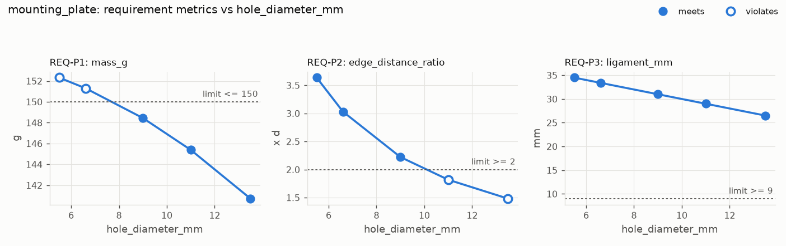

# Parametric mounting plate

[Portfolio index](../PORTFOLIO.md) · Geometry automation

| | |
|---|---|
| **Answer** | Only the 9 mm (M8 clearance) hole meets both the weight and edge-distance rules. |
| **Discipline** | Geometry automation |
| **Tools** | CadQuery 2.8 (OpenCASCADE) |
| **Methods** | Parametric solid modelling, geometry measured back from the solid, STEP export and re-import |

## The question

An aluminium plate, 120 by 80 by 6 mm, has a grid of six holes. Which clearance-hole size, from M5 up to M12, keeps the plate at or under 150 g while leaving at least twice the hole diameter between each hole and the edge?

## The answer

Only the 9 mm hole, the M8 clearance size, meets both. Bigger holes save weight but eat into the edge distance; smaller holes do the opposite.

## How I know it's right

The plate is generated in code with CadQuery, and every number is measured back from the finished solid rather than taken from the design inputs: the volume, the overall size, and the position and diameter of each hole. The volume matches a hand calculation to the limit of the computer's arithmetic. I also export each plate as a STEP file, read it back in, and confirm nothing changed. All 40 checks pass.

## Limits

- Geometry only: no stress analysis of the plate.
- Synthetic design rules.

## Evidence

Each report traces every requirement to its result, the checks behind it, and the saved inputs that reproduce it.

- [report](../runs/20261119-090540_mounting_plate/report.md)
