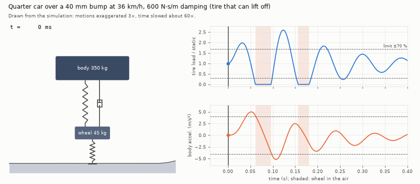
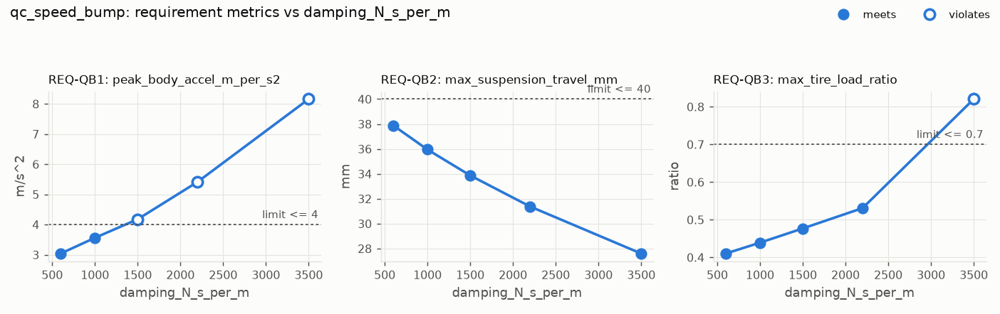
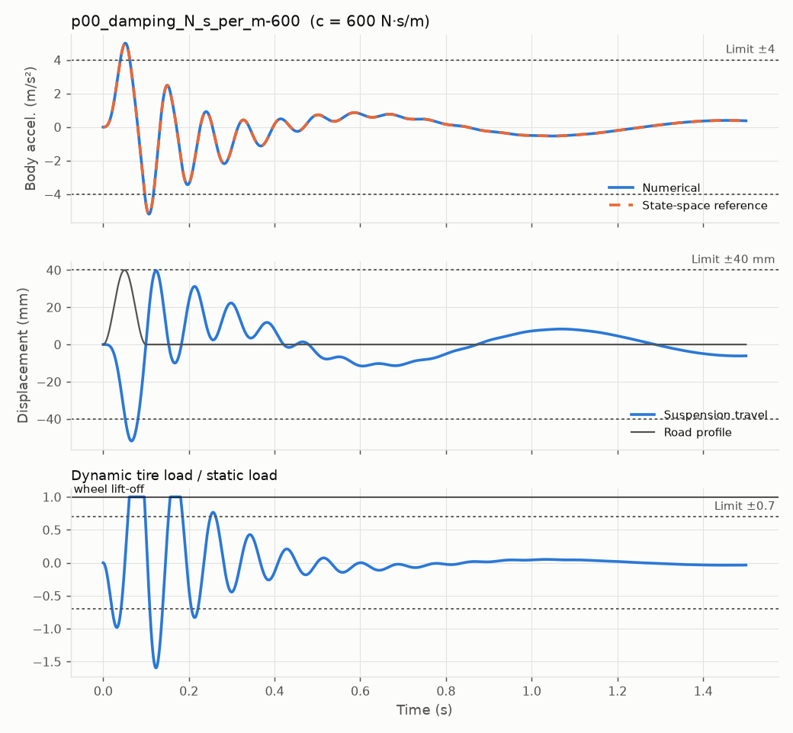
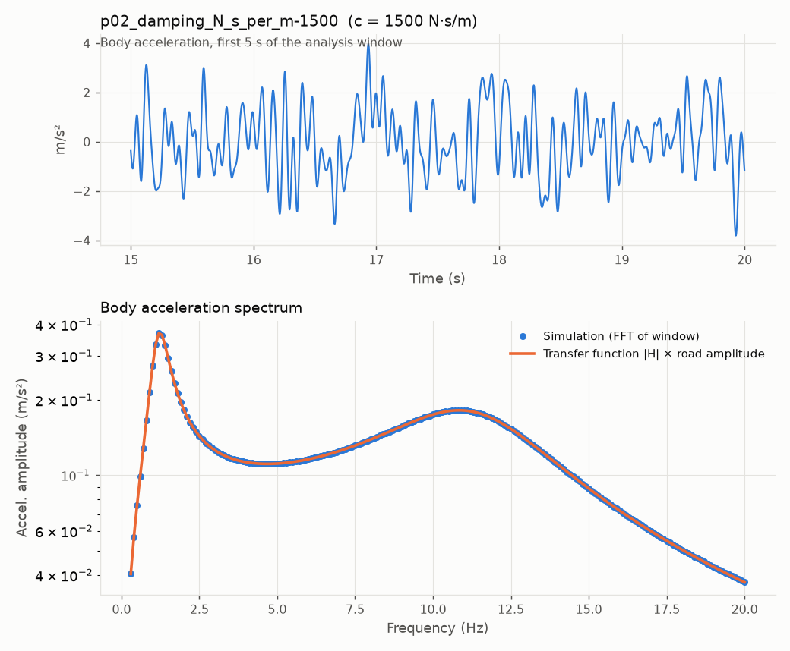

# Quarter-car ride and road holding

[Portfolio index](../PORTFOLIO.md) · Vehicle and system dynamics

| | |
|---|---|
| **Answer** | 600 to 1000 N·s/m over a speed bump at 18 km/h. At 36 km/h no damper rate works, because the wheel leaves the road. On a rough road, the spring rate has to change too. |
| **Discipline** | Vehicle and system dynamics |
| **Tools** | Python (SciPy), OpenModelica 1.26 with the Modelica Standard Library |
| **Methods** | Two-degree-of-freedom ride model, a tire that can leave the road and a bump stop, both with exact event location, exact piecewise state-space solution, frequency-response prediction, energy balance, a second tool as cross-check |

## The question

For a compact-car front corner, which damper rates between 600 and 3500 N·s/m meet the targets for ride comfort, suspension travel, and tire load? I tested it over a speed bump and over a rough road.

## The answer

- **Over a 40 mm speed bump at 18 km/h,** damper rates from 600 to 1000 N·s/m meet all three targets. At 1500 the car just misses the comfort limit, 4.18 against 4.0 m/s². At 3500 the tire load goes over its limit.
- **Over the same bump at 36 km/h, no damper rate works.** The wheel leaves the road at every setting, for 32 to 59 ms, and the comfort and road-holding targets fail everywhere. That's not something a damper change can fix; it needs a lower speed, a softer tire, or a gentler bump.
- **With a bump stop, light damping gets worse, not better.** At 36 km/h and 600 N·s/m the suspension compresses past the 40 mm bump-stop gap. Adding the stop to the model more than doubles the peak body acceleration, from 5.2 to 11.3 m/s², and the stop still runs past its 8 mm of usable stroke at 2.8 kN against a 2.5 kN rating. From 1000 N·s/m upwards the stop stays within its rating.
- **On a rough road at 72 km/h** (class C in the ISO 8608 road-roughness standard), no damper rate meets the comfort target. Meanwhile travel and tire load need at least about 1500. Those two demands conflict, so the fix is a spring-rate change, not a different damper.

## How I know it's right

- **Speed bump.** The simulation matches an independent exact solution of the same equations. Energy into the system balances the energy stored and dissipated. All 30 checks pass. I also built the same car from standard library components in a second tool, OpenModelica, and it agrees with the Python model to about one part in a million.
- **Wheel lift-off.** The tire model pushes but never pulls, and the solver stops exactly when the wheel leaves the road and again when it lands, so it never steps across the change. I checked it against an exact solution built independently: the matrix exponential within each phase, and root-finding for the switch times. Lift-off and touchdown times agree to within a tenth of a nanosecond, and the motion to about two parts per billion of the bump height. When the wheel stays down, that exact solution reproduces the original linear reference, so the two references check each other.
- **Rough road.** The simulated vibration levels match the prediction from the system's frequency response to within one part in ten billion.

## What the checks caught

I first ran the bump at 36 km/h. Every numerical check passed, but the check on whether the wheel stays on the road failed at every damper rate: the tire load swung to as much as 1.7 times its static value. A linear tire model can't represent a wheel leaving the ground, so none of those results could be trusted, and none were reported as pass or fail. I kept that run as evidence and added a documented case at 18 km/h.

Then I built the model that failed check called for: a tire that can leave the road. I wrote five predictions down before running it, and the comparison taught me two things:

- **The linear model overstated the peak body acceleration by up to 29 %.** After the crest, the linear tire pulls the wheel back down, which a real tire can't do, and a stiff damper passes that pull into the body. The error grows with damping: 8 % at 600 N·s/m, 22 % at 3500.
- **The worst moment for the tire is the landing, not the lift-off.** With light damping the wheel bounces twice, and it lands hard enough to load the tire to 2.6 times its static load.

The verdict the linear model had to withhold is now a clear fail, and it's backed by 30 passing checks. Also, at 600 N·s/m on the rough road the wheel briefly lifts off, so that one point is marked unverified.

## Limits

- Point-contact tire: it follows the road profile exactly, while a real tire's footprint smooths a short bump, so the lift-off here is probably overstated. The bump stop is linear and undamped; real elastomer stops are progressive and damped.
- Comfort is unweighted; a production study would apply ISO 2631 weighting.
- Synthetic vehicle parameters.

## Evidence

Each report traces every requirement to its result, the checks behind it, and the saved inputs that reproduce it.

- [speed bump](../runs/20261119-085019_qc_speed_bump/report.md)
- [same case in OpenModelica](../runs/20261119-085040_qc_speed_bump_modelica/report.md)
- [rough road](../runs/20261119-084926_qc_iso_road/report.md)
- [first bump case, wheel lift-off](../runs/20261119-084857_qc_bump/report.md)
- [36 km/h with the lift-off tire](../runs/20261120-105126_qc_bump_liftoff/report.md)
- [36 km/h with lift-off and a bump stop](../runs/20261120-123312_qc_bump_stop/report.md)
