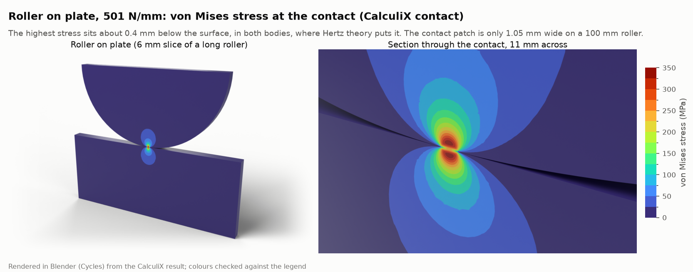

# Roller-on-plate contact

[Portfolio index](../PORTFOLIO.md) · Structures and vibration

| | |
|---|---|
| **Answer** | Yes. Peak contact pressure 609 MPa against a 650 MPa limit, and maximum shear below the surface 184 MPa against 200 MPa. |
| **Discipline** | Structures and vibration |
| **Tools** | Gmsh 4.15, CalculiX 2.22 (surface-to-surface contact) |
| **Methods** | Nonlinear contact FEA (penalty, frictionless), plane strain, displacement control, Hertz line contact as the exact reference, mesh refinement |

## The question

A hardened steel track roller, 100 mm in diameter, runs on a steel rail plate and carries 500 N per mm of its width. Does the peak contact pressure stay at or under 650 MPa? And does the maximum shear stress below the surface, which is where rolling-contact fatigue cracks start, stay at or under 200 MPa?

## The answer

**Yes, on both.** The peak contact pressure is 609 MPa and the maximum shear below the surface is 184 MPa, about 0.4 mm down. That leaves margins of 6 % and 8 %. The contact patch is 1.05 mm wide.

## How I know it's right

- **The model.** The roller and the plate are separate bodies that only touch. CalculiX finds where they're in contact as part of the solution, which makes it a nonlinear analysis. I push the roller down by a set distance and read the force it takes from the reactions. That's more robust than pushing with a force before the bodies have engaged.
- **Against the exact solution.** Hertz's theory gives the exact contact pressure and the stress field underneath for a cylinder on a flat. I compare at the load the model actually carries, 501.1 N/mm. On the finest mesh, the contact half-width matches to 0.005 %, the peak pressure to 0.4 %, and the depth of the maximum shear to within 2 % of one element.
- **Equilibrium.** The force on the roller and the reaction under the plate balance exactly. The contact pressure integrated across the patch accounts for the load to within 2.2 %.
- **The contact itself.** The penalty method lets the surfaces overlap very slightly. The largest overlap is less than a ten-thousandth of the imposed approach.
- **Mesh refinement.** Three meshes, with contact elements of 0.08, 0.04 and 0.02 mm. The two coarser meshes fail some checks against Hertz, as they should, so only the finest mesh gives the verdict. Mesh uncertainty is 1.2 % on the pressure and 0.15 % on the shear.

## What the checks caught

- **Reading the wrong output overstates the pressure.** Taking the pressure from the element stresses at the surface gave a peak 3.5 to 6.5 % too high, and that pressure added up to more than the load. CalculiX's own contact pressure output was within 0.2 % of Hertz on the same mesh. The study reads the contact output.
- **A converged answer the convergence check called divergent.** The maximum shear agreed across the three meshes to 0.06 %, but the convergence check failed it. The metric was the largest value at any node, and which node sits nearest the true peak changes with the mesh. I didn't loosen the tolerance. I changed the metric to locate the peak between nodes, wrote down the expected result first, and kept the failed run as evidence. The check now passes at 0.15 %.
- **A mesh nearly eight times bigger than it needed to be.** My first refinement zone spread across the whole model: 70,820 nodes and 3.5 minutes per solve. Keeping it close to the contact gave 9,334 nodes, 20 seconds, and the same answer to 0.2 %.

## Limits

- Frictionless, linear elastic contact. Friction, roughness, residual stress and plasticity are not modelled, and fatigue life is not assessed.
- Plane strain: a long roller, with no end effects or edge loading.
- The shear below the surface sits 1.2 % above Hertz on every mesh. Because it doesn't change with refinement, it comes from the model (finite bodies rather than Hertz's infinite ones), not the mesh.

## Evidence

- [mesh study](../runs/20261120-120243_contact_roller_mesh/report.md)
- [first run, with the shear metric that couldn't converge](../runs/20261120-120004_contact_roller_mesh/report.md)
- case file: `cases/contact_roller_mesh.toml` (predictions, revision note)
