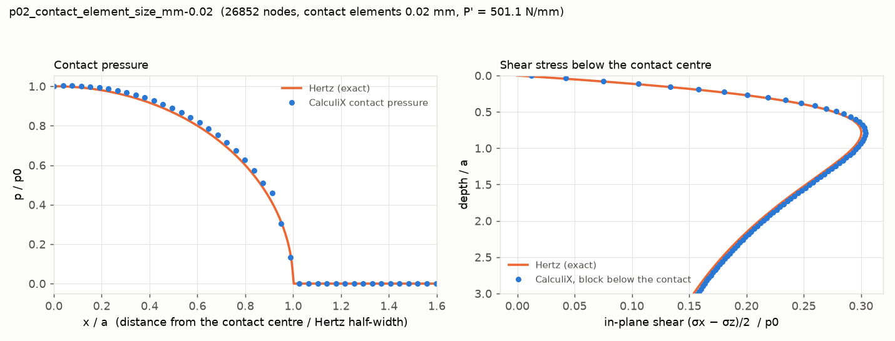
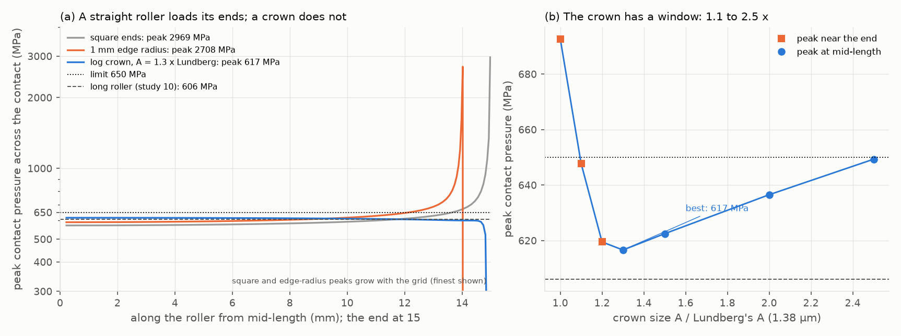

# Roller-on-plate contact

[Portfolio index](../PORTFOLIO.md) · Structures and vibration

| | |
|---|---|
| **Answer** | Yes. Peak contact pressure 609 MPa against a 650 MPa limit, and maximum shear below the surface 184 MPa against 200 MPa. **Part 2, with the roller's ends:** a straight roller fails. Square ends, or a 1 mm edge break, load the ends at 2,700-3,000 MPa and more, against 650. **With a logarithmic crown it passes at 617 MPa** (A = 1.8 µm, crown drop 3.7 µm at 1 mm from the end); the crown works from about 3 to 7 µm of drop, so it needs a grinding tolerance of about ±2 µm. |
| **Discipline** | Structures and vibration |
| **Tools** | Gmsh 4.15, CalculiX 2.22 (surface-to-surface contact) |
| **Methods** | Nonlinear contact FEA (penalty, frictionless), plane strain, displacement control, Hertz line contact as the exact reference, mesh refinement; part 2: 3D contact along the roller by half-space influence coefficients (Boussinesq, Love), checked against Hertz line and elliptical contact, with crowning profiles |

## The question

A hardened steel track roller, 100 mm in diameter, runs on a steel rail plate and carries 500 N per mm of its width. Does the peak contact pressure stay at or under 650 MPa? And does the maximum shear stress below the surface, which is where rolling-contact fatigue cracks start, stay at or under 200 MPa?

## The answer

**Yes, on both.** The peak contact pressure is 609 MPa and the maximum shear below the surface is 184 MPa, about 0.4 mm down. That leaves margins of 6 % and 8 %. The contact patch is 1.05 mm wide.

## How I know it's right

- **The model.** The roller and the plate are separate bodies that only touch. CalculiX finds where they're in contact as part of the solution, which makes it a nonlinear analysis. I push the roller down by a set distance and read the force it takes from the reactions. That's more robust than pushing with a force before the bodies have engaged.
- **Against the exact solution.** Hertz's theory gives the exact contact pressure and the stress field underneath for a cylinder on a flat. I compare at the load the model actually carries, 501.1 N/mm. On the finest mesh, the contact half-width matches to 0.005 %, the peak pressure to 0.4 %, and the depth of the maximum shear to within 2 % of one element.
- **Equilibrium.** The force on the roller and the reaction under the plate balance exactly. The contact pressure integrated across the patch accounts for the load to within 2.2 %.
- **The contact itself.** The penalty method lets the surfaces overlap very slightly. The largest overlap is less than a ten-thousandth of the imposed approach.
- **Mesh refinement.** Three meshes, with contact elements of 0.08, 0.04 and 0.02 mm. The two coarser meshes fail some checks against Hertz, as they should, so only the finest mesh gives the verdict. Mesh uncertainty is 1.2 % on the pressure and 0.15 % on the shear.

## What the checks caught

- **Reading the wrong output overstates the pressure.** Taking the pressure from the element stresses at the surface gave a peak 3.5 to 6.5 % too high, and that pressure added up to more than the load. CalculiX's own contact pressure output was within 0.2 % of Hertz on the same mesh. The study reads the contact output.
- **A converged answer the convergence check called divergent.** The maximum shear agreed across the three meshes to 0.06 %, but the convergence check failed it. The metric was the largest value at any node, and which node sits nearest the true peak changes with the mesh. I didn't loosen the tolerance. I changed the metric to locate the peak between nodes, wrote down the expected result first, and kept the failed run as evidence. The check now passes at 0.15 %.
- **A mesh nearly eight times bigger than it needed to be.** My first refinement zone spread across the whole model: 70,820 nodes and 3.5 minutes per solve. Keeping it close to the contact gave 9,334 nodes, 20 seconds, and the same answer to 0.2 %.

## Limits

- Frictionless, linear elastic contact. Friction, roughness, residual stress and plasticity are not modelled, and fatigue life is not assessed.
- Plane strain: a long roller, with no end effects or edge loading. Part 2 adds the ends, below.
- The shear below the surface sits 1.2 % above Hertz on every mesh. Because it doesn't change with refinement, it comes from the model (finite bodies rather than Hertz's infinite ones), not the mesh.

## Part 2: the roller's ends

### The question

Part 1 modelled a long roller: a section in plane strain, far from any end. Its 609 MPa against 650 left 6 %. A real
track roller is short, here 30 mm long for the 500 N/mm (15 kN), and a straight roller on a wider plate presses
hardest at its ends: the classic edge loading. Under the portfolio's standing rule (a fuller model wherever the margin
is as small as the simplification's likely error), the roller was modelled along its length. Does it pass, and what
profile does it need?

### The answer

**A straight roller fails; a crowned one passes.**

| Roller profile | Peak contact pressure (limit 650 MPa) | Verdict |
|---|---|---|
| straight, square ends | 2,018 → 2,443 → 2,969 MPa as the grid refines (the end is singular) | fails |
| straight, 1 mm edge radius | 1,497 → 2,010 → 2,708 MPa, 1 mm from the end (still growing) | fails |
| logarithmic crown, A = 1.38 µm (Lundberg's value) | 693 MPa, near the end | fails |
| **logarithmic crown, A = 1.79 µm (1.3 x Lundberg's)** | **617 MPa, at mid-length** | **passes, 5 % margin** |
| logarithmic crown, A = 3.45 µm (2.5 x) | 649 MPa, at mid-length | passes, only just |

The crown is the logarithmic profile of the Fujiwara-Kawase form, its drop capped at 30 µm at the ends. Too gentle
a crown leaves the ends loaded; too strong a crown piles the load into the middle. The window runs from about 1.1 to
2.5 times Lundberg's parameter, a drop at 1 mm from the end of about 3.1 to 7.1 µm. The drawing should call for about
3.7 µm there, with a tolerance of about ±2 µm. With it, the roller keeps part 1's verdict at 617 MPa, 1.7 % above the
long roller.

### How it works

- **Half-space contact.** The contact plane is divided into small rectangles. The surface displacement a uniform
  pressure on a rectangle causes in an elastic half-space is known in closed form (Love, 1929), and the two bodies'
  displacements add. The pressures are found so that the gap closes where they push and stays open where they do not
  (an active-set solution), and the approach is adjusted until the total force is 15 kN.
- **The profile** is the same function the 3D finite-element model uses: the roller's surface drops by d(y) along its
  length.
- **Why not the 3D finite-element model?** It is built (study 10's section extruded along the roller, the profile as a
  micron drop), but one solve takes about an hour; the half-space method is the standard tool for roller profiles and
  solves a design in seconds. One crowned case on the FE model is kept as a cross-check.

### How I know it's right

- **Two exact solutions, inside every run.** On each run's own grid: the middle of a long straight roller matches
  Hertz line contact for the line load it carries (within 6 × 10⁻⁴), and a roller with a circular crown matches
  Hertz's elliptical contact (within 2.4 × 10⁻⁴ on the finest grid).
- **Grid refinement**: the crowned design gives 616.3, 616.6 and 616.8 MPa on three grids: uncertainty 0.03 %.
- **The failures behave as theory says**: the square end's peak grows as the end cells shrink, roughly as their size
  to the power -0.47, the signature of a singular edge, so its runs fail their convergence check by design.

### What the checks caught

- **My own formula error, caught by a limit.** The Hertz elliptical reference first came out 2.4 times too far from
  the solver. Checking it against its own long-ellipse limit (the minor semi-axis must tend to 2 p₀ R / E*) showed an
  extra factor I had "fixed" in; the original was right. A first test case also used the wrong load (15 kN for a 40 mm
  roller at 500 N/mm). Both were found before any run; the reference now carries the limit as a test.
- **A number CalculiX could not read.** The 3D FE model's crowned trial stopped on inverted elements. The cause was
  not the mesh: node coordinates written at full precision (21 characters) were cut at CalculiX's 20-character field,
  so `8.73e-05` became `8.73e-0` and a node jumped. The deck now writes 12 significant digits.
- **A trial lost to a timeout.** The first 3D FE trial was killed at 30 minutes by a time limit inside the command,
  at 47 % of its load; long solves now run in the background with none.

### Limits (part 2)

- Both bodies are half-spaces: the roller's end face and the plate's edges are left out. That overstates a sharp end's
  peak somewhat, but the failing profiles fail by 3 to 4 times, and the crowned design's peak is at mid-length.
- No misalignment. A tilted roller loads one end; a crown's tolerance to tilt is a separate check.
- Contact pressure only; the subsurface shear (part 1's second requirement) is not computed along the roller.
- The roller's length (30 mm) and the crown are a design input, marked synthetic.

## Evidence

- [mesh study](../runs/20261120-120243_contact_roller_mesh/report.md)
- [first run, with the shear metric that couldn't converge](../runs/20261120-120004_contact_roller_mesh/report.md)
- case file: `cases/contact_roller_mesh.toml` (predictions, revision note)
- Part 2: [crown size](../runs/20261127-172125_roller_hs_crown/report.md) (PASS), [the crowned design at three
  grids](../runs/20261127-172428_roller_hs_mesh/report.md) (PASS), [1 mm edge radius](../runs/20261127-172625_roller_hs_plain/report.md)
  and [square ends](../runs/20261127-172828_roller_hs_square/report.md) (both FAIL their convergence check, as
  predicted: the peak has no converged value); cases `cases/roller_hs_*.toml`; code `models/contact/roller_halfspace.py`,
  `studies/roller_halfspace.py` (tests `tests/test_roller_halfspace.py`), the 3D FE model `models/fea/roller_3d.py`;
  figure `scripts/make_roller_halfspace_figure.py`
