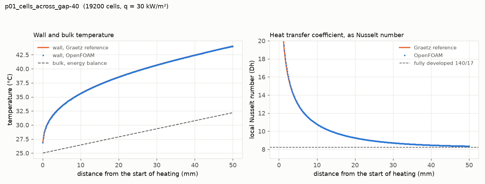

# Cold-plate channel heat transfer (in progress)

[Portfolio index](../PORTFOLIO.md) · Thermal and fluids

| | |
|---|---|
| **Answer** | Not yet given. The wall peaks at about 44.0 °C against a 45 °C limit, but one convergence check doesn't pass yet, so the verdict is withheld. |
| **Discipline** | Thermal and fluids |
| **Tools** | OpenFOAM 14 (in WSL) with scalar temperature transport, Python |
| **Methods** | Laminar CFD with heat transfer, the Graetz thermal-entry solution as an independent reference, energy balance, mesh refinement |

## The question

A cold-plate passage, 1 mm deep, carries water at 25 °C and 0.1 m/s. Electronics heat both walls at 30 kW/m² over 50 mm. Does the wall stay at or under 45 °C, and does the coolant warm by no more than 10 K?

## Where it stands

- **The physics checks pass.** The wall temperature matches an independent thermal-entry (Graetz) solution to within 0.03 to 0.6 % of the temperature rise, closer on finer meshes. The peak wall temperature is 44.0 °C on all three meshes, and the coolant warms by 7.2 K.
- **The verdict is withheld.** The finest mesh's temperature field was still changing when the run stopped, and the energy balance closes to 4 to 7 × 10⁻⁵ on the two coarser meshes and 2 × 10⁻³ on the finest, against the 10⁻⁶ I set. Under the rules this portfolio works to, an unconverged result doesn't get a pass or fail, however close it looks.
- **Next:** solve the temperature on the converged flow field for a few thousand cheap iterations, then rerun with the same tolerances.

## Why the reference matters

The heated length is shorter than the thermal entry length (about 137 mm here), so the heat transfer is still developing at the end of the heating: the Nusselt number is 8.34, not the textbook fully developed 8.24. A hand calculation that assumed developed flow would get the wall temperature wrong. The reference solves the entry problem directly: exact along the flow, and checked against the fully developed limit (140/17) and the energy balance before use.

## What the checks caught

- **An overshoot exactly where the answer is.** The usual second-order scheme for temperature overshot by 0.06 to 0.11 K at the last heated cell, where the heated wall meets an unheated one, which is where the peak wall temperature sits. A bounded scheme removed it.
- **A field that never settled.** The bounded scheme's limiter then flipped one part of the field by up to 0.1 K every iteration. The peak wall temperature barely moved (3 × 10⁻⁵ K), but the convergence check failed, correctly. Under-relaxation stopped the flip-flop, and convergence is now judged on how much the field itself changes. The slower convergence that followed is what's holding the verdict.

## Evidence

- [mesh study, current](../runs/20261120-131818_heated_channel_mesh/report.md)
- [first mesh study, with the limiter flip-flop](../runs/20261120-124736_heated_channel_mesh/report.md)
- [first heat-flux sweep, with the limiter flip-flop](../runs/20261120-130606_heated_channel_flux/report.md)
- case files: `cases/heated_channel_mesh.toml`, `cases/heated_channel_flux.toml` (predictions and revision notes)
