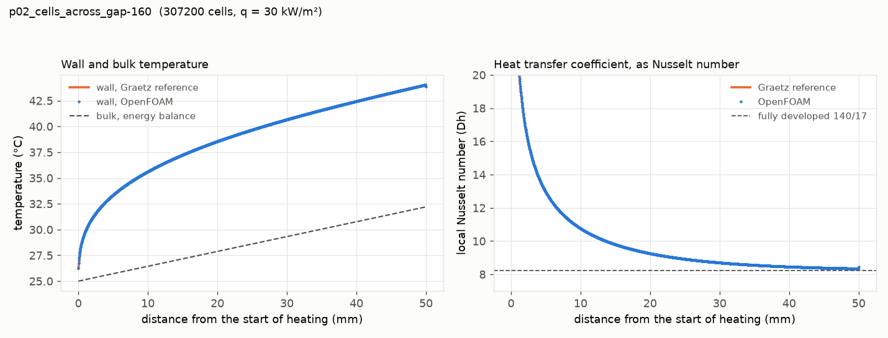

# Cold-plate channel heat transfer

[Portfolio index](../PORTFOLIO.md) · Thermal and fluids

| | |
|---|---|
| **Answer** | Yes on both counts, verified. The wall peaks at 44.03 °C against a 45 °C limit (mesh uncertainty 0.23 % of the rise), and the coolant warms by 7.2 K within its 10 K budget. Rated heat flux about 31 kW/m². |
| **Discipline** | Thermal and fluids |
| **Tools** | OpenFOAM 14 (in WSL), scalar temperature transport, Python |
| **Methods** | Laminar CFD with heat transfer, the Graetz thermal-entry solution as an independent reference, energy balance, mesh refinement, a heat-flux sweep |

## The question

A cold-plate passage, 1 mm deep, carries water at 25 °C and 0.1 m/s. Electronics heat both walls at 30 kW/m² over 50 mm. Does the wall stay at or under 45 °C, does the coolant warm by no more than 10 K, and how much heat flux could the passage take?

## The answer

- **The coolant warms by 7.2 K**, inside its 10 K budget. That result is verified: the energy balance closes to a part in a trillion on every mesh.
- **The wall peaks at 44.03 °C, 0.97 K under the limit (verified).** The first mesh study (20, 40 and 80 cells across the gap) couldn't put a number on the peak's uncertainty, so that verdict was withheld. A rerun on 40, 80 and 160 cells settled it: 44.097, 44.029 and 44.029 °C, an uncertainty of 0.23 % of the rise. It matches the independent reference within 0.6 %.
- **The rating:** at 40 cells the wall reaches 45 °C at about 31 kW/m². Up to 30 kW/m² passes, and 35 fails.

## How I know it's right

- **Against an independent solution.** The thermal-entry (Graetz) problem is solved separately: exact along the flow, and checked first against the textbook fully developed Nusselt number (140/17) and the energy balance. The CFD wall temperature matches it to within 0.03 to 0.6 % of the temperature rise, closer on finer meshes.
- **Energy balance.** The heat put into the walls comes out in the coolant to a part in a trillion.
- **Converged.** Temperature is solved on the converged flow until the field stops changing, which it does to 10⁻¹¹ of the rise.
- **Validity.** The flow is laminar (Reynolds number 224), and the reference's no-axial-conduction assumption holds (Péclet number 1373).

## Why the reference matters

The heated length is shorter than the thermal entry length (about 137 mm here), so the heat transfer is still developing at the end of the heating: the Nusselt number is 8.34, not the textbook fully developed 8.24. A hand calculation that assumed developed flow would get the wall temperature wrong.

## What the checks caught

- **An overshoot exactly where the answer is.** The standard second-order scheme overshoots by 0.06 to 0.11 K at the last heated cell, where the heated wall meets an unheated one. On the coarser meshes the peak sat in that cell, so it didn't converge smoothly. On finer meshes the overshoot shrinks and reverses, the peak moves one or two cells upstream, and the value settles: that is why the 160-cell mesh was needed for the verdict.
- **Fixes that only hid the problem.** I tried four bounded schemes to remove the overshoot. All of them dithered from one iteration to the next near the end of the heating and never closed the energy balance. Under-relaxation only masked it. I went back to the scheme that converges exactly and let the checks bound its bias, and kept every failed run as evidence. The tolerances never changed.

## Limits

- 2D: the passage is much wider than it is deep, so the side walls are neglected (the 3D duct check showed a 3 % effect on the flow).
- No conduction in the plate itself (no conjugate heat transfer), which would smooth the wall temperature along the length.
- Constant water properties, reasonable for a rise under 20 K.

## Evidence

- [mesh study, 40 / 80 / 160 cells](../runs/20261121-151154_heated_channel_mesh_r2/report.md) (verifies the wall), the [first mesh study](../runs/20261120-150722_heated_channel_mesh/report.md) (wall withheld), and [heat-flux sweep](../runs/20261120-150722_heated_channel_flux/report.md)
- earlier runs kept as evidence: [first mesh study](../runs/20261120-124736_heated_channel_mesh/report.md), [first heat-flux sweep](../runs/20261120-130606_heated_channel_flux/report.md), [relaxed run](../runs/20261120-131818_heated_channel_mesh/report.md)
- case files: `cases/heated_channel_mesh.toml`, `cases/heated_channel_flux.toml`, `cases/heated_channel_mesh_r1.toml` (timed out at 160 cells), `cases/heated_channel_mesh_r2.toml` (predictions, revision notes, results)
