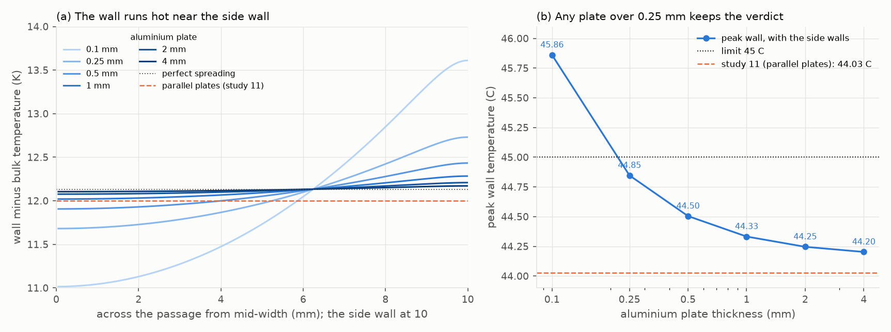

# Cold-plate channel heat transfer

[Portfolio index](../PORTFOLIO.md) · Thermal and fluids

| | |
|---|---|
| **Answer** | Yes on both counts, verified. The wall peaks at 44.03 °C against a 45 °C limit (mesh uncertainty 0.23 % of the rise), and the coolant warms by 7.2 K within its 10 K budget. Rated heat flux about 31 kW/m². **Part 2, with the side walls:** the passage's broad wall runs hotter near its side walls, where the flow slows. With a 2 mm aluminium plate the wall peaks at **44.25 °C**: the verdict stands, its margin down from 0.97 to 0.75 K. Any aluminium plate over about 0.25 mm keeps it; a wall that spreads no heat would reach 143 °C at the corners. |
| **Discipline** | Thermal and fluids |
| **Tools** | OpenFOAM 14 (in WSL), scalar temperature transport, Python |
| **Methods** | Laminar CFD with heat transfer, the Graetz thermal-entry solution as an independent reference, energy balance, mesh refinement, a heat-flux sweep; part 2: fully developed cross-section with the side walls (finite volumes, the plate as a conducting sheet), checked against the parallel-plate limit, the exact duct friction series and Incropera's duct Nusselt numbers |

## The question

A cold-plate passage, 1 mm deep, carries water at 25 °C and 0.1 m/s. Electronics heat both walls at 30 kW/m² over 50 mm. Does the wall stay at or under 45 °C, does the coolant warm by no more than 10 K, and how much heat flux could the passage take?

## The answer

- **The coolant warms by 7.2 K**, inside its 10 K budget. That result is verified: the energy balance closes to a part in a trillion on every mesh.
- **The wall peaks at 44.03 °C, 0.97 K under the limit (verified).** The first mesh study (20, 40 and 80 cells across the gap) couldn't put a number on the peak's uncertainty, so that verdict was withheld. A rerun on 40, 80 and 160 cells settled it: 44.097, 44.029 and 44.029 °C, an uncertainty of 0.23 % of the rise. It matches the independent reference within 0.6 %.
- **The rating:** at 40 cells the wall reaches 45 °C at about 31 kW/m². Up to 30 kW/m² passes, and 35 fails.

## How I know it's right

- **Against an independent solution.** The thermal-entry (Graetz) problem is solved separately: exact along the flow, and checked first against the textbook fully developed Nusselt number (140/17) and the energy balance. The CFD wall temperature matches it to within 0.03 to 0.6 % of the temperature rise, closer on finer meshes.
- **Energy balance.** The heat put into the walls comes out in the coolant to a part in a trillion.
- **Converged.** Temperature is solved on the converged flow until the field stops changing, which it does to 10⁻¹¹ of the rise.
- **Validity.** The flow is laminar (Reynolds number 224), and the reference's no-axial-conduction assumption holds (Péclet number 1373).

## Why the reference matters

The heated length is shorter than the thermal entry length (about 137 mm here), so the heat transfer is still developing at the end of the heating: the Nusselt number is 8.34, not the textbook fully developed 8.24. A hand calculation that assumed developed flow would get the wall temperature wrong.

## What the checks caught

- **An overshoot exactly where the answer is.** The standard second-order scheme overshoots by 0.06 to 0.11 K at the last heated cell, where the heated wall meets an unheated one. On the coarser meshes the peak sat in that cell, so it didn't converge smoothly. On finer meshes the overshoot shrinks and reverses, the peak moves one or two cells upstream, and the value settles: that is why the 160-cell mesh was needed for the verdict.
- **Fixes that only hid the problem.** I tried four bounded schemes to remove the overshoot. All of them dithered from one iteration to the next near the end of the heating and never closed the energy balance. Under-relaxation only masked it. I went back to the scheme that converges exactly and let the checks bound its bias, and kept every failed run as evidence. The tolerances never changed.

## Limits

- 2D: the passage is much wider than it is deep, so the side walls are neglected (the 3D duct check showed a 3 % effect on the flow). Part 2 measures what that leaves out for the wall temperature, below.
- No conduction in the plate itself (no conjugate heat transfer), which would smooth the wall temperature along the length.
- Constant water properties, reasonable for a rise under 20 K.

## Part 2: the side walls

### The question

Part 1 modelled the passage as parallel plates, and its wall passed at 44.03 °C against 45 °C: 0.97 K to spare out of
a 19 K rise. A real passage 1 mm deep and 20 mm wide has side walls. Near them the flow slows, and a heated wall over
slow coolant runs hot. Under the portfolio's standing rule (a fuller model wherever the margin is as small as the
simplification's likely error), that needed measuring. Does the wall still pass?

### The answer

**It depends on the plate, and for any real aluminium plate it passes.** How hot the wall gets near the side walls
depends on how far the plate spreads heat across the width:

| The heated wall | Peak wall temperature (limit 45 °C) | Share of part 1's 0.97 K margin |
|---|---|---|
| spreads no heat at all (a uniform flux) | **143 °C**, at the corners | fails by 98 K |
| aluminium, 0.1 mm | 45.86 °C | fails |
| aluminium, 0.25 mm | 44.85 °C | 84 % |
| aluminium, 1 mm | 44.33 °C | 31 % |
| **aluminium, 2 mm** | **44.25 °C** | **22 %** |
| aluminium, 4 mm | 44.20 °C | 18 % |
| spreads heat perfectly | 44.16 °C | 13 % |

With a 2 mm aluminium plate, the verdict stands and the margin shrinks from 0.97 to 0.75 K. The threshold is about
0.23 mm of aluminium (a sheet conductance of 0.04 W/K), which is also about 2 mm of stainless steel: a thin or
stainless plate would fail at the corners, and the parallel-plate model could never have shown it. Part 1's rating
barely moves: every temperature difference scales with the heat flux, so the wall reaches 45 °C at 31.2 kW/m² instead
of 31.5 (still "about 31").

### How it works

- **The cross-section, fully developed**: the flow and the temperature are solved on a quarter of the 1 x 20 mm
  section by finite volumes, fine towards the side wall. Far enough downstream both stop changing shape, which part 1
  showed is nearly true at the passage's outlet (98 % developed).
- **The plate as a conducting sheet**: the broad wall's temperature is solved with the coolant, the heat entering the
  sheet, spreading along it by conduction and passing into the coolant. A sheet that conducts nothing is the uniform
  flux bound; one that conducts perfectly is the uniform temperature bound.
- **The correction**: the 3D peak excess of the wall over the bulk, minus the parallel-plate value (12.00 K), is
  added to part 1's verified 2D wall temperature, which already includes the entry effects.

### How I know it's right

- **Exact limits, inside every point**: with the side wall replaced by a symmetry plane, the solver must give parallel
  plates, wall minus bulk = (17/70) q H / k: it does within 1 × 10⁻⁴. Its friction factor matches the exact
  rectangular-duct series within 3 × 10⁻⁴.
- **A published table**: for rectangular ducts heated on all four walls, Incropera's Nusselt numbers are 5.33
  (aspect ratio 4) and 6.49 (8); the solver gives 5.332 and 6.491.
- **The plate model's own limits**: a sheet of zero conductance reproduces the uniform-flux result to round-off, and a
  very conductive one the uniform-temperature result.
- **Grid refinement**: 20, 40 and 80 cells across the half gap give 12.215, 12.220 and 12.221 K: uncertainty 4 × 10⁻⁵.

### What the checks caught

- **The coarsest grid missed one exact check.** At 20 cells the friction factor is 1.3 × 10⁻³ from the exact series,
  against a 10⁻³ tolerance; it falls as the square of the cell size (3.4 × 10⁻⁴ at 40, 1.0 × 10⁻⁴ at 80). The run is
  reported as failing that check; the tolerance is unchanged.
- **A case the harness could not run.** The bounds were first set up as a sweep over the name of the boundary
  condition, which the harness cannot sweep (it formats sweep values as numbers). No point had run; the bounds are now
  the plate model's own limits, a sweep of the plate's conductivity from 0 to 10⁹ W/m K, and the predictions were
  left as written.
- **A second effect, not predicted.** Away from the side walls a thin plate runs cooler than parallel plates: the flow
  the side walls hold back goes faster down the middle (panel a). It does not change the verdict, which is set at the
  hottest point.

### Limits (part 2)

- Fully developed in the section; the side-wall correction is added to part 1's developing 2D value, not solved in
  3D along the passage.
- The side walls adiabatic (conservative: metal side walls carry heat away) and the heat applied evenly over the
  passage's width; the plate's temperature taken uniform through its thickness.
- The width (20 mm) is synthetic, as in study 5; the plate's material and thickness are the design input the answer
  is given against.

## Evidence

- [mesh study, 40 / 80 / 160 cells](../runs/20261121-151154_heated_channel_mesh_r2/report.md) (verifies the wall), the [first mesh study](../runs/20261120-150722_heated_channel_mesh/report.md) (wall withheld), and [heat-flux sweep](../runs/20261120-150722_heated_channel_flux/report.md)
- earlier runs kept as evidence: [first mesh study](../runs/20261120-124736_heated_channel_mesh/report.md), [first heat-flux sweep](../runs/20261120-130606_heated_channel_flux/report.md), [relaxed run](../runs/20261120-131818_heated_channel_mesh/report.md)
- case files: `cases/heated_channel_mesh.toml`, `cases/heated_channel_flux.toml`, `cases/heated_channel_mesh_r1.toml` (timed out at 160 cells), `cases/heated_channel_mesh_r2.toml` (predictions, revision notes, results)
- Part 2: [grids](../runs/20261127-170402_duct_section_mesh/report.md) (FAIL on one exact check at the coarsest
  grid, above), [plate thickness](../runs/20261127-170409_duct_section_plate/report.md) (PASS),
  [the two bounds](../runs/20261127-170502_duct_section_bounds/report.md) (PASS); cases `cases/duct_section_*.toml`;
  code `models/thermal/duct_section.py`, `studies/duct_section.py` (tests `tests/test_duct_section.py`), figure
  `scripts/make_duct_section_figure.py`
