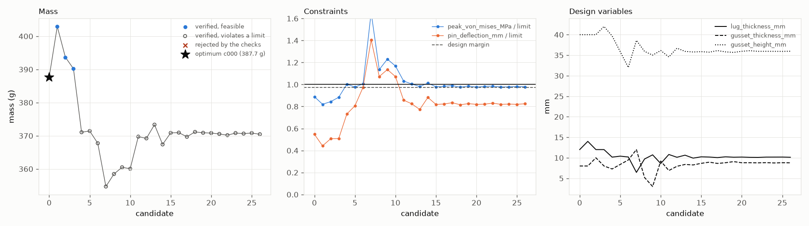

# Bracket optimisation loop: a machined clevis bracket

[Portfolio index](../PORTFOLIO.md) · Structures and vibration

| | |
|---|---|
| **Answer** | The lightest bracket that meets both limits found here weighs 371.9 g: lug 10.17 mm thick, gussets 9.07 mm thick and 36.4 mm tall. That's 4.1 % lighter than the starting design. Its peak stress is 98.3 MPa (98.9 MPa with the mesh uncertainty added) against 100 MPa; the pin moves 0.079 mm against 0.10 mm. |
| **Discipline** | Structures, design automation |
| **Tools** | CadQuery, Gmsh, CalculiX, SciPy (COBYLA), Python |
| **Methods** | Derivative-free optimisation driving a CAD-to-FEA pipeline, checks on every candidate, local mesh refinement at the stress peak, measured mesh noise, local response surface, mesh study at the chosen design |

## The question

A 6061-T6 clevis bracket on a vibrating machine carries an inclined pin load of (1.5, 1.0, 4.5) kN. The interfaces fix the base (100 × 100 × 10 mm), the lug outline (40 mm wide, 16 mm pin 70 mm up) and the 3 mm fillets. Which lug thickness, gusset thickness and gusset height make it lightest, while the peak stress stays at or under 100 MPa (fatigue-rated) and the pin moves at most 0.10 mm?

## The answer

- **371.9 g**, against 387.7 g for the starting design (12 mm lug, 8 × 40 mm gussets). The 270 g base plate is fixed, so the parts the optimiser could change got 13 % lighter.
- **Stress governs**, at the fillet where the lug's outer end meets the base. Deflection, 0.079 mm, has margin.
- **The answer is flat.** Every design in the region the optimiser converged to weighs 370 ± 1 g. The chosen design gives up about 1.5 g to stay clear of the limit by more than the mesh noise.

## How it works

An optimiser (COBYLA: derivative-free, handles constraints) proposes three dimensions. For each candidate the harness:

1. builds the solid in CadQuery;
2. meshes it in Gmsh, with quadratic tets of 4 mm, refined to 1 mm on the fillets;
3. solves it in CalculiX;
4. runs every check of the study.

A candidate that fails any check counts as infeasible, so a result the checks rejected can't steer the search. Constraints carry a design margin sized from measured mesh error. The chosen design then gets its own mesh study.

## How I know it's right

- **Every candidate is checked.** The CAD solid is valid. The meshed volume equals the CAD volume (to 2 × 10⁻⁴ or better). The base reactions balance the pin load in force and moment (10⁻⁸): the load acts where it should. Where the lug has a clear section, its stress is compared with beam theory. Validity: below yield, small deflection.
- **A mesh study at the chosen design that refines the peak itself.** The fillet elements go from 1.0 to 0.85 to 0.75 mm. The peak stays within 0.99 %, under the measured mesh noise, so it's classed converged with 0.62 % uncertainty. The requirement holds with that added: 98.9 MPa.
- **Predictions written before each run**, with each one marked held or failed in the case files.

## What the checks caught

This study took three optimisation runs. Each failure was caught by a check, not by inspection.

1. **The first optimum failed its own mesh study.** With a 1 % design margin, the optimiser's pick read 94 MPa on the 4 mm mesh. The mesh study put it at 101.7 MPa once the uncertainty was included. A fillet peak needs far more margin than a smooth beam stress, where 0.5 % had been plenty.
2. **The mesh study wasn't refining the fillet.** Gmsh's curvature refinement and minimum element size held the fillet elements at about 1.6 mm whatever the global size. So the "global" study barely touched the peak, and its convergence order swung between 1.66 and 1.16 for nearly the same shape. A margin sized from it (9 %) failed too.
3. **The CAD wasn't reproducible.** The same dimensions gave 40 or 41 B-rep faces from run to run, with the same volume to ten digits, and so different meshes, different stresses (94.0 against 94.9 MPa), and sometimes a crash. The cause: CadQuery merged the fillet edges through a set ordered by memory address. The edges are now passed in a fixed order, and a test checks that two builds are byte-identical.
4. **Gmsh occasionally inverted an element** when curving the quadratic tets, which CalculiX rejects. The pipeline now remeshes once with Gmsh's high-order optimiser; it fired on 8 of 21 candidates in one run, and every one then solved.
5. **The optimiser stalled in mesh noise.** With the fillet refined locally, the peak converged: 96.6 to 97.6 MPa at fillet elements of 1.0 mm and finer. But it still scattered 1.5 % between designs a tenth of a millimetre apart. The optimiser's last candidates all sat just over the limit, so the best point that met it was the start. A linear fit of the stress over those 15 candidates averages the noise (0.5 MPa). The chosen design sits two standard deviations inside the limit, within the region the candidates sampled.
6. **The final mesh study first read "divergent"**: 97.36, 97.54, 98.33 MPa. Once resolved, the peak is a maximum over nodes and jitters from mesh to mesh by as much as one refinement step changes it. That jitter had been measured beforehand (1.5 %). Declared as the study's noise floor, it classes the three values as converged; a peak that kept rising would still be caught.

## Limits

- Static load; the fatigue rating is folded into the 100 MPa allowable.
- Fixed outline and fillet radius; only three dimensions vary.
- The base is fixed rigidly and the pin is idealised as rigid; the bolted base and pin bearing need their own checks (the lug net section and bearing are sized by the standard lug method).
- No physical test data.

## Earlier version

The first version of this study optimised a tapered cantilever. It was verified (546 g, mesh uncertainty 0.005 %, an independent beam-theory optimum within 0.13 %), but it was too close to [study 1](01-cantilever-bracket.md) to show anything new. Its evidence is kept: [optimisation run](../runs/20261120-225322_bracket_opt/report.md), [confirmation](../runs/20261120-225744_bracket_opt_confirm/report.md).

## Evidence

- final: [optimisation run 2](../runs/20261121-091836_clevis_opt_r2/report.md) and the [mesh study at the chosen design](../runs/20261121-115130_clevis_confirm_r2b/report.md) (verification PASS)
- the path there:
  - [optimisation 1](../runs/20261121-000013_clevis_opt/report.md) and its mesh studies ([before](../runs/20261121-002416_clevis_confirm/report.md) and [after](../runs/20261121-004057_clevis_confirm/report.md) the reproducibility fix);
  - [optimisation r1](../runs/20261121-004740_clevis_opt_r1/report.md), its [global mesh study](../runs/20261121-010500_clevis_confirm_r1/report.md) and its [fillet mesh study](../runs/20261121-091836_clevis_confirm_r1_fillet/report.md);
  - the [first mesh study at the chosen design](../runs/20261121-111455_clevis_confirm_r2/report.md).
- case files: `cases/clevis_opt.toml`, `clevis_confirm.toml`, `clevis_opt_r1.toml`, `clevis_confirm_r1.toml`, `clevis_confirm_r1_fillet.toml`, `clevis_opt_r2.toml`, `clevis_confirm_r2.toml`, `clevis_confirm_r2b.toml` (each with its predictions, results, and the reason for the next)
- code: `harness/optimize.py`, `harness/response_surface.py`, `studies/clevis_bracket.py`, `models/fea/clevis_bracket.py`
