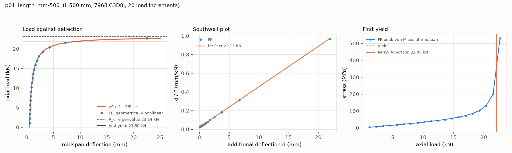

# Strut buckling, with an imperfect strut

[Portfolio index](../PORTFOLIO.md) · Structures and vibration

| | |
|---|---|
| **Answer** | The longest acceptable strut is about 587 mm. At 500 mm the bowed strut reaches 21.8 kN before any fibre yields (requirement 16 kN); at 600 mm only 15.3 kN. Mesh uncertainty 0.003 %. |
| **Discipline** | Structures, stability |
| **Tools** | CalculiX (linear buckling and geometrically nonlinear static), Python |
| **Methods** | Eigenvalue buckling, nonlinear analysis of an imperfect strut, Euler with shear correction, the amplification law, the Southwell plot, Perry-Robertson first yield, Euler/Johnson validity check, mesh refinement |

## The question

A 6061-T6 strut with a solid 25 × 16 mm section, pinned at both ends, carries 8 kN in compression. It must reach twice that, 16 kN, before any fibre yields, allowing for an initial bow of L/1000 (a typical straightness tolerance). How long can it be?

## The answer

- **About 587 mm.** The bowed strut reaches 33.4 / 21.8 / 15.3 / 11.4 kN at 400 / 500 / 600 / 700 mm before first yield, so 400 and 500 mm pass and 600 and 700 mm fail.
- **The bow costs 4 to 7 %.** First yield arrives at 93 to 96 % of the elastic buckling load. A check on the buckling load alone would overstate the capacity.

## How I know it's right

- **Two independent routes to the buckling load agree.** The linear eigenvalue analysis and the Southwell plot of the nonlinear run (which reads the critical load from the load-deflection response alone) agree to 0.04 %. Both sit 0.06 to 0.1 % below Euler with the shear correction.
- **The first mode is an exact half sine** (1 - MAC = 2.5 × 10⁻¹¹).
- **The nonlinear response follows the amplification law** e₀ / (1 - P/P_cr) to 0.2 % up to 80 % of the critical load, and the Southwell fit recovers the imposed bow to 0.3 %.
- **First yield** is within 1.3 % of the Perry-Robertson formula at every length (the formula is slightly unconservative here).
- **Mesh refinement** at 600 mm: grid convergence index 0.003 %.
- **Validity.** Every length is in the Euler range (Euler stress below half the yield stress), where elastic buckling governs. A shorter strut would fall in the Johnson range, and the check would flag the elastic analysis as the wrong tool.

## What the checks caught

- **The wrong eigenvector.** The mode-shape check failed at first. CalculiX prints the static pre-buckling solution before the first eigenvector, and the parser was reading that as mode 1. The real mode was then an exact half sine. Two wrong explanations came first (solver accuracy, support layout); the changes they prompted were kept because they are harmless, and the record says which was the cause.
- **Equilibrium a few parts per million out.** The nonlinear solver's default convergence criterion left the global balance 3 × 10⁻⁶ out. Tighter criteria brought it to 2 × 10⁻⁷ without moving the tolerance.

## Limits

- Capacity is defined as first yield; the plastic reserve beyond it is not used.
- No residual stresses or load eccentricity beyond the bow.
- No test data.

## Evidence

- [length sweep](../runs/20261120-232856_strut_length/report.md) and [mesh study at 600 mm](../runs/20261120-233637_strut_mesh/report.md)
- case files: `cases/strut_length.toml`, `cases/strut_mesh.toml` (predictions, smoke-test findings and results in the headers)
