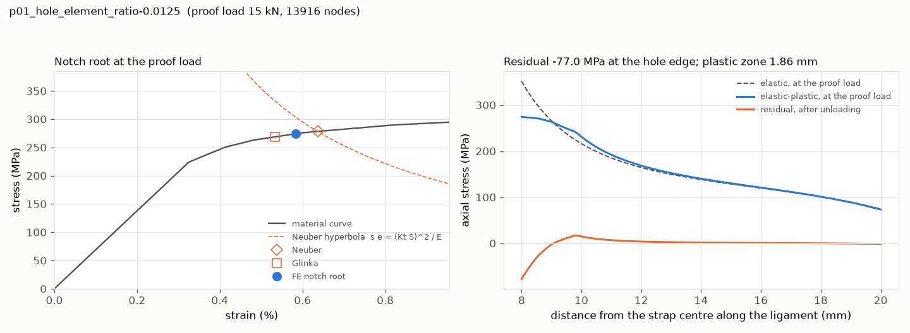

# Strap proof test, notch plasticity

[Portfolio index](../PORTFOLIO.md) · Structures and vibration

| | |
|---|---|
| **Answer** | A 15 kN proof test (three times service) strains the hole edge to 0.58 %, inside a 1 % limit, and leaves −77 MPa of compressive residual stress there. Mesh uncertainty 0.05 % on the residual stress. |
| **Discipline** | Structures, nonlinear material |
| **Tools** | CadQuery, Gmsh, CalculiX (isotropic-hardening plasticity), Python |
| **Methods** | Elastic-plastic FE with loading and unloading, Neuber's rule and Glinka's strain-energy method, Peterson's stress concentration factor, elastic-unloading superposition, mesh refinement |

## The question

The aluminium strap from the [strap-hole](02-strap-cable-hole.md) and [fatigue](03-strap-fatigue.md) studies (6061-T6, 40 × 4 mm, 16 mm hole, 5 kN service load) is proof tested at 15 kN before installation. Elastically the hole edge would see about 350 MPa, well past yield, while the rest of the section stays elastic. Does the hole edge stay within 1 % strain during the test, and does the test leave compressive residual stress behind, which helps fatigue?

## The answer

- **0.58 % strain at the hole edge during the test,** against a 1 % limit.
- **−77 MPa residual stress at the hole edge after unloading.** The yielded material is squeezed by the elastic material around it as the load comes off.
- **The yielding stays local:** a plastic zone of 1.8 mm on a 12 mm ligament.

## How I know it's right

- **Bounded by two classical methods.** The notch-root strain sits between Glinka's estimate (0.53 %) and Neuber's (0.64 %), 8 % below Neuber, as expected in plane stress.
- **Exact elastic unloading.** The residual stress equals the proof-load stress minus the elastic peak from a separate elastic run, to 2 × 10⁻⁶. That holds only if the unloading is purely elastic, so it checks both the solver and the assumption. The residual is within 1.6 % of the Neuber-based estimate.
- **The elastic peak** matches Peterson's stress concentration factor to 0.5 %.
- **Equilibrium** at the proof load and after unloading, to round-off.
- **Validity.** The net section stays below first yield, the plastic zone is contained, the unloading doesn't yield in reverse, and strains are small.

## What the checks caught

- **A mesh study that wasn't yet in its asymptotic range.** On the first three meshes the residual stress converged at an observed order of 3.3, well above the method's order of 2, so the convergence check refused to estimate an uncertainty and that verdict was withheld. Dropping the coarsest mesh and adding a finer one gave order 2.1 and 0.05 %.
- **A convergence check that stays strict.** On the finer set the notch strain varies by only 1.6 × 10⁻⁴ (0.5834 to 0.5835 %), but the differences don't shrink with refinement, so the formal check reports no estimate on that run. I left the noise threshold where it was set before the runs. The strain was verified on the first set (0.3 %), and every mesh of both sets gives 0.581 to 0.584 %.

## Limits

- Synthetic material curve (a Ramberg-Osgood fit with the 0.2 % proof stress at 276 MPa); a real test would use the batch certificate.
- Isotropic hardening, no Bauschinger effect (no reversed yield occurs here).
- No test data.

## Evidence

- [mesh study, revision 1](../runs/20261120-233830_strap_proof_r1/report.md) and the [first mesh study](../runs/20261120-233440_strap_proof/report.md), kept as evidence
- case files: `cases/strap_proof.toml`, `cases/strap_proof_r1.toml`
