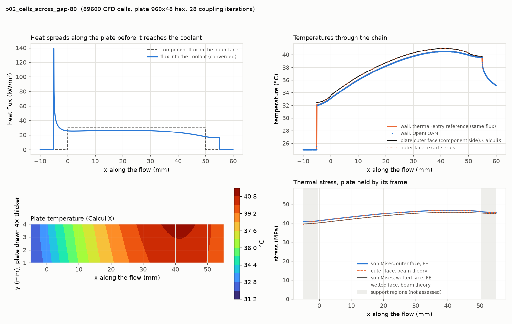

# Cold plate, full thermal chain

[Portfolio index](../PORTFOLIO.md) · Thermal and fluids

| | |
|---|---|
| **Answer** | Yes, on all three counts. The component face peaks at 40.99 °C (limit 45 °C), the coolant warms by 7.20 K (limit 10 K), and the thermal stress in the plate peaks at 46.8 MPa (limit 60 MPa). Mesh uncertainty 0.035 % or less on every answer. |
| **Discipline** | Heat transfer, fluids, structures (coupled) |
| **Tools** | OpenFOAM (coolant CFD), CalculiX (plate conduction and thermal stress), Python (coupling loop) |
| **Methods** | Partitioned conjugate heat transfer (Robin-Neumann coupling with Aitken relaxation), thermal-entry reference, exact Fourier-series plate reference, plane-strain beam theory, energy balance at every handoff, mesh refinement of the whole chain |

## The question

Electronics on both faces of an aluminium cold plate put 30 kW/m² into it over a 50 mm footprint. The 3 mm 6061-T6 plate sits on a 1 mm water channel (25 °C inlet, 0.1 m/s) and is bolted at both ends to a rigid frame, assembled at 20 °C. Does the component face stay at or under 45 °C? Does the coolant warm by no more than 10 K? Does the thermal stress in the plate stay under 60 MPa?

## The answer

- **Component face 40.99 °C, 4.0 K under the limit.** The hottest point is inside the footprint, at 41 mm, not at its downstream end. The plate spreads heat sideways, so 16.8 % of it reaches the coolant outside the footprint.
- **Coolant rise 7.20 K, 2.8 K under the limit.** This one is fixed by the energy balance alone, and the CFD matches it to 2 × 10⁻¹².
- **Thermal stress 46.8 MPa, 22 % under the limit.** The plate is held at both ends, so it can't expand. That puts it in compression at -44 MPa, with bending on top.

## How it works

Three solvers run in a chain, and each stage is checked before the next one uses its result:

1. **Coolant (OpenFOAM).** Laminar flow in the 1 mm gap, then the coolant temperature with the wall heat flux the plate delivers.
2. **Plate conduction (CalculiX).** The plate takes the coolant's wall temperature as a film condition. The two are iterated until the interface temperature and heat flux agree (Robin-Neumann coupling, accelerated with Aitken relaxation, 26 to 28 passes).
3. **Thermal stress (CalculiX).** Plane strain on the converged plate temperatures, ends clamped.

A single command runs the whole chain at three mesh densities (40, 60 and 80 cells across the gap, with the plate refined to match).

## How I know it's right

- **The CFD against an independent solution.** The wall temperature matches the thermal-entry solution with the same flux profile to 0.08 %, and the energy balance is exact to 2 × 10⁻¹².
- **The plate against an exact series.** Every node is within 0.012 % of the coolant rise of the exact 2D Fourier-series solution, using the film data the plate actually had.
- **The stress against beam theory, plus an exact case.** A uniform temperature rise through the same deck and solver gives the exact restrained stress to 5 × 10⁻⁸. The peak stress matches beam theory to 0.06 %.
- **Nothing is lost at the handoffs.** The heat that crosses each interface balances to 4 × 10⁻⁹ or better.
- **Mesh refinement of the whole chain.** GCI is 0.004 % on the component face rise, 0.035 % on the stress, and 3 × 10⁻¹² on the coolant rise. The chain is refined together, not one stage at a time.
- **Validity checks.** The flow is laminar (Re 224), the reference's neglect of axial conduction holds (Pe 1370), the plate stays elastic (17 % of yield) and far from buckling.

## What the checks caught

- **The reference was being checked where it doesn't apply.** In the first mesh study the CFD-versus-reference error peaked at 5.5, 2.8 and 6.3 % and didn't shrink with refinement. It sat exactly at the plate edges, where the wall flux steps from zero and the wall temperature goes like x^(1/3). Neither the reference nor any mesh resolves that point. Two gap heights away from each edge the error converged at second order (0.27, 0.13 and 0.08 %). The check now excludes that band and keeps its 1 % tolerance.
- **The coupling loop was converging, just slowly.** It hit its 25-pass limit at the finer meshes. The rate is set by the coolant's local heat transfer at the plate's leading edge, not by the plate's Biot number, as I had predicted. Each pass was slow because OpenFOAM solved every inner temperature system to machine precision. Loosening that inner tolerance changed the answers by under 5 × 10⁻⁷ and made each pass three times faster. With 60 passes allowed, the loop now converges in 26 to 28.
- **Smaller finds on the way.** The CFD undershot below the inlet temperature next to the plate's leading edge, fixed with a cell-limited gradient. Heat leaked back out through the inlet, fixed by extending the channel past each plate end. Aitken steps amplified rounding in the total heat, fixed by rescaling after each step. And CalculiX's nodal stresses were 4 × 10⁻⁵ low even in a uniform field, so the stress stage extrapolates the integration-point stresses itself.

## Limits

- 2D: a slice through the plate and channel; no side walls or manifolds. Checked against a fuller model, as the
  portfolio's standing rule asks where a margin is thin: study 11 part 2 solved this passage with its side walls
  and the plate as a conducting sheet, and for a 3 mm aluminium plate the wall's hot spot near the side walls is
  0.19 K above the 2D value. Against this study's 4.0 K margin on the component face that does not need a 3D
  model.
- Constant fluid properties; laminar flow.
- The plate ends are rigidly clamped; a real bolted end has some give, which would lower the stress.
- Synthetic limits; no test data.

## Evidence

- [mesh study, 40 / 60 / 80 cells](../runs/20261121-094235_cold_plate_mesh_r1/report.md) (verification PASS), the [first mesh study](../runs/20261120-224255_cold_plate_mesh/report.md) whose two failures are described above, and the [solver-settings check](../runs/20261121-093029_cold_plate_solver_check/report.md)
- case files: `cases/cold_plate_mesh.toml`, `cases/cold_plate_solver_check.toml`, `cases/cold_plate_mesh_r1.toml` (predictions, smoke-test findings and results in the headers)
- code: `studies/cold_plate.py`, `models/cfd/cold_plate_openfoam.py`, `models/cfd/run_cold_plate.sh`, `models/thermal/cold_plate_ccx.py`, `validation/graetz.py`, `validation/plate_conduction.py`, `validation/thermal_stress.py`
