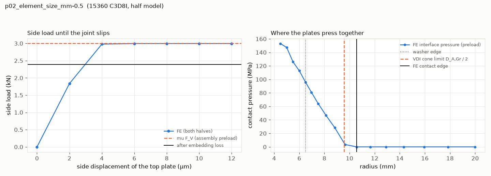

# Bolted joint: slip and opening, with friction contact

[Portfolio index](../PORTFOLIO.md) · Structures and vibration

| | |
|---|---|
| **Answer** | No. After the joint settles it slips at 2.39 kN, 4.4 % short of the 2.5 kN it must carry. A preload of about 15.6 kN instead of 15 kN fixes it, still within the bolt's capacity. It won't open below 13.1 kN, well above the 10 kN requirement. Mesh uncertainty 0.01 %. |
| **Discipline** | Structures, joints |
| **Tools** | CalculiX (surface-to-surface contact with Coulomb friction), Python |
| **Methods** | Nonlinear friction contact (clamp, then slide to gross slip), VDI 2230 joint diagram (bolt compliance, embedding loss, load factor), rigid-limit extrapolation for an exact friction check, mesh refinement |

## The question

Two 6 mm steel plates are clamped by an M8 class 8.8 bolt tightened to 15 kN. The joint must carry a 2 kN side load by friction alone, with a safety factor of 1.25 against slip, so 2.5 kN. It must also not open under a 10 kN axial separating load. Both must hold after the joint settles. Does it, and if not, what fixes it?

## The answer

- **It slips too early.** Clamped at 15 kN the interface carries 3.0 kN of friction, but settling (9.5 µm of embedding) costs 3.03 kN of clamp force. That leaves 11.97 kN and a slip load of 2.39 kN, 4.4 % short of the requirement.
- **The fix is a preload of about 15.6 kN.** That keeps 12.5 kN of clamp force after settling. It loads the bolt to 71 % of its proof stress, within its capacity.
- **It doesn't open.** The opening load after settling is 13.1 kN against the 10 kN requirement.

## How it works

The finite element model is half the joint (a symmetry plane along the load). Two plates are meshed with structured hexes and pressed together by the clamp force on the washer areas. A second step pushes the top plate sideways until the whole interface slides. The FE measures what the hand method can only estimate: how stiff the plates are in the clamp, where they touch, and the friction the interface carries. The VDI 2230 joint diagram combines those with the bolt's own compliance and the settling loss to give both design loads.

## How I know it's right

- **The friction check is exact in the limit where the reference is exact.** Each mesh level is solved twice, once at the real stiffness and once with the plates 100 times stiffer. Extrapolating the slip load to a rigid interface recovers μ × clamp force to 1 × 10⁻⁷ or better at every mesh.
- **Equilibrium:** the clamp forces balance and the side forces on the two plates cancel, to round-off.
- **The plate stiffness and the contact zone against VDI 2230's pressure cone.** These are model form, since the cone is an approximation: at the finest mesh, plate compliance within 18 % and contact diameter within 11 % (19 % at 1 mm: the contact edge sharpens with refinement).
- **Mesh refinement at 1.0, 0.75 and 0.5 mm:** GCI 0.01 % on the design slip load and 0.035 % on the opening load.
- **Validity:** the bolt stays within its proof stress, the plates slide less than the hole clearance (the shank isn't modelled, so it must not touch), and the pressure cone fits inside the plates.

## What the checks caught

- **A 0.13 % shortfall that wasn't a mistake, but wasn't what the reference assumed either.** The slip load came out 1.3 × 10⁻³ under μ × clamp force on every mesh, against a 10⁻³ tolerance. Several suspects were ruled out:
  - **The friction law.** At every contact point the shear equals μ times the pressure, along the load.
  - **The applied load.** Replacing the clamp pressure with fixed nodal forces changed nothing.
  - **The solver's friction.** Two exact sliding-block cases came out exact.

  The decisive test was scaling the plates' stiffness: the shortfall fell exactly in proportion to 1/E (1.3 × 10⁻³, 1.3 × 10⁻⁴, 1.3 × 10⁻⁵). CalculiX evaluates contact on the deformed surfaces, and under the side load the interface tilts by about the strain. The hand formula assumes a rigid, flat interface. So the exact check now uses the rigid-limit extrapolation, and the 0.13 % deformable value is reported as model form. Raising the tolerance would have hidden all of this.
- **A mesh level that stalled.** The contact solve at 0.7 mm hit a four-hour timeout while 0.5 mm finished in 22 minutes. It was a convergence stall on that particular mesh, not cost; 0.75 mm replaced it.

## The joint as built

The joint is delivered as a detailed CadQuery assembly ([`models/cad/bolted_lap.py`](../models/cad/bolted_lap.py),
[STEP](cad/bolted_lap_m8.step)): two 6 mm steel strips lapped 40 mm, the 9 mm hole, an M8 x 25 hex bolt and its nut
(ISO 4017 and 4032 proportions, threads and chamfers not drawn), with the study's 12 mm grip and no washers. Every
part matches a hand volume to 10⁻⁹ and nothing overlaps. The strips' width and length are synthetic; the bolt's
bending in a real lap joint (which this model's axisymmetric slice cannot show) was judged earlier not to change the
verdicts.

## Limits

- Static side load; no cyclic loading, fretting or self-loosening.
- The bolt is represented by its clamp force on the washer areas; the shank and threads aren't modelled.
- The friction coefficient (0.2) and the embedding amount (9.5 µm) are synthetic and dominate the answer: ±20 % on μ moves the slip load by the same 20 %.
- No test data.

## Evidence

- [mesh study with rigid-limit checks](../runs/20261121-110554_bolted_joint_mesh_r1/report.md) (verification PASS) and the [first mesh study](../runs/20261120-235041_bolted_joint_mesh/report.md) whose slip check failed
- case files: `cases/bolted_joint_mesh.toml` (predictions, smoke-test findings and the investigation), `cases/bolted_joint_mesh_r1.toml` (the cause and the revised checks)
- code: `studies/bolted_joint.py`, `models/fea/bolted_joint_ccx.py`, `validation/bolted_joint.py`
