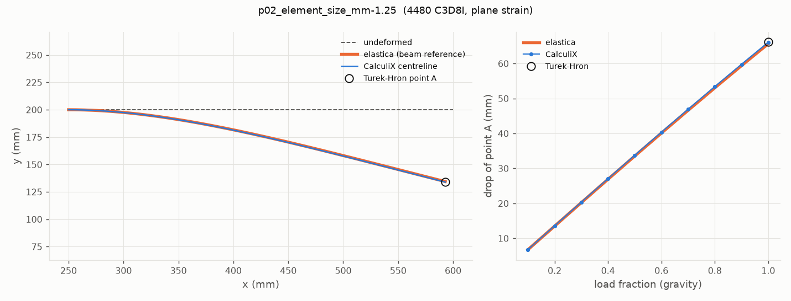

# Flexible flag behind a cylinder: fluid-structure interaction, built one verified stage at a time

[Portfolio index](../PORTFOLIO.md) · Fluids and structures (coupled)

> **Draft, in progress (2026-11-21).** The solid and fluid stages are being verified; the coupled stage
> waits on installing preCICE. Numbers marked *pending* are filled in as their runs finish.

| | |
|---|---|
| **Answer so far** | Both single-physics halves reproduce the published Turek-Hron benchmark before any coupling. Solid, static (CSM1, CSM2): the tip displacement extrapolates to within 0.015 % of the published values. Fluid (CFD1): drag within 0.07 %, lift within 0.6 % on every mesh. Solid, dynamic (CSM3): frequency 1.095 Hz, 0.06 % from the published values. Fluid at Re 100 (CFD2): drag within 0.014 % when extrapolated, lift within 0.7 % on the finer meshes. Coupled runs (FSI1 to FSI3): *pending*. |
| **Discipline** | Structures (large deflection, dynamics), fluids, fluid-structure interaction |
| **Tools** | CalculiX (solid), OpenFOAM 14 with Gmsh (fluid), Python; preCICE with OpenFOAM v2512 for the coupled stage (*pending*) |
| **Methods** | Geometrically nonlinear static and dynamic FE, a large-deflection elastica as an independent reference, steady laminar CFD, mesh and time-step refinement with GCI, published benchmark values as the acceptance requirement |

## The question

A flexible flag sits in the wake of a cylinder in a channel. The flow bends it and the flag's motion
changes the flow. Turek and Hron (2006) published the standard benchmark for this, with reference values
for each half on its own (the CSM and CFD tests) and for the coupled problem (FSI1 to FSI3).

A coupled simulation that doesn't match is hard to debug: the error could be in the fluid, the solid or
the coupling. So the plan is the one the cold-plate chain used. Each participant has to reproduce its own
published results first, and only then are they coupled.

## The answers so far

- **Solid, static (CSM1, CSM2).** The flag hangs under gravity. Point A at its tip drops 66.08 mm in CSM1
  on the finest mesh, extrapolating to 66.108 mm against the published 66.102. The stiffer CSM2 flag
  matches to the same 0.01 %.
- **Fluid (CFD1, Re 20).** Drag 14.300 N/m on 208,000 cells, extrapolating to 14.303 against the
  published 14.293, with a 0.02 % mesh uncertainty. Lift lands within 0.6 % of the published 1.119 on
  every mesh, but it scatters between meshes (see below).
- **Solid, dynamic (CSM3).** Released from rest, the flag swings at 1.095 Hz, against published values of
  1.096 to 1.100. Amplitude and mean: *pending, final run in progress*.
- **Fluid at Re 100 (CFD2).** Drag converges to 136.719 N/m against the published 136.700 (0.014 %, mesh
  uncertainty 0.11 %). Lift is 10.61 on the finest mesh, 0.7 % from the published 10.53, with the same
  mesh-to-mesh scatter as CFD1.
- **The coupled runs**: *pending*.

## How it works

- **Solid.** A structured hex mesh of the flag, clamped on the cylinder arc. It's one element thick and
  held in z, which makes it plane strain. CalculiX solves it geometrically nonlinear (the flag's tip drops
  by a fifth of its length) with the benchmark's St. Venant-Kirchhoff material.
- **Fluid.** Gmsh meshes the channel round the cylinder and flag. `gmshToFoam` converts it, and OpenFOAM
  solves steady laminar flow with the benchmark's parabolic inflow. Forces are integrated on the body.
- **Coupled (pending).** preCICE couples OpenFOAM v2512 and CalculiX (its official adapters); the version
  of OpenFOAM the rest of this portfolio uses isn't supported by the adapter.

## How I know it's right

- **An independent reference for the solid.** A large-deflection elastica (a nonlinear beam solved
  separately in Python) agrees with the FE to 0.7 % for the tip drop and 1 % for the sideways pull-in.
  That remaining gap is what a beam theory leaves out: the flag's root sits on the cylinder arc and flexes
  a little.
- **Exact equilibrium.** The clamp reaction equals the flag's weight once the share CalculiX applies
  directly to the clamped nodes is added back (that share is computed exactly from the mesh).
- **The time integrator on its own.** A companion run at a thousandth of the gravity swings at the
  linear natural frequency to 0.1 %.
- **The inflow, face by face.** The inlet velocity matches the benchmark's parabola at every face to
  6 × 10⁻⁸, and mass is conserved to 10⁻¹³.
- **Mesh and time-step refinement**, with a GCI on every requirement, and the benchmark values as the
  pass criterion.

## What the checks caught

- **The benchmark doesn't say plane strain or plane stress.** The elastica settled it before any FE run:
  plane strain matches to 0.7 %, plane stress misses by 17 %.
- **A standard inflow condition that isn't the profile it claims.** OpenFOAM's parabolic inlet was 1.6 %
  low at mid-channel and 1.5 % high near the walls. It scales the profile by the largest face distance on
  the inlet, not the true half-height. My first explanation (the cylinder counted as a wall) was tested
  and was wrong. The inlet now sets the benchmark's exact parabola, checked face by face.
- **The time-stepping scheme adds energy to a large swing.** The trapezoidal rule only conserves energy
  for linear problems. At a 0.01 s step the flag climbed 1.9 mm higher each swing and its frequency rose
  by 1.3 %. The drift falls about four times per halving of the step, and the checks reject the coarse
  steps. The published rows themselves differ by up to 1.8 % between their time steps.
- **My own frequency measurement was being fooled.** The sudden release also excites the flag's second
  mode, which never decays without damping and shifts the troughs. A synthetic two-mode test showed the
  trough finder reading 1.71 Hz for 1.07. Cycles are now counted from mid-level crossings, and the
  frequency became steady across time steps at 1.095 Hz.
- **Lift scatters with the mesh.** Gmsh regenerates the mesh at each size rather than refining it, and
  lift is a small difference of large pressure forces, so it scatters by about ±0.6 % from mesh to mesh.
  One CFD1 mesh study verified it and the next withheld it; CFD2 shows the same. The fix (nested meshes, or measuring that scatter
  first) is the next revision; the tolerance stays.
- **Smaller finds.** CalculiX uses one print frequency for every request in a step, so one request
  silently thinned another's output. The `.dat` file's seven digits limit how well equilibrium can close.

## Limits

- 2D, as the benchmark defines it.
- The fluid stages are steady; the coupled FSI2 and FSI3 cases are periodic and will need a transient
  fluid solver.
- The published reference values are themselves numerical, and their rows are not all labelled with the
  time step they used.

## Evidence

- solid, static: [CSM1 mesh study](../runs/20261121-131111_flag_csm1_mesh/report.md),
  [CSM2 mesh study](../runs/20261121-131133_flag_csm2_mesh/report.md) (both verification PASS)
- solid, dynamic: CSM3 time-step study (first run kept as evidence of the energy drift; final run
  *pending*)
- fluid: [CFD1 first mesh study](../runs/20261121-140245_turek_hron_cfd1_mesh/report.md) (lift verified), [CFD1 refined](../runs/20261121-140657_turek_hron_cfd1_mesh_r1/report.md) (drag verified), [CFD2](../runs/20261121-151947_turek_hron_cfd2_mesh/report.md) (drag verified, lift withheld on mesh noise)
- case files: `cases/flag_csm1_mesh.toml`, `cases/flag_csm2_mesh.toml`, `cases/flag_csm3_dt.toml`,
  `cases/flag_csm3_dt_r1.toml`, `cases/turek_hron_cfd1_mesh.toml`, `cases/turek_hron_cfd1_mesh_r1.toml`,
  `cases/turek_hron_cfd2_mesh.toml` (predictions, smoke-test findings and results in the headers)
- code: `models/fea/flag_ccx.py`, `studies/flag_csm.py`, `validation/elastica.py`,
  `models/cfd/turek_hron_openfoam.py`, `models/cfd/run_turek_hron.sh`, `studies/turek_hron_cfd.py`
