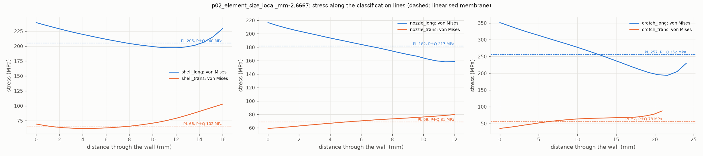

# Pressure vessel nozzle: design by analysis against design by rule

[Portfolio index](../PORTFOLIO.md) · Structures and vibration

| | |
|---|---|
| **Answer** | The nozzle wall the elastic analysis asks for depends on where the classification line is drawn. With the lines at the weld-fillet toes, the 12 mm nozzle passes with no pad (local membrane stress 205.1 MPa against 207) and about 11.7 mm would do. With the line through the crotch corner, the usual alternative, 12 mm fails by 24 % (256.7 MPa) and the wall needs about 20 mm. A simplified pressure-area rule sits between, at about 16 mm. Recommendation for review: agree the placement before choosing the wall. If the crotch line applies, use about 21 mm or a pad. A limit-load analysis would settle the question without a placement judgement. The hemispherical head can be about 6.5 mm: its own membrane stress governs, not the head-to-shell junction. |
| **Discipline** | Structures, pressure equipment |
| **Tools** | CadQuery (geometry), Gmsh (quadratic tetrahedra), CalculiX (3D and axisymmetric), Python |
| **Methods** | Elastic stress analysis with stress linearisation on classification lines (the method of ASME BPVC Section VIII Division 2, Part 5), a placement sensitivity (toe lines moved out, lines through the crotch), exact Lamé cylinder, thick-sphere and pressure-resultant checks, thin-shell discontinuity theory at the head junction, a simplified pressure-area balance as the design-by-rule comparison, mesh refinement with a measured mesh-noise floor, thickness sweeps |

## The question

A 200 mm bore radial nozzle with a 12 mm wall goes into a 1000 mm bore cylindrical shell with a 16 mm wall, at 3.5 MPa internal pressure. Can it go in without a reinforcing pad, and how thin can the hemispherical head on the same shell be? The limits follow the structure of an elastic design-by-analysis check, with a synthetic allowable S = 138 MPa (of the order of carbon-steel plate values, not taken from a code table):

- general primary membrane stress away from discontinuities, Pm ≤ S;
- local primary membrane stress at a junction, PL ≤ 1.5 S = 207 MPa;
- primary plus secondary stress at a junction, P + Q ≤ 3 S = 414 MPa.

## The answer

- **The shell away from the nozzle is comfortable:** Pm 96.2 MPa against 138, 30 % margin.
- **At the nozzle, the verdict depends on the classification line:**

  | Line | PL at 12 mm | Verdict | Wall where PL = 207 MPa |
  |---|---|---|---|
  | At the weld-fillet toes (shell side, governing) | 205.1 MPa | passes, 0.9 % margin | about 11.7 mm |
  | Through the crotch corner (sharp inner corner to the fillet) | 256.7 MPa | fails, 24 % over | about 20.1 mm |
  | Simplified pressure-area rule (mean membrane against S) | 153 MPa against 138 | fails | about 16 mm |

  Both FE verdicts are verified (mesh uncertainty 0.03 % and 0.01 %). The difference is the analyst's judgement, not the mesh.
- **Moving the toe line matters much less.** A weld size (10 mm) further out, PL is 185.6 MPa, 10 % lower. Drawing the line through the corner rather than beside it is what changes the verdict.
- **Primary plus secondary is not close** on any line: 240 MPa at the toe and 352 through the crotch, against 414.
- **The head can be thin.** With a hemispherical head on the same shell (flush bore, a plain step outside), the head's own membrane stress governs down to about 6.4 mm (135.5 MPa at 6.5 mm against 138). The junction stays well inside its limits: at 6.5 mm, PL is 152.6 MPa (limit 207) and P + Q is 210 MPa (limit 414). The thin-sphere rule gives 6.34 mm.

## How it works

**Nozzle.** The geometry is a quarter of the vessel, cut on the two planes through the nozzle axis. The shell runs 1000 mm each side of the nozzle (11 √(Rt)) and the nozzle stands 350 mm (7 √(rt)), far enough that both ends are back to plain cylinders. A 10 mm outer weld fillet is modelled; the inner corner is left sharp. The closed-end thrusts are applied as tractions on the cut ends, so far from the nozzle the shell is exactly the Lamé closed-end cylinder. Quadratic tetrahedra are refined at the junction.

The stresses are linearised along classification lines through the wall. Linearisation splits the through-wall stress into a membrane part (the average) and a bending part (the linear variation); the peak that remains is what a sharp corner produces and is excluded from these limits by design. There are three sets of lines:

- **at the fillet toes,** in both symmetry planes, on the shell side and the nozzle side;
- **through the crotch,** from the sharp inner corner towards the fillet's centre, ending on the fillet (24 mm long in the plane along the vessel);
- **on the back of the shell,** far from the nozzle.

**Head.** A separate axisymmetric model: the same shell, closed by a hemispherical head with the same bore, from the vessel's mid-length plane to the apex. The mesh is a structured quadratic quad mesh written directly in Python, so every classification line falls on element boundaries.

## How I know it's right

- **Equilibrium is exact:** at the nozzle, the pressure resultants balance the reactions on both symmetry planes to 3 × 10⁻⁷, and the single axial support carries 8 × 10⁻⁷ of the nozzle thrust (a closed vessel balances itself). At the head, the axial reaction matches p π Ri² to 6 × 10⁻⁸.
- **The far fields are exact:** the far shell is the Lamé cylinder (membrane within 2 to 3 × 10⁻⁴; Pm within 0.03 %), and the far head is the thick-wall sphere to 6 × 10⁻⁶.
- **The head junction against shell theory:** with equal thicknesses, thin-shell discontinuity theory gives the largest bending in the shell, 16.26 MPa at 55.1 mm from the junction, and a junction hoop membrane of 81.60 MPa. The model gives 16.01 MPa at 55.6 mm and 81.57 MPa on every mesh. The 1.5 % on the bending is the shell theory's own approximation (of order t / R, about 3 %).
- **Mesh refinement:** at 6, 4 and 2.67 mm, PL is 205.04 / 205.13 / 205.13 MPa at the toe and 256.64 / 256.63 / 256.67 MPa through the crotch. The linearised membrane converges even where the line starts at the sharp corner. At the head (2, 1, 0.5 mm), the uncertainty is under 10⁻⁵.
- **A second route to the same decision:** the simplified pressure-area rule, computed independently from the geometry, also says this nozzle is near its limit. It lands between the two placements.

## What the checks caught

- **A pass that depended on where the line was drawn.** The first version reported "passes, narrowly" from the toe lines and listed the placement as a judgement call "not yet quantified". Quantifying it reversed the verdict: through the crotch, the same model gives 25 % more membrane stress. The 14 mm recommendation built on the toe-line result was withdrawn, because it fails on the crotch line.
- **A convergence check fooled by a regenerated mesh.** The crotch values moved by under 0.02 % between meshes, but the differences grew, so the GCI gave no estimate. Five meshes at the same nominal size scattered by 0.08 to 0.3 %: Gmsh rebuilds the whole tetrahedral mesh at each size, so part of every difference is which mesh came out. That scatter was measured, declared as the noise floor before a rerun, and the crotch result became a verified fail. One check stays unverified: the toe P + Q, whose spread (0.35 %) is above the floor against a 42 % margin.
- **A maximum sampled at different places on each mesh.** At the thin head, P + Q is largest a few millimetres from the junction. The classification lines are one element length apart, so each mesh sampled the peak at a different point, and the convergence check read the result as divergent on nested meshes. The fix was to locate the peak between lines with a parabola. The fit settled PL (uncertainty about 10⁻⁶). P + Q still spreads 1.5 % (171.8 to 174.4 MPa), because on the coarser meshes the fit uses the line that ends at the step's sharp corner. With a 58 % margin it is reported as unverified.
- **A prediction that was too pessimistic, in the right direction.** I expected the mesh uncertainty on the toe-line PL to be about 3 %, larger than the 0.9 % margin. It converged to 0.03 %, so the toe-line case did decide its requirement.
- **Two tool limits.** The classification-line points on curved surfaces sit up to h² / 8R outside the straight-sided elements, so the inside-the-mesh tolerance follows the smallest radius each line ends on (10 mm at the fillet). CalculiX rejected a node written as a 22-character number (r = 3 × 10⁻¹⁴ at the axis), so every number is now written with 12 significant digits, and points on an axis are set to exactly zero.

## Limits

- Pressure only: no nozzle loads from piping, no thermal gradients, no fatigue screening. Piping loads would add directly to the junction stresses.
- The allowable and the pressure-area rule are synthetic or simplified, not a code-stamped calculation. The analysis method follows the structure of Part 5; the classification-line placement is a judgement call, now quantified, which a limit-load or elastic-plastic analysis (Part 5's other routes) would remove.
- The inner corner is sharp and the weld is idealised; a fabricated corner radius would lower the crotch values somewhat.
- The transverse-plane toe lines sit about 2 mm outboard of the true fillet toe; the offset sweep shows this moves values that carry a third of the limit by about 2 %.
- The head joins the shell with a plain step and no taper; a taper (the usual fabrication detail) would lower the junction stresses further.
- No test data.

## Evidence

- Nozzle, toe lines: [mesh study](../runs/20261122-102842_pv_nozzle_mesh/report.md) and [thickness sweep](../runs/20261122-103521_pv_nozzle_thickness/report.md)
- Nozzle, placement: [crotch mesh study with the noise floor](../runs/20261122-201431_pv_nozzle_crotch_mesh_r1/report.md) (first run [here](../runs/20261122-195433_pv_nozzle_crotch_mesh/report.md)), [mesh noise at one size](../runs/20261122-200428_pv_nozzle_crotch_noise/report.md), [crotch PL against the wall](../runs/20261122-200149_pv_nozzle_crotch_thickness/report.md), [toe lines moved out](../runs/20261122-201050_pv_nozzle_scl_offset/report.md)
- Head junction: [equal thickness against theory](../runs/20261122-201907_vh_junction_mesh_r1/report.md), [8 mm head, mesh study](../runs/20261122-202007_vh_thin_head_mesh_r1/report.md), [head thickness sweep](../runs/20261122-202049_vh_head_thickness_r1/report.md)
- Case files: `cases/pv_nozzle_*.toml` and `cases/vh_*.toml` (predictions written before each run, then the results scored against them)
- Code: `studies/pressure_vessel.py`, `models/fea/pressure_vessel.py`, `studies/vessel_head.py`, `models/fea/vessel_head_axi.py`, `harness/linearize.py`
