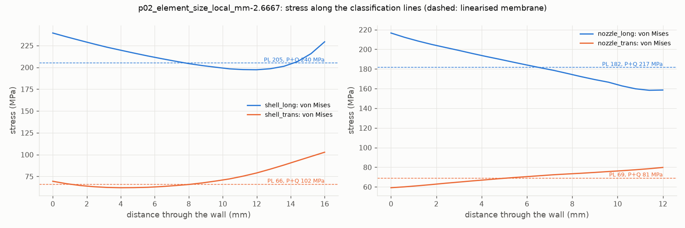
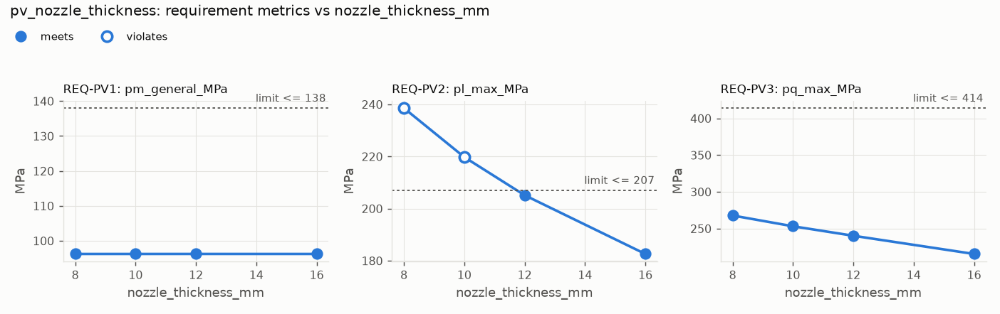

# Pressure vessel nozzle: design by analysis against design by rule

[Portfolio index](../PORTFOLIO.md) · Structures and vibration

| | |
|---|---|
| **Answer** | By elastic stress analysis the 12 mm nozzle needs no reinforcing pad, but only just: the local membrane stress at the junction is 205.1 MPa against a 207 MPa limit (0.9 % margin, mesh uncertainty 0.03 %). The wall needs about 11.7 mm. A simplified pressure-area rule asks for about 16 mm. Recommendation for review: 14 mm, about 6 % margin without the rule's full thickness. |
| **Discipline** | Structures, pressure equipment |
| **Tools** | CadQuery (geometry), Gmsh (quadratic tetrahedra), CalculiX, Python |
| **Methods** | Elastic stress analysis with stress linearisation on classification lines (the method of ASME BPVC Section VIII Division 2, Part 5), exact Lamé cylinder and pressure-resultant checks, a simplified pressure-area balance as the design-by-rule comparison, mesh refinement, a thickness sweep |

## The question

A 200 mm bore radial nozzle with a 12 mm wall goes into a 1000 mm bore cylindrical shell with a 16 mm wall, at 3.5 MPa internal pressure. Can it go in without a reinforcing pad? The limits follow the structure of an elastic design-by-analysis check, with a synthetic allowable S = 138 MPa (of the order of carbon-steel plate values, not taken from a code table):

- general primary membrane stress away from the nozzle, Pm ≤ S;
- local primary membrane stress at the junction, PL ≤ 1.5 S = 207 MPa;
- primary plus secondary stress at the junction, P + Q ≤ 3 S = 414 MPa.

## The answer

- **The shell away from the nozzle is comfortable:** Pm 96.2 MPa against 138, 30 % margin.
- **The junction passes, narrowly:** PL 205.1 MPa against 207 on the governing line (the shell side of the junction, in the plane along the vessel). The margin is real for this model (more than 30 times the mesh uncertainty) but thin against the judgement calls behind it: where the classification lines sit, the weld size, and the sharp inner corner.
- **Primary plus secondary is not close:** 240 MPa against 414.
- **Thickness:** PL is 238.6 / 219.8 / 205.1 / 182.6 MPa at 8 / 10 / 12 / 16 mm. It fails at 8 and 10 mm and passes from 12 mm; it reaches the limit at about 11.7 mm.
- **By rule:** a simplified pressure-area balance gives a mean membrane stress of 153 MPa in the reinforcement zone at 12 mm against S = 138, and needs about 16 mm. The analysis saves about a quarter of the wall. The 14 mm recommendation splits the difference: about 6 % margin on PL without the rule's full thickness.

## How it works

The geometry is a quarter of the vessel, cut on the two planes through the nozzle axis. The shell runs 1000 mm each side of the nozzle (11 √(Rt)) and the nozzle stands 350 mm (7 √(rt)), far enough that both ends are back to plain cylinders. A 10 mm outer weld fillet is modelled; the inner corner is left sharp. The closed-end thrusts are applied as tractions on the cut ends, so far from the nozzle the shell is exactly the Lamé closed-end cylinder. Quadratic tetrahedra are refined at the junction.

The stresses are linearised along classification lines through the wall at the fillet toes, in both symmetry planes, on the shell side and the nozzle side, plus one on the back of the shell. Linearisation splits the through-wall stress into a membrane part (the average) and a bending part (the linear variation); the peak that remains is what a sharp corner produces and is excluded from these limits by design.

## How I know it's right

- **Equilibrium is exact:** the pressure resultants balance the reactions on both symmetry planes to 3 × 10⁻⁷, and the single axial support carries 8 × 10⁻⁷ of the nozzle thrust (a closed vessel balances itself).
- **The far shell is the exact Lamé cylinder:** membrane stress within 2 to 3 × 10⁻⁴, and Pm within 0.03 % of the exact linearised value.
- **Mesh refinement at 6, 4 and 2.67 mm:** PL 205.04 / 205.13 / 205.13 MPa, uncertainty 0.03 %. The linearised membrane converges even though the sharp inner corner does not.
- **A second route to the same decision:** the simplified pressure-area rule, computed independently from the geometry, points the same way (this nozzle is near its limit) and is more conservative, as a rule should be.

## What the checks caught

- **A prediction that was too pessimistic, in the right direction.** I expected the mesh uncertainty on PL to be about 3 %, larger than the 1 % margin, so the case would not decide the requirement. The linearised values converged to 0.03 %, so it did decide it: a verified pass with a thin margin. That changed the recommendation from "can't tell, thicken it" to "passes, but here is how fast it goes".
- **P + Q that moved the wrong way.** The primary-plus-secondary stress changed by 0.08 % and then 0.27 % with refinement, which a convergence check rightly calls divergent: the surface bending picks up the sharp corner's local field. The spread is 0.35 % against a 42 % margin, so the verdict stands, but it is reported as unverified rather than as a clean pass.
- **A tolerance that was wrong on paper.** The classification-line sample points on curved surfaces sit 0.1 % outside the straight-sided elements, so a 10⁻⁶ inside-the-mesh check failed in the smoke test. The tolerance became 10⁻², with the reason in the case file, before any evidence run.

## Limits

- Pressure only: no nozzle loads from piping, no thermal gradients, no fatigue screening. Piping loads would add directly to the junction stresses and could remove the thin margin.
- The allowable and the pressure-area rule are synthetic or simplified, not a code-stamped calculation. The analysis method follows the structure of Part 5; the classification-line placement is a judgement call, and its sensitivity is not yet quantified.
- The inner corner is sharp and the weld is idealised; both affect the peak stress, not the linearised values on the toe lines.
- No test data.

## Evidence

- [mesh study](../runs/20261122-102842_pv_nozzle_mesh/report.md) (one run-level classification flagged, on P + Q) and [thickness sweep](../runs/20261122-103521_pv_nozzle_thickness/report.md) (verification PASS)
- case files: `cases/pv_nozzle_mesh.toml` and `cases/pv_nozzle_thickness.toml` (predictions written before each run, then the results scored against them)
- code: `studies/pressure_vessel.py`, `models/fea/pressure_vessel.py`, `harness/linearize.py`
