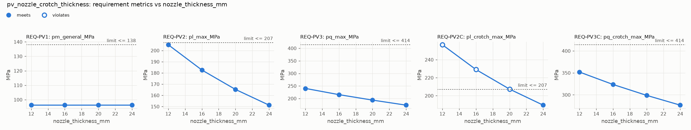
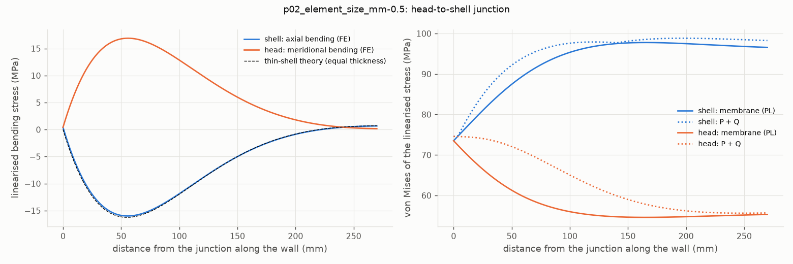
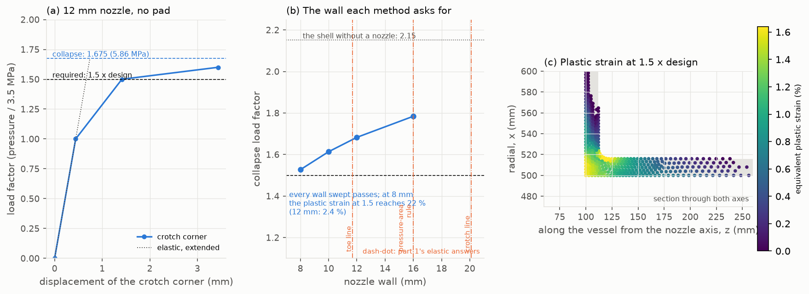

# Pressure vessel nozzle: design by analysis against design by rule, settled by limit load

[Portfolio index](../PORTFOLIO.md) · Structures and vibration

| | |
|---|---|
| **Answer** | The nozzle wall the elastic analysis asks for depends on where the classification line is drawn. With the lines at the weld-fillet toes, the 12 mm nozzle passes with no pad (local membrane stress 205.1 MPa against 207) and about 11.7 mm would do. With the line through the crotch corner, the usual alternative, 12 mm fails by 24 % (256.7 MPa) and the wall needs about 20 mm. A simplified pressure-area rule sits between, at about 16 mm. Recommendation for review: judge the opening by the crotch line, which sees the membrane concentration at the hole's edge that PL is meant to limit; the toe line sits 22 mm beyond it. That means about 21 mm, or a pad. A limit-load analysis would settle the question without a placement judgement. The hemispherical head can be about 6.5 mm: its own membrane stress governs, not the head-to-shell junction. **Part 2 settles it:** by limit load, which needs no classification line, the 12 mm nozzle carries the required 1.5 times the design pressure **without a pad**: it collapses at 1.66-1.68 times (5.8-5.9 MPa), 11 % over the requirement. Recommendation: 12 mm, no pad; part 1's 21 mm-or-a-pad recommendation is withdrawn. Detailed CAD of the nozzle as built (and of the padded alternative), STEP. |
| **Discipline** | Structures, pressure equipment |
| **Tools** | CadQuery (geometry), Gmsh (quadratic tetrahedra), CalculiX (3D and axisymmetric), Python; part 2: CalculiX elastic-perfectly plastic, CadQuery assemblies (STEP) |
| **Methods** | Elastic stress analysis with stress linearisation on classification lines (the method of ASME BPVC Section VIII Division 2, Part 5), a placement sensitivity (toe lines moved out, lines through the crotch), exact Lamé cylinder, thick-sphere and pressure-resultant checks, thin-shell discontinuity theory at the head junction, a simplified pressure-area balance as the design-by-rule comparison, mesh refinement with a measured mesh-noise floor, thickness sweeps; part 2: limit-load analysis (the method of Part 5.2.3: elastic-perfectly plastic at 1.5 S, small displacement, 1.5 times the design load), checked on the exact collapse pressure of a plain cylinder; mesh refinement and a wall-thickness sweep |

## The question

A 200 mm bore radial nozzle with a 12 mm wall goes into a 1000 mm bore cylindrical shell with a 16 mm wall, at 3.5 MPa internal pressure. Can it go in without a reinforcing pad, and how thin can the hemispherical head on the same shell be? The limits follow the structure of an elastic design-by-analysis check, with a synthetic allowable S = 138 MPa (of the order of carbon-steel plate values, not taken from a code table):

- general primary membrane stress away from discontinuities, Pm ≤ S;
- local primary membrane stress at a junction, PL ≤ 1.5 S = 207 MPa;
- primary plus secondary stress at a junction, P + Q ≤ 3 S = 414 MPa.

## The answer

- **The shell away from the nozzle is comfortable:** Pm 96.2 MPa against 138, 30 % margin.
- **At the nozzle, the verdict depends on the classification line:**

  | Line | PL at 12 mm | Verdict | Wall where PL = 207 MPa |
  |---|---|---|---|
  | At the weld-fillet toes (shell side, governing) | 205.1 MPa | passes, 0.9 % margin | about 11.7 mm |
  | Through the crotch corner (sharp inner corner to the fillet) | 256.7 MPa | fails, 24 % over | about 20.1 mm |
  | Simplified pressure-area rule (mean membrane against S) | 153 MPa against 138 | fails | about 16 mm |

  Both FE verdicts are verified (mesh uncertainty 0.03 % and 0.01 %). The difference is the analyst's judgement, not the mesh.
- **Moving the toe line matters much less.** A weld size (10 mm) further out, PL is 185.6 MPa, 10 % lower. Drawing the line through the corner rather than beside it is what changes the verdict.
- **Primary plus secondary is not close** on any line: 240 MPa at the toe and 352 through the crotch, against 414.
- **The head can be thin.** With a hemispherical head on the same shell (flush bore, a plain step outside), the head's own membrane stress governs down to about 6.4 mm (135.5 MPa at 6.5 mm against 138). The junction stays well inside its limits: at 6.5 mm, PL is 152.6 MPa (limit 207) and P + Q is 210 MPa (limit 414). The thin-sphere rule gives 6.34 mm.

## How it works

**Nozzle.** The geometry is a quarter of the vessel, cut on the two planes through the nozzle axis. The shell runs 1000 mm each side of the nozzle (11 √(Rt)) and the nozzle stands 350 mm (7 √(rt)), far enough that both ends are back to plain cylinders. A 10 mm outer weld fillet is modelled; the inner corner is left sharp. The closed-end thrusts are applied as tractions on the cut ends, so far from the nozzle the shell is exactly the Lamé closed-end cylinder. Quadratic tetrahedra are refined at the junction.

The stresses are linearised along classification lines through the wall. Linearisation splits the through-wall stress into a membrane part (the average) and a bending part (the linear variation); the peak that remains (351 MPa at the inner corner, converged) is excluded from these limits by design and would matter only for fatigue. There are three sets of lines:

- **at the fillet toes,** in both symmetry planes, on the shell side and the nozzle side;
- **through the crotch,** from the sharp inner corner towards the fillet's centre, ending on the fillet (24 mm long in the plane along the vessel);
- **on the back of the shell,** far from the nozzle.

**Head.** A separate axisymmetric model: the same shell, closed by a hemispherical head with the same bore, from the vessel's mid-length plane to the apex. The mesh is a structured quadratic quad mesh written directly in Python, so every classification line falls on element boundaries.

## How I know it's right

- **Equilibrium is exact:** at the nozzle, the pressure resultants balance the reactions on both symmetry planes to 3 × 10⁻⁷, and the single axial support carries 8 × 10⁻⁷ of the nozzle thrust (a closed vessel balances itself). At the head, the axial reaction matches p π Ri² to 6 × 10⁻⁸.
- **The far fields are exact:** the far shell is the Lamé cylinder (membrane within 2 to 3 × 10⁻⁴; Pm within 0.03 %), and the far head is the thick-wall sphere to 6 × 10⁻⁶.
- **The head junction against shell theory:** with equal thicknesses, thin-shell discontinuity theory gives the largest bending in the shell, 16.26 MPa at 55.1 mm from the junction, and a junction hoop membrane of 81.60 MPa. The model gives 16.01 MPa at 55.6 mm and 81.57 MPa on every mesh. The 1.5 % on the bending is the shell theory's own approximation (of order t / R, about 3 %).
- **Mesh refinement:** at 6, 4 and 2.67 mm, PL is 205.04 / 205.13 / 205.13 MPa at the toe and 256.64 / 256.63 / 256.67 MPa through the crotch. The inner corner's peak converges too (349.9 / 351.0 / 351.1 MPa): in the plane along the vessel it is a convex 90° edge, not a singularity. At the head (2, 1, 0.5 mm), the uncertainty is under 10⁻⁵.
- **A second route to the same decision:** the simplified pressure-area rule, computed independently from the geometry, also says this nozzle is near its limit. It lands between the two placements.
- **A hand check on the crotch value:** the crotch line's hoop membrane is 280 MPa, 2.56 times the shell's nominal hoop stress. A hole in a flat plate under the same 2:1 stresses has 2.50 at its edge (Kirsch). At the crotch, the 12 mm nozzle does little more than offset the extra concentration that the shell's curvature adds. The toe line, 22 mm further out, sits where that concentration has decayed by about a quarter (flat plate 1.84, FE 2.14).

## What the checks caught

- **A pass that depended on where the line was drawn.** The first version reported "passes, narrowly" from the toe lines and listed the placement as a judgement call "not yet quantified". Quantifying it reversed the verdict: through the crotch, the same model gives 25 % more membrane stress. The 14 mm recommendation built on the toe-line result was withdrawn, because it fails on the crotch line.
- **A convergence check fooled by a regenerated mesh.** The crotch values moved by under 0.02 % between meshes, but the differences grew, so the GCI gave no estimate. Five meshes at the same nominal size scattered by 0.08 to 0.3 %: Gmsh rebuilds the whole tetrahedral mesh at each size, so part of every difference is which mesh came out. That scatter was measured, declared as the noise floor before a rerun, and the crotch result became a verified fail. One check stays unverified: the toe P + Q, whose spread (0.35 %) is above the floor against a 42 % margin.
- **A maximum sampled at different places on each mesh.** At the thin head, P + Q is largest a few millimetres from the junction. The classification lines are one element length apart, so each mesh sampled the peak at a different point, and the convergence check read the result as divergent on nested meshes. The fix was to locate the peak between lines with a parabola. The fit settled PL (uncertainty about 10⁻⁶). P + Q still spreads 1.5 % (171.8 to 174.4 MPa), because on the coarser meshes the fit uses the line that ends at the step's sharp corner. With a 58 % margin it is reported as unverified.
- **A wrong explanation, corrected on review.** I first described the inner corner as a stress singularity, and blamed it for the toe P + Q that would not converge. The corner's peak converges (349.9 / 351.0 / 351.1 MPa), and the measured mesh noise explains the P + Q spread. The explanation was corrected; the numbers and verdicts did not change.
- **A prediction that was too pessimistic, in the right direction.** I expected the mesh uncertainty on the toe-line PL to be about 3 %, larger than the 0.9 % margin. It converged to 0.03 %, so the toe-line case did decide its requirement.
- **Two tool limits.** The classification-line points on curved surfaces sit up to h² / 8R outside the straight-sided elements, so the inside-the-mesh tolerance follows the smallest radius each line ends on (10 mm at the fillet). CalculiX rejected a node written as a 22-character number (r = 3 × 10⁻¹⁴ at the axis), so every number is now written with 12 significant digits, and points on an axis are set to exactly zero.

## Limits

- Pressure only: no nozzle loads from piping, no thermal gradients, no fatigue screening. Piping loads would add directly to the junction stresses.
- The allowable and the pressure-area rule are synthetic or simplified, not a code-stamped calculation. The analysis method follows the structure of Part 5; the classification-line placement is a judgement call, now quantified, which a limit-load or elastic-plastic analysis (Part 5's other routes) would remove.
- The inner corner is sharp (unrounded) and the weld is idealised. The corner's stress is bounded and converged, so the linearised values do not depend on it being sharp; a fabricated radius changes the geometry slightly, not the conclusion.
- The transverse-plane toe lines sit about 2 mm outboard of the true fillet toe; the offset sweep shows this moves values that carry a third of the limit by about 2 %.
- The head joins the shell with a plain step and no taper; a taper (the usual fabrication detail) would lower the junction stresses further.
- No test data.

## Part 2: settled by limit load

### The question

Part 1's verdict on the unpadded 12 mm nozzle depended on where the classification line was drawn: it passed at
the weld toes and failed by 24 % through the crotch corner, and the recommendation (judge by the crotch line: about
21 mm, or a pad) rested on that judgement. The same Part 5 offers a route with no line to place: a limit-load
analysis. The model is made elastic-perfectly plastic with a yield of 1.5 S (207 MPa), the pressure is raised until
the structure can carry no more, and the design passes if it carries 1.5 times the design pressure. Does the 12 mm
nozzle need a pad?

### The answer

**No. The 12 mm nozzle without a pad collapses at 1.675 times the design pressure (5.86 MPa) on the finest mesh,
1.663 extrapolated: 11 % over the 1.5 required.** The limit load sides with part 1's toe-line verdict; the crotch
line was conservative by a wide margin.

| Nozzle wall | Collapse load factor (required 1.5) | Peak plastic strain at 1.5 x design |
|---|---|---|
| 8 mm | 1.527 | 21.5 % |
| 10 mm | 1.614 | 4.8 % |
| **12 mm (the design)** | **1.683** (finest mesh 1.675) | **2.4 %** (finest mesh 2.7 %) |
| 16 mm | 1.784 | 1.1 % |
| no nozzle (plain shell) | 2.151 | 0 |

Every wall swept passes, so by collapse alone the wall could be thinner than 8 mm, far below part 1's answers
(11.7 mm at the toe line, 16 mm by the pressure-area rule, 20.1 mm at the crotch line). That is not a design answer
by itself: at 8 mm the metal at the junction strains 21.5 % at 1.5 times the design pressure. Part 5.2.3 protects
against collapse only; a strain like that is for the local-failure check (Part 5.3) to judge, and a thin nozzle
carries piping loads worse. **Recommendation for review: keep the 12 mm nozzle and leave the pad off.** It carries
the code load with 11 % to spare, and its peak plastic strain at that load is 2-3 %. The pad would have added 11 kg
of plate and about 2 m of fillet weld (the padded alternative is drawn below).

**How it fails.** The yielding does not stay at the corner. At 1.5 times the design pressure the shell has yielded
through its whole wall beside the opening and, at over 0.1 % plastic strain, about 290 mm along the vessel in the
plane through both axes; the largest strain is on the outer weld fillet near its toe. The collapse is a mechanism of
the shell beside the hole, which is why a line through one corner could not judge it.

### How it works

- **The same model as part 1**, the quarter vessel from CadQuery meshed by Gmsh, with the material made
  elastic-perfectly plastic (von Mises, yield 1.5 S) and small displacement theory, as Part 5.2.3 specifies.
- **The pressure is stepped**: 1, 1.5, then 0.1 apart, the end thrusts ramped with it. Each step must converge; the
  load where CalculiX's equilibrium iterations stop converging, located inside the last step to 1e-5, is the
  collapse load.

### How I know it's right

- **The method against an exact collapse load.** The same model, mesh sizing, loads and solver settings with the
  nozzle left out is a closed-end cylinder, whose collapse pressure is exact: (2/√3) × 207 × ln(516/500) = 7.529 MPa.
  The model stops at 7.528 MPa on all three meshes (6 × 10⁻⁵ low). The solver's stop is the collapse, not a numerical
  failure.
- **Equilibrium at every step.** The reactions on both symmetry planes match the load factor times the exact
  pressure resultants within 2 × 10⁻⁶ at every completed step.
- **Mesh refinement.** Junction elements of 13.5, 9 and 6 mm give 1.694, 1.683 and 1.675: falling as the mesh
  refines, as a limit load from a displacement model should; uncertainty 0.9 %, extrapolated 1.663.
- **A collapse, not a stall.** By 1.5 the weld toe has moved twice its elastic value, and four and a half times by 1.6.

### What the checks caught

- **The solver hid the last step.** When CalculiX stops on non-convergence it writes none of that step's printed
  output, so a single ramp to collapse left no load history at all. One step per load level keeps every completed
  step's reactions and displacements, and the stop is found from the solver's status file.
- **An equilibrium check that failed on the mesh, not the solution.** The single axial support should carry nothing
  (a closed vessel balances itself); it carries 1.08 × 10⁻⁵ of the nozzle's thrust, 0.3 N in 27.5 kN, the same at
  every mesh and every step. Refinement stays at the junction, so all three meshes share the coarse elements at the
  nozzle's far end, 350 mm away, and their curved end face carries 5.5 × 10⁻⁶ too much area. The 10⁻⁵ tolerance
  came from part 1, whose far mesh was finer. It stands, and so does the failure: the runs are reported as failing
  that one check.
- **Predictions that did not hold.** I expected the 8 mm wall to fail (it passes at 1.527) and the plastic strain to
  peak at the inner crotch corner (it peaks on the outer fillet, and spreads along the vessel). The collapse loads on
  the three meshes came within 0.5 % of the prediction.

### The nozzle as built

The nozzle is delivered as a detailed CadQuery assembly ([`models/cad/vessel_nozzle.py`](../models/cad/vessel_nozzle.py)):
the 2 m shell course, the set-in nozzle with its 10 mm weld, and a weld-neck flange beyond the analysed length
([STEP, as analysed](cad/vessel_nozzle_t12.step)); and the padded alternative part 1's crotch line would have
required, a 400 x 16 mm pad with its two fillet welds and tell-tale hole ([STEP](cad/vessel_nozzle_t12_pad.step)).
Shell, nozzle, pad and flange match hand volumes to 10⁻⁸; the welds, a fillet around a saddle-shaped corner, match a
section-by-section integration within 1 % (the gap shrinks with the fillet's size squared, as it should). The
welded metal of the design is the analysed solid to 10⁻⁶. The flange and the pad are synthetic.

### Limits (part 2)

- Protection against plastic collapse only. The local strain limit (Part 5.3), ratcheting (part 1's P + Q check
  passed) and fatigue are separate checks, not made here.
- Pressure only: no piping loads on the nozzle, no thermal loads.
- The allowable S is synthetic, as in part 1, and the model is elastic-perfectly plastic at 1.5 S, not a real
  stress-strain curve (Part 5.2.4's elastic-plastic route would use one, with large displacements).
- The wall sweep ran on the 9 mm mesh; its uncertainty comes from the 12 mm mesh study (0.9 %). The plastic
  strains at the sharp inner corner and the fillet are mesh dependent; the collapse load is not.

## Evidence

- Nozzle, toe lines: [mesh study](../runs/20261122-102842_pv_nozzle_mesh/report.md) and [thickness sweep](../runs/20261122-103521_pv_nozzle_thickness/report.md)
- Nozzle, placement: [crotch mesh study with the noise floor](../runs/20261122-201431_pv_nozzle_crotch_mesh_r1/report.md) (first run [here](../runs/20261122-195433_pv_nozzle_crotch_mesh/report.md)), [mesh noise at one size](../runs/20261122-200428_pv_nozzle_crotch_noise/report.md), [crotch PL against the wall](../runs/20261122-200149_pv_nozzle_crotch_thickness/report.md), [toe lines moved out](../runs/20261122-201050_pv_nozzle_scl_offset/report.md)
- Head junction: [equal thickness against theory](../runs/20261122-201907_vh_junction_mesh_r1/report.md), [8 mm head, mesh study](../runs/20261122-202007_vh_thin_head_mesh_r1/report.md), [head thickness sweep](../runs/20261122-202049_vh_head_thickness_r1/report.md)
- Case files: `cases/pv_nozzle_*.toml` and `cases/vh_*.toml` (predictions written before each run, then the results scored against them)
- Code: `studies/pressure_vessel.py`, `models/fea/pressure_vessel.py`, `studies/vessel_head.py`, `models/fea/vessel_head_axi.py`, `harness/linearize.py`
- Part 2: [collapse of the plain shell against its exact value](../runs/20261127-143302_nozzle_limit_reference/report.md)
  (PASS), [the 12 mm nozzle at three meshes](../runs/20261127-143302_nozzle_limit_mesh/report.md) and
  [four nozzle walls](../runs/20261127-143302_nozzle_limit_thickness/report.md) (both FAIL on the one far-mesh check
  above); cases `cases/nozzle_limit_*.toml`; code `models/fea/nozzle_limit.py`, `studies/nozzle_limit.py` (tests
  `tests/test_nozzle_limit.py`), the CAD `models/cad/vessel_nozzle.py` (`tests/test_vessel_nozzle_cad.py`), figure
  `scripts/make_nozzle_limit_figure.py`
