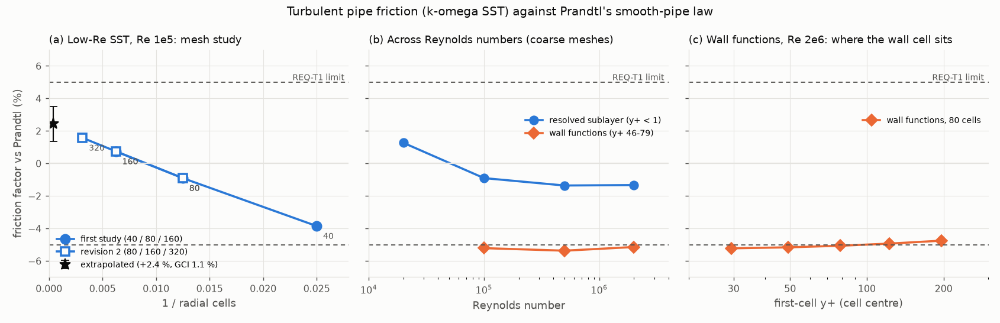

# Turbulent pipe friction: RANS against measured data, and what one mesh hides

[Portfolio index](../PORTFOLIO.md) · Thermal and fluids

> **Part 1 of study 19.** Part 2, the backward-facing step against Driver and Seegmiller's measured profiles, waits
> on its data source (the hosts were unreachable on 2026-11-22).

| | |
|---|---|
| **Answer** | Yes, with the viscous sublayer resolved. k-omega SST predicts the smooth-pipe friction factor at Re 10⁵ about 2.4 % above Prandtl's law once the mesh is converged (mesh uncertainty about 1 %), inside the 5 % a pressure-drop budget needs. Within 2 % across Re 2 × 10⁴ to 2 × 10⁶. With wall functions instead it sits about 5 % low whatever the mesh and wherever the wall cell sits: not usable to 5 %. |
| **Discipline** | Fluids, turbulence modelling, validation against measured data |
| **Tools** | OpenFOAM 14 (k-omega SST), Python |
| **Methods** | Fully developed RANS on a periodic axisymmetric wedge; low-Reynolds and wall-function wall treatments; an exact force balance; mesh studies with GCI; comparison with Prandtl's smooth-pipe law (Nikuradse's measurements), Blasius and Petukhov |

## The question

Can this OpenFOAM RANS setup be trusted for turbulent pressure-drop budgets, such as a coolant line or a heat-exchanger
passage? The requirement (REQ-T1): the friction factor within 5 % of Prandtl's smooth-pipe law,
1/√f = 2.0 log₁₀(Re √f) − 0.8. That law is a fit to Nikuradse's measurements and the smooth curve of the Moody
chart, so this is the portfolio's first comparison with measured data, through a correlation (about ±2 % scatter).

## The answer

- **Resolved sublayer (y+ below 1):** f = 0.01783 / 0.01813 / 0.01828 on 80 / 160 / 320 radial cells, extrapolating
  to 0.01843, **+2.4 %** on Prandtl, with a mesh uncertainty of 1.05 %. REQ-T1 passes with a clear margin.
- **Across Reynolds numbers** (Re 2 × 10⁴ to 2 × 10⁶, on 60-120 cells): within 1.4 % of Prandtl at every point. Those
  meshes carry the same kind of mesh error as the 80-cell point above, so read them as about 2-3 % high when converged.
- **Wall functions** (first cell in the log layer): 5.0-5.4 % below Prandtl at every Reynolds number. Refining the
  core four times moves f by 0.1 %, and moving the first cell from y+ 29 to 196 moves it from −5.2 to −4.75 %. The
  offset belongs to the wall treatment, so no mesh choice makes it pass with a margin.

## How it works

The pipe is a 5° wedge, one cell thick, with the two ends joined (cyclic), so the flow is the fully developed state
with no inlet to model. A fixed bulk velocity is held by a momentum source, which reports the pressure gradient it
needs. Radial cells grade towards the wall so the first cell sits at the requested y+. D = 0.1 m, ν = 10⁻⁶ m²/s.

## How I know it's right

- **An exact force balance:** in steady periodic flow the wall shear and the applied pressure gradient must balance
  exactly, two independent routes to f. They agree to 10⁻⁹ or better on every converged mesh; before convergence they differ,
  so this check also catches an unconverged run.
- **The bulk velocity** is held to 10⁻¹³, the wall shear is uniform along the wall, and the pressure gradient's
  change over the last 10 % of iterations is under 10⁻⁸.
- **The model's validity:** first-cell y+ inside each treatment's range; the mean velocity follows the log law
  within 2.5-3.4 % (its constants scatter by a few per cent between experiments).
- **Mesh studies** with every level halving every cell, and the extrapolated value reported, not a single mesh.

## What the checks caught

- **A good agreement that was mesh error.** The first smoke test gave f 0.9 % below Prandtl on 80 cells: reassuring
  and wrong. The mesh study moved it to +0.7 % at 160 cells and +1.6 % at 320; the friction factor converges at
  about first order (0.84, then 0.98), not the scheme's second, and the converged value is about 2.4 % *above*
  Prandtl. Quoting one mesh would have got the sign wrong.
- **A fix that broke convergence.** At Re 2 × 10⁶ checkMesh flagged the wedge's aspect ratio (2884): its fixed 2 mm
  axial length against sub-micron wall cells. Tying the length to the cells fixed that and left the converged f
  unchanged, but it slowed the solver by orders of magnitude on the finest meshes: a 160-cell mesh that converged in
  15,000 iterations no longer converged in 80,000, and the 320-cell point never did. Its unconverged value even looked
  plausible (flat against 160 cells). The force balance exposed it (7 × 10⁻³ instead of 10⁻⁹ or better). The revision went back
  to the fixed length, which checkMesh accepts at this Reynolds number, and every point converged in minutes.
- **A suspect mesh that wasn't the problem.** The wall-function offset first looked like a coarse outer mesh (25-40
  cells). A probe at four times the cells moved f by 0.1 %; a placement sweep confirmed the wall treatment itself.

## Limits

- Smooth walls only; no roughness (the Colebrook range).
- The reference is a correlation of measurements, with about ±2 % scatter, not the measurements themselves.
- One turbulence model (k-omega SST as implemented in openfoam.org v14).
- The mesh uncertainty (1.05 %) is just over the 1 % the case set, so REQ-T1's pass is formally unverified, though the
  margin to 5 % is clear. A finer level would need the shorter axial cells that stall the solver.

## Evidence

- low-Re mesh studies: [first](../runs/20261122-104218_pipe_rans_mesh/report.md) (40 / 80 / 160),
  [revision 1](../runs/20261122-134230_pipe_rans_mesh_r1/report.md) (the stalled solver),
  [revision 2](../runs/20261122-153857_pipe_rans_mesh_r2/report.md) (80 / 160 / 320, converged)
- [Reynolds sweep](../runs/20261122-104744_pipe_rans_reynolds/report.md), wall functions:
  [core mesh study](../runs/20261122-135114_pipe_rans_wf_mesh/report.md) and
  [first-cell placement](../runs/20261122-140211_pipe_rans_wf_yplus/report.md)
- case files: `cases/pipe_rans_*.toml` (predictions before each run, results scored after)
- code: `models/cfd/pipe_openfoam.py`, `models/cfd/run_pipe.sh`, `studies/pipe_flow.py`, `tests/test_pipe_flow.py`;
  figure `scripts/make_pipe_figure.py`
