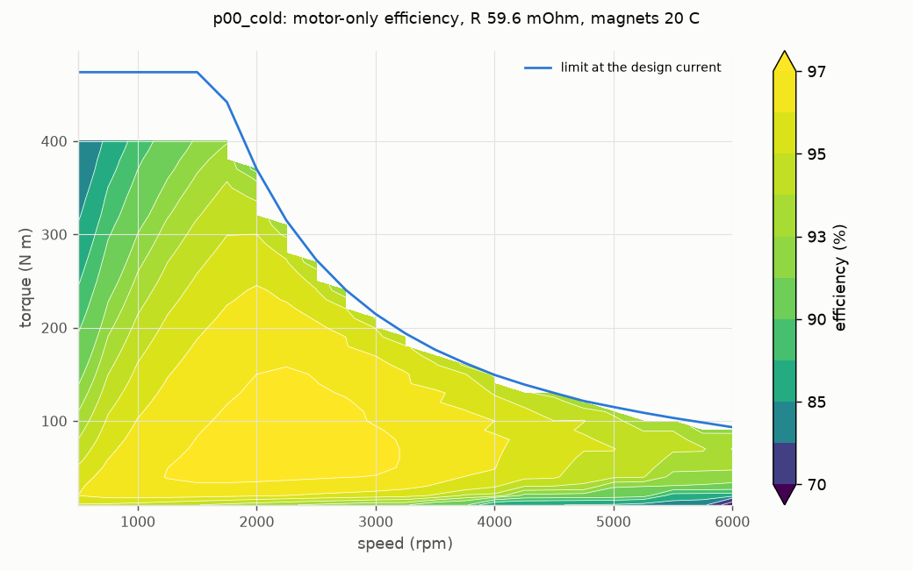

# Traction motor, blind: the 2004 Prius motor rebuilt from published drawings

[Portfolio index](../PORTFOLIO.md) · Electric machines

> **Draft, in progress (2026-11-22).** Every prediction below was written before any of Oak Ridge National
> Laboratory's (ORNL's) measurements of this motor was opened. That test data stays sealed until the study is
> complete; the comparison against it is the last step. The full reports, with every run and the blind protocol
> log, are in `reports/motor/`.

| | |
|---|---|
| **Answer so far** | Blind predictions written: back-EMF 110.9 V rms line-to-line per 1000 rpm at 20 °C; torque 119-606 N m from 50 to 350 A rms (400 N m at about 168 A); an efficiency map with a 97.4 % peak (motor only). Design checks: the rated 400 N m fits inside the copper limit (REQ-M2 pass), and the rated 50 kW holds to 6000 rpm (58.6 kW, verified). Two fails a design review would want to know about: the open-circuit voltage at top speed is about 1040 V against a 500 V bus (REQ-M1), and the rotor bridges exceed the stand-in steel's yield at overspeed (424 against 335 MPa, REQ-M4). Thermal network (synthetic 65 °C water jacket): about 230 N m continuous to 2000 rpm and 42-48 kW from 2500 to 6000 rpm, limited by the magnets (150 °C) at every speed, not the winding; the efficiency map's hot corner understates the magnets by 13-25 K. |
| **Discipline** | Electric machines: electromagnetics, losses, thermal, rotor stress |
| **Tools** | Pyleecan (geometry, drives FEMM), FEMM 4.2 (2D magnetostatics), CalculiX (rotor stress, slot heat conduction), Gmsh, Python |
| **Methods** | Machine rebuilt from published drawings (PDF vector data); open-circuit and loaded magnetostatics; maximum torque per amp; dq look-up tables with iron-loss coefficients; loss-minimising current search under voltage and current limits; a lumped thermal network coupled to the losses; mesh studies; a blind-validation protocol |

## The question

Can an open-source toolchain predict a production traction motor well enough for early design screening? The test
case is the 2004 Toyota Prius motor (48 slots, 8 poles, interior V magnets, 50 kW, 400 N m), which ORNL took apart,
drew and measured. Two kinds of answer are kept apart:

- **Design checks,** from our models with internal verification only: does the rated torque fit inside the copper's
  current limit, does the rated power hold to top speed, does the rotor survive overspeed, and what happens if the
  inverter stops switching at top speed?
- **Validation,** against ORNL's measurements, once, at the end, with limits agreed before any data was seen:
  back-EMF within 5 %, torque within 10 %, efficiency within 2 points at sample points.

## The answers so far

| Check | Result | Status |
|---|---|---|
| REQ-M1: open-circuit voltage at 6000 rpm ≤ 500 V (inverter fault) | about 1040 V line-to-line peak | **Fail**, verified: the machine needs the inverter to hold its voltage down at speed |
| REQ-M2: 400 N m within 25 A/mm² of copper current density | 400 N m at about 168 A rms, 19.8 A/mm² | **Pass** |
| REQ-M3: every operating point within 25 A/mm² | the limit is 212 A rms; 250 A and above exceed it | **Fail** above 212 A (a short-time rating question) |
| REQ-M4: rotor bridges below yield at 7200 rpm overspeed | 424 MPa against 335 MPa (M330-35A) | **Fail**, verified; elastic at 6000 rpm (295 MPa). A stronger grade (M250-35A, 455 MPa typical) would pass |
| REQ-M5: rated 50 kW from base speed to 6000 rpm (500 V, 212 A) | 58.6 kW at the worst speed (6000 rpm), magnets and copper at 20 °C; 53.7 kW hot | **Pass** (verified cold; hot unverified) |
| REQ-TH1: at least 25 kW continuous from 1250 to 6000 rpm (winding hotspot ≤ 180 °C, magnets ≤ 150 °C; jacket 65 °C, synthetic) | 30.2 kW at the worst speed (1250 rpm); 26.2-34.3 kW over ten cooling and material scenarios | **Pass**: verified in four scenarios; in the other six the slot-hotspot check misses its 5 % by 0.1-2.2 points, and a bound shows that cannot move the answer |

Blind predictions, for the comparison at the end: back-EMF **110.9 V** per 1000 rpm; MTPA torque **118.8 / 251.6 /
366.6 / 456.9 / 522.3 / 569.4 / 606.4 N m** at 50-350 A rms; an efficiency map from 500 to 6000 rpm, peaking at
**97.4 %** at 2500 rpm and 80 N m (cold), 97.0 % hot. These are motor-only efficiencies (copper and iron loss;
mechanical, magnet and inverter losses left out), so they are upper bounds on what a dynamometer would measure.

*(The white band between the map's edge and the torque-limit line is a plotting artefact of the contour fill next to
empty cells; the map's last feasible torque equals the limit at every speed.)*

## How it works

- **The machine.** Pyleecan ships a model of this motor, but rebuilt from ORNL's dimensioned drawing (read from the
  PDF's vector outline, not by eye) its slot is 145 mm², not 218, and its air gap 0.775 mm, not 0.750. The magnet
  pockets, bridges and magnet material come from ORNL's design reports (the magnet's measured B-H line was opened
  by decision, as a material input like a datasheet). The lamination grade isn't published: M330-35A stands in, and
  two other grades bracket it.
- **Electromagnetics.** FEMM solves 2D magnetostatics over one electrical period. Open circuit gives the back-EMF;
  loaded runs sweep the current angle for the maximum torque per amp.
- **Efficiency.** Look-up tables of torque, dq flux linkage and iron-loss coefficients over the dq current plane
  (FEMM, 169 plus 91 solves per magnet temperature), then, at every speed and torque, the current with the least
  copper plus iron loss that the 500 V bus can drive.
- **Rotor.** CalculiX, plane stress, centrifugal and magnet loads at 7200 rpm, stresses linearised across the bridges.
- **Thermal.** A lumped network built from the geometry (yoke, teeth, slot winding, liner, end windings, end-space
  air, housing, rotor; Mellor's T-equivalent circuits, exact for 1D conduction), with the losses taken from the dq
  tables at the network's own temperatures (copper resistance, magnet flux) and iterated to a steady state. The
  continuous envelope is the largest torque per speed within the winding and magnet limits. Cooling, the insulation
  class and the magnet grade aren't published, so they are synthetic and swept; the stator-housing interface and
  end-space coefficients come from measured machines in the literature.

## How I know it's right (before the test data)

- **Independent routes inside the model:** the power balance (Σ i·dφ/dt against torque × speed) checks FEMM's
  torque to 0.1-0.4 %; winding theory checks the flux linkage to 0.3-0.6 %; the dq torque equation checks the
  tables' fluxes; the efficiency tables reproduce the open-circuit and torque studies (2.7 × 10⁻⁶ and 0.2 %).
- **The rotor pipeline on an exact case:** a plain rotating disk matches the closed form to 4 × 10⁻⁴.
- **The thermal network against CalculiX:** 2D conduction on half a slot pitch with the same losses and boundary
  conditions: winding mean within 3-6 %, teeth within 2-5 %, yoke within 2 %, slot hotspot 4-7 % low (see below).
- **Mesh studies** on every quantity, with the coarsest mesh dropped where it left the thin bridges under one element.
- **Sensitivity to what isn't published:** the three lamination grades move the back-EMF 0.13 % and the torque under
  2 %; the unmeasured deep-saturation tail of the steel's curve moves the high-current torque about 2 %.

## What the checks caught

- **A copper area 1.57 times too large.** ORNL quotes a slot fill of 0.84, and the first version applied it to the
  whole slot. Re-reading the definition: it is the fill of the *squares* of the insulated wires. The bare copper is
  about 0.59 of the slot, so the 25 A/mm² limit is 212 A, not 333 A. Torques didn't change; two verdicts did (REQ-M2's
  margin fell from 52 % to 19 %, REQ-M3 now fails above 212 A). Caught and corrected before any test data was seen.
- **A library model that wasn't the motor it was named after.** Pyleecan's Prius slot is half as large again as
  ORNL's drawing; the drawing itself turned out to be stretched 1.1 % in x, and was corrected before use.
- **An efficiency map that looked finished.** The first map passed its spot checks against the torque and
  open-circuit studies, but its interpolation check failed, all on one row of the table. At light load and high speed
  the best operating point used 2-5 A of q-axis current, inside the table's first 25 A cell, and the map there moved
  by up to 10 points with the table spacing. Finer rows at low current fixed it everywhere from 20 N m up (to under
  1 point); the 10 N m row above 4000 rpm is reported as unresolved.
- **Hot magnets cost more than their remanence.** At 80 °C the magnets lose 6 % of their remanence, but the motor
  lost 7 % of its flux: the saturated bridges keep their leakage flux.
- **A hotspot in the wrong place.** The network first put the slot's hottest point at the middle of the winding
  (a slab between walls at one temperature) and read 10 % low on the rise. CalculiX put it at the top of the slot, by
  the tooth tips: the teeth carry the winding's heat out to the yoke, so they are hottest at the bore. Reading the
  hotspot there halved the error; the remaining 4-7 % is the 2D field a lumped model leaves out, and a bound shows it
  cannot move the envelope.
- **The magnets, not the copper, set the continuous rating.** With no heat path through the shaft and only
  conduction across the 0.77 mm air gap, the rotor floats at the temperature of the tooth tips, the hottest iron. A
  better air gap made it slightly worse: it ties the rotor closer to those tips.
- **A leak in a blind protocol, recorded rather than hidden.** A line filter on one ORNL report let through some of
  ORNL's own *model* results (not measurements). They are logged with their time and declared in every case that
  followed; extraction is whitelist-only since.

## Limits

- 2D magnetostatics: no end effects, no eddy currents in the magnets, no AC copper loss.
- The lamination grade, the end-winding length and the copper temperature are estimates; their effects are bracketed
  or stated.
- Thermal: steady state only (no short-time ratings); cooling, insulation class and magnet grade synthetic; the
  rotor's paths (air gap, end space, shaft) are the least checked and set the answer; no thermal test data is used.
- Validation against ORNL's measurements has not happened yet. Until it does, these are predictions.

## Evidence

- Reports: `reports/motor/` (overview, design inputs, open circuit, torque, efficiency), built from the runs by
  `reports/motor/build_report.py`; thermal: `runs/20261122-174925_motor_prius_thermal_r1/report.md`
- Cases (predictions before each run, results after): `cases/motor_prius_*.toml`
- Code: `models/motor/`, `studies/motor_em.py`, `studies/motor_torque.py`, `studies/motor_lut.py`,
  `studies/motor_efficiency.py`, `studies/motor_thermal.py` (with `models/motor/thermal_network.py`,
  `models/motor/stator_section_ccx.py`), `studies/rotor_stress.py`
