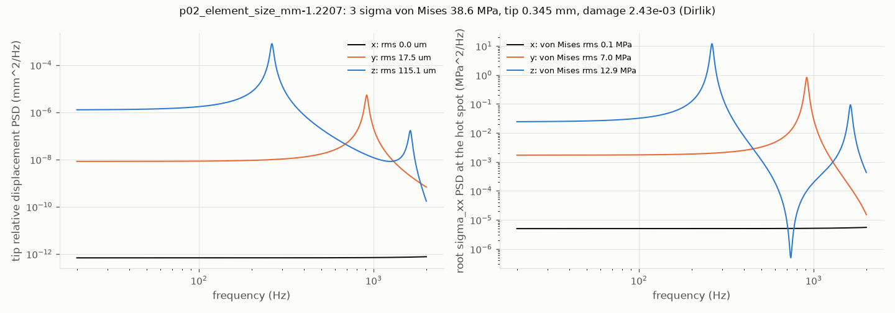

# Bracket arm under random vibration: 3-sigma stress and vibration fatigue

[Portfolio index](../PORTFOLIO.md) · Structures and vibration

| | |
|---|---|
| **Answer** | Yes, with wide margins. Shaken for one hour per axis at a flat 0.04 g²/Hz from 20 to 2000 Hz (8.9 g rms), the 7 mm steel arm from [study 4](04-bracket-modal.md) sees a 3-sigma root stress of 38.6 MPa against 236.7 allowed, a fatigue damage of 0.0024 against 0.5, and a 3-sigma tip movement of 0.345 mm against a 1 mm clearance. Mesh uncertainty 1.3 % on the stress, 0.1 % on the tip. Excitation, damping, S-N detail and clearance are synthetic. |
| **Discipline** | Structures, random vibration, fatigue |
| **Tools** | CadQuery, Gmsh, CalculiX, Python (NumPy, SciPy) |
| **Methods** | Modal superposition for base excitation, hot-spot stress extrapolation (IIW), von Mises of a random stress state (Segalman), spectral fatigue (Dirlik, Steinberg's three bands) on an EN 1993-1-9 S-N curve, Miles' equation, mesh refinement |

## The question

The arm passed its modal target in study 4: first mode 261.7 Hz, above 250. A qualification test then shakes it on a
table with a random acceleration spectrum, one hour on each of the three axes. Does it survive? Three requirements:
the 3-sigma von Mises stress at the clamp stays below yield / 1.5 (S355-type steel, 236.7 MPa); the fatigue damage of
the whole test stays below 0.5 (EN 1993-1-9 detail category 160, plain rolled plate); and the tip moves less than
1 mm (3 sigma) relative to its base, a clearance I set. The spectrum, the 2 % modal damping and the steel were agreed
with the client as synthetic stand-ins.

## The answer

- **Stress: 38.6 MPa at 3 sigma**, a factor of 6 under the limit. The flapwise shake (z) governs: the first bending
  mode carries almost all of it, 12.9 MPa rms on the top face at the clamp.
- **Fatigue: damage 0.0024 for the three hours**, about 200 times under the limit. Dirlik's method and Steinberg's
  three bands agree within 14 %. The damage is this small because the 3-sigma stress range (about 77 MPa) sits near
  the S-N curve's cut-off (65 MPa for this detail): most cycles do no damage at all. That also makes the damage very
  sensitive to the stress: 10 % more stress roughly doubles it ([study H](../cases/bracket_random_uq.toml) puts
  numbers on this).
- **Tip: 0.345 mm at 3 sigma**, a factor of 2.9 inside the clearance; the closest of the three margins.

## How it works

CalculiX finds 30 modes of the clamped arm (the highest near 53 kHz, far above the 2 kHz band) with their stresses
and participation factors. The random response is then a sum over modes in Python, one axis at a time: each mode
responds to the base acceleration like a damped single oscillator, and the stresses add with their phases. From the
response spectra come the rms values, the von Mises rms of the full 3D stress state, and the spectral moments that
fatigue methods need.

The raw stress at the clamp corner is singular: it grows without limit as the mesh refines. The hot-spot rule used for
welded and clamped details reads the surface stress at 0.4 and 1.0 times the thickness from the clamp and
extrapolates to the clamp line. It is applied to each mode before summing, which is exact because the extrapolation
is linear.

## How I know it's right

- **CalculiX's own harmonic solver against the Python sum**, at every one of its frequencies on all three axes: agree
  to 2 × 10⁻⁷ to 1 × 10⁻⁶. Getting there exposed how CalculiX defines the base-motion problem (below).
- **Miles' equation** (exact for one mode under a flat spectrum) against the band integral of mode 1: 0.1 %, the
  difference being the band's ends.
- **Effective mass** of the kept modes: at least 93 % on every axis, so no significant mode is missing.
- **The frequency grid:** doubling it changes the rms values by 2 × 10⁻⁴.
- **The root stress against beam theory** (bending moment from the rotational participation factors, M c / I):
  within 5 % on the finest mesh. The difference is model form: the clamp's restraint of Poisson contraction, which a
  beam doesn't have.
- **Mesh refinement at 3.1, 1.95 and 1.22 mm** (quadratic tetrahedra): stress 44.2, 39.8, 38.6 MPa, GCI 1.3 %; tip
  GCI 0.1 %.

## What the checks caught

- **CalculiX's base excitation is not the textbook one.** The harmonic check first missed by 4 % at resonance and by
  far more below it. CalculiX reports absolute displacement, and its modal damping acts on the absolute velocity
  (base included), which adds a forcing term the textbook relative-motion equation doesn't have. With that term the
  Python sum matches it to 10⁻⁶; the study itself keeps the physical form (damping on the relative motion) and uses
  CalculiX only as the check. Noted in the project's CalculiX notes.
- **A test run that ate the RAM.** On the finest mesh, the output requests of the modal step silently carried into the
  three harmonic check steps, so every frequency point rewrote the whole mesh's displacements and stresses: a 16.5 GB
  result file, and 38 GB of memory to read it. The run was stopped and the check steps now write only the tip node.
  The rerun reproduced the first two meshes to every printed digit and took 37 minutes.

## Limits

- Synthetic excitation, damping (2 % on every mode), S-N detail and clearance. The damping is the input that matters
  most: see study H.
- A rigid clamp and no attached mass. A real bolted clamp is softer and would lower the first mode (study 4's main
  risk); a clamp edge also frets, which needs a lower S-N detail than plain plate.
- Gaussian, stationary excitation, one axis at a time; zero mean stress.

## Evidence

- [mesh study](../runs/20261123-100907_bracket_random_mesh/report.md) (verification PASS)
- case file: `cases/bracket_random_mesh.toml` (hand estimate, two declared prototypes, predictions, results)
- code: `studies/bracket_random.py`, `models/fea/bracket_random.py`; tests `tests/test_bracket_random.py`
