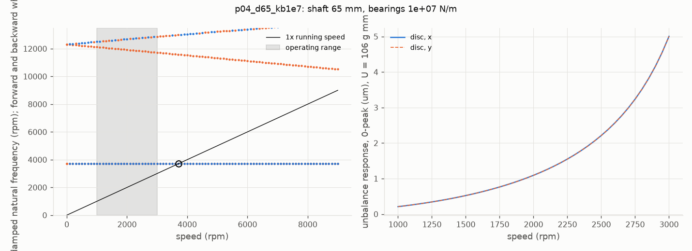
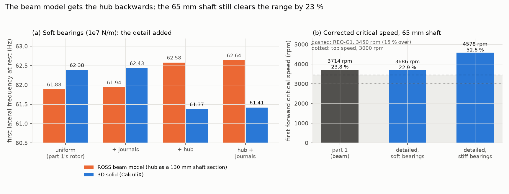

# Fan rotor: critical speeds and unbalance response, and the real rotor as a 3D solid

[Portfolio index](../PORTFOLIO.md) · Structures and vibration

| | |
|---|---|
| **Answer** | The 50 mm shaft does not work: its first critical speed (2710-2911 rpm) sits inside the 1000-3000 rpm operating range, and the impeller swings 335-345 µm through it. A 60 mm shaft clears the range only on stiff bearings (14.3 % margin against 15 % on soft ones). **Use 65 mm**: at least 23.8 % margin over the whole bearing-stiffness band, response under 5 µm. Geometry, speed range, bearing band and damping are synthetic. **Part 2, the real rotor:** with a hub and bearing journals, a 3D solid (CalculiX) puts the first critical at **3686 rpm**, 22.9 % over the range, so **65 mm holds**. The beam model gets the hub backwards (it raises the frequency 1.1 % where the solid lowers it 1.6 %); either beam idealisation of a hub is 2-6 % off. Detailed CAD with STEP. |
| **Discipline** | Rotordynamics |
| **Tools** | ROSS 3.1 (open-source rotordynamics, Python); part 2: CadQuery (STEP), Gmsh, CalculiX |
| **Methods** | Timoshenko rotor finite elements with gyroscopic terms, Campbell diagram, critical speeds as 1× crossings, API 684 unbalance response, Jeffcott and Euler-Bernoulli closed forms; part 2: 3D solid modal analysis against the beam model on the same rotor, one detail at a time, the critical speed corrected by the solid |

## The question

A fan's impeller (400 mm steel disc, 25 mm thick) sits mid-span on a steel shaft between two rolling bearings 1 m
apart. It runs at 1000-3000 rpm on a variable-speed drive. A rotor that runs near a critical speed vibrates hard, so
the requirement, simplified from API 684, is that every forward critical speed sits at least 15 % outside the
operating range: none between 850 and 3450 rpm. The bearing pedestals' stiffness is not known well, so it is a band,
1e7 to 1e8 N/m, and the requirement must hold across it. A second requirement limits the impeller's response to the
standard API unbalance to 50 µm. The drawing's shaft is 50 mm; is it enough, and if not, what is?

## The answer

| Shaft | Bearings (N/m) | First forward critical | Margin (at least 15 %) | Response (at most 50 µm) |
|---|---|---|---|---|
| 50 mm | 1e7 / 1e8 | 2710 / 2911 rpm | -9.7 / -3.0 % **FAIL** | 335 / 345 µm **FAIL** |
| 60 mm | 1e7 / 1e8 | 3429 / 3957 rpm | **14.3 % FAIL** / 31.9 % | 8.7 / 3.8 µm |
| 65 mm | 1e7 / 1e8 | 3714 / 4494 rpm | 23.8 / 49.8 % | 5.0 / 2.3 µm |

The soft-bearing end of the band governs: a softer support lowers every critical speed. The 60 mm shaft would pass
on stiff pedestals and fail on soft ones, which is exactly the uncertainty the band was meant to cover.

## How it works

ROSS builds the rotor from 20 Timoshenko beam elements (shear deformation, rotary inertia, gyroscopic coupling), a
rigid disc and two linear bearings. Its Campbell diagram tracks each mode's frequency against running speed, split
into forward and backward whirl. A critical speed is where a forward-whirl mode crosses the 1× running-speed line. The
unbalance response applies API 684's standard unbalance (6350 W / N g·mm, here 84-106 g·mm) at the disc.

## How I know it's right

- **Jeffcott rotor** (massless shaft, rigid supports, central disc) against sqrt(48 EI / m L³): within 0.27-0.46 %,
  the difference being shear deformation and the disc's width.
- **The same rotor on the case's bearings** against the closed form with shaft and bearings as springs in series:
  within 0.24-0.44 %.
- **The bare shaft** on rigid supports against Euler-Bernoulli pinned-pinned: within 0.30-0.50 %.
- **The Campbell crossings** against ROSS's own critical-speed search: agree to 6e-6 or better.
- **Element convergence:** 10, 20 and 40 elements give the same critical speed and response (GCI 2e-7).

## What the checks caught

- **ROSS's own critical-speed search failed to converge** over the full 0-9000 rpm range (its Newton iteration). The
  study takes the critical speeds from the Campbell diagram's 1× crossings instead and keeps ROSS's search, over its
  default range, as a cross-check.
- **My hand estimate ran 2 % high on soft bearings.** Rayleigh's method, with 17/35 of the shaft's mass at mid-span,
  matched within 0.2 % on stiff bearings, but that factor assumes a simply supported mode shape; on soft bearings the
  whole shaft also translates, so more of its mass takes part. That 2 % put the 60 mm shaft just under the limit,
  outside the band I had predicted for it.

## Limits

- Linear bearings: a rolling bearing's stiffness rises with load and speed; the band is meant to cover that.
- No aerodynamic cross-coupling, foundation mass or seal forces; the blades are lumped into the disc.
- API 684's separation margin depends on each mode's amplification factor; a fixed 15 % is a simplification.

## Part 2: the real rotor, as a 3D solid

### The question

Part 1's answer rests on a beam model: a uniform shaft, the impeller a rigid disc bored straight onto it, point
bearings at the shaft's ends. A real rotor has its impeller on a hub, smaller bearing journals and a disc that is not
rigid. Does the 65 mm recommendation hold for the rotor as it would be built?

### The answer

**Yes: the corrected first critical speed is 3686 rpm on the soft bearings, 22.9 % above the 3000 rpm top speed**
(part 1: 3714 rpm, 23.8 %); 4578 rpm (52.6 %) on stiff bearings. But the beam model gets the hub's effect backwards:

| Rotor (soft bearings) | ROSS beam model | 3D solid | Solid / ROSS |
|---|---|---|---|
| Part 1's rotor (uniform shaft, disc bored to it) | 61.88 Hz | 62.38 Hz | 1.008 |
| + 55 x 50 mm journals | 61.94 Hz (+0.1 %) | 62.43 Hz (+0.1 %) | 1.008 |
| + 130 x 100 mm hub | **62.58 Hz (+1.1 %)** | **61.37 Hz (-1.6 %)** | 0.981 |
| Hub and journals | 62.64 Hz | 61.41 Hz | 0.981 |

A beam model has two ways to take a hub, and both are wrong: as a shaft section of the hub's diameter it is too stiff
(+2.0 % on the first frequency, +3.2 % on stiff bearings); as mass and inertia only it is too soft (-5.9 %, -8.8 %).
A 100 mm hub on a 65 mm shaft stiffens it only partly, and only the solid says how much. The rotor's verdict has the
margin to absorb it; a rotor sized closer to its limit would not.

### The detailed part

The rotor is delivered as a detailed CadQuery assembly ([`models/cad/fan_rotor.py`](../models/cad/fan_rotor.py),
[STEP](cad/fan_rotor_d65.step)): the 65 mm shaft with 55 mm journals, shoulder fillets and end chamfers, a DIN 6885
18 x 11 keyway and key under the hub, the 130 x 100 mm hub with its keyway, the 400 x 25 mm disc and its fillet welds,
55.3 kg. Every part is checked against a hand volume (the keyway's curved top by quadrature, itself tested on a closed
form), and no two parts overlap. Hub, journal and weld sizes are a plausible layout, marked synthetic.

### How it works

- **The solid** ([`models/fea/rotor_solid.py`](../models/fea/rotor_solid.py)): the rotor in CadQuery, half of it about
  a plane through the axis (its symmetric modes are the lateral bending modes in that plane), 10-node tetrahedra from
  Gmsh, CalculiX's eigenvalue solver. The bearings are point springs on the shaft's end faces, held rigid and free to
  rotate, as part 1's point bearings. Everything is bonded: the hub shrunk or tightly keyed on.
- **The same rotor in ROSS**, in every point: part 1's model with an optional hub (shaft elements of the hub's
  diameter) and journals. The solid checks ROSS at rest; the critical speed needs the gyroscopic stiffening a solid at
  rest lacks, so ROSS's is scaled by the ratio of the first frequencies at rest.

### How I know it's right

- **On the rotor ROSS idealises exactly**, the solid is 0.8 % above it at every mesh (the disc's thickness and the
  rigid end faces), inside a 2 % cross-tool check.
- **Mesh**: three meshes (31 k to 97 k nodes) agree within 0.03 %. The convergence check itself failed: the steps
  grow (0.004 then 0.014 Hz), which the check reads as divergence at the default noise floor; the meshes are not a
  strict refinement (the curved edges keep the same element count at every level), and no floor was declared
  beforehand, so the failure stands. The 0.03 % is set against effects of 2-3 %.
- **Geometry**: every solid's volume against a hand volume to 1e-15; ROSS's builder places the hub and journals on its
  element nodes (tested).

### What the checks caught

- **CalculiX read a spring with no stiffness** ("*SPRING card without data") until the stiffness carried a decimal
  point: 50000 failed, 50000. worked.
- **The cross-tool check did its job**: it passes on the uniform rotor and fails once the hub matters (3.1 % on stiff
  bearings), which is the finding, not a fault.
- **My predictions had the journals' effect backwards**: smaller journals raise the first frequency slightly (+0.1 %),
  because they take mass off where the bending moment is smallest.

### Limits (part 2)

- Hub and journal sizes are synthetic; the bonded hub is the tight-fit limit (a loose fit stiffens less still).
- The solid is at rest: its correction applies the at-rest ratio to ROSS's gyroscopic critical speed.
- No keyway in the solid (a tight key restores the section); no blades or aerodynamic forces, as part 1.

## Evidence

- [design run](../runs/20261123-162721_rotor_fan_design/report.md) (verification PASS),
  [element convergence](../runs/20261123-163104_rotor_fan_mesh/report.md) (PASS)
- case files: `cases/rotor_fan_design.toml`, `cases/rotor_fan_mesh.toml` (hand estimate, predictions, results)
- code: `models/rotor/fan_rotor.py` (runs in its own ROSS environment), `studies/rotor_critical.py`;
  tests `tests/test_rotor_critical.py`
- Part 2: the solid's mesh study [`rotor_solid_mesh`](../runs/20261127-120200_rotor_solid_mesh/report.md) (the
  discretization check failed, above), the detail [`rotor_solid_detail`](../runs/20261127-120457_rotor_solid_detail/report.md);
  cases `cases/rotor_solid_mesh.toml`, `cases/rotor_solid_detail.toml`; code `models/fea/rotor_solid.py`,
  `studies/rotor_solid.py` (tests `tests/test_rotor_solid.py`), the CAD `models/cad/fan_rotor.py`
  (`tests/test_fan_rotor_cad.py`), figure `scripts/make_rotor_solid_figure.py`
