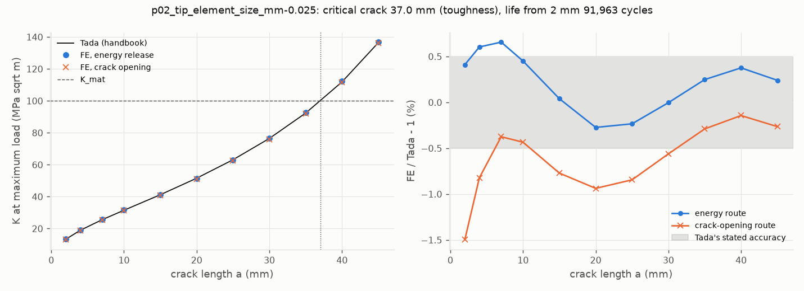
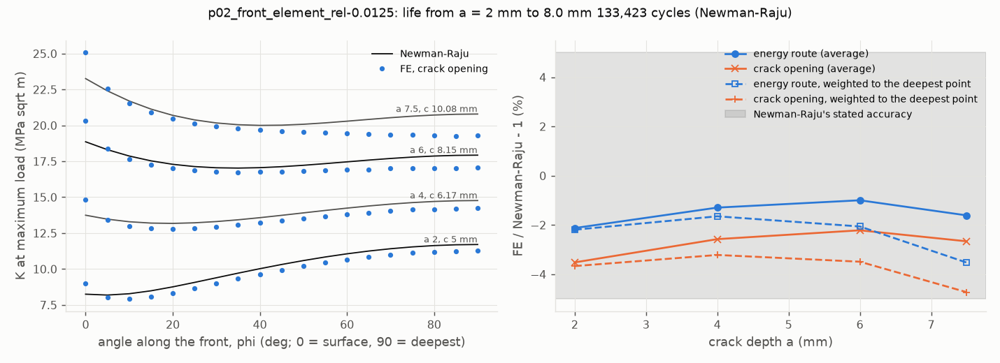

# Cracked steel plate: critical crack and fatigue crack growth

[Portfolio index](../PORTFOLIO.md) · Structures and vibration

> **Study 24 has two parts.** Part 1 (below): a through-thickness edge crack, K against Tada's handbook, growth
> life and inspection interval. [Part 2](#part-2-the-surface-flaw-inspection-actually-finds): the flaw magnetic-
> particle inspection actually finds, a semi-elliptical surface crack, in a 3D model against Newman and Raju's
> solution (the one BS 7910 uses): Part 1's answer is conservative for it, by at least 45 % on life.

| | |
|---|---|
| **Answer** | A 2 mm edge crack (the smallest magnetic-particle inspection reliably finds) in the 100 mm S355 plate grows to the critical size, **37.0 mm**, in about **92,000 cycles** at 150 MPa maximum stress (R = 0.1). Inspect at least every **46,000 cycles**; the planned 40,000 has margin. At the detectable crack, K is 13.4 MPa√m against the 50 allowed. Loads, toughness and the detectable size are synthetic; the crack growth law is the published BS 7910 / IIW one. Part 2: for a surface flaw of the same depth (10 mm long) K is 11.3 MPa√m and the life to 80 % of the thickness alone is 133,000 cycles, so the edge-crack answer is the conservative one. |
| **Discipline** | Fracture mechanics, damage tolerance |
| **Tools** | Gmsh, CalculiX, Python (SciPy) |
| **Methods** | Linear elastic fracture mechanics, stress intensity by energy release rate and by crack opening, Paris-law crack growth (BS 7910 simplified law for steels in air), handbook K (Tada), mesh noise measurement; 3D crack front K against Newman-Raju, energy release weighted along the front, BS 7910 two-point growth of a surface crack |

## The question

A steel plate (S355, 100 mm wide, 10 mm thick) carries cyclic tension, 150 MPa at peak, 15 MPa at the bottom of each
cycle. Inspections can find an edge crack once it is 2 mm deep. How long does such a crack take to grow to failure,
and how often must the plate be inspected? Requirements: at the detectable crack, the stress intensity stays below
half the fracture toughness (100 MPa√m, synthetic: a client would supply CTOD or Charpy data); and the growth life is
at least twice the planned inspection interval of 40,000 cycles.

## The answer

- **Critical crack 37.0 mm**, set by the toughness; the ligament would yield only at 57.7 mm.
- **Life from 2 mm to 37.0 mm: about 92,000 cycles**, so an inspection interval of at most 46,000 cycles. 81 % of
  that life is spent growing from 2 to 10 mm: the early crack is slow, which is what gives inspection its chance.
- **K at the 2 mm crack: 13.4 MPa√m**, a quarter of the toughness.

## How it works

CalculiX solves half the plate (the crack plane is a plane of symmetry) in plane strain, meshed by Gmsh with
quadratic triangles that shrink towards the crack tip. At each of eleven crack lengths from 2 to 45 mm the stress
intensity K comes two ways, neither needing special crack-tip elements:

- **Energy release rate:** the strain energy at the crack length and 0.2 mm either side; G = dU/da, K = √(E′G).
- **Crack opening:** near the tip the crack faces open as √r, in proportion to K; fitting the opening along the face
  and extrapolating to the tip gives K.

K(a) then gives the critical crack (where K reaches the toughness) and, integrated through the BS 7910 crack growth
law (da/dN = 5.21×10⁻¹³ ΔK³), the life.

## How I know it's right

- **Tada's handbook solution** for an edge crack in a finite strip: the energy route agrees within 0.66 % at every
  crack length, against Tada's own stated accuracy of 0.5 %. The wave in the difference against crack length (right
  plot) is the same on every mesh, so it is the handbook's polynomial fit, not the model.
- **Two routes to K** agree within 1.9-2.2 %; the crack-opening route is the weaker one (few points to fit at small
  cracks) and converges towards the energy route as the tip mesh refines.
- **Equilibrium** to 1e-16; the life integral by two quadratures to 3e-9.
- **Tip mesh study** (0.1, 0.05, 0.025 mm): the critical crack converges (GCI 2e-4).
- **Measured mesh noise:** five meshes at one tip size, perturbed in the far field, scatter the life by 0.11 %.

## What the checks caught

- **The life would not converge cleanly, and fixing it took three revisions.** The first energy step (2 % of the crack
  length) was 0.04 mm at a 2 mm crack, about one tip element, so the energy difference picked up the mesh's own noise.
  A 10 % step cured that but added 1.2 % of truncation error at long cracks, where K rises steeply. A fixed 0.2 mm
  step, a few tip elements long and small against long cracks, satisfies both.
- **I had declared a noise floor I had not measured.** The first case's floor (1e-4) was a guess written beside a
  measured-sounding source. Measured afterwards, the life's scatter is 1.1e-3, and the finest tip still sits 0.05 %
  below that band. So the life is known to about ±0.2 %, but the harness's mesh check stays formally unverified for it.
  Against a 15 % margin to the requirement, no further revision can change the answer, so I stopped there.

## Part 2: the surface flaw inspection actually finds

Magnetic-particle inspection finds cracks that break the plate's face, so the realistic detectable flaw is a
semi-elliptical surface crack, not Part 1's through-thickness edge crack. Is Part 1's answer conservative for it?
The flaw: 2 mm deep, 10 mm long on the surface (synthetic; a client's inspection procedure would give it), in the
middle of the plate's face, same plate, same loading, same growth law.

- **K at the detectable flaw: 11.3 MPa√m** at its deepest point by FE (Newman-Raju 11.7), against Part 1's 13.4.
- **Life to 80 % of the thickness: 133,400 cycles** by the BS 7910 procedure (Newman-Raju K at the deepest and the
  surface point, the crack growing in depth and length together), 1.45 times Part 1's whole life. That is a lower
  bound: it stops where Newman-Raju's equations stop (a = 0.8 t), before the crack breaks through, and K there is
  still a quarter of the toughness. The crack's shape settles from a/c = 0.4 to about 0.74 on the way.
- **So Part 1's 46,000-cycle interval holds** for the surface flaw with more margin; the edge crack is the
  conservative assumption.

**How it works.** A quarter of the plate (two planes of symmetry) in Gmsh, quadratic tetrahedra sized by distance
from the crack front (front elements 1.25 % of the crack depth, 70,000-106,000 nodes), solved by CalculiX. The FE
checks Newman-Raju on four shapes along the growth path (a = 2, 4, 6, 7.5 mm), each solved seven times:

- **Energy, front average:** scaling the crack by (1 ± 2 %) releases energy in proportion to K² summed along the
  front (on an ellipse the normal advance per unit angle is the same everywhere, which makes the sum simple).
- **Energy, weighted:** growing the depth alone weights the front towards the deepest point (sin²φ); growing the
  length alone weights it towards the surface (cos²φ). The two add up to the average, which checks itself to 0.2-0.6 %.
- **Crack opening:** K along the front from how far the crack faces open behind it.

**How I know it's right.**

- **Newman-Raju:** the FE front average is 1-2.4 % below it on every shape at every mesh (stated accuracy ±5 %).
- **Two independent routes:** crack opening and energy agree within 1.4 % on the average and within 1.6 % weighted
  to the deepest point.
- **Measured mesh noise** (five perturbed meshes): 0.1-0.3 % on the energy ratios; the energy results converge
  within it, and K at the detectable flaw converges with a mesh uncertainty of 0.03 %.
- **Equilibrium** exact; the loads sum to stress × area to 1e-16; the life by two integrators to 2e-9.

**What the checks caught.**

- **Newman-Raju's shape is off for deep cracks, and the FE had to prove it twice.** At 60-75 % of the thickness the
  FE's K falls below Newman-Raju towards the deepest point (7 % low at 75 %), while it agrees within 1-2 % elsewhere.
  That rested on the crack-opening fit alone, so I added the depth-only and length-only energy solves: weighted to
  the deepest point, energy alone gives 0.965 of Newman-Raju for the deepest crack (predicted 0.955-0.970 before the
  run), and 1.000 weighted to the surface. Newman-Raju over-reads there, which is conservative. The study's check on
  the shape of K along the front (3 %) fails on every mesh as a result; it stands as a finding about the reference,
  not a fault in the model.
- **The crack-opening fit started inside the elements that can't follow the singularity.** Fitted from one element
  behind the front it read 7 % low at every mesh size, and refining didn't help, because the bad zone shrinks with
  the mesh. The apparent K settles three elements back; the fit starts there.
- **I declared a noise floor I hadn't measured, again.** The first case guessed 1e-4, the exact mistake Part 1
  recorded. Measured, the floor is 25-85 times larger; with it, the energy ratios' mesh checks pass. The life with K
  scaled by the FE ratio still converges slowly (mesh uncertainty 1.05 % against 1 %); it is a
  supporting number, not the answer.

## Limits

- Part 1: through-thickness straight crack (Part 2 covers the surface crack).
- Part 2: life stops at 80 % of the thickness (the end of Newman-Raju's range), so it is a lower bound; no
  residual stress (a weld toe would need it); the crack is assumed to stay semi-elliptical; FE checked at four
  shapes on the path, interpolated between them.
- Constant-amplitude loading; no crack closure, sequence effects or environment.
- Linear elastic: valid while the plastic zone (up to about 4 mm near the critical crack) is small against the
  ligament.

## Evidence

- [tip mesh study, revision 2](../runs/20261123-164649_edge_crack_mesh_r2/report.md),
  [noise measurement](../runs/20261123-165115_edge_crack_noise/report.md); revisions 0 and 1 in `runs/` with their
  reasons in the case files
- case files: `cases/edge_crack_mesh.toml`, `cases/edge_crack_mesh_r1.toml`, `cases/edge_crack_mesh_r2.toml`,
  `cases/edge_crack_noise.toml`
- code: `models/fea/edge_crack.py`, `studies/edge_crack.py`; tests `tests/test_edge_crack.py`
- Part 2: [front mesh study, revision 1](../runs/20261126-204858_surface_crack_mesh_r1/report.md) (with the weighted
  energy routes), [noise measurement](../runs/20261126-202527_surface_crack_noise/report.md),
  [first mesh study](../runs/20261126-200939_surface_crack_mesh/report.md); case files with predictions and Results:
  `cases/surface_crack_mesh.toml`, `cases/surface_crack_noise.toml`, `cases/surface_crack_mesh_r1.toml`; code
  `models/fea/surface_crack.py`, `studies/surface_crack.py`; tests `tests/test_surface_crack.py`
