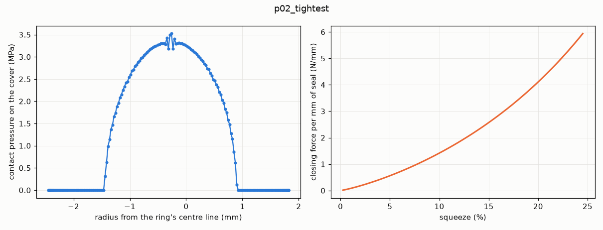
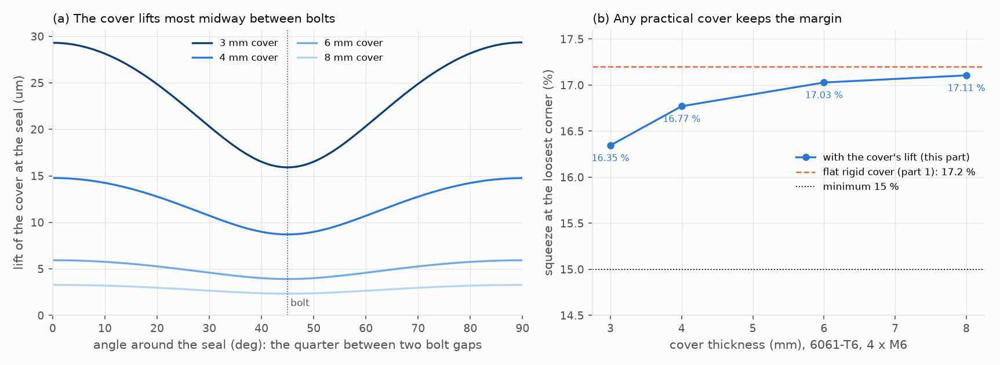

# O-ring face seal: squeeze, sealing pressure, closing force and groove fill across the tolerance stack

[Portfolio index](../PORTFOLIO.md) · Structures and vibration

| | |
|---|---|
| **Answer** | A 3.53 mm NBR 70 O-ring in a 2.79 x 4.80 mm face-seal groove (a coolant-pump cover, 3 bar) **passes every requirement at every corner of the tolerance stack**: squeeze 17.2-24.5 % (limit 15-30 %), peak contact pressure at the loosest corner **1.50 MPa** (2.5 x the 0.6 MPa needed), closing force at the tightest **5.94 N per mm of seal** (2.0 x under the 12 N/mm bolt budget), groove fill at most **80.4 %** (limit 85 %). Two cross-checks just missed their tolerances (the hand fill at the tightest corner, 1.05 % against 1 %; the contact-pressure integral at 5 % squeeze, 3.08 % against 3 %), explained below; neither touches a verdict. The client, the limits and the compound are synthetic; the hardness-to-modulus relation, the force-squeeze reference and the measured force band are published. **Part 2, the cover between its bolts:** part 1 took the cover as flat and rigid. Modelled as a plate held at 4 bolts, a 4 mm aluminium cover lifts about 15 um at the seal between them, and even 3 mm lifts only 29 um, against the 75 um the loosest corner can give up: the squeeze stays at 16.3 % or more. The assumption holds; the faces' flatness tolerance matters more than the cover's stiffness. |
| **Discipline** | Elastomer seals: hyperelastic large strain with contact |
| **Tools** | Gmsh (Python API), CalculiX, Python |
| **Methods** | Axisymmetric neo-Hookean model with penalty contact, tolerance-stack corners, mesh study (GCI), Hertz line contact, Lindley's force-squeeze relation, Parker's measured load bands; part 2: 3D linear FEA of the bolted cover (CadQuery, Gmsh, CalculiX), Mindlin plate theory as the reference |

## The question

A cover seals a water-glycol coolant pump at up to 3 bar with an O-ring in a face groove. Across the stack of
tolerances (cross-section 3.53 ± 0.10 mm, groove depth 2.79 ± 0.05 mm, width 4.80 ± 0.05 mm, hardness 70 ± 5 Shore
A), does the ring stay within 15-30 % squeeze (REQ-E1), keep a peak contact pressure of at least twice the sealed
pressure at the loosest stack (REQ-E2), close with no more than the bolts' 12 N per mm of seal at the tightest
(REQ-E3), and fill no more than 85 % of the groove (REQ-E4)?

## The answer

| Corner | Squeeze | Closing force | Peak contact pressure | Groove fill |
|---|---|---|---|---|
| Loosest (3.43 mm ring, 2.84 mm deep, 65 Shore A) | 17.2 % | 1.89 N/mm | **1.50 MPa** | 67.5 % |
| Nominal (70 Shore A) | 21.0 % | 3.39 N/mm | 2.34 MPa | 73.7 % |
| Tightest (3.63 mm ring, 2.74 mm deep, 75 Shore A) | 24.5 % | **5.94 N/mm** | 3.52 MPa | **80.4 %** |

Every requirement passes with margin; the closest is the fill, 4.6 points under 85 %. Verification: every check passes
except two narrow misses, both on cross-checks rather than on a requirement (below).

## How it works

CalculiX solves the upper half of the ring's cross-section, axisymmetric: the groove bottom and the cover are flat and
the contact frictionless, so the mid-plane is a plane of symmetry. The rubber is neo-Hookean, near-incompressible
(bulk modulus 1000 x shear), with Young's modulus from the Shore hardness by Gent's relation (Rubber Chem. Technol.
1958; 4.43 / 5.52 / 7.05 MPa at 65 / 70 / 75). A steel cover moves down by half the squeeze; steel blocks are the
groove's walls, the ring installed against the outer one, as for internal pressure. Node-to-surface penalty contact;
quadratic elements meshed by Gmsh, refined where the contact grows.

## How I know it's right

- **Volume conserved** to 5e-4 or better (the near-incompressible rubber; 4.96e-4 at the tightest corner).
- **The contact pressure adds up to the closing force** within 2.0 / 1.6 / 1.4 % at the loosest / nominal / tightest
  corner (tolerance 3 %), and the cover's reaction balances the symmetry plane's exactly. At 5 % squeeze, where the
  contact is only 0.66 mm wide, the integral missed by 3.08 %: reported, not retuned.
- **Hertz line contact** at 5 % squeeze, at the model's own force: peak pressure within 1.6 %, contact width within
  0.3 %.
- **Lindley's relation** for a laterally free ring (the model with the groove walls removed, his test case): within
  10.6 / 0.05 / 8.1 % at 10 / 20 / 30 % squeeze, and **inside Parker's measured band** for this cross-section and
  hardness (O-Ring Handbook ORD 5700 Fig. 2-6, read from the PDF's vector lines) at every squeeze.
- **Mesh study** at the tightest corner (contact elements 0.1 / 0.07 / 0.05 mm): uncertainty 1.1 % on the force,
  0.04 % on the peak pressure, 0.02 % on the fill.

## What the checks caught

- **A squeezed O-ring grows in diameter.** The incompressible squeeze spreads into the hoop as well as across the
  section; a ring with nothing holding it radially drifted 1.7-2.0 mm outward. A flat 2D model hides this. The groove
  wall that stops it is modelled, and it adds 40 % to the closing force against the free ring.
- **A contact setting borrowed from the steel models** (the tension the penalty law allows at small gaps) let the
  edges of the rubber contact pull: the pressure integral missed the force by up to 47 %. Corrected before the
  evidence runs.
- **CalculiX's node-to-surface contact on quadratic faces lumps equal areas per node**, so corner and mid-side
  pressures alternate by about 30 %; the reported pressure is the two-node average, which the force balance confirms.
- **The hand fill check was too simple.** It assumes the section area does not change; the outer wall moves the ring's
  centroid inward, so by Pappus the area grows about 1 %, and at the tightest corner the check missed its 1 %
  tolerance (1.05 %). Reported as a miss, not retuned: the FE fill is the better number.
- **The free ring went numerically singular** at 26.5 % squeeze on the fine mesh (held radially only by its own hoop
  stiffness); smaller load steps fixed it, recorded in the case.

## Limits

- Frictionless contact, quasi-static; no compression set or stress relaxation over time, no temperature effect on the
  compound, no extrusion under pressure (the sealed pressure enters only through the 2 x rule).
- The compound's modulus comes from its hardness alone (Gent); a client's compound data would replace it.
- Lindley's exponents come from a copy whose text extraction is garbled; Parker's band is wide (a factor of about 6.6).
- No physical test data.

## Part 2: the cover between its bolts

### The question

Part 1 took the cover as flat and rigid. A real cover is a plate held at its bolts, and the 3 bar inside the seal
and the O-ring's own reaction push it away from the pump between them. Any lift at the seal comes straight off the
squeeze. At the loosest corner of the stack the squeeze is 17.2 % against a 15 % minimum, so the cover may lift only
**75 µm** at the seal. A first plate-theory estimate put the lift of an 8 mm cover at about 12 µm with continuous
support, several times that between discrete bolts: the same order as the margin. So, under the portfolio's standing
rule (a fuller model wherever the margin is as small as the simplification's likely error), the cover was modelled.

Part 1 never drew the cover, and a contractor would ask the client for it. Here it is defined as a synthetic
design, which turns the question into a design one: **how thin can the cover be?** The cover is 6061-T6
aluminium, 96 mm across, with 4 M6 bolts on a 76 mm circle.

### The answer

**The flat-cover assumption holds for any practical cover.** Midway between the bolts, where it lifts most:

| Cover | Lift at the seal | Share of the 75 µm allowance | Squeeze at the loosest corner (15 % minimum) |
|---|---|---|---|
| 3 mm | 29 µm | 39 % | 16.35 % |
| 4 mm | about 15 µm | 20 % | 16.77 % |
| 6 mm | 5.9 µm | 8 % | 17.03 % |
| 8 mm | 3.3 µm | 4 % | 17.11 % |
| flat and rigid (part 1) | 0 | 0 | 17.20 % |

What matters more is the flatness of the two machined faces: a gap from a flatness tolerance adds to the lift one
for one. A 0.05 mm flatness callout on a 4 mm cover would use 86 % of the allowance; the drawing should hold the
faces' flatness to well under that, rather than thicken the cover.

### How it works

- **The cover** is built in CadQuery as a quarter (the bolt pattern is symmetric about both centre lines, a bolt at
  45°), its underside split at the radii where the loads begin and end and around each washer, and meshed with
  quadratic tetrahedra.
- **The loads** push up on the underside: 3 bar out to the groove's outer diameter (conservative: the pressure
  reaches the ring's outer contact), and the O-ring's reaction from part 1 at the loosest corner, 1.89 N per mm over
  its 1.68 mm contact. The reaction is held at that value as the cover lifts, although it falls as the squeeze falls
  (conservative).
- **The supports.** The washer footprints are held against lifting only, free to slide and pivot: the softer of the
  two bounds (held in every direction, a 6 mm cover lifts 17 % less). The pump is rigid, and the rim beyond the bolts
  is left unsupported, although a real flange would push back on it as the cover lifts (conservative again).
- **The lift** is read on the O-ring's centroid circle at 181 points, interpolated with the elements' own shape
  functions.

### How I know it's right

- **Plate theory.** The same cover simply supported along its edge under 3 bar over its whole underside deflects
  73.35 µm at the centre; Mindlin's plate (Kirchhoff plus the transverse-shear term) gives 72.98 µm, 0.5 % apart.
- **Equilibrium.** The reaction at the washers equals the applied load to 1 part in 10⁸ on every mesh.
- **Mesh refinement, and what it showed.** The lift converges slowly: four meshes of the 4 mm cover give 14.37,
  14.60, 14.81 and 14.92 µm, steps of 0.23, 0.21 and 0.12, heading for about 15.1 µm. The washer patch is held rigidly
  over a sharp-edged circle, which concentrates its reaction at the edge, and the whole cover tilts a little more as
  that edge is resolved. The three-mesh evidence run did not pass its convergence check (below); the four-mesh study
  shows where the lift is going, and the verdict uses a fifth of the margin.

### What the checks caught

- **A sampling that made its own noise.** The first runs read the lift at the nodes near the seal circle. Those
  nodes sit at slightly different radii, so the lift around the seal came out as a sawtooth, up to 5 % at 3 mm, and
  the largest value took the highest tooth. The lift is now interpolated exactly on the circle. The first runs are
  kept; they passed, with peaks 2-5 % high.
- **A convergence check that failed, for two reasons, both traced.** With exact sampling the three-mesh study read
  14.50, 14.60, 14.81 µm: growing, the second step twice the first, so the check called it divergent and the run
  fails. In scratch: the coarsest mesh had been shaped partly by Gmsh's curvature sizing (10,412 nodes against
  10,210 without it; the two finer meshes are the same either way). That is a trap the rotor study had already
  recorded, repeated here. And the lift converges slowly toward about 15.1 µm, as above. The failure stands; the
  tolerance is unchanged.
- **CalculiX's reaction includes the load on a support node.** The plate-theory case's edge supports also carry
  pressure, so their printed reaction came out 0.8 % short of the load. CalculiX prints a node's internal force,
  which at a loaded support node includes its own share of the load. The washer footprints carry no load, so there
  the printed reaction is the true one, and the equilibrium check is made only there.

### Limits (part 2)

- The cover is synthetic (geometry, material, bolts); the answer is the lift per thickness, to set against the real
  cover when the client supplies it.
- No bolt stretch, flange flexibility or flatness tolerance in the model; the rigid pump and the unsupported rim
  bracket them on the conservative side.
- Linear elastic, small displacement; the O-ring's reaction from part 1's loosest corner, held constant.

## Evidence

- Corners [`oring_seal_corners`](../runs/20261124-100619_oring_seal_corners/report.md), mesh study
  [`oring_seal_mesh`](../runs/20261124-100621_oring_seal_mesh/report.md), Hertz
  [`oring_free_hertz`](../runs/20261124-100617_oring_free_hertz/report.md), Lindley and Parker
  [`oring_free_lindley`](../runs/20261124-105309_oring_free_lindley/report.md) (the first attempt, which went singular,
  is kept: `runs/20261124-100614_oring_free_lindley`)
- Cases with predictions and results: `cases/oring_*.toml`; model `models/fea/oring_ccx.py`, study
  `studies/oring_seal.py`, references `validation/oring.py`
- Part 2: [plate theory](../runs/20261127-161150_oring_cover_reference/report.md) (PASS),
  [the 4 mm cover at three meshes](../runs/20261127-162109_oring_cover_mesh_r1/report.md) (FAIL on the convergence
  check, above), [four thicknesses](../runs/20261127-162214_oring_cover_thickness_r1/report.md) (PASS); the first
  runs with the node sampling: [mesh](../runs/20261127-161204_oring_cover_mesh/report.md),
  [thicknesses](../runs/20261127-161311_oring_cover_thickness/report.md); cases `cases/oring_cover_*.toml`; code
  `models/fea/oring_cover.py`, `studies/oring_cover.py` (tests `tests/test_oring_cover.py`), figure
  `scripts/make_oring_cover_figure.py`
