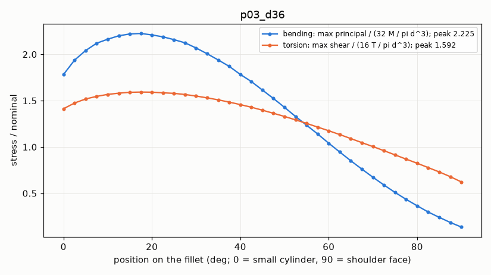
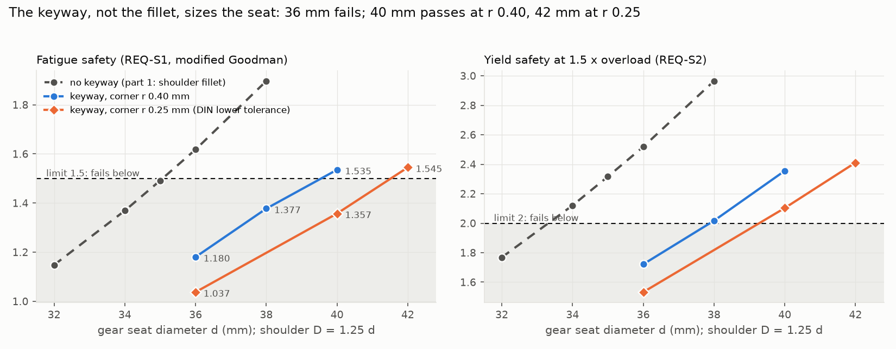

# Gearbox shaft: fatigue and overload safety at the shoulder fillet and the keyway, and the seat that passes

[Portfolio index](../PORTFOLIO.md) · Structures and vibration

| | |
|---|---|
| **Answer** | The intermediate shaft as drawn (42CrMo4 Q&T, D 40 -> d 32 mm, fillet 1.6 +0.4 / -0.2 mm; rotating bending 300 N m, steady torque 500 N m) **fails both requirements**: fatigue safety **1.19** at the nominal fillet and **1.15** at its lower tolerance (limit 1.5, modified Goodman), first-cycle yield safety at a 1.5 x overload **1.83 / 1.77** (limit 2.0). **No fillet that fits under the 4 mm shoulder reaches 1.5** (1.47 at 3.9 mm). Scaling the step does: the smallest small diameter meeting both is **35.1 mm**, so a **36 mm seat with a 45 mm shoulder** (fillet 1.8 mm) gives fatigue safety **1.62** and yield safety **2.52** across the fillet tolerance. Verification: two checks fail, neither on a verdict: the mesh study's check on the torsion factor Kts (it creeps up 0.12 % at the finest level, against a measured noise floor of 0.11 %; no requirement uses Kts directly) and the element quality at a 3.7 mm fillet (0.065 against 0.1; that point is unverified, its neighbours at 3.5 and 3.9 mm pass). The client, loads and limits are synthetic; the material values are catalogue values and every fatigue relation is from a fetched, published source. **Part 2, the keyed gear seat:** the gear's DIN 6885 keyway, ending 2 mm before the fillet, governs: at the 36 mm seat it drops the fatigue safety to **1.18** and the yield safety to **1.72** (both fail; the fillet alone 1.65 / 2.48). The smallest keyed seat is **40 mm with "keyway bottom corner r 0.4 min" on the drawing** (1.535 / 2.36), or **42 mm** if the corner may sit at the bottom of its 0.25-0.40 mm tolerance (1.545 / 2.41). The shaft is delivered as a detailed CadQuery part with STEP files. |
| **Discipline** | Machine elements: shaft fatigue at a stress concentration |
| **Tools** | CadQuery (STEP), Gmsh (Python API), CalculiX, Python |
| **Methods** | 3D half model (symmetry for bending, antisymmetry for torsion), Kt and Kts from FE, Shigley's stress-life method (Marin factors, Neuber notch sensitivity, von Mises combined stresses, modified Goodman, ASME elliptic), mesh study with a measured noise floor, published Kt fits (Pilkey, Roark); part 2: global model driving five submodels (`*SUBMODEL`), keyseat factors against Le and Le (ASEE 2013), detailed parametric CAD checked against hand volumes |

## The question

A two-stage gearbox's intermediate shaft steps from a 40 mm shoulder to a 32 mm seat through a 1.6 mm fillet (+0.4 /
-0.2 mm). It carries a rotating bending moment of 300 N m (fully reversed at the fillet) and a steady torque of 500 N m.
Is the fatigue safety at the fillet at least 1.5 (REQ-S1), is the first-cycle yield safety under a 1.5 x overload at
least 2.0 (REQ-S2), and what is the smallest fillet radius that meets REQ-S1 (REQ-S3)?

## The answer

| Fillet radius | Kt (bending) | Kts (torsion) | Fatigue safety (Goodman) | ASME elliptic | Yield safety at 1.5 x |
|---|---|---|---|---|---|
| 1.4 mm (lower tolerance) | 2.232 | 1.599 | **1.15** | 1.39 | **1.77** |
| 1.6 mm (nominal) | 2.136 | 1.548 | **1.19** | 1.44 | **1.83** |
| 2.0 mm (upper tolerance) | 1.988 | 1.475 | 1.26 | 1.53 | 1.92 |
| 2.5 mm | 1.858 | 1.409 | 1.33 | 1.61 | 2.02 |
| 3.0 mm | 1.763 | 1.361 | 1.38 | 1.69 | 2.09 |
| 3.5 mm | 1.690 | 1.325 | 1.43 | 1.75 | 2.16 |
| 3.7 mm | 1.664 | 1.312 | 1.45 (unverified) | 1.77 | 2.18 |
| 3.9 mm (0.1 mm below the shoulder height) | 1.640 | 1.300 | 1.47 | 1.79 | 2.20 |

REQ-S1 fails at every radius and REQ-S2 across the whole tolerance band (it passes from about 2.4 mm). So REQ-S3 has no
answer on this step: the fillet cannot be made large enough under a 4 mm shoulder.

What does pass: scaling the step with its diameter (D = 1.25 d, fillet 0.05 d at its -0.2 mm tolerance), with the same
loads and material:

| Small diameter d | Shoulder D | Fillet (lower tol.) | Fatigue safety | Yield safety |
|---|---|---|---|---|
| 32 mm (as drawn) | 40 mm | 1.40 mm | 1.15 | 1.77 |
| 34 mm | 42.5 mm | 1.50 mm | 1.37 | **2.12** |
| 35 mm | 43.75 mm | 1.55 mm | 1.49 | 2.32 |
| **36 mm** | **45 mm** | **1.60 mm** | **1.62** | **2.52** |
| 38 mm | 47.5 mm | 1.70 mm | 1.90 | 2.96 |

Interpolated, the smallest d is 35.1 mm for fatigue and 33.3 mm for yield. A 36 mm seat is the recommendation with
margin; a stronger steel or a rolled fillet are the other levers, not assessed here.

## How it works

- **Kt from the FE model.** CalculiX solves half of the stepped shaft (the profile revolved by 180 degrees, 10-node
  tetrahedra from Gmsh, refined along the fillet). Two linear load cases on one mesh: bending (the plane through the
  axis is a symmetry plane) and torsion (the same plane is antisymmetric). The large end is clamped; on the loaded end
  the exact beam stresses are applied as consistent nodal forces, so the small section carries the beam field from the
  end on. Kt is the peak nodal max principal stress on the fillet over 32 M / (pi d^3); Kts the peak max shear over
  16 T / (pi d^3). Both peaks sit 15-17 degrees up the fillet from the small cylinder.
- **Fatigue by Shigley's method** (Mechanical Engineering Design, 11th ed., chapter 6, checked against the published
  solutions manual's worked values): Se' = 0.5 Sut; machined surface factor and size factor; notch sensitivity from
  Neuber's constant for steels (separate bending and torsion fits) at the fillet radius; Kf and Kfs on the alternating
  bending and mean torsion stresses, combined by von Mises; modified Goodman (and ASME elliptic beside it).
- **Yield**: von Mises of the overload stresses with Kf and Kfs applied (the conservative form Shigley uses for shafts).
- DIN 743 is a paid standard and was not used.

## How I know it's right

- **Equilibrium**: the clamp's reaction moment matches the applied moment to 1e-7 in both load cases.
- **Load introduction**: the consistent nodal forces give M / 2 and T / 2 on the half model to 1.4e-5.
- **Beam theory** in the small section, away from the fillet: within 0.3-0.6 % at every point (0.6 % on the finest
  mesh, 0.3-0.5 % at the 0.14 mm evidence mesh).
- **Published fits**: FE Kt is 1.5-6.7 % above Pilkey's fit of Peterson's charts (more at small radii), Kts 1.8-2.7 %
  below. Recent finite-element work finds Peterson's bending values up to 15 % low, so this is the expected direction;
  the FE value is used for the verdicts. Two published fits of the same charts (Pilkey 2nd ed., Roark 8th ed.) differ by
  up to 2.2 % themselves.
- **Mesh study** (fillet elements 0.28 / 0.2 / 0.14 / 0.1 mm) with a **measured noise floor** (five perturbed meshes at
  0.14 mm: 0.11-0.23 %): Kt, the fatigue and the yield safety converge within the noise (uncertainty about 0.1 %); Kts
  creeps up 0.12 % at the finest level, just above its 0.11 % floor, so that one check fails. No requirement uses Kts
  directly; its whole range over four meshes is 0.27 %, against margins of 9-23 % on the verdicts.
- **Off-plane consistency**: the peak read away from the refined plane (cos-corrected for bending) agrees with the
  on-plane peak within 0.04-1.3 %, closing with refinement.
- **Reference relations unit-tested** against the source's own worked numbers (Neuber's constant, notch sensitivity,
  Kf, surface and size factors, endurance limit).

## What the checks caught

- **A sign, not a stress.** The first mesh run failed its end-load check by exactly 200 % in torsion: the tractions turn
  the end in the negative sense and the check compared signed values. The equilibrium check passed; the end-load check
  now compares magnitudes. The run is kept.
- **Nodal-stress noise read as divergence.** Kts and the yield safety moved by 0.1-0.2 % between fine meshes and the
  convergence index called them divergent. A finer level did not settle it (it added another noisy sample); measuring
  the noise with perturbed meshes did, as in the cracked-plate study.
- **A maximum over many nodes is biased upward.** Taking the peak over every fillet node picked nodes 1.6-1.9 mm off the
  plane that read 0.9 % above the true peak, which bending's cos(theta) variation forbids. The peak is read on the
  refined plane; the off-plane maximum became a check.
- **Straight-sided end faces lost 1.8 % of the moment** (the polygon under the circle); integrating on the curved
  quadratic faces closes it to 1.4e-5.
- **A sliver face inverted the mesh.** At a 3.9 mm fillet the shoulder face is 0.1 mm wide and 14 curved tetrahedra
  turned inside out; Gmsh's high-order optimisation untangles them (the optimised mesh moves the 3.5 mm result by
  0.03 %), and an element-quality check now guards it. It caught one more: at 3.7 mm the optimised mesh's worst
  element is poor (scaled Jacobian 0.065, under the 0.1 floor), so that point is reported unverified.
- **The textbook's own editions differ.** Shigley's 11th edition lowered the machined surface factor (6.5 % less
  endurance limit at 1000 MPa than the 10th); the 10th would give fatigue safety about 1.25 at the nominal fillet, still
  a fail. And the solutions manual has an arithmetic slip in one worked value (torsion, 64 kpsi), caught because every
  fit was tested against more than one worked example.

## Limits

- Shigley's stress-life method with catalogue material values; no test certificates, no reliability factor (the mean
  endurance limit), no residual stresses, surface rolling or peening.
- No fretting or press-fit stress from a gear or bearing seated at the shoulder; no torsional alternation (steady
  torque).
- Elastic Kt; the yield check applies Kf to the overload (conservative).
- No physical test data.

## Part 2: the keyed gear seat

### The question

The gear on the 36 mm seat is driven by a key, so the seat carries a keyway (DIN 6885 form A, end-milled; 10 x 8 key
for 30-38 mm shafts, 12 x 8 for 38-44 mm; keyway 5.0 mm deep; bottom corner radius 0.25-0.40 mm). It is 40 mm long and
ends 2 mm before the shoulder fillet starts; the length and the gap are synthetic, as a drawing would give them. Same
loads, material and requirements as part 1. Does the 36 mm seat still pass once the keyway is cut, and if not, which
seat does?

### The answer

| Seat d / shoulder D | Key | Keyway corner | Keyway Kt (bending / torsion) | Fatigue safety | Yield safety at 1.5 x | |
|---|---|---|---|---|---|---|
| 36 / 45 mm (part 1's choice) | 10 x 8 | 0.40 mm | 3.18 / 2.76 | **1.18** | **1.72** | fails both |
| 36 / 45 mm | 10 x 8 | 0.25 mm | 3.86 / 3.19 | **1.04** | **1.53** | fails both |
| 38 / 47.5 mm | 10 x 8 | 0.40 mm | 3.20 / 2.77 | **1.38** | 2.02 | fails fatigue |
| **40 / 50 mm** | **12 x 8** | **0.40 mm** | 3.46 / 2.63 | **1.535** | **2.36** | **passes** |
| 40 / 50 mm | 12 x 8 | 0.25 mm | 4.16 / 3.02 | **1.36** | 2.10 | fails fatigue |
| **42 / 52.5 mm** | **12 x 8** | **0.25 mm** | 4.23 / 3.03 | **1.545** | **2.41** | **passes** |

The keyway, not the fillet, now sets the seat: at every point the fillet's own fatigue safety (1.65-2.61) is well above
the keyway's. The keyway's bottom corner moves the answer by one seat size: at 0.25 mm its fatigue safety is 12 % lower
than at 0.40 mm. So the recommendation is a **40 mm seat with a 50 mm shoulder and "keyway bottom corner r 0.4 min" on
the drawing**, or a **42 mm seat** if the corner may sit anywhere in its tolerance. The 40 mm margin is thin (2.4 % on
fatigue, against a measured mesh noise of 1.2 %); a stronger steel, a keyway that stops further from the shoulder, or a
rolled keyway corner are the other levers, not assessed here.

### The detailed part

The shaft is delivered as a detailed CadQuery part, not just the analysed stub
([`models/cad/intermediate_shaft.py`](../models/cad/intermediate_shaft.py)). STEP files:
[36 mm seat (fails)](cad/intermediate_shaft_d36.step), [40 mm seat, corner r 0.4](cad/intermediate_shaft_d40.step),
[42 mm seat, corner r 0.25](cad/intermediate_shaft_d42.step).

- Bearing journals (6206 / 6207 deep-groove ball bearings) with DIN 471 circlip grooves and 1 x 45 deg end chamfers;
  the gear seat with its end-milled keyway; the analysed shoulder fillet; the collar; the pinion seat with its own
  keyway.
- The dimensions the study analysed (seat, shoulder, fillet, keyway width, depth, corner, length and gap) come from
  the study's own model; everything else is a plausible layout, marked synthetic in the source.
- Checked by hand, not by eye: the revolved body matches a hand volume (cylinders, Pappus for the fillets and
  chamfers, the grooves) to 1e-9, and the keyways remove the same volume as the study's half model to 1e-4.

### How it works

- **One CAD model through to the solver.** The analysed half shaft (cut through the keyway's centre plane: symmetric in
  bending, antisymmetric in torsion) is built in CadQuery, written as STEP, meshed by Gmsh (10-node tetrahedra) and
  solved by CalculiX.
- **Global model and submodels.** A single fine mesh would be 440-510 k nodes, past what CalculiX's SPOOLES solver
  handles (a 540 k-node trial ran 25 min without output). So a coarse global model (84 k nodes) drives five fine
  submodels through their cut faces (`*SUBMODEL`): the shoulder fillet in two quarter rings, the keyway's end at the
  shoulder, its far end and its middle (97-186 k nodes each).
- **Kt and fatigue as in part 1**: Kt from the gross nominal stresses at the seat diameter, Shigley's method with the
  keyway's own corner radius for the notch sensitivity. The bending peak is at the bottom corner of the keyway's end
  nearest the shoulder; the torsion peak along the bottom corner of its long side.

### How I know it's right

- **The same path without a keyway** reproduces part 1's verified fillet Kt within 0.38 % (bending) and 0.42 %
  (torsion).
- **Published keyseat factors** ([Le and Le, ASEE 2013](https://peer.asee.org/22476), an isolated profile keyseat at
  ANSI proportions), at three of their corner ratios. Their bending factor is the axial stress (their eq. 2); ours
  is above theirs by 3.5 %, 5.5 % and 8.7 % at r/B 0.083, 0.05 and 0.03, and in torsion by 1.7-4.8 %. The gap grows
  as the corner sharpens, so it is not a fixed difference of definition; the likelier cause is their peak reading (a
  2 % strain-energy convergence criterion converges the model, not a local peak). Reported as an open difference,
  measured, not a pass. Our factors are the higher at every ratio, and the verdicts use the higher principal stress,
  so a lower reference value could only raise the safety factors.
- **Equilibrium and load** of the global model: reaction against applied moment within 4e-7, the applied end loads
  within 1.1e-5, in both load cases.
- **Global against submodel** at the fillet, where the global mesh resolves it: within 2 % (one point at 2.18 %, with
  both peaks at the same spot, 0.4 mm apart).
- **A measured noise floor.** Five meshes differing only in their far-field sizes: the keyway's bending Kt scatters
  1.8 %, the fatigue safety 1.2 %. This is the resolution of a peak-node value at this mesh, declared before the mesh
  study.
- **Mesh study** (submodel sizes x 1.0 / 0.8 / 0.64), judged against that floor: the keyway's Kt, the fatigue and the
  yield safety settle within 0.34-0.64 %, the fillet's Kt within 0.24 %; every check passes the 1 % target. At the
  36 mm seat the fatigue safety is 1.174-1.184 on all three meshes, against the 1.5 it needs.
- **Box size**: submodels 3 and 5 mm clear of their features agree within the noise floor (keyway torsion 0.47 %, the
  smaller box reading higher).

### What the checks caught

- **The fillet's peaks were outside the box.** The first runs boxed the fillet with the keyway's end. A scan of the
  global model showed the keyway moves the fillet's peaks: in bending to about 27 deg from the keyway, onto the box's
  cut face; in torsion to the far side of the shaft (+6 %: the keyed section is weaker in torsion, so the side away
  from the keyway carries more shear into the fillet). The global-against-submodel check caught the torsion one (6.4 %
  apart). The fillet now has its own submodels over the whole half ring.
- **Peaks read on driven faces.** Those nodes carry the global model's error, and a long side under uniform shear puts
  its maximum there. No peak is now read within 1 mm of a cut face.
- **A small corner inverted the coarse mesh.** One quadratic element across the 0.25 mm corner turned inside out, and
  the submodels it drives inherit the error. The global mesh now uses at most 0.75 x the corner radius there.
- **Noise read as a trend.** Between mesh levels the keyway's Kt moved 0.5-1 %, and one safety factor came out with a
  convergence order of 6.8, a nonsense value. Measuring the noise first showed that a 1 % convergence target was below
  what three meshes can resolve here.

### Limits (part 2)

- The key's bearing pressure on the keyway wall and any press fit of the gear are not modelled (Shigley's practice for
  keyseat factors).
- The full bending moment and torque are taken at the keyway's end, 2 mm from the fillet (conservative).
- DIN 6885 dimensions from published reproductions of the table; the standard itself (a paid document) was not read.

## Evidence

- Mesh study [`shaft_fillet_mesh_r2`](../runs/20261124-160912_shaft_fillet_mesh_r2/report.md) (with the measured noise floor), noise
  [`shaft_fillet_noise`](../runs/20261124-154527_shaft_fillet_noise/report.md), radius
  [`shaft_fillet_radius`](../runs/20261124-152828_shaft_fillet_radius/report.md) and
  [`shaft_fillet_radius_r1`](../runs/20261124-160916_shaft_fillet_radius_r1/report.md), sizing
  [`shaft_fillet_size`](../runs/20261124-155125_shaft_fillet_size/report.md); the earlier mesh runs are kept
  (`runs/20261124-151223_shaft_fillet_mesh`, `runs/20261124-152823_shaft_fillet_mesh_r1`)
- Cases with predictions and results: `cases/shaft_fillet_*.toml`; model `models/fea/shaft_fillet_ccx.py`, study
  `studies/shaft_fillet.py`, references `validation/shaft_fatigue.py`
- Part 2: mesh study [`keyed_shaft_mesh_r1`](../runs/20261127-031958_keyed_shaft_mesh_r1/report.md), noise
  [`keyed_shaft_noise`](../runs/20261127-010741_keyed_shaft_noise/report.md), checks
  [`keyed_shaft_check_r1`](../runs/20261127-015248_keyed_shaft_check_r1/report.md), Le and Le at three ratios
  [`keyed_shaft_le_sweep`](../runs/20261127-110904_keyed_shaft_le_sweep/report.md), seat and corner radius
  [`keyed_shaft_design_r1`](../runs/20261127-021152_keyed_shaft_design_r1/report.md); the first runs, whose fillet
  boxes missed the peaks, are kept (`runs/20261126-232303_keyed_shaft_mesh`, `runs/20261126-234913_keyed_shaft_check`,
  `runs/20261127-000418_keyed_shaft_design`)
- Part 2 cases with predictions and results: `cases/keyed_shaft_*.toml`; model `models/fea/keyed_shaft.py`, study
  `studies/keyed_shaft.py`; the detailed part `models/cad/intermediate_shaft.py` (tests
  `tests/test_intermediate_shaft.py`); figure `scripts/make_keyed_shaft_figure.py`
