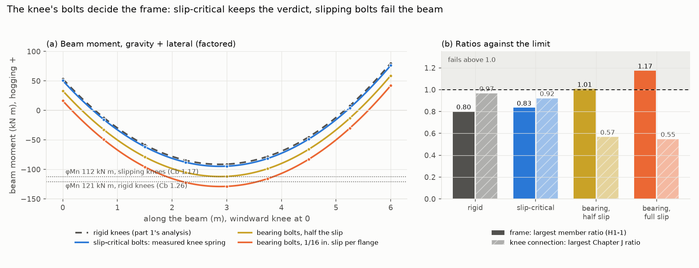

# Steel portal frame to AISC 360-22, by the Direct Analysis Method, and its bolted knee

[Portfolio index](../PORTFOLIO.md) · Structures and machines

| | |
|---|---|
| **Answer** | The equipment-platform frame (W10x33 columns 4.0 m, W14x30 beam 6.0 m, fixed bases, ASTM A992) **passes all three of the client's requirements** under their factored loads (35 kN/m on the beam, 15 kN lateral): the largest combined axial-and-bending ratio (AISC Eq. H1-1) is **0.80**, in the beam under gravity plus wind, governed by lateral-torsional buckling over its unbraced 6.0 m span; the columns reach 0.45. Live-load deflection **4.1 mm** (limit L/360 = 16.7 mm), service drift **2.6 mm** (limit H/400 = 10.0 mm). The beam's bracing was not specified, so it was taken as unbraced (conservative): bracing it at midspan cuts the largest ratio to **0.48**, and the verdict does not depend on it. Verification: the analysis reproduces AISC's own worked Direct Analysis Method example (C.1A) within 0.7 % on forces and 1.7 % on drift; the member checks reproduce 12 worked answers of the AISC Design Examples within 0.5 %; first-order moments match the closed-form portal solution to 4e-9; AISC's approximate B1-B2 method agrees with the exact second-order moment to 0.05 %. The client and loads are synthetic. **Part 2, the knee:** the beam-to-column joint designed as a bolted flange-plated moment connection (AISC 360-22 Chapter J; the method reproduces Design Example II.B-1's 18 capacities) and modelled as a 3D solid. By AISC's classification index it is partially restrained (Ks L/EI **8.0** against 20 for fully restrained), but as a spring in the frame's own centreline model (k L/EI **23.7**) it changes little: beam **0.80 to 0.83**, drift 2.6 to 2.8 mm, all pass. **The bolts must be slip-critical** (six 3/4 in. per flange; slip governs at 0.97): snug-tight bearing bolts that slip 1/16 in. into bearing move the knees' moment to the unbraced midspan and the beam **fails (1.17)**. Detailed CAD of the knee with STEP files. |
| **Discipline** | Structural steel design: frame stability and member design to a building code |
| **Tools** | Python (a plane-frame solver written and verified for this study), AISC 360-22 and the v16.0 Design Examples; part 2: CadQuery (STEP), Gmsh, CalculiX |
| **Methods** | Second-order plane-frame analysis by the direct stiffness method with exact stability functions (P-Delta and P-delta); the Direct Analysis Method (80 % stiffness, notional loads, effective length = unbraced length); AISC 360-22 Chapters E (with slender-web effective area), F, G and H; serviceability; part 2: AISC Chapter J and J10 connection design, the knee as a 3D solid for its rotational stiffness (section rotations against beam theory), semi-rigid knees and bolt slip (a gap, then the spring) in the Direct Analysis Method |

## The question

A client's equipment platform rests on a single-bay steel portal: two W10x33 columns 4.0 m tall with fixed bases,
rigidly connected to a W14x30 beam spanning 6.0 m, all ASTM A992 (yield 345 MPa). The client gives the factored
loads (LRFD): 35 kN/m on the beam and 15 kN lateral at beam level; and the service loads: 12 kN/m live and 10 kN
lateral. Does the frame meet AISC 360-22?

| ID | Requirement | Limit |
|---|---|---|
| REQ-A1 | Every member's combined axial and flexural ratio, Eq. H1-1, by the Direct Analysis Method | at most 1.0 |
| REQ-A2 | Beam deflection under the service live load | L/360 = 16.7 mm |
| REQ-A3 | Frame drift under the service lateral load | H/400 = 10.0 mm |

## The answer

| Member | Gravity + notional load | Gravity + lateral load | Governing limit state |
|---|---|---|---|
| Beam (W14x30) | 0.789 | **0.801** | Lateral-torsional buckling, unbraced 6.0 m (Cb 1.26) |
| Leeward column (W10x33) | 0.385 | 0.452 | Flexure at the plastic moment (Cb 2.2 lifts lateral-torsional buckling to the 0.9 Mp cap), small axial load |
| Windward column | 0.381 | 0.313 | |

**All three requirements pass.** Shear is far from critical (at most 22 % of capacity). The frame is stiff: the
second-order drift is only 2 % above the first-order drift, so stability effects are small, and the notional loads
need not be added to the wind case (Specification C2.2b(d): only above a ratio of 1.7).

**The beam's bracing decides the margin, not the verdict.** The client has not said how the beam is braced against
lateral-torsional buckling. The base case takes no credit for the platform deck (unbraced over 6.0 m). If the deck
or a brace holds the beam's compression flange:

| Beam unbraced length | Largest ratio | Governing |
|---|---|---|
| 6.0 m (no bracing; the base case) | 0.801 | the beam |
| 3.0 m (braced at midspan) | 0.477 | the beam |
| 1.5 m (quarter points; below Lp = 1.60 m) | 0.452 | the leeward column (beam 0.389) |

**Questions for the client:** how is the beam braced (deck attachment, kicker braces)? And is the frame braced out of
its plane at the beam level, as assumed for the columns' weak axis?

## How it works

- **Analysis.** A plane-frame solver by the direct stiffness method, with the exact stiffness of a member under axial
  load (stability functions), so both P-Delta (frame sway) and P-delta (member bowing) are exact without subdividing
  members; second order by iterating on the axial forces. Members can carry end hinges (needed for leaning columns).
- **Direct Analysis Method** (Specification Chapter C): every stiffness reduced to 80 %; notional loads of 0.2 % of
  the gravity load to stand for out-of-plumbness; the extra reduction tau_b checked (axial load about 5 % of the
  squash load, so tau_b = 1); effective length equal to the unbraced length.
- **Member checks** (Chapters E, F, G, H): compression with the effective area of the beam's slender web (h/tw 45.4 >
  35.9, Section E7), flexure with lateral-torsional buckling and flange local buckling (the column's flange is
  compact by 0.002 on the ratio), web shear, and the H1-1 interaction. Cb is computed from each member's own
  second-order moment diagram.
- **Serviceability** with full (unreduced) stiffness: the beam's live-load deflection relative to its ends, and the
  drift under the service lateral load with the live load on the beam, second order.

## How I know it's right

- **The analysis against AISC's own worked example.** Design Example C.1A (a pinned-base portal with a leaning
  column, by the Direct Analysis Method) rerun inside every point: drift 0.288 against 0.290 in., knee moments 109 and
  128 against 109 and 127 kip-ft, base shears and reactions within 0.7 %.
- **The member checks against the worked answers of nine AISC Design Examples** (and the Manual table values one
  of them uses): columns E.1C, E.1D and E.1E (a
  slender web at three lengths), beams F.1-1B, F.1-2B and F.1-3B (yielding, inelastic and elastic lateral-torsional
  buckling) and F.3B (a noncompact flange), shear G.1B, interaction H.1B and its table values; all within 0.5 %
  except where the example rounds an intermediate value (0.8 %, stated in the test).
- **First order against the closed form** for a fixed-base portal (Kleinlogel): knee moment under the beam load and
  base moment under the lateral load agree to 4e-9.
- **Second order two ways**: the exact solution against AISC's approximate B1-B2 method (Appendix 8): 0.05 %.
- **Equilibrium** to 3e-14; the same answer with 2 or 8 elements per member (3e-10).

## What the checks caught

- **A wrong check, and a commit that went in with it failing.** The C.1A equilibrium test first compared the
  leaning column's base shear with the frame's average drift; the leaning column sways with the column it is tied to. A shell pipe (`pytest | tail`) hid the failure from the commit gate; the fix and the rule
  (gate commits on the test runner's own exit code) are recorded.
- **The approximate method's lateral case carried the gravity load a second time**, so B1-B2 came out 85 % above the
  exact moment (148 against 80 kN m). With the "no translation" and "lateral translation" analyses properly
  separated, B2 = 1.02 and the two agree to 0.05 %.
- **The column's flange sits on the compact limit**: bf/2tf 9.15 against 0.38 sqrt(E/Fy) = 9.152, compact by 0.002.
  The comparison is made at full precision and the test pins the classification, so a change in rounding or in the
  section data shows up as a failing test, not a silent change of limit state.

## Limits

- Plane frame; rigid knees and fixed bases assumed adequate (base plates and anchors not designed; the knees are designed and their stiffness checked in part 2).
- The bracing assumptions above (beam unbraced; columns braced out of plane at the beam).
- Loads as given by the client (no load derivation); no dynamic, fatigue or vibration assessment of the equipment.
- The prediction for the base case was not blind (a development run printed the values first; the case file says
  so); the evidence is the checks above, and the bracing sensitivity's predictions were made before its run.
- Synthetic client and loads.

## Part 2: the knee

### The question

Part 1 analysed the frame with rigid knees and left the knees undesigned. As built, each knee is the W14x30 beam
bolted to the top of a W10x33 column through flange plates. Does that joint carry its forces (AISC 360-22 Chapter J),
is it stiff enough to be analysed as rigid, and does the frame still meet its three requirements with the knee as it
really is?

### The answer

| Knee | Knee stiffness in the frame | Beam (H1-1) | Live deflection | Service drift | Connection (Chapter J) |
|---|---|---|---|---|---|
| Rigid (part 1's analysis) | infinite | 0.80 | 4.1 mm | 2.6 mm | 0.97 (slip-critical bolts) |
| **Slip-critical bolts, 6 per flange** | **k L/EI 23.7** | **0.83** | **4.3 mm** | **2.8 mm** | **0.92** (slip) |
| Bearing bolts, 4 per flange, half the slip | k L/EI 21.3 after 4.4 mrad | **1.01** | 8.3 mm | 4.5 mm | 0.57 |
| Bearing bolts, 1/16 in. slip per flange | k L/EI 21.3 after 8.7 mrad | **1.17** | 8.4 mm | 7.6 mm | 0.55 |

Limits: 1.0, 16.7 mm (L/360), 10.0 mm (H/400), 1.0.

**Recommendation: slip-critical bolts** (3/4 in. Group A, Class A faying surfaces, three per line, plates 6 x 1/2 x
9 1/2 in.), a pair of 1/2 in. continuity plates at the top plate's level, and part 1's verdict stands. With snug-tight
bearing bolts the knees act as hinges until the bolts slip into bearing; the moment they don't take goes to the
beam's midspan, where its unbraced 6 m governs, and the beam fails. Bracing the beam at midspan (part 1: 0.48) is the
other way out.

AISC's classification index puts the knee at Ks L/EI 8.0: partially restrained, not fully restrained (20). That does
not make part 1 wrong, but it means the knee's stiffness belongs in the analysis, which this part does.

### The detailed part

The knee is delivered as a detailed CadQuery assembly ([`models/cad/portal_knee.py`](../models/cad/portal_knee.py)).
STEP files: [slip-critical, 15 bolts](cad/portal_knee_slip_critical6.step), [bearing, 11
bolts](cad/portal_knee_bearing4.step).

- Column and beam stubs with their root fillets, the flange plates and the single shear tab with standard holes,
  clipped continuity plates, 1/4 in. fillet welds, heavy-hex structural bolts with nuts and hardened washers (lengths
  from the grip).
- Checked by hand, not by eye: every part's volume against a hand calculation (to 1e-9), no interference between
  bolts, plates, beam and welds, and the plate lengths equal to the analysed ones.
- Stub lengths and weld returns are layout, marked synthetic in the source; bolt, nut and washer sizes are the
  nominal values of published tables.

### How it works

- **Connection design** ([`validation/flange_plated.py`](../validation/flange_plated.py)): every limit state of the
  flange-plated connection (bolts in shear, bearing and tearout, slip for slip-critical bolts, plates in tension,
  compression and block shear, welds with the directional factor, the beam's flange holes) and of the column at a knee
  (J10 in its column-end forms, panel-zone shear, the continuity plates as stiffeners), for the forces part 1's frame
  puts on each knee in each factored case.
- **The knee as a solid** ([`models/fea/moment_connection.py`](../models/fea/moment_connection.py)): column and beam
  stubs with every plate, bonded, as 10-node tetrahedra in CalculiX (half model about the webs' plane). A tip load on
  the beam; the rotations of a beam section and a column section clear of the joint give two numbers:
  - AISC's index Ks L/EI (Commentary B3.4b), the beam at the column face against the column at the joint's bottom,
    as a test would measure it;
  - the spring k L/EI that, put at the beam's end in the frame's centreline model, reproduces the solid. The
    centreline model already treats the members as flexible inside the joint, so k is three times Ks.
- **The frame with its knees**: the spring at each beam end, times 0.8 as the Direct Analysis Method requires for
  every stiffness (C2.3); for bearing bolts a gap of the hole clearance first. A gap then a spring is linear once the
  gap has closed, so it is solved exactly as a lack of fit, knee by knee, from an open start.

### How I know it's right

- **The connection method against AISC's own worked example**: fed Example II.B-1's geometry and forces, it returns
  the example's 18 capacities within 0.5 % and its weld size; slip resistance against Examples J.4A and J.4B.
- **The solid**: its volume against a hand volume to 1e-15; beam theory between two sections of each member within
  0.2 % (with the solid's own section stiffness); base reactions balance the tip load to about 1e-6; the joint's
  stiffness from two pairs of sections, 300 and 700 mm out, agrees within 0.08 %.
- **Mesh study** (124 k, 180 k, 268 k nodes): k L/EI 23.88 / 23.77 / 23.69, converged within 0.97 %; Ks L/EI
  8.01 / 8.00 / 7.99, within 0.36 %. One check failed: moment equilibrium at the finest mesh, 1.4e-6 against 1e-6,
  round-off over 3,000 base nodes (the force balance is 7e-8).
- **The frame**: with rigid knees it reproduces part 1 exactly; the spring against the closed form of a semi-rigid
  portal (Kleinlogel's rigid frame in the limit); the slip law M = k (theta - slip) holds to 1e-15; every part 1 check
  (AISC C.1A rerun, closed forms, equilibrium, B1-B2) passes in all four scenarios.

### What the checks caught

- **The fillets were drawn inside out.** The first solid was 4.7 % heavier than its hand volume: the root fillets
  bulged the wrong way. One sign fixed it to 1e-15.
- **A tabulated section is not the drawn one.** Beam theory missed the solid by 0.8 % (beam) and 0.3 % (column):
  exactly the drawn section's Ix (root fillets from kdes) against the tabulated one. Left in, it would have biased the
  joint's spring by 4 %; beam theory now uses the drawn section, the frame the tabulated one.
- **Coarse elements on thin walls inverted** (25 mm elements against a 3.4 mm half web and 10 mm fillets): curvature
  sizing and a finer far field fixed it. A 399 k-node mesh crashed CalculiX, so the finest level stays at 268 k.
- **The slip would not converge.** Iterating a secant spring crawled, then diverged when a lightly loaded knee was
  forced closed; a gap and a spring are linear once the gap is known, so the knees now start open and close only when
  their rotation passes the slip.
- **One mesh-quality check failed** on the variant without continuity plates (one element far from the joint): that
  point is reported unverified.

### Limits (part 2)

- The solid is bonded: no bolt deformation or bearing at holes, so its stiffness is an upper bound below slip.
- The slip is the hole clearance with holes aligned at fit-up (1/16 in. per flange); offset holes could double it
  (worse), half of it is shown. Service checks run from zero load with the live load alone, as part 1: the dead load
  would close part of the gap first, so the slipping knees' deflection and drift are upper bounds.
- Continuity-plate welds are not designed; the panel zone is checked by J10.6(a) only. AISC J3.1 leaves when
  slip-critical bolts are required to the RCSC Specification, which was not read; the requirement here comes from the
  frame's own behaviour.

## Evidence

- Base case: [`steel_frame_portal`](../runs/20261125-231923_steel_frame_portal/report.md); bracing sensitivity:
  [`steel_frame_beam_bracing`](../runs/20261125-231927_steel_frame_beam_bracing/report.md); cases with predictions and
  results: `cases/steel_frame_portal.toml`, `cases/steel_frame_beam_bracing.toml`
- Code: `validation/frame2d.py` (solver, tests in `tests/test_frame2d_reference.py`), `validation/aisc_frame.py`
  (Direct Analysis Method portal, `tests/test_aisc_frame.py` against C.1A), `validation/aisc360.py` (member checks,
  `tests/test_aisc360.py` against the Design Examples), `studies/steel_frame.py`
- References: ANSI/AISC 360-22 and the v16.0 Companion Design Examples, free from AISC (not redistributed); section
  properties from the AISC Shapes Database v16.0 (the shapes used: `validation/aisc_shapes_subset.json`)
- Part 2: knee mesh study [`steel_knee_mesh`](../runs/20261127-104729_steel_knee_mesh/report.md), designs
  [`steel_knee_design`](../runs/20261127-105017_steel_knee_design/report.md), the frame with its knees
  [`steel_frame_knee`](../runs/20261127-105635_steel_frame_knee/report.md); cases with predictions and results:
  `cases/steel_knee_mesh.toml`, `cases/steel_knee_design.toml`, `cases/steel_frame_knee.toml`
- Part 2 code: `validation/aisc_connections.py` and `validation/flange_plated.py` (tests in
  `tests/test_aisc_connections.py` against Examples II.B-1, J.4A, J.4B), `models/fea/moment_connection.py` and
  `studies/steel_knee.py` (the solid), knee springs and slip in `validation/frame2d.py` and `validation/aisc_frame.py`,
  the CAD `models/cad/portal_knee.py` (`tests/test_portal_knee.py`), figure `scripts/make_steel_knee_figure.py`
