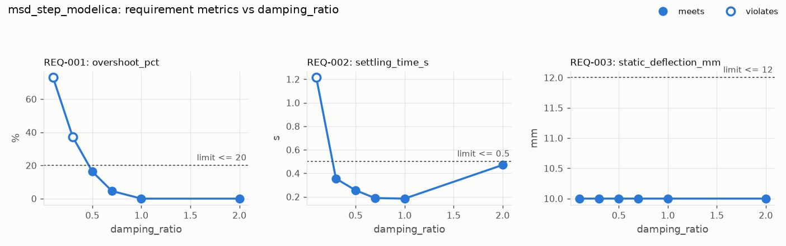
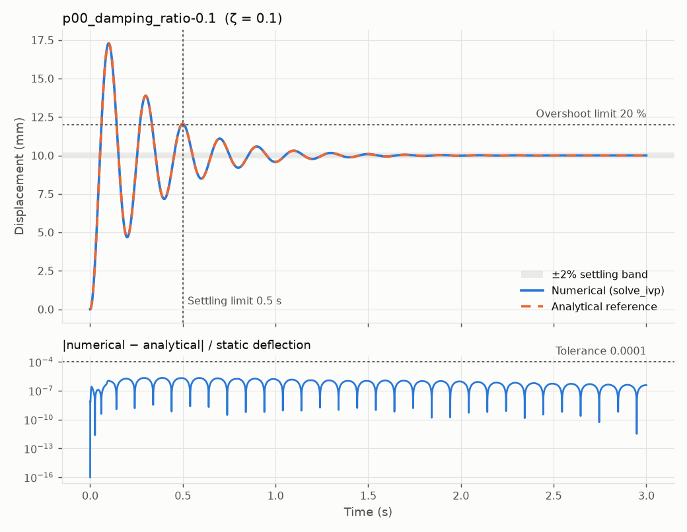
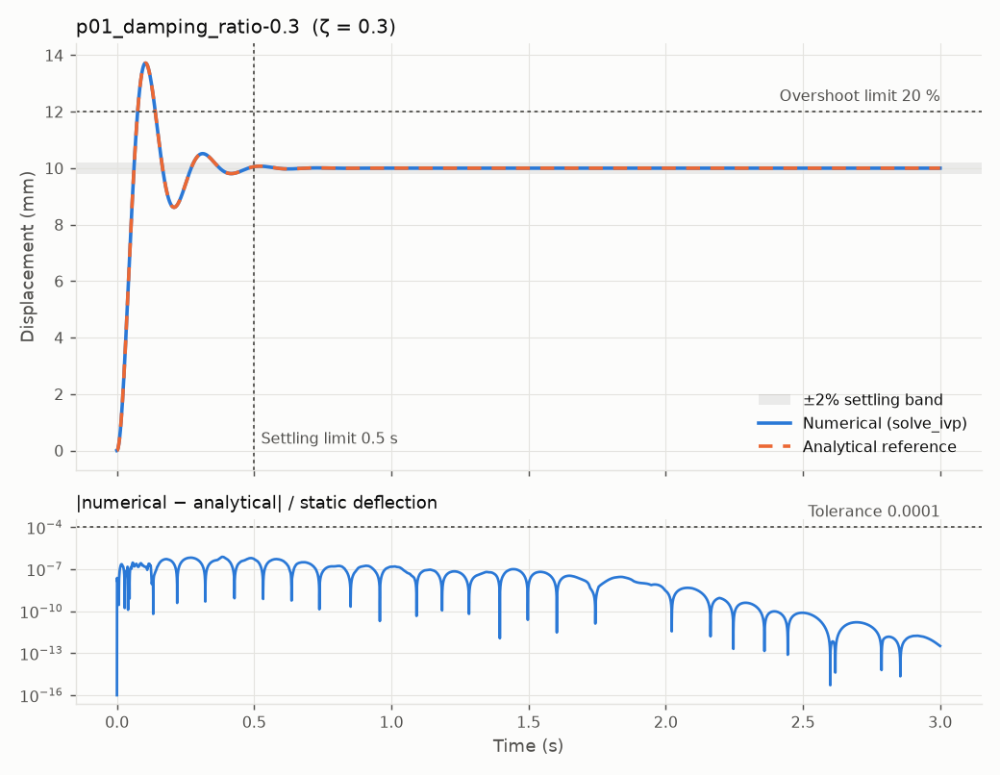
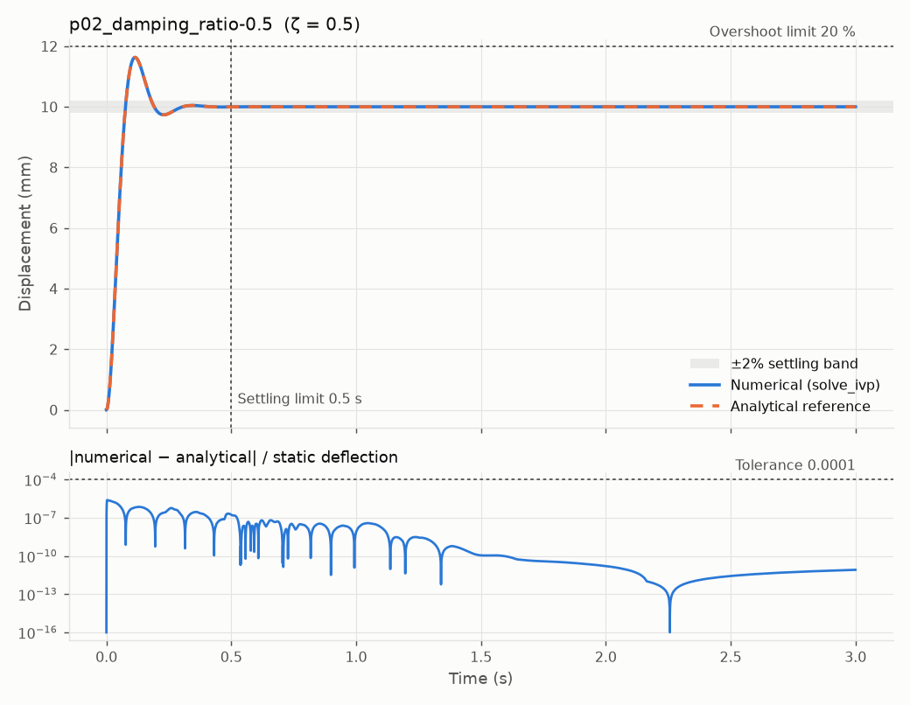
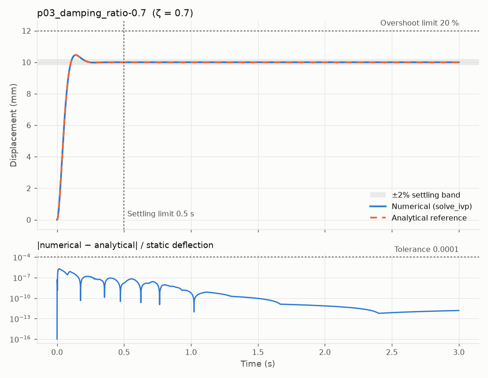
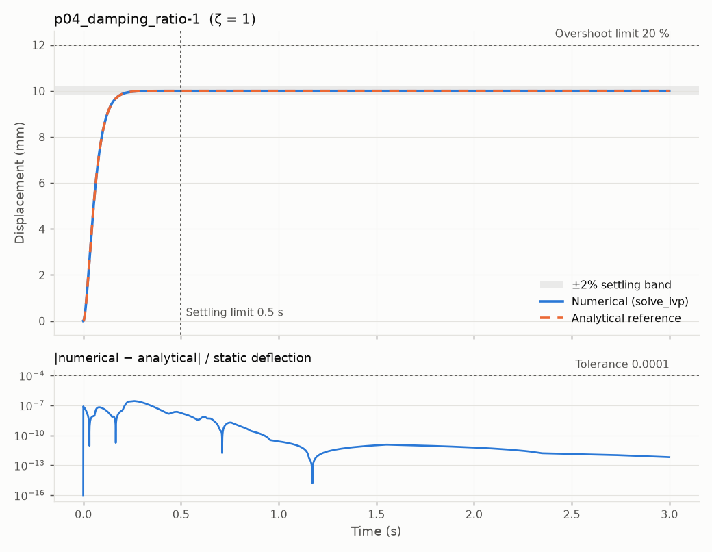
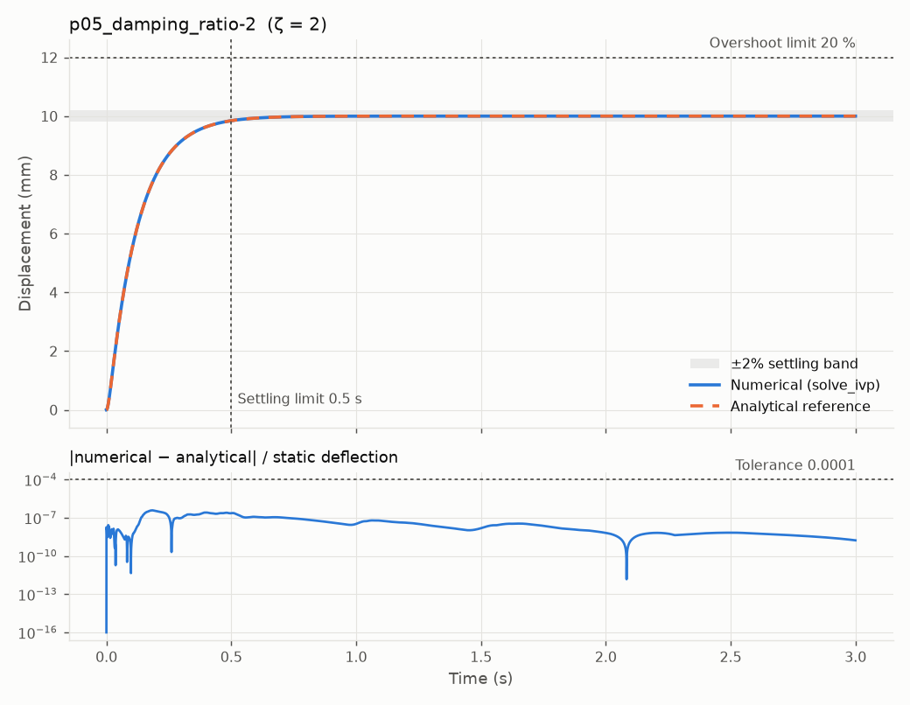

# Engineering review report: msd_step_modelica

- **Run:** `20261118-213145_msd_step_modelica`
- **Generated:** 2026-11-19T14:01:02+00:00
- **Case file SHA-256:** `73ed4ffbf0aab71ed5c59e87a6db90c0692bb018a4665405aef2429694edee1d`
- **Environment:** Python 3.14.10, numpy 2.5.5, scipy 1.18.1, matplotlib 3.11.2; Windows-11-10.0.26100-SP0
- **Tools:** omc OpenModelica v1.26.3 (64-bit); Modelica Standard Library 4.1.0
- **Code version:** git `none`
- **Simulation status:** completed
- **Verification status:** PASS

## Scope

1-DOF mass-spring-damper subjected to a 10 N step force, modelled with Modelica Standard Library translational components and solved by OpenModelica (DASSL); damping-ratio sweep against the same requirements as the SciPy case, plus a cross-tool comparison.

**Assumptions**

- Single translational degree of freedom; no gravity or preload.
- Linear spring and viscous damper, constant over the full stroke.
- Constant force applied at t = 0 from rest (x = 0, v = 0).
- Rigid mass (MSL Mass with L = 0); no compliance or friction elsewhere in the load path.

## Requirements

| ID | Requirement | Metric | Limit |
|---|---|---|---|
| REQ-001 | Peak overshoot of the step response shall not exceed 20 %. | `overshoot_pct` | <= 20 % |
| REQ-002 | The response shall settle within +/-2 % of its final value in 0.5 s or less. | `settling_time_s` | <= 0.5 s |
| REQ-003 | Static deflection under the 10 N load shall not exceed 12 mm. | `static_deflection_mm` | <= 12 mm |

## Summary across points

| Point | damping_ratio | REQ-001 | REQ-002 | REQ-003 | Checks |
|---|---|---|---|---|---|
| p00_damping_ratio-0.1 | 0.1 | 72.94 %: **FAIL** | 1.214 s: **FAIL** | 9.999 mm: **PASS** | 6/6 PASS |
| p01_damping_ratio-0.3 | 0.3 | 37.23 %: **FAIL** | 0.3552 s: **PASS** | 10 mm: **PASS** | 6/6 PASS |
| p02_damping_ratio-0.5 | 0.5 | 16.3 %: **PASS** | 0.2554 s: **PASS** | 10 mm: **PASS** | 6/6 PASS |
| p03_damping_ratio-0.7 | 0.7 | 4.599 %: **PASS** | 0.1891 s: **PASS** | 10 mm: **PASS** | 6/6 PASS |
| p04_damping_ratio-1 | 1 | 9.407e-08 %: **PASS** | 0.1845 s: **PASS** | 10 mm: **PASS** | 6/6 PASS |
| p05_damping_ratio-2 | 2 | 4.554e-07 %: **PASS** | 0.4705 s: **PASS** | 10 mm: **PASS** | 6/6 PASS |

## Point details

### p00_damping_ratio-0.1

Parameters: mass_kg = 1, stiffness_N_per_m = 1000, damping_ratio = 0.1, step_force_N = 10

Derived: damping_N_s_per_m = 6.325, natural_frequency_rad_per_s = 31.62, natural_frequency_Hz = 5.033

| Requirement | Result | Limit | Margin | Verdict | Evidence |
|---|---|---|---|---|---|
| REQ-001 | 72.94 % | <= 20 | -52.9 | **FAIL** | [point.json](points/p00_damping_ratio-0.1/point.json) |
| REQ-002 | 1.214 s | <= 0.5 | -0.714 | **FAIL** | [point.json](points/p00_damping_ratio-0.1/point.json) |
| REQ-003 | 9.999 mm | <= 12 | 2 | **PASS** | [point.json](points/p00_damping_ratio-0.1/point.json) |

| Check | Description | Value | Tolerance | Status |
|---|---|---|---|---|
| reference_agreement | max |x_num - x_ref| / (F/k) over the full time history | 2.22e-06 | 1e-04 | PASS |
| overshoot_reference | |overshoot_num - overshoot_closed_form| in percentage points | 1.29e-02 | 5e-02 | PASS |
| settling_reference | |settling_num - settling of analytical curve| in s | 0.00e+00 | 1e-03 | PASS |
| steady_state | |x(t_end) - F/k| / (F/k) | 7.58e-05 | 1e-03 | PASS |
| energy_balance | |W_in - (KE + PE + E_dissipated)| / W_in | 2.58e-06 | 1e-04 | PASS |
| solver_convergence | max |x(rtol, atol) - x(rtol/100, atol/100)| / (F/k) | 2.22e-06 | 1e-04 | PASS |

### p01_damping_ratio-0.3

Parameters: mass_kg = 1, stiffness_N_per_m = 1000, damping_ratio = 0.3, step_force_N = 10

Derived: damping_N_s_per_m = 18.97, natural_frequency_rad_per_s = 31.62, natural_frequency_Hz = 5.033

| Requirement | Result | Limit | Margin | Verdict | Evidence |
|---|---|---|---|---|---|
| REQ-001 | 37.23 % | <= 20 | -17.2 | **FAIL** | [point.json](points/p01_damping_ratio-0.3/point.json) |
| REQ-002 | 0.3552 s | <= 0.5 | 0.145 | **PASS** | [point.json](points/p01_damping_ratio-0.3/point.json) |
| REQ-003 | 10 mm | <= 12 | 2 | **PASS** | [point.json](points/p01_damping_ratio-0.3/point.json) |

| Check | Description | Value | Tolerance | Status |
|---|---|---|---|---|
| reference_agreement | max |x_num - x_ref| / (F/k) over the full time history | 7.76e-07 | 1e-04 | PASS |
| overshoot_reference | |overshoot_num - overshoot_closed_form| in percentage points | 4.94e-05 | 5e-02 | PASS |
| settling_reference | |settling_num - settling of analytical curve| in s | 0.00e+00 | 1e-03 | PASS |
| steady_state | |x(t_end) - F/k| / (F/k) | 6.09e-13 | 1e-03 | PASS |
| energy_balance | |W_in - (KE + PE + E_dissipated)| / W_in | 1.42e-07 | 1e-04 | PASS |
| solver_convergence | max |x(rtol, atol) - x(rtol/100, atol/100)| / (F/k) | 7.66e-07 | 1e-04 | PASS |

### p02_damping_ratio-0.5

Parameters: mass_kg = 1, stiffness_N_per_m = 1000, damping_ratio = 0.5, step_force_N = 10

Derived: damping_N_s_per_m = 31.62, natural_frequency_rad_per_s = 31.62, natural_frequency_Hz = 5.033

| Requirement | Result | Limit | Margin | Verdict | Evidence |
|---|---|---|---|---|---|
| REQ-001 | 16.3 % | <= 20 | 3.7 | **PASS** | [point.json](points/p02_damping_ratio-0.5/point.json) |
| REQ-002 | 0.2554 s | <= 0.5 | 0.245 | **PASS** | [point.json](points/p02_damping_ratio-0.5/point.json) |
| REQ-003 | 10 mm | <= 12 | 2 | **PASS** | [point.json](points/p02_damping_ratio-0.5/point.json) |

| Check | Description | Value | Tolerance | Status |
|---|---|---|---|---|
| reference_agreement | max |x_num - x_ref| / (F/k) over the full time history | 2.51e-06 | 1e-04 | PASS |
| overshoot_reference | |overshoot_num - overshoot_closed_form| in percentage points | 6.45e-05 | 5e-02 | PASS |
| settling_reference | |settling_num - settling of analytical curve| in s | 0.00e+00 | 1e-03 | PASS |
| steady_state | |x(t_end) - F/k| / (F/k) | 8.29e-12 | 1e-03 | PASS |
| energy_balance | |W_in - (KE + PE + E_dissipated)| / W_in | 2.95e-06 | 1e-04 | PASS |
| solver_convergence | max |x(rtol, atol) - x(rtol/100, atol/100)| / (F/k) | 2.49e-06 | 1e-04 | PASS |

### p03_damping_ratio-0.7

Parameters: mass_kg = 1, stiffness_N_per_m = 1000, damping_ratio = 0.7, step_force_N = 10

Derived: damping_N_s_per_m = 44.27, natural_frequency_rad_per_s = 31.62, natural_frequency_Hz = 5.033

| Requirement | Result | Limit | Margin | Verdict | Evidence |
|---|---|---|---|---|---|
| REQ-001 | 4.599 % | <= 20 | 15.4 | **PASS** | [point.json](points/p03_damping_ratio-0.7/point.json) |
| REQ-002 | 0.1891 s | <= 0.5 | 0.311 | **PASS** | [point.json](points/p03_damping_ratio-0.7/point.json) |
| REQ-003 | 10 mm | <= 12 | 2 | **PASS** | [point.json](points/p03_damping_ratio-0.7/point.json) |

| Check | Description | Value | Tolerance | Status |
|---|---|---|---|---|
| reference_agreement | max |x_num - x_ref| / (F/k) over the full time history | 1.97e-06 | 1e-04 | PASS |
| overshoot_reference | |overshoot_num - overshoot_closed_form| in percentage points | 2.63e-05 | 5e-02 | PASS |
| settling_reference | |settling_num - settling of analytical curve| in s | 2.78e-17 | 1e-03 | PASS |
| steady_state | |x(t_end) - F/k| / (F/k) | 1.54e-12 | 1e-03 | PASS |
| energy_balance | |W_in - (KE + PE + E_dissipated)| / W_in | 2.06e-06 | 1e-04 | PASS |
| solver_convergence | max |x(rtol, atol) - x(rtol/100, atol/100)| / (F/k) | 1.97e-06 | 1e-04 | PASS |

### p04_damping_ratio-1

Parameters: mass_kg = 1, stiffness_N_per_m = 1000, damping_ratio = 1, step_force_N = 10

Derived: damping_N_s_per_m = 63.25, natural_frequency_rad_per_s = 31.62, natural_frequency_Hz = 5.033

| Requirement | Result | Limit | Margin | Verdict | Evidence |
|---|---|---|---|---|---|
| REQ-001 | 9.407e-08 % | <= 20 | 20 | **PASS** | [point.json](points/p04_damping_ratio-1/point.json) |
| REQ-002 | 0.1845 s | <= 0.5 | 0.316 | **PASS** | [point.json](points/p04_damping_ratio-1/point.json) |
| REQ-003 | 10 mm | <= 12 | 2 | **PASS** | [point.json](points/p04_damping_ratio-1/point.json) |

| Check | Description | Value | Tolerance | Status |
|---|---|---|---|---|
| reference_agreement | max |x_num - x_ref| / (F/k) over the full time history | 2.79e-07 | 1e-04 | PASS |
| overshoot_reference | |overshoot_num - overshoot_closed_form| in percentage points | 9.41e-08 | 5e-02 | PASS |
| settling_reference | |settling_num - settling of analytical curve| in s | 0.00e+00 | 1e-03 | PASS |
| steady_state | |x(t_end) - F/k| / (F/k) | 6.40e-13 | 1e-03 | PASS |
| energy_balance | |W_in - (KE + PE + E_dissipated)| / W_in | 5.78e-08 | 1e-04 | PASS |
| solver_convergence | max |x(rtol, atol) - x(rtol/100, atol/100)| / (F/k) | 2.79e-07 | 1e-04 | PASS |

### p05_damping_ratio-2

Parameters: mass_kg = 1, stiffness_N_per_m = 1000, damping_ratio = 2, step_force_N = 10

Derived: damping_N_s_per_m = 126.5, natural_frequency_rad_per_s = 31.62, natural_frequency_Hz = 5.033

| Requirement | Result | Limit | Margin | Verdict | Evidence |
|---|---|---|---|---|---|
| REQ-001 | 4.554e-07 % | <= 20 | 20 | **PASS** | [point.json](points/p05_damping_ratio-2/point.json) |
| REQ-002 | 0.4705 s | <= 0.5 | 0.0295 | **PASS** | [point.json](points/p05_damping_ratio-2/point.json) |
| REQ-003 | 10 mm | <= 12 | 2 | **PASS** | [point.json](points/p05_damping_ratio-2/point.json) |

| Check | Description | Value | Tolerance | Status |
|---|---|---|---|---|
| reference_agreement | max |x_num - x_ref| / (F/k) over the full time history | 3.92e-07 | 1e-04 | PASS |
| overshoot_reference | |overshoot_num - overshoot_closed_form| in percentage points | 4.55e-07 | 5e-02 | PASS |
| settling_reference | |settling_num - settling of analytical curve| in s | 5.55e-17 | 1e-03 | PASS |
| steady_state | |x(t_end) - F/k| / (F/k) | 1.70e-09 | 1e-03 | PASS |
| energy_balance | |W_in - (KE + PE + E_dissipated)| / W_in | 6.66e-08 | 1e-04 | PASS |
| solver_convergence | max |x(rtol, atol) - x(rtol/100, atol/100)| / (F/k) | 3.94e-07 | 1e-04 | PASS |

## Cross-tool check against `20261118-200205_msd_step` (msd)

Status: **PASS** (tolerance: max |x - x_other| / (F/k) <= 0.0001). Evidence: [cross_check_20261118-200205_msd_step.json](cross_check_20261118-200205_msd_step.json)

| Point | Max rel. diff | overshoot_pct diff | settling_time_s diff | static_deflection_mm diff | Status |
|---|---|---|---|---|---|
| p00_damping_ratio-0.1 | 2.22e-06 | -1.79e-04 | 0.00e+00 | 3.85e-06 | PASS |
| p01_damping_ratio-0.3 | 7.76e-07 | -1.53e-05 | 0.00e+00 | 3.32e-12 | PASS |
| p02_damping_ratio-0.5 | 2.51e-06 | 6.63e-05 | 0.00e+00 | -8.12e-11 | PASS |
| p03_damping_ratio-0.7 | 1.97e-06 | 2.66e-05 | 0.00e+00 | 1.53e-11 | PASS |
| p04_damping_ratio-1 | 2.79e-07 | 7.49e-08 | 0.00e+00 | -6.34e-12 | PASS |
| p05_damping_ratio-2 | 3.92e-07 | 4.53e-07 | 0.00e+00 | 1.71e-08 | PASS |

## Limitations

- Synthetic parameters; not calibrated to any physical part.
- Checks establish numerical verification only. No physical validation data exists for this case.
- A converged solver run that matches an analytical reference shows that the equations were solved correctly. It does not show that the equations represent real hardware.

## Engineering acceptance

Pending human review. This report does not accept or reject the design.
