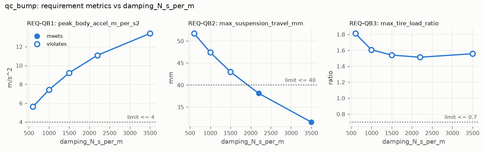
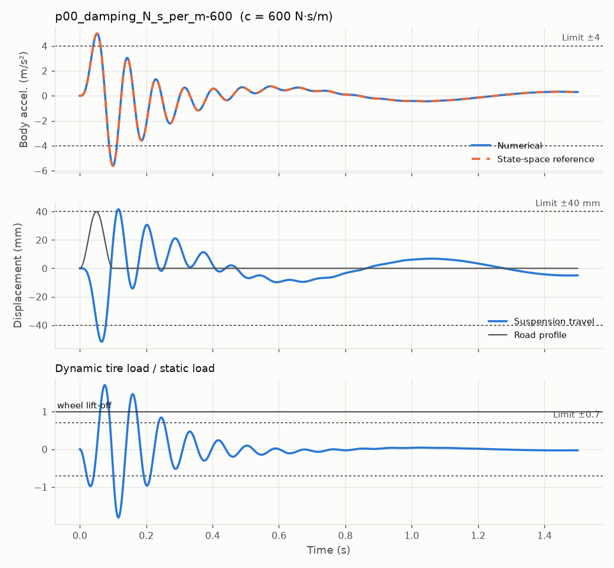
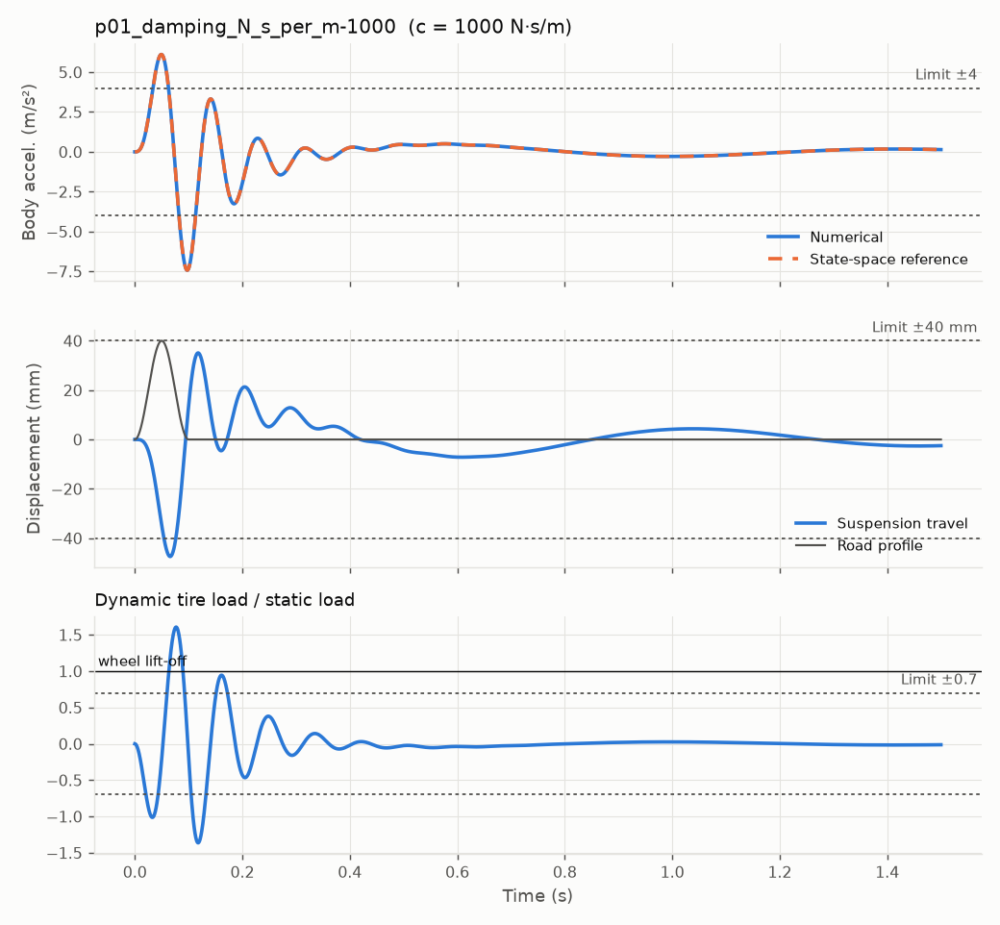
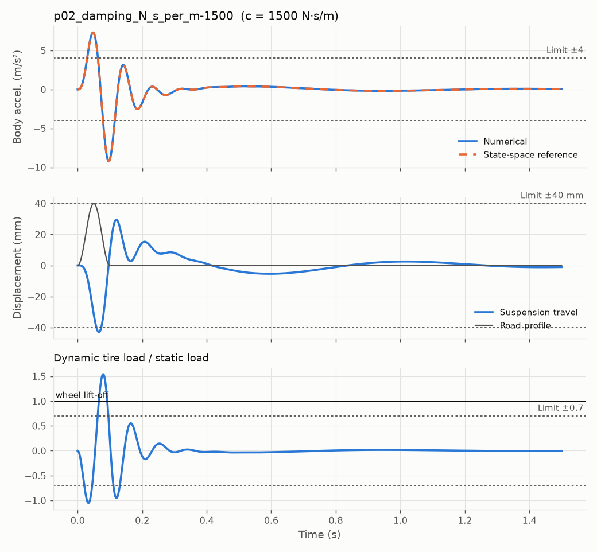
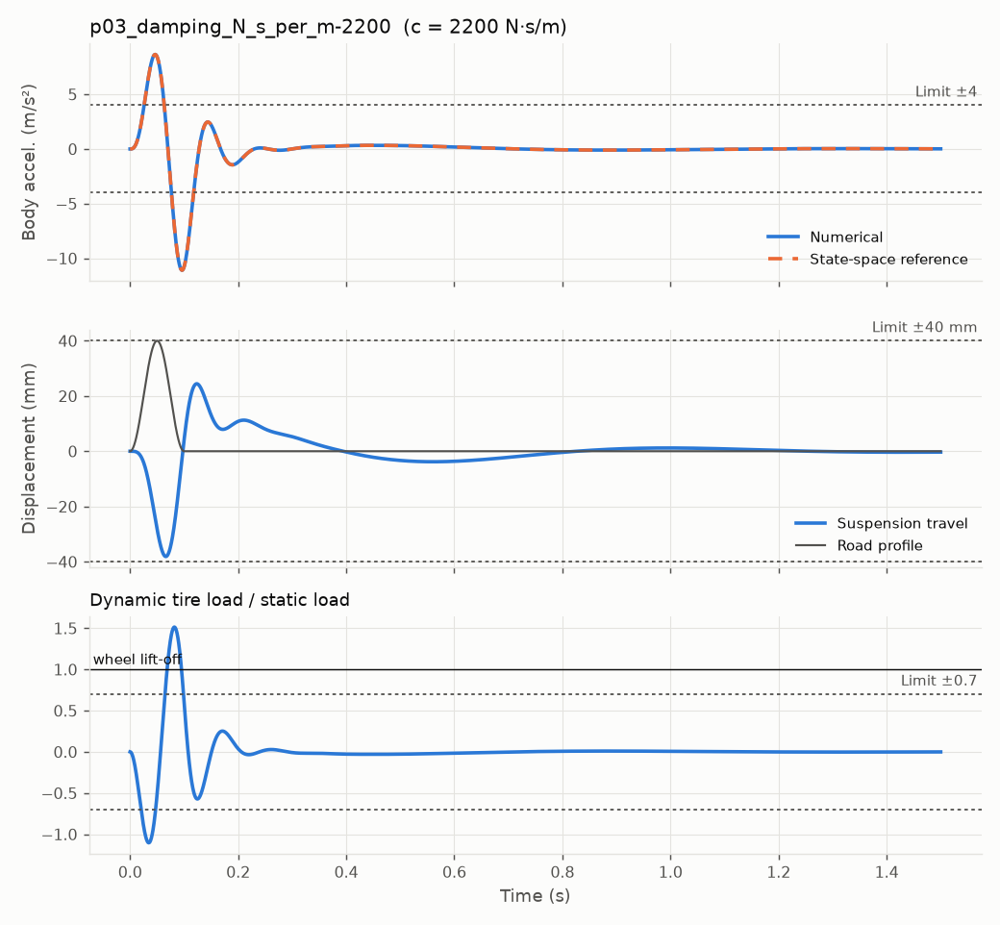
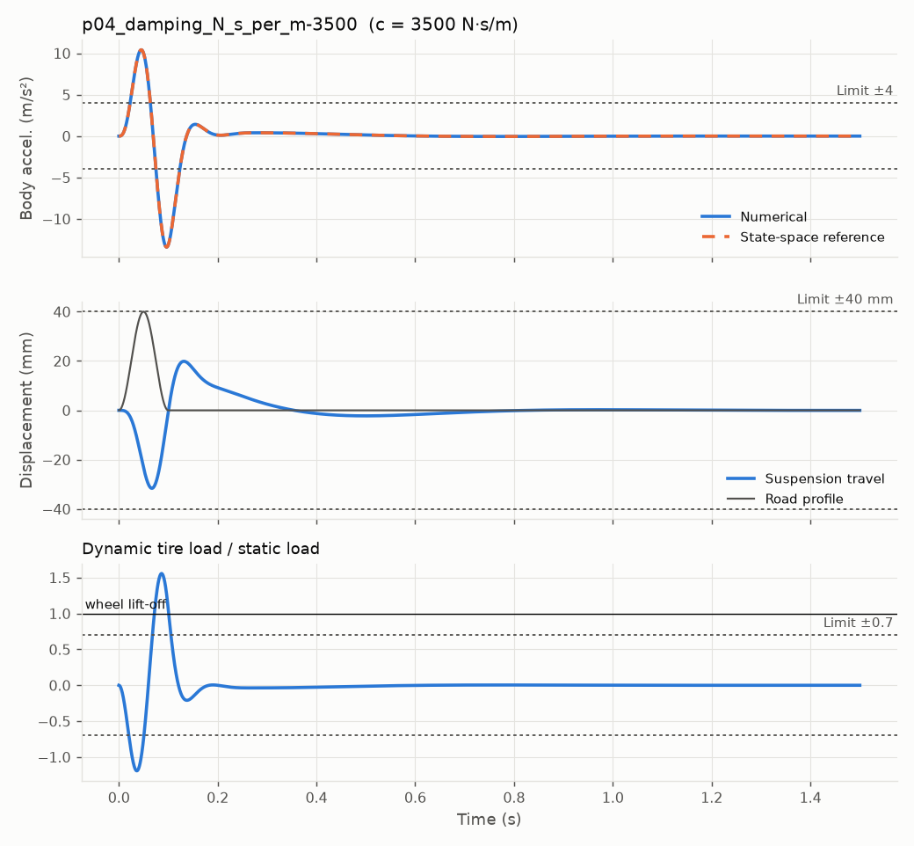

# Engineering review report: qc_bump

- **Run:** `20261119-084857_qc_bump`
- **Generated:** 2026-11-19T13:51:57+00:00
- **Case file SHA-256:** `07e472a5cb25cb9bb79c40559fb0a0394f0a2d3ba52dfb352980317f7ae500d2`
- **Environment:** Python 3.14.10, numpy 2.5.5, scipy 1.18.1, matplotlib 3.11.2; Windows-11-10.0.26100-SP0
- **Tools:** scipy 1.18.1
- **Code version:** git `833aecbcf507cb002cdf90362e408dcdafe22ed0` (uncommitted changes present)
- **Simulation status:** completed
- **Verification status:** FAIL

> **Warning:** verification did not pass for every point. Requirement verdicts marked *(unverified)* are not supported by evidence and must not be used for acceptance.

## Scope

Linear 2-DOF quarter car crossing a 40 mm x 1.0 m (1 - cos) bump at 10 m/s (36 km/h); wheel-rate damping swept from 600 to 3500 N.s/m against peak body acceleration, suspension travel, and dynamic tire load requirements.

**Assumptions**

- Linear spring, damper, and tire; parameters are wheel rates (motion ratio already applied).
- Point-contact tire with no tire damping; the tire never leaves the road (checked: no_wheel_lift).
- Coordinates from static equilibrium; gravity cancels in the linear model.
- Rigid body above one corner (no pitch/roll coupling, no seat or occupant dynamics).
- Suspension travel stays inside the linear range (no bump-stop contact); REQ-QB2 bounds it.

## Requirements

| ID | Requirement | Metric | Limit |
|---|---|---|---|
| REQ-QB1 | Peak vertical body acceleration over the bump shall not exceed 4.0 m/s^2 (comfort). | `peak_body_accel_m_per_s2` | <= 4 m/s^2 |
| REQ-QB2 | Suspension travel shall stay within +/-40 mm of static (no bump-stop contact). | `max_suspension_travel_mm` | <= 40 mm |
| REQ-QB3 | Dynamic tire load shall stay within +/-70 % of static load (road holding). | `max_tire_load_ratio` | <= 0.7 - |

## Summary across points

| Point | damping_N_s_per_m | REQ-QB1 | REQ-QB2 | REQ-QB3 | Checks |
|---|---|---|---|---|---|
| p00_damping_N_s_per_m-600 | 600 | 5.622 m/s^2: **FAIL (unverified)** | 51.72 mm: **FAIL (unverified)** | 1.812 -: **FAIL (unverified)** | 5/6 FAIL |
| p01_damping_N_s_per_m-1000 | 1000 | 7.428 m/s^2: **FAIL (unverified)** | 47.43 mm: **FAIL (unverified)** | 1.607 -: **FAIL (unverified)** | 5/6 FAIL |
| p02_damping_N_s_per_m-1500 | 1500 | 9.226 m/s^2: **FAIL (unverified)** | 43.02 mm: **FAIL (unverified)** | 1.54 -: **FAIL (unverified)** | 5/6 FAIL |
| p03_damping_N_s_per_m-2200 | 2200 | 11.09 m/s^2: **FAIL (unverified)** | 38.13 mm: **PASS (unverified)** | 1.514 -: **FAIL (unverified)** | 5/6 FAIL |
| p04_damping_N_s_per_m-3500 | 3500 | 13.4 m/s^2: **FAIL (unverified)** | 31.61 mm: **PASS (unverified)** | 1.557 -: **FAIL (unverified)** | 5/6 FAIL |

## Point details

### p00_damping_N_s_per_m-600

Parameters: sprung_mass_kg = 350, unsprung_mass_kg = 45, suspension_stiffness_N_per_m = 2.2e+04, damping_N_s_per_m = 600, tire_stiffness_N_per_m = 2.2e+05, road = bump, speed_m_per_s = 10, bump_height_m = 0.04, bump_length_m = 1

Derived: ride_rate_N_per_m = 2e+04, body_frequency_Hz_approx = 1.203, wheel_hop_frequency_Hz_approx = 11.67, body_damping_ratio_approx = 0.1134, static_tire_load_N = 3874, slowest_decay_rate_per_s = 0.7084

| Requirement | Result | Limit | Margin | Verdict | Evidence |
|---|---|---|---|---|---|
| REQ-QB1 | 5.622 m/s^2 | <= 4 | -1.62 | **FAIL (unverified)** | [point.json](points/p00_damping_N_s_per_m-600/point.json) |
| REQ-QB2 | 51.72 mm | <= 40 | -11.7 | **FAIL (unverified)** | [point.json](points/p00_damping_N_s_per_m-600/point.json) |
| REQ-QB3 | 1.812 - | <= 0.7 | -1.11 | **FAIL (unverified)** | [point.json](points/p00_damping_N_s_per_m-600/point.json) |

| Check | Description | Value | Tolerance | Status |
|---|---|---|---|---|
| energy_balance | |W_road - (dE + E_dissipated)| / integral |P_road| dt | 5.16e-09 | 1e-04 | PASS |
| solver_convergence | max |z(tol) - z(tol/100)| / max |z| (body and wheel) | 1.33e-09 | 1e-06 | PASS |
| no_wheel_lift | max dynamic tire load / static load (linear tire valid only < 1) | 1.70e+00 | 1e+00 | FAIL |
| reference_agreement | max |z_num - z_ref| / bump height (body and wheel; matrix-exponential ref) | 9.36e-07 | 1e-05 | PASS |
| peak_accel_reference | |peak accel num - peak accel ref| / peak accel ref | 9.99e-07 | 1e-04 | PASS |
| return_to_rest | max(|zs(t_end)|, |zu(t_end)|) / bump height | 7.57e-05 | 1e-03 | PASS |

### p01_damping_N_s_per_m-1000

Parameters: sprung_mass_kg = 350, unsprung_mass_kg = 45, suspension_stiffness_N_per_m = 2.2e+04, damping_N_s_per_m = 1000, tire_stiffness_N_per_m = 2.2e+05, road = bump, speed_m_per_s = 10, bump_height_m = 0.04, bump_length_m = 1

Derived: ride_rate_N_per_m = 2e+04, body_frequency_Hz_approx = 1.203, wheel_hop_frequency_Hz_approx = 11.67, body_damping_ratio_approx = 0.189, static_tire_load_N = 3874, slowest_decay_rate_per_s = 1.188

| Requirement | Result | Limit | Margin | Verdict | Evidence |
|---|---|---|---|---|---|
| REQ-QB1 | 7.428 m/s^2 | <= 4 | -3.43 | **FAIL (unverified)** | [point.json](points/p01_damping_N_s_per_m-1000/point.json) |
| REQ-QB2 | 47.43 mm | <= 40 | -7.43 | **FAIL (unverified)** | [point.json](points/p01_damping_N_s_per_m-1000/point.json) |
| REQ-QB3 | 1.607 - | <= 0.7 | -0.907 | **FAIL (unverified)** | [point.json](points/p01_damping_N_s_per_m-1000/point.json) |

| Check | Description | Value | Tolerance | Status |
|---|---|---|---|---|
| energy_balance | |W_road - (dE + E_dissipated)| / integral |P_road| dt | 2.67e-09 | 1e-04 | PASS |
| solver_convergence | max |z(tol) - z(tol/100)| / max |z| (body and wheel) | 7.12e-10 | 1e-06 | PASS |
| no_wheel_lift | max dynamic tire load / static load (linear tire valid only < 1) | 1.61e+00 | 1e+00 | FAIL |
| reference_agreement | max |z_num - z_ref| / bump height (body and wheel; matrix-exponential ref) | 7.34e-07 | 1e-05 | PASS |
| peak_accel_reference | |peak accel num - peak accel ref| / peak accel ref | 9.30e-07 | 1e-04 | PASS |
| return_to_rest | max(|zs(t_end)|, |zu(t_end)|) / bump height | 1.26e-06 | 1e-03 | PASS |

### p02_damping_N_s_per_m-1500

Parameters: sprung_mass_kg = 350, unsprung_mass_kg = 45, suspension_stiffness_N_per_m = 2.2e+04, damping_N_s_per_m = 1500, tire_stiffness_N_per_m = 2.2e+05, road = bump, speed_m_per_s = 10, bump_height_m = 0.04, bump_length_m = 1

Derived: ride_rate_N_per_m = 2e+04, body_frequency_Hz_approx = 1.203, wheel_hop_frequency_Hz_approx = 11.67, body_damping_ratio_approx = 0.2835, static_tire_load_N = 3874, slowest_decay_rate_per_s = 1.803

| Requirement | Result | Limit | Margin | Verdict | Evidence |
|---|---|---|---|---|---|
| REQ-QB1 | 9.226 m/s^2 | <= 4 | -5.23 | **FAIL (unverified)** | [point.json](points/p02_damping_N_s_per_m-1500/point.json) |
| REQ-QB2 | 43.02 mm | <= 40 | -3.02 | **FAIL (unverified)** | [point.json](points/p02_damping_N_s_per_m-1500/point.json) |
| REQ-QB3 | 1.54 - | <= 0.7 | -0.84 | **FAIL (unverified)** | [point.json](points/p02_damping_N_s_per_m-1500/point.json) |

| Check | Description | Value | Tolerance | Status |
|---|---|---|---|---|
| energy_balance | |W_road - (dE + E_dissipated)| / integral |P_road| dt | 2.29e-10 | 1e-04 | PASS |
| solver_convergence | max |z(tol) - z(tol/100)| / max |z| (body and wheel) | 5.44e-10 | 1e-06 | PASS |
| no_wheel_lift | max dynamic tire load / static load (linear tire valid only < 1) | 1.54e+00 | 1e+00 | FAIL |
| reference_agreement | max |z_num - z_ref| / bump height (body and wheel; matrix-exponential ref) | 6.01e-07 | 1e-05 | PASS |
| peak_accel_reference | |peak accel num - peak accel ref| / peak accel ref | 8.71e-07 | 1e-04 | PASS |
| return_to_rest | max(|zs(t_end)|, |zu(t_end)|) / bump height | 5.54e-09 | 1e-03 | PASS |

### p03_damping_N_s_per_m-2200

Parameters: sprung_mass_kg = 350, unsprung_mass_kg = 45, suspension_stiffness_N_per_m = 2.2e+04, damping_N_s_per_m = 2200, tire_stiffness_N_per_m = 2.2e+05, road = bump, speed_m_per_s = 10, bump_height_m = 0.04, bump_length_m = 1

Derived: ride_rate_N_per_m = 2e+04, body_frequency_Hz_approx = 1.203, wheel_hop_frequency_Hz_approx = 11.67, body_damping_ratio_approx = 0.4158, static_tire_load_N = 3874, slowest_decay_rate_per_s = 2.714

| Requirement | Result | Limit | Margin | Verdict | Evidence |
|---|---|---|---|---|---|
| REQ-QB1 | 11.09 m/s^2 | <= 4 | -7.09 | **FAIL (unverified)** | [point.json](points/p03_damping_N_s_per_m-2200/point.json) |
| REQ-QB2 | 38.13 mm | <= 40 | 1.87 | **PASS (unverified)** | [point.json](points/p03_damping_N_s_per_m-2200/point.json) |
| REQ-QB3 | 1.514 - | <= 0.7 | -0.814 | **FAIL (unverified)** | [point.json](points/p03_damping_N_s_per_m-2200/point.json) |

| Check | Description | Value | Tolerance | Status |
|---|---|---|---|---|
| energy_balance | |W_road - (dE + E_dissipated)| / integral |P_road| dt | 2.27e-09 | 1e-04 | PASS |
| solver_convergence | max |z(tol) - z(tol/100)| / max |z| (body and wheel) | 4.56e-10 | 1e-06 | PASS |
| no_wheel_lift | max dynamic tire load / static load (linear tire valid only < 1) | 1.51e+00 | 1e+00 | FAIL |
| reference_agreement | max |z_num - z_ref| / bump height (body and wheel; matrix-exponential ref) | 5.00e-07 | 1e-05 | PASS |
| peak_accel_reference | |peak accel num - peak accel ref| / peak accel ref | 8.12e-07 | 1e-04 | PASS |
| return_to_rest | max(|zs(t_end)|, |zu(t_end)|) / bump height | 5.50e-13 | 1e-03 | PASS |

### p04_damping_N_s_per_m-3500

Parameters: sprung_mass_kg = 350, unsprung_mass_kg = 45, suspension_stiffness_N_per_m = 2.2e+04, damping_N_s_per_m = 3500, tire_stiffness_N_per_m = 2.2e+05, road = bump, speed_m_per_s = 10, bump_height_m = 0.04, bump_length_m = 1

Derived: ride_rate_N_per_m = 2e+04, body_frequency_Hz_approx = 1.203, wheel_hop_frequency_Hz_approx = 11.67, body_damping_ratio_approx = 0.6614, static_tire_load_N = 3874, slowest_decay_rate_per_s = 4.713

| Requirement | Result | Limit | Margin | Verdict | Evidence |
|---|---|---|---|---|---|
| REQ-QB1 | 13.4 m/s^2 | <= 4 | -9.4 | **FAIL (unverified)** | [point.json](points/p04_damping_N_s_per_m-3500/point.json) |
| REQ-QB2 | 31.61 mm | <= 40 | 8.39 | **PASS (unverified)** | [point.json](points/p04_damping_N_s_per_m-3500/point.json) |
| REQ-QB3 | 1.557 - | <= 0.7 | -0.857 | **FAIL (unverified)** | [point.json](points/p04_damping_N_s_per_m-3500/point.json) |

| Check | Description | Value | Tolerance | Status |
|---|---|---|---|---|
| energy_balance | |W_road - (dE + E_dissipated)| / integral |P_road| dt | 5.24e-09 | 1e-04 | PASS |
| solver_convergence | max |z(tol) - z(tol/100)| / max |z| (body and wheel) | 2.24e-09 | 1e-06 | PASS |
| no_wheel_lift | max dynamic tire load / static load (linear tire valid only < 1) | 1.56e+00 | 1e+00 | FAIL |
| reference_agreement | max |z_num - z_ref| / bump height (body and wheel; matrix-exponential ref) | 3.82e-07 | 1e-05 | PASS |
| peak_accel_reference | |peak accel num - peak accel ref| / peak accel ref | 7.44e-07 | 1e-04 | PASS |
| return_to_rest | max(|zs(t_end)|, |zu(t_end)|) / bump height | 6.67e-15 | 1e-03 | PASS |

## Limitations

- Synthetic parameters; not calibrated to any vehicle.
- Peak acceleration is unweighted; ISO 2631 frequency weighting is not applied.
- Checks establish numerical verification and model-validity limits only; no test data.
- A converged solver run that matches an analytical reference shows that the equations were solved correctly. It does not show that the equations represent real hardware.

## Engineering acceptance

Pending human review. This report does not accept or reject the design.
