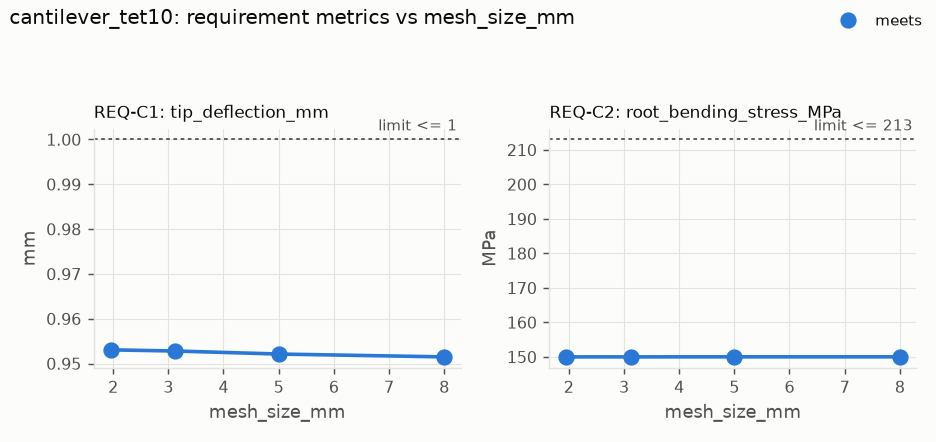
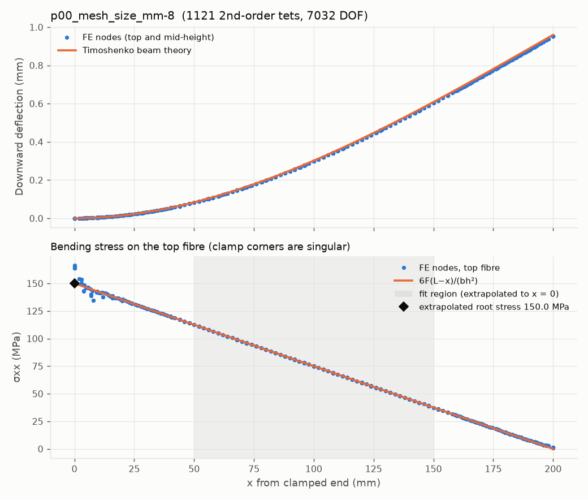
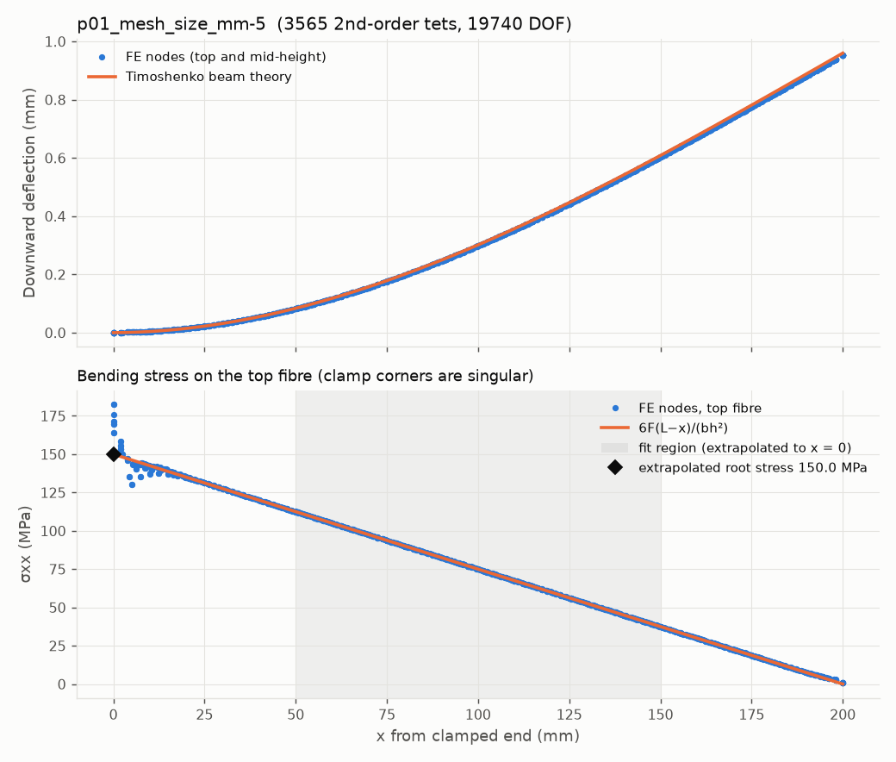
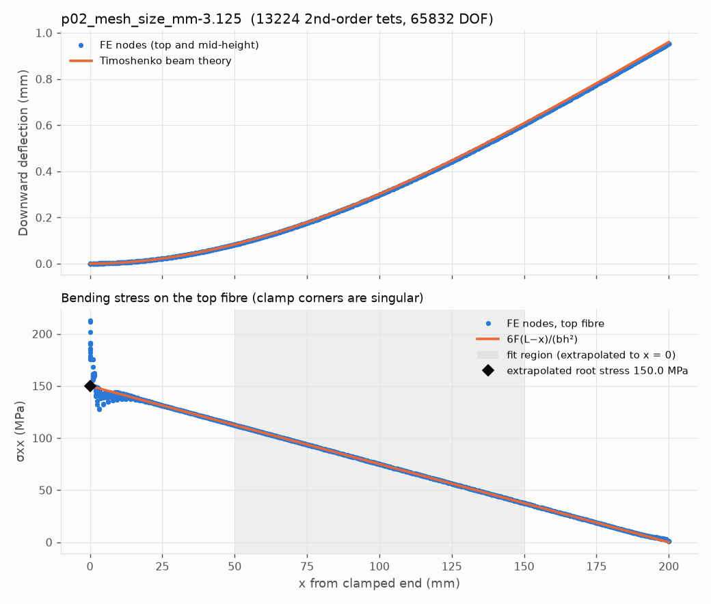
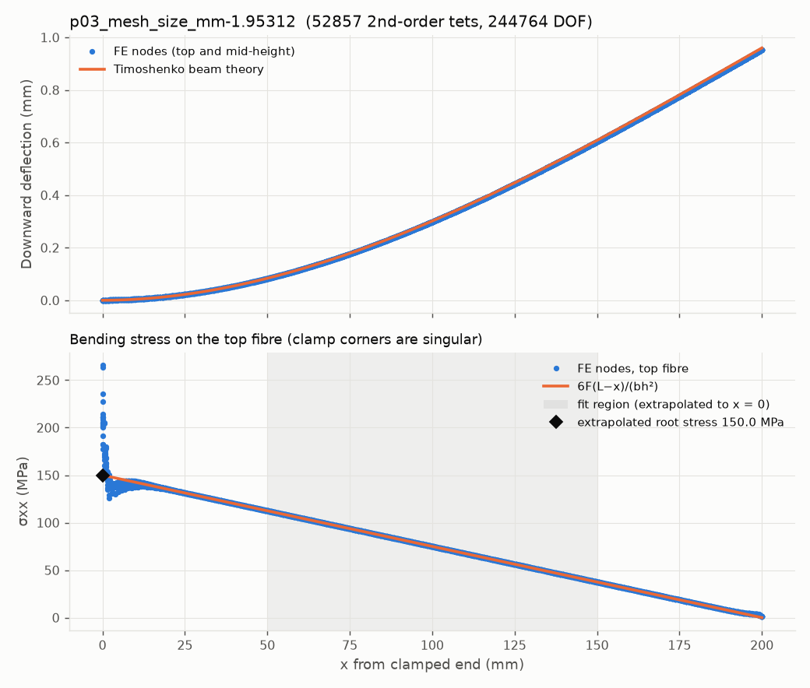

# Engineering review report: cantilever_tet10

- **Run:** `20261119-085818_cantilever_tet10`
- **Generated:** 2026-11-19T14:01:12+00:00
- **Case file SHA-256:** `a9e840aea9ca98a2fadfe179d9a9f97aae6dc207090111b27c21aa9c45e0e038`
- **Environment:** Python 3.14.10, numpy 2.5.5, scipy 1.18.1, matplotlib 3.11.2; Windows-11-10.0.26100-SP0
- **Tools:** freecadcmd C:\Users\mrstego\AppData\Local\Programs\FreeCAD 1.1\bin\freecadcmd.exe; CalculiX This is Version 2.22; FreeCAD 1.1.4
- **Code version:** git `cf813cec2ea2e8d2fea2f44f46ba0521707f8d32` (uncommitted changes present)
- **Simulation status:** completed
- **Verification status:** PASS

## Scope

Steel cantilever, 200 x 20 x 20 mm, clamped at x = 0, 1000 N downward tip load distributed over the free end face. Mesh refinement (characteristic length 8 -> 1.95 mm, ratio 1.6) with quadratic (10-node) tetrahedra; checks tip stiffness and root bending stress requirements.

**Assumptions**

- Linear elastic, isotropic, homogeneous steel (E = 210 GPa, nu = 0.3); checked against yield.
- Small deflections and strains (geometrically linear); checked: tip deflection / L.
- Ideal clamp: all displacements fixed on the x = 0 face (stiffer than a real bolted joint).
- Tip load applied as a uniform traction over the x = L face.
- Root bending stress is evaluated by extrapolating the top-fibre stress from 0.25L-0.75L to x = 0, because the clamp corners are stress singularities (peak FE stress there grows with mesh refinement).

## Requirements

| ID | Requirement | Metric | Limit |
|---|---|---|---|
| REQ-C1 | Tip deflection under the 1000 N service load shall not exceed 1.0 mm. | `tip_deflection_mm` | <= 1 mm |
| REQ-C2 | Root bending stress shall not exceed 213 MPa (S355 yield / 1.67). | `root_bending_stress_MPa` | <= 213 MPa |

## Summary across points

| Point | mesh_size_mm | REQ-C1 | REQ-C2 | Checks |
|---|---|---|---|---|
| p00_mesh_size_mm-8 | 8 | 0.9515 mm: **PASS** | 150 MPa: **PASS** | 5/5 PASS |
| p01_mesh_size_mm-5 | 5 | 0.9521 mm: **PASS** | 150 MPa: **PASS** | 5/5 PASS |
| p02_mesh_size_mm-3.125 | 3.125 | 0.9528 mm: **PASS** | 150 MPa: **PASS** | 5/5 PASS |
| p03_mesh_size_mm-1.95312 | 1.95312 | 0.9531 mm: **PASS** | 150 MPa: **PASS** | 5/5 PASS |

## Run-level checks

Checks that use several points together (for example mesh convergence).

| Check | Description | Value | Tolerance | Status |
|---|---|---|---|---|
| discretization_tip_deflection_mm | relative discretization uncertainty of tip_deflection_mm, monotone (R = 0.383): GCI_fine, observed order 2.04, extrapolated 0.953216 | 0.000211 | 0.01 | PASS |
| discretization_root_bending_stress_MPa | relative discretization uncertainty of root_bending_stress_MPa, oscillatory (R = -0.021): 1.25 x half-range of the 3 finest solutions | 6.8e-05 | 0.02 | PASS |

## Point details

### p00_mesh_size_mm-8

Parameters: length_mm = 200, width_mm = 20, height_mm = 20, youngs_modulus_MPa = 2.1e+05, poisson_ratio = 0.3, yield_strength_MPa = 355, tip_load_N = 1000, mesh_size_mm = 8, element_order = 2nd

Derived: slenderness_L_over_h = 10, tip_deflection_euler_bernoulli_mm = 0.9524, tip_deflection_timoshenko_mm = 0.9597, root_bending_stress_beam_theory_MPa = 150

| Requirement | Result | Limit | Margin | Verdict | Evidence |
|---|---|---|---|---|---|
| REQ-C1 | 0.9515 mm | <= 1 | 0.0485 | **PASS** | [point.json](points/p00_mesh_size_mm-8/point.json) |
| REQ-C2 | 150 MPa | <= 213 | 63 | **PASS** | [point.json](points/p00_mesh_size_mm-8/point.json) |

| Check | Description | Value | Tolerance | Status |
|---|---|---|---|---|
| equilibrium | |R_fixed - (0, 0, F)| / F (sum of reactions) | 5.69e-12 | 1e-06 | PASS |
| tip_deflection_reference | |tip deflection FE - Timoshenko| / Timoshenko | 8.52e-03 | 2e-02 | PASS |
| root_stress_reference | |extrapolated root stress FE - 6FL/(bh^2)| / beam theory | 7.45e-05 | 2e-02 | PASS |
| linear_material (validity) | root bending stress / yield strength (linear elastic only below 1) | 4.23e-01 | 1e+00 | PASS |
| small_deflection (validity) | tip deflection / length (geometrically linear analysis) | 4.76e-03 | 1e-02 | PASS |

### p01_mesh_size_mm-5

Parameters: length_mm = 200, width_mm = 20, height_mm = 20, youngs_modulus_MPa = 2.1e+05, poisson_ratio = 0.3, yield_strength_MPa = 355, tip_load_N = 1000, mesh_size_mm = 5, element_order = 2nd

Derived: slenderness_L_over_h = 10, tip_deflection_euler_bernoulli_mm = 0.9524, tip_deflection_timoshenko_mm = 0.9597, root_bending_stress_beam_theory_MPa = 150

| Requirement | Result | Limit | Margin | Verdict | Evidence |
|---|---|---|---|---|---|
| REQ-C1 | 0.9521 mm | <= 1 | 0.0479 | **PASS** | [point.json](points/p01_mesh_size_mm-5/point.json) |
| REQ-C2 | 150 MPa | <= 213 | 63 | **PASS** | [point.json](points/p01_mesh_size_mm-5/point.json) |

| Check | Description | Value | Tolerance | Status |
|---|---|---|---|---|
| equilibrium | |R_fixed - (0, 0, F)| / F (sum of reactions) | 1.01e-11 | 1e-06 | PASS |
| tip_deflection_reference | |tip deflection FE - Timoshenko| / Timoshenko | 7.86e-03 | 2e-02 | PASS |
| root_stress_reference | |extrapolated root stress FE - 6FL/(bh^2)| / beam theory | 9.31e-05 | 2e-02 | PASS |
| linear_material (validity) | root bending stress / yield strength (linear elastic only below 1) | 4.23e-01 | 1e+00 | PASS |
| small_deflection (validity) | tip deflection / length (geometrically linear analysis) | 4.76e-03 | 1e-02 | PASS |

### p02_mesh_size_mm-3.125

Parameters: length_mm = 200, width_mm = 20, height_mm = 20, youngs_modulus_MPa = 2.1e+05, poisson_ratio = 0.3, yield_strength_MPa = 355, tip_load_N = 1000, mesh_size_mm = 3.125, element_order = 2nd

Derived: slenderness_L_over_h = 10, tip_deflection_euler_bernoulli_mm = 0.9524, tip_deflection_timoshenko_mm = 0.9597, root_bending_stress_beam_theory_MPa = 150

| Requirement | Result | Limit | Margin | Verdict | Evidence |
|---|---|---|---|---|---|
| REQ-C1 | 0.9528 mm | <= 1 | 0.0472 | **PASS** | [point.json](points/p02_mesh_size_mm-3.125/point.json) |
| REQ-C2 | 150 MPa | <= 213 | 63 | **PASS** | [point.json](points/p02_mesh_size_mm-3.125/point.json) |

| Check | Description | Value | Tolerance | Status |
|---|---|---|---|---|
| equilibrium | |R_fixed - (0, 0, F)| / F (sum of reactions) | 5.81e-12 | 1e-06 | PASS |
| tip_deflection_reference | |tip deflection FE - Timoshenko| / Timoshenko | 7.16e-03 | 2e-02 | PASS |
| root_stress_reference | |extrapolated root stress FE - 6FL/(bh^2)| / beam theory | 1.58e-05 | 2e-02 | PASS |
| linear_material (validity) | root bending stress / yield strength (linear elastic only below 1) | 4.23e-01 | 1e+00 | PASS |
| small_deflection (validity) | tip deflection / length (geometrically linear analysis) | 4.76e-03 | 1e-02 | PASS |

### p03_mesh_size_mm-1.95312

Parameters: length_mm = 200, width_mm = 20, height_mm = 20, youngs_modulus_MPa = 2.1e+05, poisson_ratio = 0.3, yield_strength_MPa = 355, tip_load_N = 1000, mesh_size_mm = 1.953, element_order = 2nd

Derived: slenderness_L_over_h = 10, tip_deflection_euler_bernoulli_mm = 0.9524, tip_deflection_timoshenko_mm = 0.9597, root_bending_stress_beam_theory_MPa = 150

| Requirement | Result | Limit | Margin | Verdict | Evidence |
|---|---|---|---|---|---|
| REQ-C1 | 0.9531 mm | <= 1 | 0.0469 | **PASS** | [point.json](points/p03_mesh_size_mm-1.95312/point.json) |
| REQ-C2 | 150 MPa | <= 213 | 63 | **PASS** | [point.json](points/p03_mesh_size_mm-1.95312/point.json) |

| Check | Description | Value | Tolerance | Status |
|---|---|---|---|---|
| equilibrium | |R_fixed - (0, 0, F)| / F (sum of reactions) | 5.75e-12 | 1e-06 | PASS |
| tip_deflection_reference | |tip deflection FE - Timoshenko| / Timoshenko | 6.89e-03 | 2e-02 | PASS |
| root_stress_reference | |extrapolated root stress FE - 6FL/(bh^2)| / beam theory | 1.34e-05 | 2e-02 | PASS |
| linear_material (validity) | root bending stress / yield strength (linear elastic only below 1) | 4.23e-01 | 1e+00 | PASS |
| small_deflection (validity) | tip deflection / length (geometrically linear analysis) | 4.77e-03 | 1e-02 | PASS |

## Limitations

- Synthetic geometry and load; not a specific part.
- Beam theory is an approximate reference for a 3D clamped solid (L/h = 10): agreement within ~1 % is expected, not exact.
- The max von Mises value is reported for information only; it sits at a singular clamp corner and is mesh-dependent.
- No physical test data.
- A converged solver run that matches an analytical reference shows that the equations were solved correctly. It does not show that the equations represent real hardware.

## Engineering acceptance

Pending human review. This report does not accept or reject the design.
