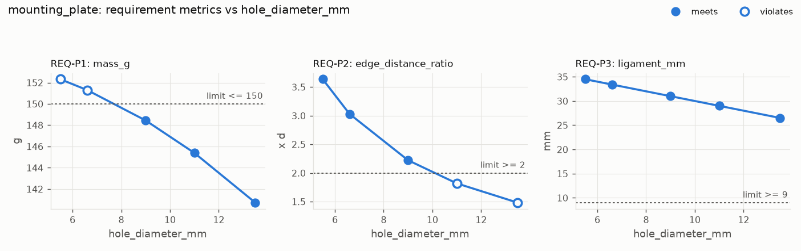
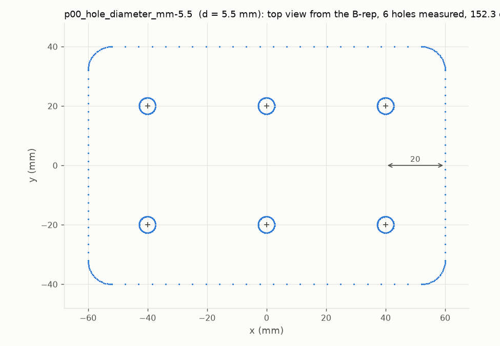
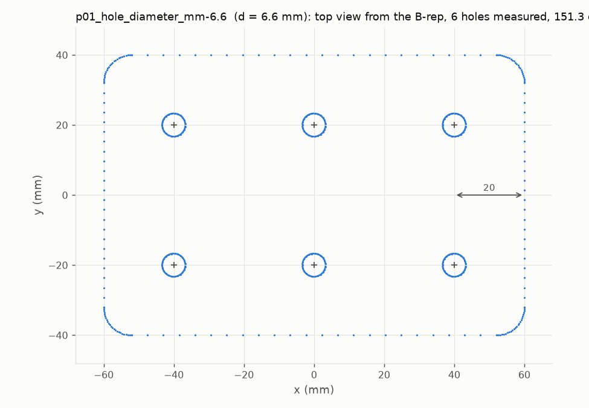
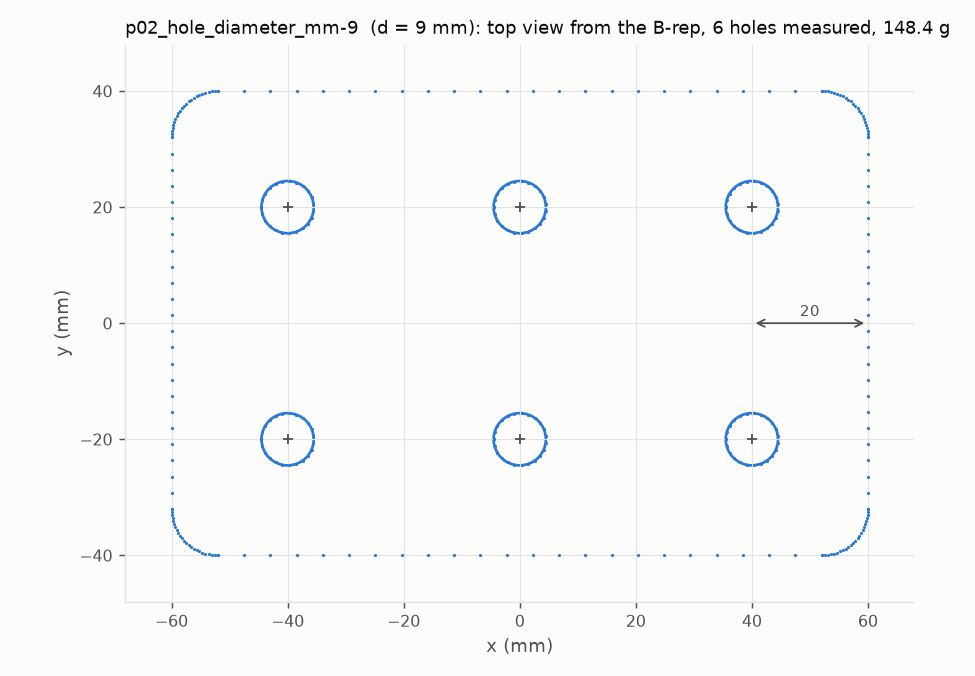
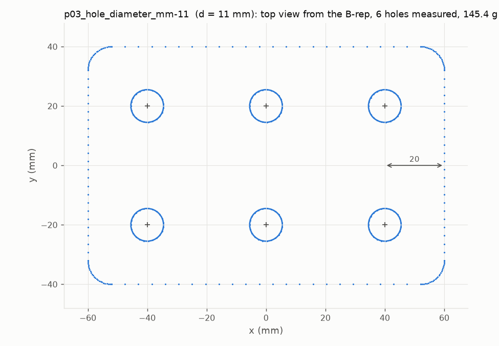
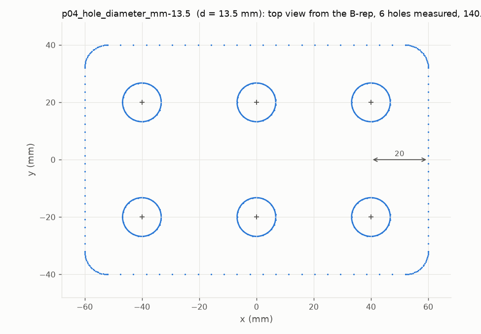

# Engineering review report: mounting_plate

- **Run:** `20261119-090540_mounting_plate`
- **Generated:** 2026-11-19T14:05:42+00:00
- **Case file SHA-256:** `de69298cc43ea1f62bbf55df846cc2b3f03e1205c2db23d83bef15d62c11734d`
- **Environment:** Python 3.14.10, numpy 2.5.5, scipy 1.18.1, matplotlib 3.11.2; Windows-11-10.0.26100-SP0
- **Tools:** cadquery 2.8.0
- **Code version:** git `9a768500462f5ecf04b87860872aa59e541200c2` (uncommitted changes present)
- **Simulation status:** completed
- **Verification status:** PASS

## Scope

6061-T6 aluminium plate 120 x 80 x 6 mm with R8 corners and a 3 x 2 grid of clearance holes on a 40 mm pitch; hole diameter swept over ISO 273 medium clearance sizes for M5 to M12 (5.5 to 13.5 mm).

**Assumptions**

- Density 2.70 g/cm^3 (6061-T6); nominal dimensions, no manufacturing tolerances.
- Edge distance is measured from hole centre to the nearest straight edge; the hole grid stays clear of the corner fillets.
- Design rules: edge distance >= 2 d (common plate/sheet practice), web between holes >= 1.5 t.

## Requirements

| ID | Requirement | Metric | Limit |
|---|---|---|---|
| REQ-P1 | Plate mass shall not exceed 150 g. | `mass_g` | <= 150 g |
| REQ-P2 | Hole centre to plate edge distance shall be at least 2 x hole diameter. | `edge_distance_ratio` | >= 2 x d |
| REQ-P3 | The web between adjacent holes shall be at least 9 mm (1.5 x thickness). | `ligament_mm` | >= 9 mm |

## Summary across points

| Point | hole_diameter_mm | REQ-P1 | REQ-P2 | REQ-P3 | Checks |
|---|---|---|---|---|---|
| p00_hole_diameter_mm-5.5 | 5.5 | 152.3 g: **FAIL** | 3.636 x d: **PASS** | 34.5 mm: **PASS** | 8/8 PASS |
| p01_hole_diameter_mm-6.6 | 6.6 | 151.3 g: **FAIL** | 3.03 x d: **PASS** | 33.4 mm: **PASS** | 8/8 PASS |
| p02_hole_diameter_mm-9 | 9 | 148.4 g: **PASS** | 2.222 x d: **PASS** | 31 mm: **PASS** | 8/8 PASS |
| p03_hole_diameter_mm-11 | 11 | 145.4 g: **PASS** | 1.818 x d: **FAIL** | 29 mm: **PASS** | 8/8 PASS |
| p04_hole_diameter_mm-13.5 | 13.5 | 140.7 g: **PASS** | 1.481 x d: **FAIL** | 26.5 mm: **PASS** | 8/8 PASS |

## Point details

### p00_hole_diameter_mm-5.5

Parameters: length_mm = 120, width_mm = 80, thickness_mm = 6, corner_radius_mm = 8, hole_diameter_mm = 5.5, holes_x = 3, holes_y = 2, hole_pitch_x_mm = 40, hole_pitch_y_mm = 40, density_g_per_mm3 = 0.0027

Derived: volume_closed_form_mm3 = 5.642e+04, mass_closed_form_g = 152.3, edge_distance_design_mm = 20, ligament_design_mm = 34.5

| Requirement | Result | Limit | Margin | Verdict | Evidence |
|---|---|---|---|---|---|
| REQ-P1 | 152.3 g | <= 150 | -2.32 | **FAIL** | [point.json](points/p00_hole_diameter_mm-5.5/point.json) |
| REQ-P2 | 3.636 x d | >= 2 | 1.64 | **PASS** | [point.json](points/p00_hole_diameter_mm-5.5/point.json) |
| REQ-P3 | 34.5 mm | >= 9 | 25.5 | **PASS** | [point.json](points/p00_hole_diameter_mm-5.5/point.json) |

| Check | Description | Value | Tolerance | Status |
|---|---|---|---|---|
| valid_solid | B-rep validity (0 = valid, 1 = invalid) | 0.00e+00 | 0e+00 | PASS |
| volume_reference | |V_cad - V_closed_form| / V_closed_form | 5.16e-16 | 1e-09 | PASS |
| bounding_box | max |bbox - (L, W, t)| in mm | 0.00e+00 | 1e-06 | PASS |
| hole_count | |holes found - holes intended| | 0.00e+00 | 0e+00 | PASS |
| hole_positions | max distance from intended centre to measured hole (mm) | 0.00e+00 | 1e-06 | PASS |
| hole_diameters | max |measured - nominal diameter| (mm) | 0.00e+00 | 1e-06 | PASS |
| step_roundtrip_volume | |V_step - V_cad| / V_cad after STEP re-import | 4.13e-15 | 1e-09 | PASS |
| step_roundtrip_holes | |holes in STEP - holes in model| | 0.00e+00 | 0e+00 | PASS |

### p01_hole_diameter_mm-6.6

Parameters: length_mm = 120, width_mm = 80, thickness_mm = 6, corner_radius_mm = 8, hole_diameter_mm = 6.6, holes_x = 3, holes_y = 2, hole_pitch_x_mm = 40, hole_pitch_y_mm = 40, density_g_per_mm3 = 0.0027

Derived: volume_closed_form_mm3 = 5.604e+04, mass_closed_form_g = 151.3, edge_distance_design_mm = 20, ligament_design_mm = 33.4

| Requirement | Result | Limit | Margin | Verdict | Evidence |
|---|---|---|---|---|---|
| REQ-P1 | 151.3 g | <= 150 | -1.3 | **FAIL** | [point.json](points/p01_hole_diameter_mm-6.6/point.json) |
| REQ-P2 | 3.03 x d | >= 2 | 1.03 | **PASS** | [point.json](points/p01_hole_diameter_mm-6.6/point.json) |
| REQ-P3 | 33.4 mm | >= 9 | 24.4 | **PASS** | [point.json](points/p01_hole_diameter_mm-6.6/point.json) |

| Check | Description | Value | Tolerance | Status |
|---|---|---|---|---|
| valid_solid | B-rep validity (0 = valid, 1 = invalid) | 0.00e+00 | 0e+00 | PASS |
| volume_reference | |V_cad - V_closed_form| / V_closed_form | 3.90e-16 | 1e-09 | PASS |
| bounding_box | max |bbox - (L, W, t)| in mm | 0.00e+00 | 1e-06 | PASS |
| hole_count | |holes found - holes intended| | 0.00e+00 | 0e+00 | PASS |
| hole_positions | max distance from intended centre to measured hole (mm) | 0.00e+00 | 1e-06 | PASS |
| hole_diameters | max |measured - nominal diameter| (mm) | 0.00e+00 | 1e-06 | PASS |
| step_roundtrip_volume | |V_step - V_cad| / V_cad after STEP re-import | 3.90e-15 | 1e-09 | PASS |
| step_roundtrip_holes | |holes in STEP - holes in model| | 0.00e+00 | 0e+00 | PASS |

### p02_hole_diameter_mm-9

Parameters: length_mm = 120, width_mm = 80, thickness_mm = 6, corner_radius_mm = 8, hole_diameter_mm = 9, holes_x = 3, holes_y = 2, hole_pitch_x_mm = 40, hole_pitch_y_mm = 40, density_g_per_mm3 = 0.0027

Derived: volume_closed_form_mm3 = 5.498e+04, mass_closed_form_g = 148.4, edge_distance_design_mm = 20, ligament_design_mm = 31

| Requirement | Result | Limit | Margin | Verdict | Evidence |
|---|---|---|---|---|---|
| REQ-P1 | 148.4 g | <= 150 | 1.55 | **PASS** | [point.json](points/p02_hole_diameter_mm-9/point.json) |
| REQ-P2 | 2.222 x d | >= 2 | 0.222 | **PASS** | [point.json](points/p02_hole_diameter_mm-9/point.json) |
| REQ-P3 | 31 mm | >= 9 | 22 | **PASS** | [point.json](points/p02_hole_diameter_mm-9/point.json) |

| Check | Description | Value | Tolerance | Status |
|---|---|---|---|---|
| valid_solid | B-rep validity (0 = valid, 1 = invalid) | 0.00e+00 | 0e+00 | PASS |
| volume_reference | |V_cad - V_closed_form| / V_closed_form | 1.32e-16 | 1e-09 | PASS |
| bounding_box | max |bbox - (L, W, t)| in mm | 0.00e+00 | 1e-06 | PASS |
| hole_count | |holes found - holes intended| | 0.00e+00 | 0e+00 | PASS |
| hole_positions | max distance from intended centre to measured hole (mm) | 0.00e+00 | 1e-06 | PASS |
| hole_diameters | max |measured - nominal diameter| (mm) | 0.00e+00 | 1e-06 | PASS |
| step_roundtrip_volume | |V_step - V_cad| / V_cad after STEP re-import | 3.71e-15 | 1e-09 | PASS |
| step_roundtrip_holes | |holes in STEP - holes in model| | 0.00e+00 | 0e+00 | PASS |

### p03_hole_diameter_mm-11

Parameters: length_mm = 120, width_mm = 80, thickness_mm = 6, corner_radius_mm = 8, hole_diameter_mm = 11, holes_x = 3, holes_y = 2, hole_pitch_x_mm = 40, hole_pitch_y_mm = 40, density_g_per_mm3 = 0.0027

Derived: volume_closed_form_mm3 = 5.385e+04, mass_closed_form_g = 145.4, edge_distance_design_mm = 20, ligament_design_mm = 29

| Requirement | Result | Limit | Margin | Verdict | Evidence |
|---|---|---|---|---|---|
| REQ-P1 | 145.4 g | <= 150 | 4.61 | **PASS** | [point.json](points/p03_hole_diameter_mm-11/point.json) |
| REQ-P2 | 1.818 x d | >= 2 | -0.182 | **FAIL** | [point.json](points/p03_hole_diameter_mm-11/point.json) |
| REQ-P3 | 29 mm | >= 9 | 20 | **PASS** | [point.json](points/p03_hole_diameter_mm-11/point.json) |

| Check | Description | Value | Tolerance | Status |
|---|---|---|---|---|
| valid_solid | B-rep validity (0 = valid, 1 = invalid) | 0.00e+00 | 0e+00 | PASS |
| volume_reference | |V_cad - V_closed_form| / V_closed_form | 4.05e-16 | 1e-09 | PASS |
| bounding_box | max |bbox - (L, W, t)| in mm | 0.00e+00 | 1e-06 | PASS |
| hole_count | |holes found - holes intended| | 0.00e+00 | 0e+00 | PASS |
| hole_positions | max distance from intended centre to measured hole (mm) | 0.00e+00 | 1e-06 | PASS |
| hole_diameters | max |measured - nominal diameter| (mm) | 0.00e+00 | 1e-06 | PASS |
| step_roundtrip_volume | |V_step - V_cad| / V_cad after STEP re-import | 3.38e-15 | 1e-09 | PASS |
| step_roundtrip_holes | |holes in STEP - holes in model| | 0.00e+00 | 0e+00 | PASS |

### p04_hole_diameter_mm-13.5

Parameters: length_mm = 120, width_mm = 80, thickness_mm = 6, corner_radius_mm = 8, hole_diameter_mm = 13.5, holes_x = 3, holes_y = 2, hole_pitch_x_mm = 40, hole_pitch_y_mm = 40, density_g_per_mm3 = 0.0027

Derived: volume_closed_form_mm3 = 5.212e+04, mass_closed_form_g = 140.7, edge_distance_design_mm = 20, ligament_design_mm = 26.5

| Requirement | Result | Limit | Margin | Verdict | Evidence |
|---|---|---|---|---|---|
| REQ-P1 | 140.7 g | <= 150 | 9.28 | **PASS** | [point.json](points/p04_hole_diameter_mm-13.5/point.json) |
| REQ-P2 | 1.481 x d | >= 2 | -0.519 | **FAIL** | [point.json](points/p04_hole_diameter_mm-13.5/point.json) |
| REQ-P3 | 26.5 mm | >= 9 | 17.5 | **PASS** | [point.json](points/p04_hole_diameter_mm-13.5/point.json) |

| Check | Description | Value | Tolerance | Status |
|---|---|---|---|---|
| valid_solid | B-rep validity (0 = valid, 1 = invalid) | 0.00e+00 | 0e+00 | PASS |
| volume_reference | |V_cad - V_closed_form| / V_closed_form | 5.58e-16 | 1e-09 | PASS |
| bounding_box | max |bbox - (L, W, t)| in mm | 0.00e+00 | 1e-06 | PASS |
| hole_count | |holes found - holes intended| | 0.00e+00 | 0e+00 | PASS |
| hole_positions | max distance from intended centre to measured hole (mm) | 0.00e+00 | 1e-06 | PASS |
| hole_diameters | max |measured - nominal diameter| (mm) | 0.00e+00 | 1e-06 | PASS |
| step_roundtrip_volume | |V_step - V_cad| / V_cad after STEP re-import | 2.23e-15 | 1e-09 | PASS |
| step_roundtrip_holes | |holes in STEP - holes in model| | 0.00e+00 | 0e+00 | PASS |

## Limitations

- Geometry-only study: no structural or fatigue assessment of the holes.
- Design-rule limits are generic, not taken from a specific standard or customer specification.
- A converged solver run that matches an analytical reference shows that the equations were solved correctly. It does not show that the equations represent real hardware.

## Engineering acceptance

Pending human review. This report does not accept or reject the design.
