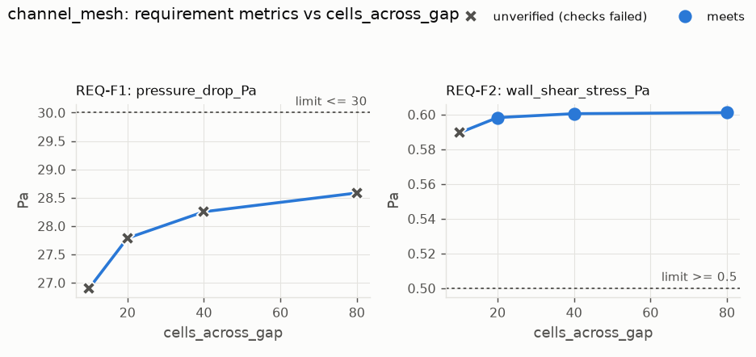
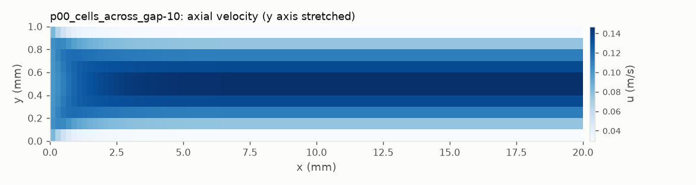
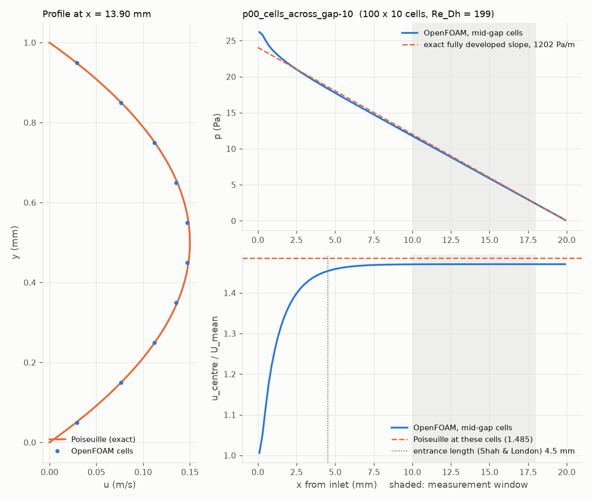
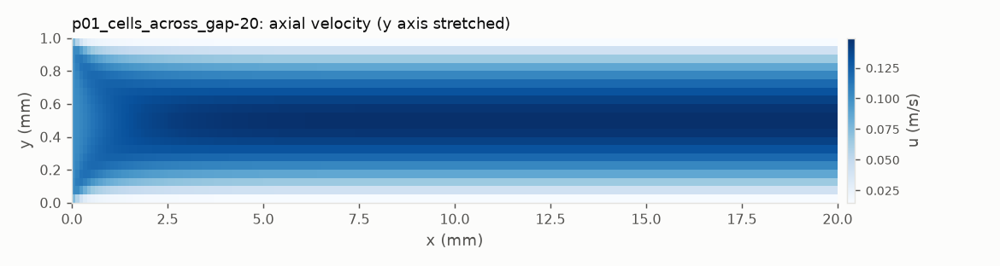
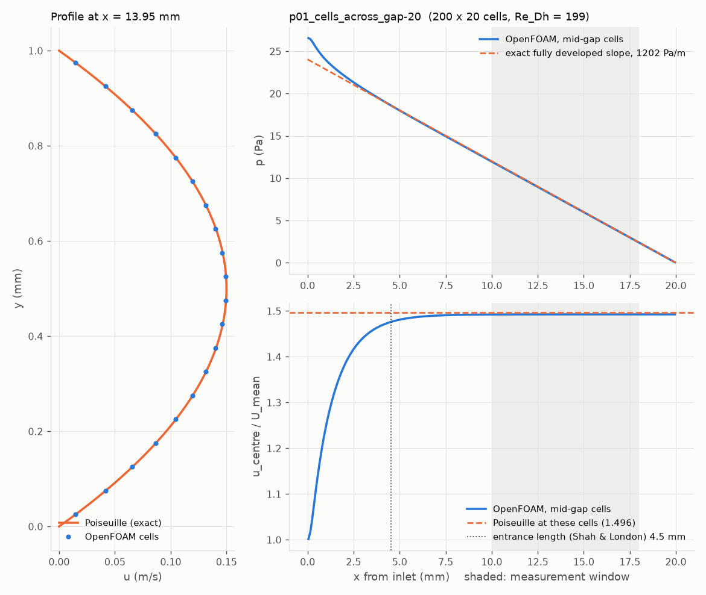
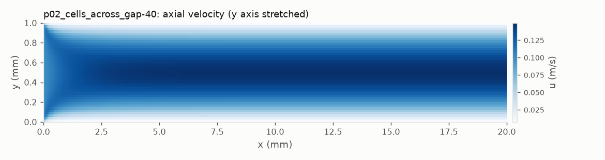
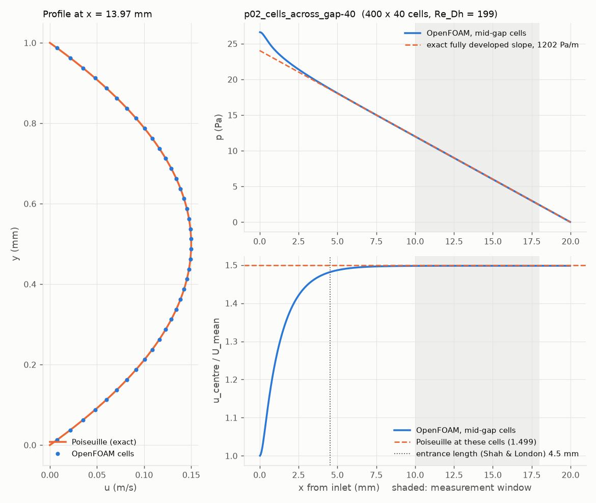
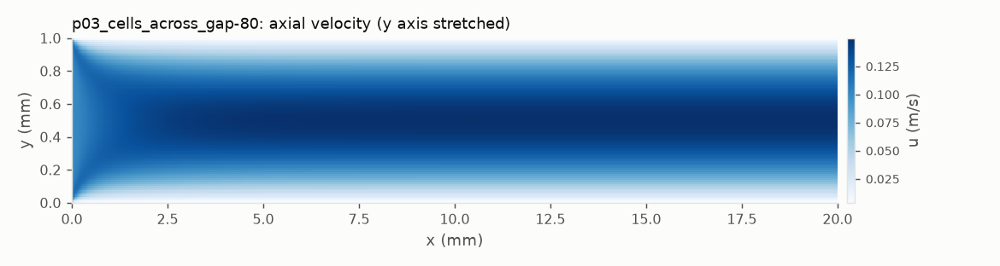
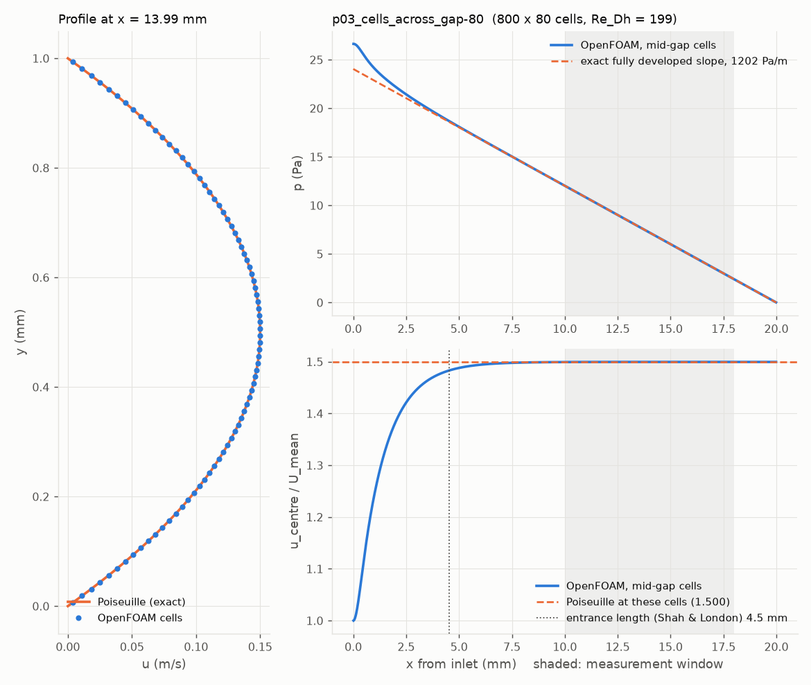

# Engineering review report: channel_mesh

- **Run:** `20261119-191916_channel_mesh`
- **Generated:** 2026-11-20T00:22:06+00:00
- **Case file SHA-256:** `dd9b8695e2e0c56f9710bd44bba5b74380ae63e8aba16435c89ace15590eab8a`
- **Environment:** Python 3.14.10, numpy 2.5.5, scipy 1.18.1, matplotlib 3.11.2, cadquery 2.8.0; Windows-11-10.0.26100-SP0
- **Tools:** openfoam_bashrc /opt/openfoam14/etc/bashrc; openfoam_version 14; openfoam_package openfoam14 20261008; linux Ubuntu 22.04.5 LTS
- **Code version:** git `14b90e1242a30bf66e619cfaf15cc201715f22c7` (uncommitted changes present)
- **Simulation status:** completed
- **Verification status:** FAIL

> **Warning:** verification did not pass for every point. Requirement verdicts marked *(unverified)* are not supported by evidence and must not be used for acceptance.

## Scope

Water at 20 C through a 1 mm gap between parallel plates, 20 mm long, mean velocity 0.1 m/s (Re_Dh about 200), uniform inlet velocity. Steady laminar 2D CFD with OpenFOAM; mesh refined from 10 to 80 cells across the gap (ratio 2). Checks the channel's pressure-drop budget and minimum wall shear stress.

**Assumptions**

- Incompressible, isothermal, Newtonian water (rho = 998.2 kg/m^3, mu = 1.002 mPa s).
- Laminar flow; checked: Re_Dh below 2000.
- 2D: the channel is much wider than the gap (side walls ignored).
- Uniform inlet velocity (no upstream plenum or header losses); outlet at p = 0 with zero-gradient velocity.
- Fully developed metrics are measured in x = 10-18 mm; checked: the predicted entrance length ends before the window, and the centreline velocity is constant across it.

## Requirements

| ID | Requirement | Metric | Limit |
|---|---|---|---|
| REQ-F1 | Pressure drop across the 20 mm channel shall not exceed 30 Pa (pump budget share). | `pressure_drop_Pa` | <= 30 Pa |
| REQ-F2 | Fully developed wall shear stress shall be at least 0.5 Pa (synthetic anti-fouling criterion). | `wall_shear_stress_Pa` | >= 0.5 Pa |

## Summary across points

| Point | cells_across_gap | REQ-F1 | REQ-F2 | Checks |
|---|---|---|---|---|
| p00_cells_across_gap-10 | 10 | 26.9 Pa: **PASS (unverified)** | 0.5895 Pa: **PASS (unverified)** | 10/12 FAIL |
| p01_cells_across_gap-20 | 20 | 27.79 Pa: **PASS (unverified)** | 0.5982 Pa: **PASS** | 12/12 PASS |
| p02_cells_across_gap-40 | 40 | 28.25 Pa: **PASS (unverified)** | 0.6005 Pa: **PASS** | 12/12 PASS |
| p03_cells_across_gap-80 | 80 | 28.58 Pa: **PASS (unverified)** | 0.6011 Pa: **PASS** | 12/12 PASS |

## Run-level checks

Checks that use several points together (for example mesh convergence).

| Check | Description | Value | Tolerance | Status |
|---|---|---|---|---|
| discretization_pressure_gradient_Pa_per_m | relative discretization uncertainty of pressure_gradient_Pa_per_m, monotone (R = 0.256): GCI_fine, observed order 1.97, extrapolated 1202.56 | 0.000409 | 0.01 | PASS |
| discretization_wall_shear_stress_Pa | relative discretization uncertainty of wall_shear_stress_Pa, monotone (R = 0.258): GCI_fine, observed order 1.95, extrapolated 0.601263 | 0.000418 | 0.01 | PASS |
| discretization_pressure_drop_Pa | relative discretization uncertainty of pressure_drop_Pa, monotone (R = 0.710): GCI_fine, observed order 0.49, extrapolated 29.3947 | 0.0355 | 0.02 | FAIL |

A failed run-level check withholds the verdicts of requirements on `pressure_drop_Pa` at every point: they are marked *(unverified)* in the table above.

## Point details

### p00_cells_across_gap-10

Parameters: gap_mm = 1, length_mm = 20, mean_velocity_m_per_s = 0.1, density_kg_per_m3 = 998.2, dynamic_viscosity_Pa_s = 0.001002, cells_across_gap = 10, cell_aspect_ratio = 2, window_start_mm = 10, window_end_mm = 18

Derived: reynolds_Dh = 199.2, entrance_length_mm = 4.524, pressure_gradient_exact_Pa_per_m = 1202, wall_shear_stress_exact_Pa = 0.6012, pressure_drop_shah_london_Pa = 27.28, pressure_drop_fully_developed_only_Pa = 24.05

| Requirement | Result | Limit | Margin | Verdict | Evidence |
|---|---|---|---|---|---|
| REQ-F1 | 26.9 Pa | <= 30 | 3.1 | **PASS (unverified)** | [point.json](points/p00_cells_across_gap-10/point.json) |
| REQ-F2 | 0.5895 Pa | >= 0.5 | 0.0895 | **PASS (unverified)** | [point.json](points/p00_cells_across_gap-10/point.json) |

| Check | Description | Value | Tolerance | Status |
|---|---|---|---|---|
| mesh_quality | checkMesh result (0 = Mesh OK) | 0.00e+00 | 0e+00 | PASS |
| iterative_convergence | max final initial residual / target (inf if SIMPLE did not converge) | 9.85e-01 | 1e+00 | PASS |
| mass_conservation | |Q_out - Q_in| / Q_in (face fluxes at inlet and outlet) | 3.25e-11 | 1e-06 | PASS |
| inlet_flow | |Q_in - U H| / (U H): imposed flow rate | 1.36e-16 | 1e-06 | PASS |
| momentum_balance | |tau_w - (-dp/dx) H/2| / tau_w in the fully developed window | 7.38e-05 | 1e-03 | PASS |
| velocity_profile_reference | max |u_CFD - u_Poiseuille| / u_max at mid-window station | 9.62e-03 | 1e-02 | PASS |
| pressure_gradient_reference | |(-dp/dx)_CFD - 12 mu U/H^2| / exact | 1.95e-02 | 1e-02 | FAIL |
| wall_shear_reference | |tau_w,CFD - 6 mu U/H| / exact | 1.95e-02 | 1e-02 | FAIL |
| pressure_drop_correlation | |dp_CFD - dp_Shah&London| / dp_Shah&London (entrance included; correlation) | 1.37e-02 | 5e-02 | PASS |
| laminar (validity) | Re_Dh / laminar limit | 9.96e-02 | 1e+00 | PASS |
| entrance_before_window (validity) | Shah & London entrance length / window start (window must be fully developed) | 4.52e-01 | 1e+00 | PASS |
| fully_developed (validity) | (max - min) / mean centreline velocity across the window | 2.20e-04 | 1e-03 | PASS |

### p01_cells_across_gap-20

Parameters: gap_mm = 1, length_mm = 20, mean_velocity_m_per_s = 0.1, density_kg_per_m3 = 998.2, dynamic_viscosity_Pa_s = 0.001002, cells_across_gap = 20, cell_aspect_ratio = 2, window_start_mm = 10, window_end_mm = 18

Derived: reynolds_Dh = 199.2, entrance_length_mm = 4.524, pressure_gradient_exact_Pa_per_m = 1202, wall_shear_stress_exact_Pa = 0.6012, pressure_drop_shah_london_Pa = 27.28, pressure_drop_fully_developed_only_Pa = 24.05

| Requirement | Result | Limit | Margin | Verdict | Evidence |
|---|---|---|---|---|---|
| REQ-F1 | 27.79 Pa | <= 30 | 2.21 | **PASS (unverified)** | [point.json](points/p01_cells_across_gap-20/point.json) |
| REQ-F2 | 0.5982 Pa | >= 0.5 | 0.0982 | **PASS** | [point.json](points/p01_cells_across_gap-20/point.json) |

| Check | Description | Value | Tolerance | Status |
|---|---|---|---|---|
| mesh_quality | checkMesh result (0 = Mesh OK) | 0.00e+00 | 0e+00 | PASS |
| iterative_convergence | max final initial residual / target (inf if SIMPLE did not converge) | 9.94e-01 | 1e+00 | PASS |
| mass_conservation | |Q_out - Q_in| / Q_in (face fluxes at inlet and outlet) | 3.37e-11 | 1e-06 | PASS |
| inlet_flow | |Q_in - U H| / (U H): imposed flow rate | 1.36e-16 | 1e-06 | PASS |
| momentum_balance | |tau_w - (-dp/dx) H/2| / tau_w in the fully developed window | 5.10e-05 | 1e-03 | PASS |
| velocity_profile_reference | max |u_CFD - u_Poiseuille| / u_max at mid-window station | 2.49e-03 | 1e-02 | PASS |
| pressure_gradient_reference | |(-dp/dx)_CFD - 12 mu U/H^2| / exact | 4.87e-03 | 1e-02 | PASS |
| wall_shear_reference | |tau_w,CFD - 6 mu U/H| / exact | 4.92e-03 | 1e-02 | PASS |
| pressure_drop_correlation | |dp_CFD - dp_Shah&London| / dp_Shah&London (entrance included; correlation) | 1.87e-02 | 5e-02 | PASS |
| laminar (validity) | Re_Dh / laminar limit | 9.96e-02 | 1e+00 | PASS |
| entrance_before_window (validity) | Shah & London entrance length / window start (window must be fully developed) | 4.52e-01 | 1e+00 | PASS |
| fully_developed (validity) | (max - min) / mean centreline velocity across the window | 1.81e-04 | 1e-03 | PASS |

### p02_cells_across_gap-40

Parameters: gap_mm = 1, length_mm = 20, mean_velocity_m_per_s = 0.1, density_kg_per_m3 = 998.2, dynamic_viscosity_Pa_s = 0.001002, cells_across_gap = 40, cell_aspect_ratio = 2, window_start_mm = 10, window_end_mm = 18

Derived: reynolds_Dh = 199.2, entrance_length_mm = 4.524, pressure_gradient_exact_Pa_per_m = 1202, wall_shear_stress_exact_Pa = 0.6012, pressure_drop_shah_london_Pa = 27.28, pressure_drop_fully_developed_only_Pa = 24.05

| Requirement | Result | Limit | Margin | Verdict | Evidence |
|---|---|---|---|---|---|
| REQ-F1 | 28.25 Pa | <= 30 | 1.75 | **PASS (unverified)** | [point.json](points/p02_cells_across_gap-40/point.json) |
| REQ-F2 | 0.6005 Pa | >= 0.5 | 0.1 | **PASS** | [point.json](points/p02_cells_across_gap-40/point.json) |

| Check | Description | Value | Tolerance | Status |
|---|---|---|---|---|
| mesh_quality | checkMesh result (0 = Mesh OK) | 0.00e+00 | 0e+00 | PASS |
| iterative_convergence | max final initial residual / target (inf if SIMPLE did not converge) | 9.76e-01 | 1e+00 | PASS |
| mass_conservation | |Q_out - Q_in| / Q_in (face fluxes at inlet and outlet) | 3.93e-11 | 1e-06 | PASS |
| inlet_flow | |Q_in - U H| / (U H): imposed flow rate | 1.36e-16 | 1e-06 | PASS |
| momentum_balance | |tau_w - (-dp/dx) H/2| / tau_w in the fully developed window | 4.49e-05 | 1e-03 | PASS |
| velocity_profile_reference | max |u_CFD - u_Poiseuille| / u_max at mid-window station | 6.34e-04 | 1e-02 | PASS |
| pressure_gradient_reference | |(-dp/dx)_CFD - 12 mu U/H^2| / exact | 1.15e-03 | 1e-02 | PASS |
| wall_shear_reference | |tau_w,CFD - 6 mu U/H| / exact | 1.19e-03 | 1e-02 | PASS |
| pressure_drop_correlation | |dp_CFD - dp_Shah&London| / dp_Shah&London (entrance included; correlation) | 3.58e-02 | 5e-02 | PASS |
| laminar (validity) | Re_Dh / laminar limit | 9.96e-02 | 1e+00 | PASS |
| entrance_before_window (validity) | Shah & London entrance length / window start (window must be fully developed) | 4.52e-01 | 1e+00 | PASS |
| fully_developed (validity) | (max - min) / mean centreline velocity across the window | 1.73e-04 | 1e-03 | PASS |

### p03_cells_across_gap-80

Parameters: gap_mm = 1, length_mm = 20, mean_velocity_m_per_s = 0.1, density_kg_per_m3 = 998.2, dynamic_viscosity_Pa_s = 0.001002, cells_across_gap = 80, cell_aspect_ratio = 2, window_start_mm = 10, window_end_mm = 18

Derived: reynolds_Dh = 199.2, entrance_length_mm = 4.524, pressure_gradient_exact_Pa_per_m = 1202, wall_shear_stress_exact_Pa = 0.6012, pressure_drop_shah_london_Pa = 27.28, pressure_drop_fully_developed_only_Pa = 24.05

| Requirement | Result | Limit | Margin | Verdict | Evidence |
|---|---|---|---|---|---|
| REQ-F1 | 28.58 Pa | <= 30 | 1.42 | **PASS (unverified)** | [point.json](points/p03_cells_across_gap-80/point.json) |
| REQ-F2 | 0.6011 Pa | >= 0.5 | 0.101 | **PASS** | [point.json](points/p03_cells_across_gap-80/point.json) |

| Check | Description | Value | Tolerance | Status |
|---|---|---|---|---|
| mesh_quality | checkMesh result (0 = Mesh OK) | 0.00e+00 | 0e+00 | PASS |
| iterative_convergence | max final initial residual / target (inf if SIMPLE did not converge) | 9.78e-01 | 1e+00 | PASS |
| mass_conservation | |Q_out - Q_in| / Q_in (face fluxes at inlet and outlet) | 1.93e-10 | 1e-06 | PASS |
| inlet_flow | |Q_in - U H| / (U H): imposed flow rate | 2.71e-16 | 1e-06 | PASS |
| momentum_balance | |tau_w - (-dp/dx) H/2| / tau_w in the fully developed window | 3.52e-05 | 1e-03 | PASS |
| velocity_profile_reference | max |u_CFD - u_Poiseuille| / u_max at mid-window station | 1.86e-04 | 1e-02 | PASS |
| pressure_gradient_reference | |(-dp/dx)_CFD - 12 mu U/H^2| / exact | 1.95e-04 | 1e-02 | PASS |
| wall_shear_reference | |tau_w,CFD - 6 mu U/H| / exact | 2.30e-04 | 1e-02 | PASS |
| pressure_drop_correlation | |dp_CFD - dp_Shah&London| / dp_Shah&London (entrance included; correlation) | 4.80e-02 | 5e-02 | PASS |
| laminar (validity) | Re_Dh / laminar limit | 9.96e-02 | 1e+00 | PASS |
| entrance_before_window (validity) | Shah & London entrance length / window start (window must be fully developed) | 4.52e-01 | 1e+00 | PASS |
| fully_developed (validity) | (max - min) / mean centreline velocity across the window | 1.47e-04 | 1e-03 | PASS |

## Limitations

- Synthetic geometry and requirement limits; not a specific cold plate.
- The Shah & London pressure-drop correlation is a model-form reference (quoted to a few percent), not an exact solution.
- Inlet and outlet losses (headers, contraction, expansion) are not modelled.
- No physical test data.
- A converged solver run that matches an analytical reference shows that the equations were solved correctly. It does not show that the equations represent real hardware.

## Engineering acceptance

Pending human review. This report does not accept or reject the design.
