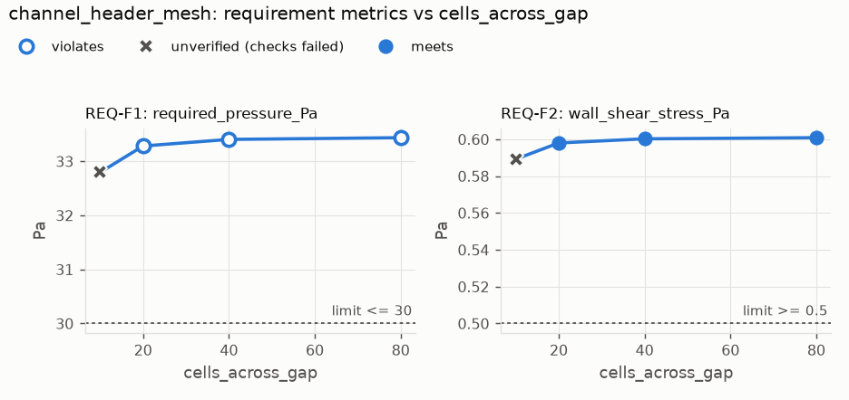
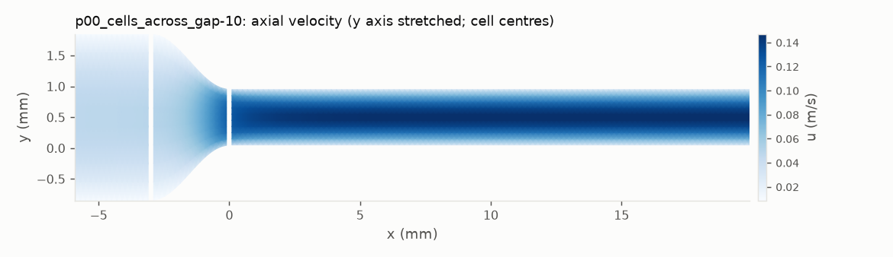
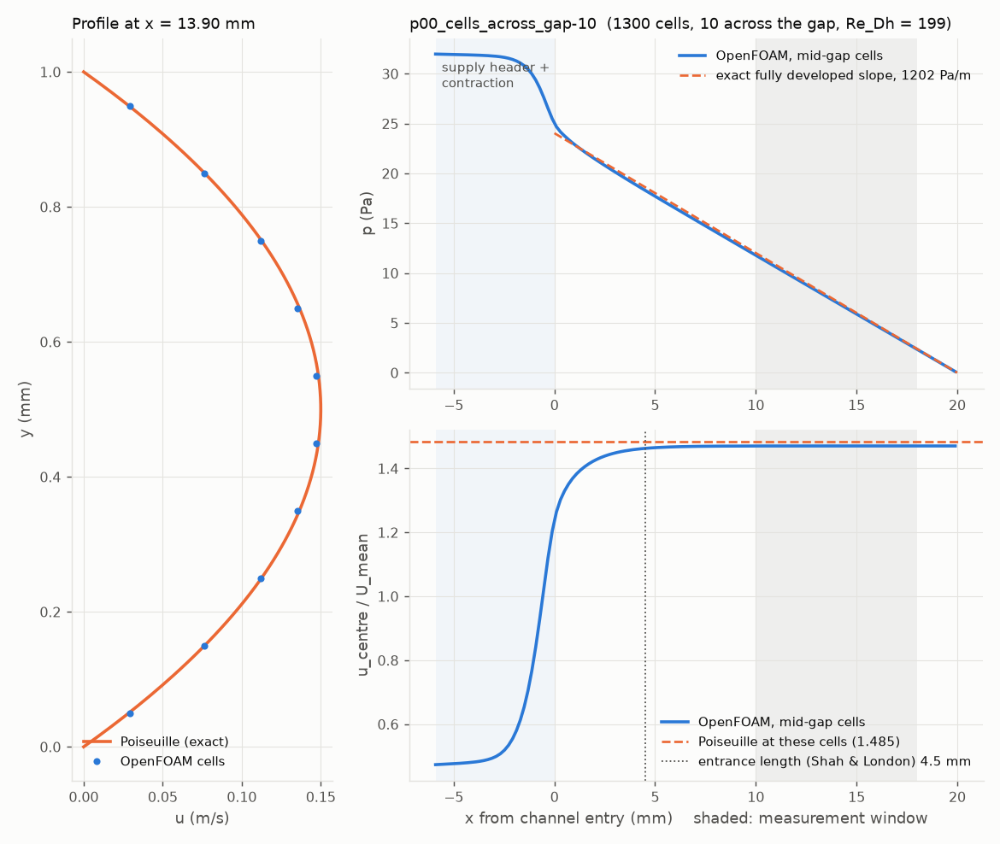
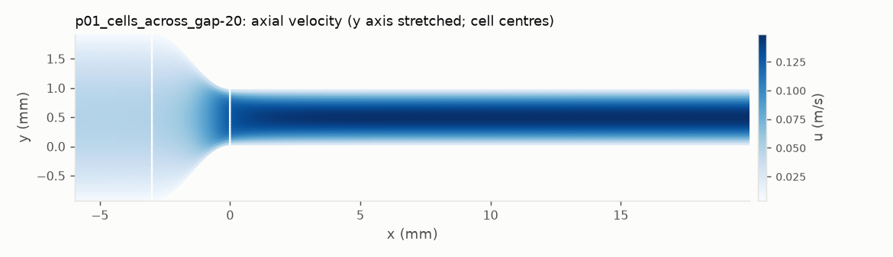
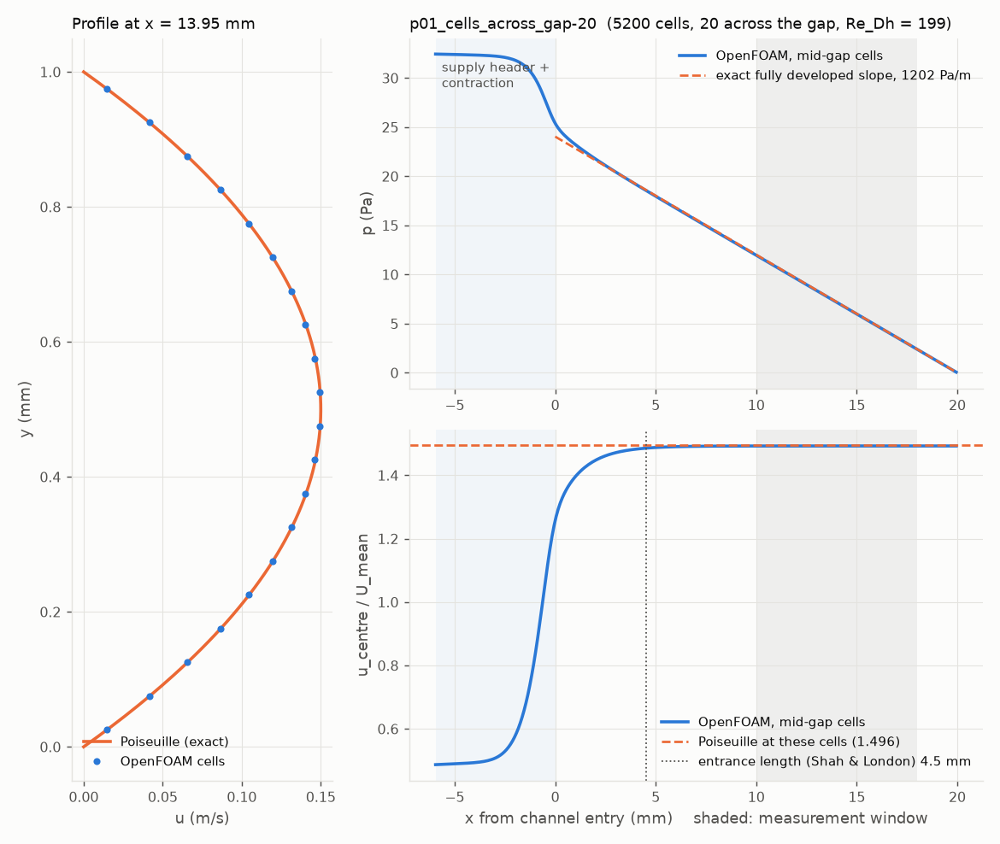
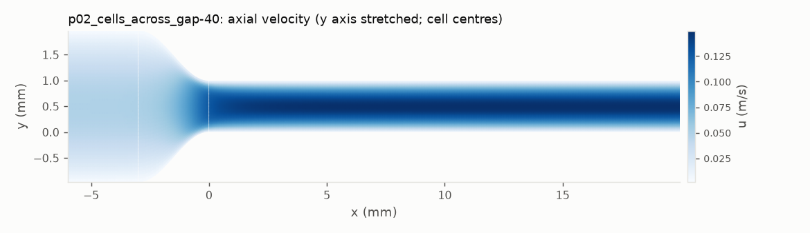
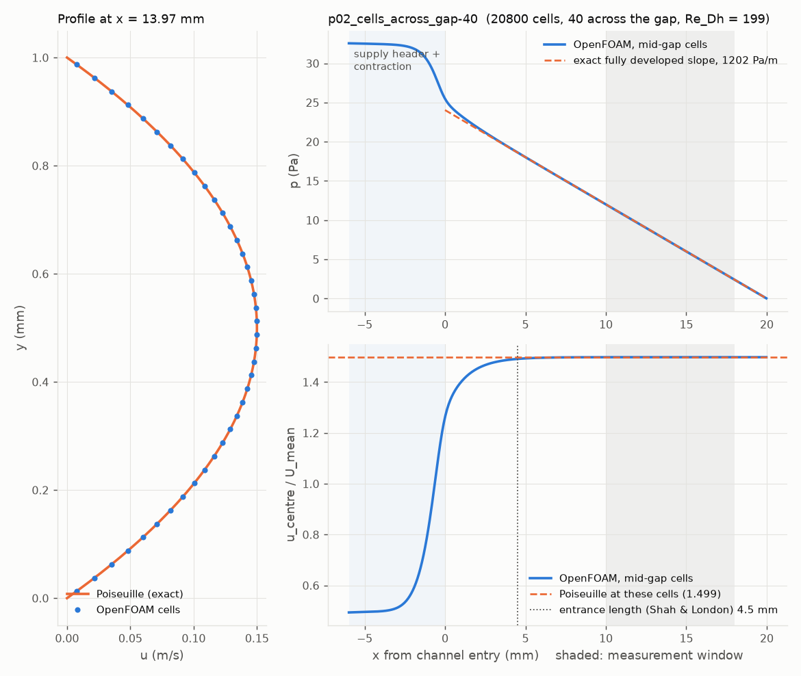
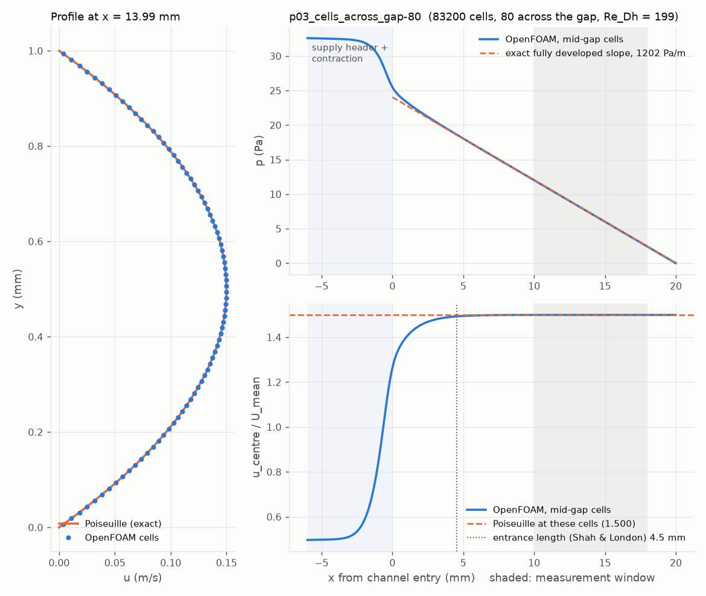

# Engineering review report: channel_header_mesh

- **Run:** `20261119-200042_channel_header_mesh`
- **Generated:** 2026-11-20T01:07:29+00:00
- **Case file SHA-256:** `51459d68642d435108cb0cdfab8aac0c9d29de8d606144d1dbb71a918de5bdd6`
- **Environment:** Python 3.14.10, numpy 2.5.5, scipy 1.18.1, matplotlib 3.11.2, cadquery 2.8.0; Windows-11-10.0.26100-SP0
- **Tools:** openfoam_bashrc /opt/openfoam14/etc/bashrc; openfoam_version 14; openfoam_package openfoam14 20261008; linux Ubuntu 22.04.5 LTS
- **Code version:** git `d8664cd0fddf3a126983492533b4a7621881a360` (uncommitted changes present)
- **Simulation status:** completed
- **Verification status:** FAIL

> **Warning:** verification did not pass for every point. Requirement verdicts marked *(unverified)* are not supported by evidence and must not be used for acceptance.

## Scope

Water at 20 C through a 1 mm gap between parallel plates, 20 mm long, mean velocity 0.1 m/s (Re_Dh about 200), fed from a 3 mm supply header through a 3 mm cosine contraction. Steady laminar 2D CFD with OpenFOAM; mesh refined from 10 to 80 cells across the gap (ratio 2). Checks the header-to-outlet pressure-drop budget and minimum wall shear stress.

**Assumptions**

- Incompressible, isothermal, Newtonian water at 20 C (IAPWS: rho = 998.21 kg/m^3, mu = 1.0016 mPa s).
- Laminar flow; checked: Re_Dh below 2000.
- 2D: the channel is much wider than the gap (side walls ignored); to be confirmed against the real width.
- Supply header modelled as a 3 mm high, 3 mm long duct with a fully developed inlet profile, then a smooth cosine contraction 3 mm long into the channel.
- Required supply pressure = flux-weighted total pressure at the supply inlet minus static pressure at the channel outlet: the outlet dynamic head is assumed lost in the outlet header (exit loss coefficient 1, conservative).
- Fully developed metrics are measured in x = 10-18 mm; checked: the predicted entrance length ends before the window, and the centreline velocity is constant across it.

## Requirements

| ID | Requirement | Metric | Limit |
|---|---|---|---|
| REQ-F1 | Supply pressure required to drive the flow from the supply header through the channel, including the exit loss, shall not exceed 30 Pa (pump budget share). | `required_pressure_Pa` | <= 30 Pa |
| REQ-F2 | Fully developed wall shear stress shall be at least 0.5 Pa (synthetic anti-fouling criterion). | `wall_shear_stress_Pa` | >= 0.5 Pa |

## Summary across points

| Point | cells_across_gap | REQ-F1 | REQ-F2 | Checks |
|---|---|---|---|---|
| p00_cells_across_gap-10 | 10 | 32.8 Pa: **FAIL (unverified)** | 0.5892 Pa: **PASS (unverified)** | 10/12 FAIL |
| p01_cells_across_gap-20 | 20 | 33.28 Pa: **FAIL** | 0.598 Pa: **PASS** | 12/12 PASS |
| p02_cells_across_gap-40 | 40 | 33.41 Pa: **FAIL** | 0.6002 Pa: **PASS** | 12/12 PASS |
| p03_cells_across_gap-80 | 80 | 33.44 Pa: **FAIL** | 0.6008 Pa: **PASS** | 12/12 PASS |

## Run-level checks

Checks that use several points together (for example mesh convergence).

| Check | Description | Value | Tolerance | Status |
|---|---|---|---|---|
| discretization_pressure_gradient_Pa_per_m | relative discretization uncertainty of pressure_gradient_Pa_per_m, monotone (R = 0.271): GCI_fine, observed order 1.88, extrapolated 1202.17 | 0.000472 | 0.01 | PASS |
| discretization_wall_shear_stress_Pa | relative discretization uncertainty of wall_shear_stress_Pa, monotone (R = 0.270): GCI_fine, observed order 1.89, extrapolated 0.601069 | 0.000467 | 0.01 | PASS |
| discretization_total_pressure_drop_Pa | relative discretization uncertainty of total_pressure_drop_Pa, monotone (R = 0.265): GCI_fine, observed order 1.91, extrapolated 25.7483 | 0.000403 | 0.02 | PASS |
| discretization_required_pressure_Pa | relative discretization uncertainty of required_pressure_Pa, monotone (R = 0.258): GCI_fine, observed order 1.95, extrapolated 33.4479 | 0.000411 | 0.02 | PASS |

## Point details

### p00_cells_across_gap-10

Parameters: gap_mm = 1, length_mm = 20, mean_velocity_m_per_s = 0.1, density_kg_per_m3 = 998.2, dynamic_viscosity_Pa_s = 0.001002, cells_across_gap = 10, cell_aspect_ratio = 2, window_start_mm = 10, window_end_mm = 18, supply_height_mm = 3, supply_length_mm = 3, contraction_length_mm = 3

Derived: reynolds_Dh = 199.3, entrance_length_mm = 4.525, pressure_gradient_exact_Pa_per_m = 1202, wall_shear_stress_exact_Pa = 0.601, pressure_drop_shah_london_Pa = 27.27, pressure_drop_fully_developed_only_Pa = 24.04, total_pressure_drop_reference_Pa = 25.73

| Requirement | Result | Limit | Margin | Verdict | Evidence |
|---|---|---|---|---|---|
| REQ-F1 | 32.8 Pa | <= 30 | -2.8 | **FAIL (unverified)** | [point.json](points/p00_cells_across_gap-10/point.json) |
| REQ-F2 | 0.5892 Pa | >= 0.5 | 0.0892 | **PASS (unverified)** | [point.json](points/p00_cells_across_gap-10/point.json) |

| Check | Description | Value | Tolerance | Status |
|---|---|---|---|---|
| mesh_quality | checkMesh result (0 = Mesh OK) | 0.00e+00 | 0e+00 | PASS |
| iterative_convergence | max final initial residual / target (inf if SIMPLE did not converge) | 9.33e-01 | 1e+00 | PASS |
| mass_conservation | |Q_out - Q_in| / Q_in (face fluxes at inlet and outlet) | 1.25e-11 | 1e-06 | PASS |
| inlet_flow | |Q_in - U H| / (U H): imposed flow rate | 8.00e-13 | 1e-06 | PASS |
| momentum_balance | |tau_w - (-dp/dx) H/2| / tau_w in the fully developed window | 3.31e-05 | 1e-03 | PASS |
| velocity_profile_reference | max |u_CFD - u_Poiseuille| / u_max at mid-window station | 9.61e-03 | 1e-02 | PASS |
| pressure_gradient_reference | |(-dp/dx)_CFD - 12 mu U/H^2| / exact | 1.95e-02 | 1e-02 | FAIL |
| wall_shear_reference | |tau_w,CFD - 6 mu U/H| / exact | 1.96e-02 | 1e-02 | FAIL |
| total_pressure_drop_reference | |dp_t,CFD - dp_t,ref| / dp_t,ref; ref = lubrication friction in header and contraction + Shah & London channel from uniform entry (model form) | 1.74e-02 | 1e-01 | PASS |
| laminar (validity) | Re_Dh / laminar limit | 9.97e-02 | 1e+00 | PASS |
| entrance_before_window (validity) | Shah & London entrance length / window start (window must be fully developed) | 4.53e-01 | 1e+00 | PASS |
| fully_developed (validity) | (max - min) / mean centreline velocity across the window | 9.86e-05 | 1e-03 | PASS |

### p01_cells_across_gap-20

Parameters: gap_mm = 1, length_mm = 20, mean_velocity_m_per_s = 0.1, density_kg_per_m3 = 998.2, dynamic_viscosity_Pa_s = 0.001002, cells_across_gap = 20, cell_aspect_ratio = 2, window_start_mm = 10, window_end_mm = 18, supply_height_mm = 3, supply_length_mm = 3, contraction_length_mm = 3

Derived: reynolds_Dh = 199.3, entrance_length_mm = 4.525, pressure_gradient_exact_Pa_per_m = 1202, wall_shear_stress_exact_Pa = 0.601, pressure_drop_shah_london_Pa = 27.27, pressure_drop_fully_developed_only_Pa = 24.04, total_pressure_drop_reference_Pa = 25.73

| Requirement | Result | Limit | Margin | Verdict | Evidence |
|---|---|---|---|---|---|
| REQ-F1 | 33.28 Pa | <= 30 | -3.28 | **FAIL** | [point.json](points/p01_cells_across_gap-20/point.json) |
| REQ-F2 | 0.598 Pa | >= 0.5 | 0.098 | **PASS** | [point.json](points/p01_cells_across_gap-20/point.json) |

| Check | Description | Value | Tolerance | Status |
|---|---|---|---|---|
| mesh_quality | checkMesh result (0 = Mesh OK) | 0.00e+00 | 0e+00 | PASS |
| iterative_convergence | max final initial residual / target (inf if SIMPLE did not converge) | 9.16e-01 | 1e+00 | PASS |
| mass_conservation | |Q_out - Q_in| / Q_in (face fluxes at inlet and outlet) | 1.14e-10 | 1e-06 | PASS |
| inlet_flow | |Q_in - U H| / (U H): imposed flow rate | 1.99e-14 | 1e-06 | PASS |
| momentum_balance | |tau_w - (-dp/dx) H/2| / tau_w in the fully developed window | 2.13e-05 | 1e-03 | PASS |
| velocity_profile_reference | max |u_CFD - u_Poiseuille| / u_max at mid-window station | 2.48e-03 | 1e-02 | PASS |
| pressure_gradient_reference | |(-dp/dx)_CFD - 12 mu U/H^2| / exact | 4.93e-03 | 1e-02 | PASS |
| wall_shear_reference | |tau_w,CFD - 6 mu U/H| / exact | 4.95e-03 | 1e-02 | PASS |
| total_pressure_drop_reference | |dp_t,CFD - dp_t,ref| / dp_t,ref; ref = lubrication friction in header and contraction + Shah & London channel from uniform entry (model form) | 3.89e-03 | 1e-01 | PASS |
| laminar (validity) | Re_Dh / laminar limit | 9.97e-02 | 1e+00 | PASS |
| entrance_before_window (validity) | Shah & London entrance length / window start (window must be fully developed) | 4.53e-01 | 1e+00 | PASS |
| fully_developed (validity) | (max - min) / mean centreline velocity across the window | 7.58e-05 | 1e-03 | PASS |

### p02_cells_across_gap-40

Parameters: gap_mm = 1, length_mm = 20, mean_velocity_m_per_s = 0.1, density_kg_per_m3 = 998.2, dynamic_viscosity_Pa_s = 0.001002, cells_across_gap = 40, cell_aspect_ratio = 2, window_start_mm = 10, window_end_mm = 18, supply_height_mm = 3, supply_length_mm = 3, contraction_length_mm = 3

Derived: reynolds_Dh = 199.3, entrance_length_mm = 4.525, pressure_gradient_exact_Pa_per_m = 1202, wall_shear_stress_exact_Pa = 0.601, pressure_drop_shah_london_Pa = 27.27, pressure_drop_fully_developed_only_Pa = 24.04, total_pressure_drop_reference_Pa = 25.73

| Requirement | Result | Limit | Margin | Verdict | Evidence |
|---|---|---|---|---|---|
| REQ-F1 | 33.41 Pa | <= 30 | -3.41 | **FAIL** | [point.json](points/p02_cells_across_gap-40/point.json) |
| REQ-F2 | 0.6002 Pa | >= 0.5 | 0.1 | **PASS** | [point.json](points/p02_cells_across_gap-40/point.json) |

| Check | Description | Value | Tolerance | Status |
|---|---|---|---|---|
| mesh_quality | checkMesh result (0 = Mesh OK) | 0.00e+00 | 0e+00 | PASS |
| iterative_convergence | max final initial residual / target (inf if SIMPLE did not converge) | 9.81e-01 | 1e+00 | PASS |
| mass_conservation | |Q_out - Q_in| / Q_in (face fluxes at inlet and outlet) | 6.40e-09 | 1e-06 | PASS |
| inlet_flow | |Q_in - U H| / (U H): imposed flow rate | 2.60e-13 | 1e-06 | PASS |
| momentum_balance | |tau_w - (-dp/dx) H/2| / tau_w in the fully developed window | 1.97e-05 | 1e-03 | PASS |
| velocity_profile_reference | max |u_CFD - u_Poiseuille| / u_max at mid-window station | 6.43e-04 | 1e-02 | PASS |
| pressure_gradient_reference | |(-dp/dx)_CFD - 12 mu U/H^2| / exact | 1.18e-03 | 1e-02 | PASS |
| wall_shear_reference | |tau_w,CFD - 6 mu U/H| / exact | 1.20e-03 | 1e-02 | PASS |
| total_pressure_drop_reference | |dp_t,CFD - dp_t,ref| / dp_t,ref; ref = lubrication friction in header and contraction + Shah & London channel from uniform entry (model form) | 5.24e-04 | 1e-01 | PASS |
| laminar (validity) | Re_Dh / laminar limit | 9.97e-02 | 1e+00 | PASS |
| entrance_before_window (validity) | Shah & London entrance length / window start (window must be fully developed) | 4.53e-01 | 1e+00 | PASS |
| fully_developed (validity) | (max - min) / mean centreline velocity across the window | 5.76e-05 | 1e-03 | PASS |

### p03_cells_across_gap-80

Parameters: gap_mm = 1, length_mm = 20, mean_velocity_m_per_s = 0.1, density_kg_per_m3 = 998.2, dynamic_viscosity_Pa_s = 0.001002, cells_across_gap = 80, cell_aspect_ratio = 2, window_start_mm = 10, window_end_mm = 18, supply_height_mm = 3, supply_length_mm = 3, contraction_length_mm = 3

Derived: reynolds_Dh = 199.3, entrance_length_mm = 4.525, pressure_gradient_exact_Pa_per_m = 1202, wall_shear_stress_exact_Pa = 0.601, pressure_drop_shah_london_Pa = 27.27, pressure_drop_fully_developed_only_Pa = 24.04, total_pressure_drop_reference_Pa = 25.73

| Requirement | Result | Limit | Margin | Verdict | Evidence |
|---|---|---|---|---|---|
| REQ-F1 | 33.44 Pa | <= 30 | -3.44 | **FAIL** | [point.json](points/p03_cells_across_gap-80/point.json) |
| REQ-F2 | 0.6008 Pa | >= 0.5 | 0.101 | **PASS** | [point.json](points/p03_cells_across_gap-80/point.json) |

| Check | Description | Value | Tolerance | Status |
|---|---|---|---|---|
| mesh_quality | checkMesh result (0 = Mesh OK) | 0.00e+00 | 0e+00 | PASS |
| iterative_convergence | max final initial residual / target (inf if SIMPLE did not converge) | 9.81e-01 | 1e+00 | PASS |
| mass_conservation | |Q_out - Q_in| / Q_in (face fluxes at inlet and outlet) | 7.20e-10 | 1e-06 | PASS |
| inlet_flow | |Q_in - U H| / (U H): imposed flow rate | 2.98e-13 | 1e-06 | PASS |
| momentum_balance | |tau_w - (-dp/dx) H/2| / tau_w in the fully developed window | 2.38e-05 | 1e-03 | PASS |
| velocity_profile_reference | max |u_CFD - u_Poiseuille| / u_max at mid-window station | 2.24e-04 | 1e-02 | PASS |
| pressure_gradient_reference | |(-dp/dx)_CFD - 12 mu U/H^2| / exact | 1.69e-04 | 1e-02 | PASS |
| wall_shear_reference | |tau_w,CFD - 6 mu U/H| / exact | 1.93e-04 | 1e-02 | PASS |
| total_pressure_drop_reference | |dp_t,CFD - dp_t,ref| / dp_t,ref; ref = lubrication friction in header and contraction + Shah & London channel from uniform entry (model form) | 3.69e-04 | 1e-01 | PASS |
| laminar (validity) | Re_Dh / laminar limit | 9.97e-02 | 1e+00 | PASS |
| entrance_before_window (validity) | Shah & London entrance length / window start (window must be fully developed) | 4.53e-01 | 1e+00 | PASS |
| fully_developed (validity) | (max - min) / mean centreline velocity across the window | 2.12e-05 | 1e-03 | PASS |

## Limitations

- Synthetic geometry and requirement limits; not a specific cold plate.
- The total-pressure reference is a model-form estimate (lubrication theory + Shah & London), not an exact solution.
- The outlet header is not modelled; its pressure recovery, if any, is neglected (conservative).
- No physical test data.
- A converged solver run that matches an analytical reference shows that the equations were solved correctly. It does not show that the equations represent real hardware.

## Engineering acceptance

Pending human review. This report does not accept or reject the design.
