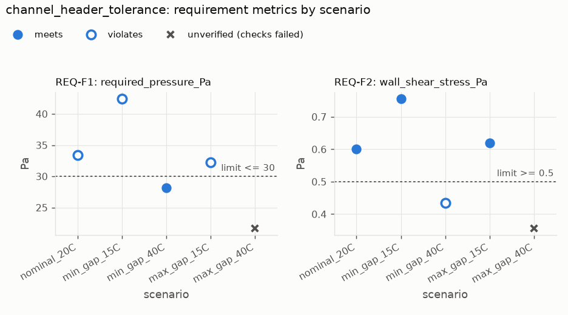
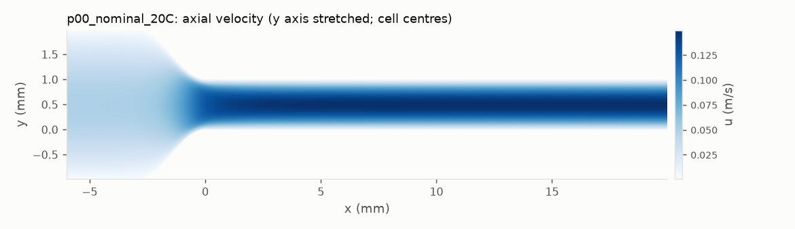
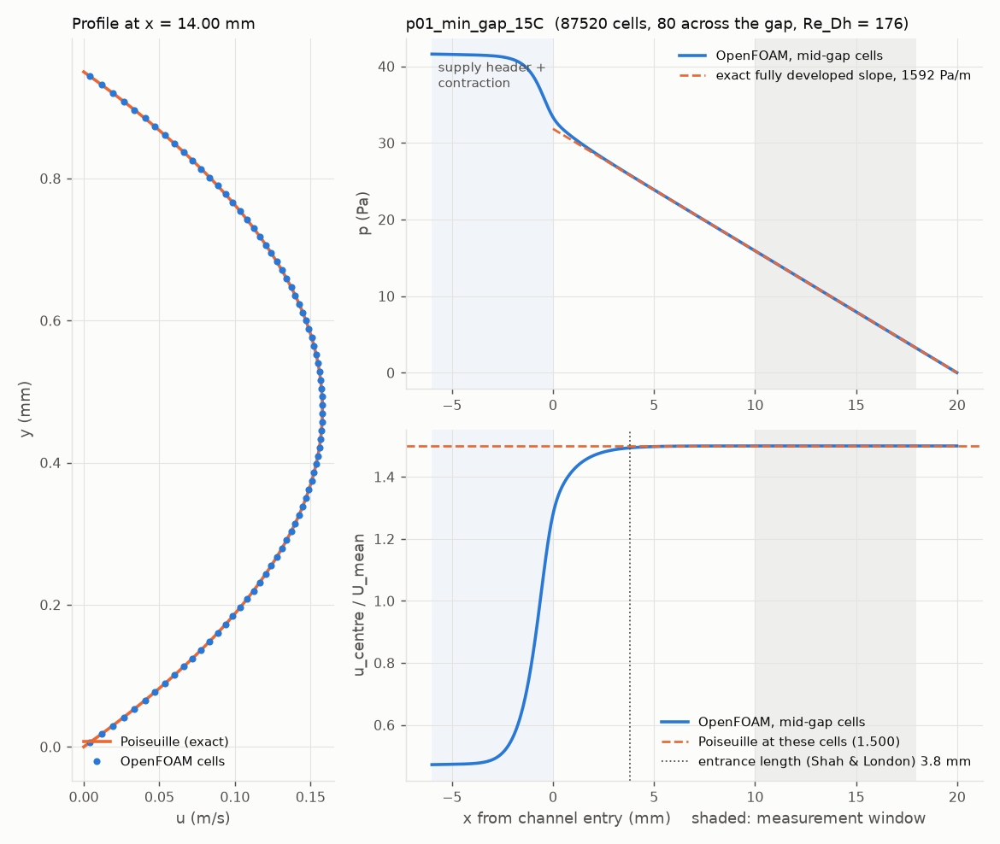
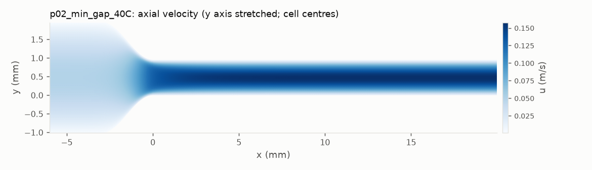
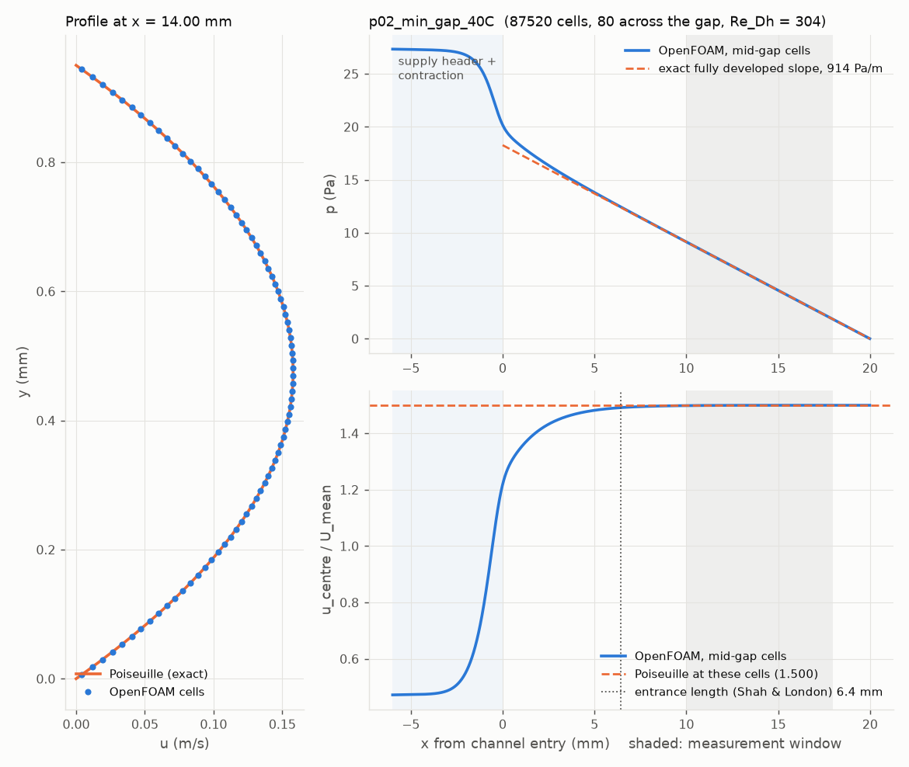
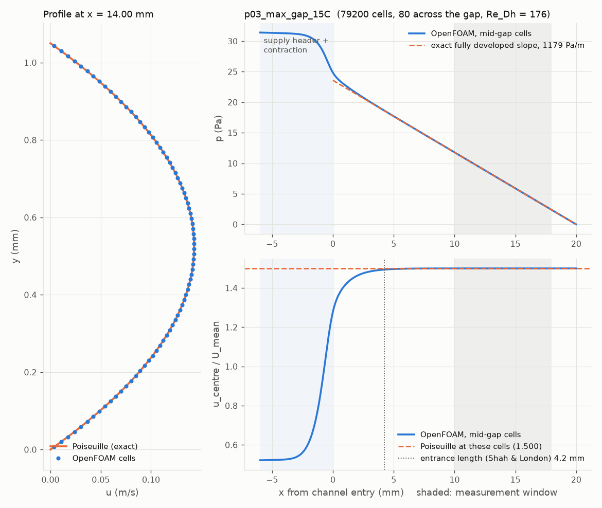
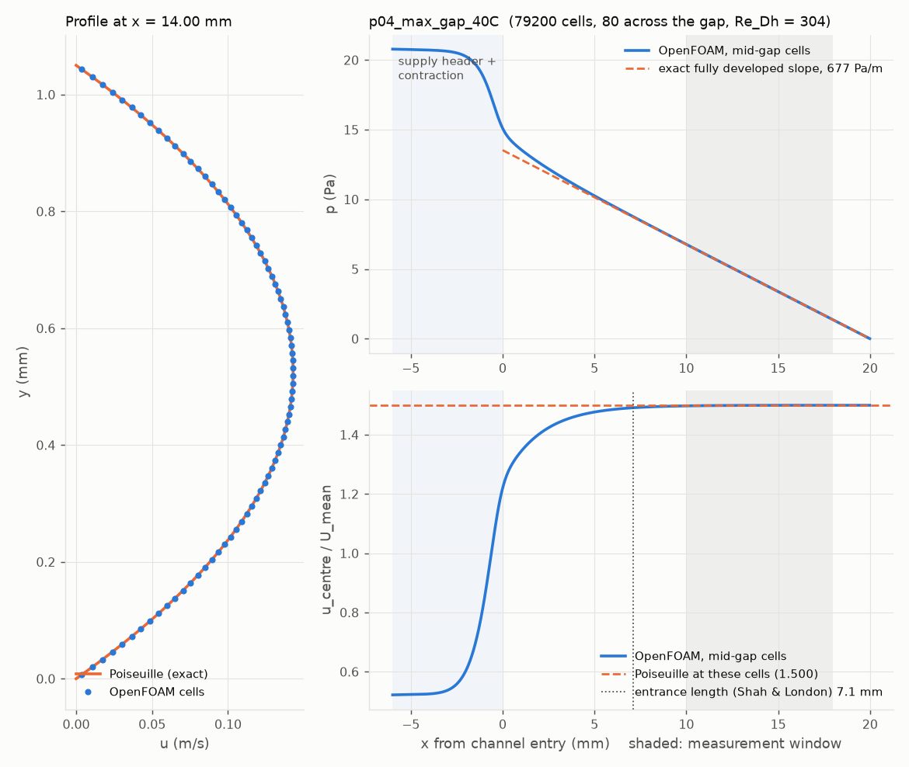

# Engineering review report: channel_header_tolerance

- **Run:** `20261119-200202_channel_header_tolerance`
- **Generated:** 2026-11-20T01:07:25+00:00
- **Case file SHA-256:** `27a47de20e85c5be9700f8992a8ba9f59d8352f2bd6ee92b94af67c799f30f9e`
- **Environment:** Python 3.14.10, numpy 2.5.5, scipy 1.18.1, matplotlib 3.11.2, cadquery 2.8.0; Windows-11-10.0.26100-SP0
- **Tools:** openfoam_bashrc /opt/openfoam14/etc/bashrc; openfoam_version 14; openfoam_package openfoam14 20261008; linux Ubuntu 22.04.5 LTS
- **Code version:** git `d8664cd0fddf3a126983492533b4a7621881a360` (uncommitted changes present)
- **Simulation status:** completed
- **Verification status:** FAIL

> **Warning:** verification did not pass for every point. Requirement verdicts marked *(unverified)* are not supported by evidence and must not be used for acceptance.

## Scope

Header-fed 1 mm parallel-plate channel (as channel_header_mesh, 80 cells across the gap) evaluated at the corners of the gap tolerance (0.95-1.05 mm) and coolant temperature range (15-40 C) at a fixed flow rate of 1.0e-4 m^2/s per unit width. Finds whether the pressure budget and minimum wall shear hold across the tolerance band.

**Assumptions**

- As channel_header_mesh, except the inputs varied below.
- Flow rate per unit width is fixed by the pump: mean velocity = 1.0e-4 / gap (m/s, gap in m).
- Water properties from IAPWS tables: 15 C (999.10 kg/m^3, 1.1375 mPa s), 20 C (998.21, 1.0016), 40 C (992.22, 0.6527).
- Gap is uniform along the channel within each scenario (no taper or waviness).

## Requirements

| ID | Requirement | Metric | Limit |
|---|---|---|---|
| REQ-F1 | Supply pressure required to drive the flow from the supply header through the channel, including the exit loss, shall not exceed 30 Pa (pump budget share). | `required_pressure_Pa` | <= 30 Pa |
| REQ-F2 | Fully developed wall shear stress shall be at least 0.5 Pa (synthetic anti-fouling criterion). | `wall_shear_stress_Pa` | >= 0.5 Pa |

## Summary across points

| Point | scenario | REQ-F1 | REQ-F2 | Checks |
|---|---|---|---|---|
| p00_nominal_20C | nominal_20C | 33.44 Pa: **FAIL** | 0.6008 Pa: **PASS** | 12/12 PASS |
| p01_min_gap_15C | min_gap_15C | 42.45 Pa: **FAIL** | 0.7561 Pa: **PASS** | 12/12 PASS |
| p02_min_gap_40C | min_gap_40C | 28.18 Pa: **PASS** | 0.434 Pa: **FAIL** | 12/12 PASS |
| p03_max_gap_15C | max_gap_15C | 32.26 Pa: **FAIL** | 0.6189 Pa: **PASS** | 12/12 PASS |
| p04_max_gap_40C | max_gap_40C | 21.63 Pa: **PASS (unverified)** | 0.3554 Pa: **FAIL (unverified)** | 11/12 FAIL |

## Point details

### p00_nominal_20C

Parameters: gap_mm = 1, length_mm = 20, mean_velocity_m_per_s = 0.1, density_kg_per_m3 = 998.2, dynamic_viscosity_Pa_s = 0.001002, cells_across_gap = 80, cell_aspect_ratio = 2, window_start_mm = 10, window_end_mm = 18, supply_height_mm = 3, supply_length_mm = 3, contraction_length_mm = 3, scenario = nominal_20C

Derived: reynolds_Dh = 199.3, entrance_length_mm = 4.525, pressure_gradient_exact_Pa_per_m = 1202, wall_shear_stress_exact_Pa = 0.601, pressure_drop_shah_london_Pa = 27.27, pressure_drop_fully_developed_only_Pa = 24.04, total_pressure_drop_reference_Pa = 25.73

| Requirement | Result | Limit | Margin | Verdict | Evidence |
|---|---|---|---|---|---|
| REQ-F1 | 33.44 Pa | <= 30 | -3.44 | **FAIL** | [point.json](points/p00_nominal_20C/point.json) |
| REQ-F2 | 0.6008 Pa | >= 0.5 | 0.101 | **PASS** | [point.json](points/p00_nominal_20C/point.json) |

| Check | Description | Value | Tolerance | Status |
|---|---|---|---|---|
| mesh_quality | checkMesh result (0 = Mesh OK) | 0.00e+00 | 0e+00 | PASS |
| iterative_convergence | max final initial residual / target (inf if SIMPLE did not converge) | 9.81e-01 | 1e+00 | PASS |
| mass_conservation | |Q_out - Q_in| / Q_in (face fluxes at inlet and outlet) | 7.20e-10 | 1e-06 | PASS |
| inlet_flow | |Q_in - U H| / (U H): imposed flow rate | 2.98e-13 | 1e-06 | PASS |
| momentum_balance | |tau_w - (-dp/dx) H/2| / tau_w in the fully developed window | 2.38e-05 | 1e-03 | PASS |
| velocity_profile_reference | max |u_CFD - u_Poiseuille| / u_max at mid-window station | 2.24e-04 | 1e-02 | PASS |
| pressure_gradient_reference | |(-dp/dx)_CFD - 12 mu U/H^2| / exact | 1.69e-04 | 1e-02 | PASS |
| wall_shear_reference | |tau_w,CFD - 6 mu U/H| / exact | 1.93e-04 | 1e-02 | PASS |
| total_pressure_drop_reference | |dp_t,CFD - dp_t,ref| / dp_t,ref; ref = lubrication friction in header and contraction + Shah & London channel from uniform entry (model form) | 3.69e-04 | 1e-01 | PASS |
| laminar (validity) | Re_Dh / laminar limit | 9.97e-02 | 1e+00 | PASS |
| entrance_before_window (validity) | Shah & London entrance length / window start (window must be fully developed) | 4.53e-01 | 1e+00 | PASS |
| fully_developed (validity) | (max - min) / mean centreline velocity across the window | 2.12e-05 | 1e-03 | PASS |

### p01_min_gap_15C

Parameters: gap_mm = 0.95, length_mm = 20, mean_velocity_m_per_s = 0.1053, density_kg_per_m3 = 999.1, dynamic_viscosity_Pa_s = 0.001138, cells_across_gap = 80, cell_aspect_ratio = 2, window_start_mm = 10, window_end_mm = 18, supply_height_mm = 3, supply_length_mm = 3, contraction_length_mm = 3, scenario = min_gap_15C

Derived: reynolds_Dh = 175.7, entrance_length_mm = 3.818, pressure_gradient_exact_Pa_per_m = 1592, wall_shear_stress_exact_Pa = 0.7562, pressure_drop_shah_london_Pa = 35.44, pressure_drop_fully_developed_only_Pa = 31.84, total_pressure_drop_reference_Pa = 33.91

| Requirement | Result | Limit | Margin | Verdict | Evidence |
|---|---|---|---|---|---|
| REQ-F1 | 42.45 Pa | <= 30 | -12.5 | **FAIL** | [point.json](points/p01_min_gap_15C/point.json) |
| REQ-F2 | 0.7561 Pa | >= 0.5 | 0.256 | **PASS** | [point.json](points/p01_min_gap_15C/point.json) |

| Check | Description | Value | Tolerance | Status |
|---|---|---|---|---|
| mesh_quality | checkMesh result (0 = Mesh OK) | 0.00e+00 | 0e+00 | PASS |
| iterative_convergence | max final initial residual / target (inf if SIMPLE did not converge) | 9.82e-01 | 1e+00 | PASS |
| mass_conservation | |Q_out - Q_in| / Q_in (face fluxes at inlet and outlet) | 4.74e-10 | 1e-06 | PASS |
| inlet_flow | |Q_in - U H| / (U H): imposed flow rate | 2.82e-13 | 1e-06 | PASS |
| momentum_balance | |tau_w - (-dp/dx) H/2| / tau_w in the fully developed window | 1.75e-05 | 1e-03 | PASS |
| velocity_profile_reference | max |u_CFD - u_Poiseuille| / u_max at mid-window station | 2.14e-04 | 1e-02 | PASS |
| pressure_gradient_reference | |(-dp/dx)_CFD - 12 mu U/H^2| / exact | 1.94e-04 | 1e-02 | PASS |
| wall_shear_reference | |tau_w,CFD - 6 mu U/H| / exact | 2.12e-04 | 1e-02 | PASS |
| total_pressure_drop_reference | |dp_t,CFD - dp_t,ref| / dp_t,ref; ref = lubrication friction in header and contraction + Shah & London channel from uniform entry (model form) | 3.08e-04 | 1e-01 | PASS |
| laminar (validity) | Re_Dh / laminar limit | 8.78e-02 | 1e+00 | PASS |
| entrance_before_window (validity) | Shah & London entrance length / window start (window must be fully developed) | 3.82e-01 | 1e+00 | PASS |
| fully_developed (validity) | (max - min) / mean centreline velocity across the window | 7.06e-07 | 1e-03 | PASS |

### p02_min_gap_40C

Parameters: gap_mm = 0.95, length_mm = 20, mean_velocity_m_per_s = 0.1053, density_kg_per_m3 = 992.2, dynamic_viscosity_Pa_s = 0.0006527, cells_across_gap = 80, cell_aspect_ratio = 2, window_start_mm = 10, window_end_mm = 18, supply_height_mm = 3, supply_length_mm = 3, contraction_length_mm = 3, scenario = min_gap_40C

Derived: reynolds_Dh = 304, entrance_length_mm = 6.449, pressure_gradient_exact_Pa_per_m = 913.5, wall_shear_stress_exact_Pa = 0.4339, pressure_drop_shah_london_Pa = 21.79, pressure_drop_fully_developed_only_Pa = 18.27, total_pressure_drop_reference_Pa = 19.65

| Requirement | Result | Limit | Margin | Verdict | Evidence |
|---|---|---|---|---|---|
| REQ-F1 | 28.18 Pa | <= 30 | 1.82 | **PASS** | [point.json](points/p02_min_gap_40C/point.json) |
| REQ-F2 | 0.434 Pa | >= 0.5 | -0.066 | **FAIL** | [point.json](points/p02_min_gap_40C/point.json) |

| Check | Description | Value | Tolerance | Status |
|---|---|---|---|---|
| mesh_quality | checkMesh result (0 = Mesh OK) | 0.00e+00 | 0e+00 | PASS |
| iterative_convergence | max final initial residual / target (inf if SIMPLE did not converge) | 9.79e-01 | 1e+00 | PASS |
| mass_conservation | |Q_out - Q_in| / Q_in (face fluxes at inlet and outlet) | 8.25e-10 | 1e-06 | PASS |
| inlet_flow | |Q_in - U H| / (U H): imposed flow rate | 2.82e-13 | 1e-06 | PASS |
| momentum_balance | |tau_w - (-dp/dx) H/2| / tau_w in the fully developed window | 4.03e-04 | 1e-03 | PASS |
| velocity_profile_reference | max |u_CFD - u_Poiseuille| / u_max at mid-window station | 2.89e-04 | 1e-02 | PASS |
| pressure_gradient_reference | |(-dp/dx)_CFD - 12 mu U/H^2| / exact | 5.34e-04 | 1e-02 | PASS |
| wall_shear_reference | |tau_w,CFD - 6 mu U/H| / exact | 1.31e-04 | 1e-02 | PASS |
| total_pressure_drop_reference | |dp_t,CFD - dp_t,ref| / dp_t,ref; ref = lubrication friction in header and contraction + Shah & London channel from uniform entry (model form) | 2.73e-03 | 1e-01 | PASS |
| laminar (validity) | Re_Dh / laminar limit | 1.52e-01 | 1e+00 | PASS |
| entrance_before_window (validity) | Shah & London entrance length / window start (window must be fully developed) | 6.45e-01 | 1e+00 | PASS |
| fully_developed (validity) | (max - min) / mean centreline velocity across the window | 7.91e-04 | 1e-03 | PASS |

### p03_max_gap_15C

Parameters: gap_mm = 1.05, length_mm = 20, mean_velocity_m_per_s = 0.09524, density_kg_per_m3 = 999.1, dynamic_viscosity_Pa_s = 0.001138, cells_across_gap = 80, cell_aspect_ratio = 2, window_start_mm = 10, window_end_mm = 18, supply_height_mm = 3, supply_length_mm = 3, contraction_length_mm = 3, scenario = max_gap_15C

Derived: reynolds_Dh = 175.7, entrance_length_mm = 4.22, pressure_gradient_exact_Pa_per_m = 1179, wall_shear_stress_exact_Pa = 0.619, pressure_drop_shah_london_Pa = 26.52, pressure_drop_fully_developed_only_Pa = 23.58, total_pressure_drop_reference_Pa = 25.27

| Requirement | Result | Limit | Margin | Verdict | Evidence |
|---|---|---|---|---|---|
| REQ-F1 | 32.26 Pa | <= 30 | -2.26 | **FAIL** | [point.json](points/p03_max_gap_15C/point.json) |
| REQ-F2 | 0.6189 Pa | >= 0.5 | 0.119 | **PASS** | [point.json](points/p03_max_gap_15C/point.json) |

| Check | Description | Value | Tolerance | Status |
|---|---|---|---|---|
| mesh_quality | checkMesh result (0 = Mesh OK) | 0.00e+00 | 0e+00 | PASS |
| iterative_convergence | max final initial residual / target (inf if SIMPLE did not converge) | 9.90e-01 | 1e+00 | PASS |
| mass_conservation | |Q_out - Q_in| / Q_in (face fluxes at inlet and outlet) | 4.37e-10 | 1e-06 | PASS |
| inlet_flow | |Q_in - U H| / (U H): imposed flow rate | 1.20e-13 | 1e-06 | PASS |
| momentum_balance | |tau_w - (-dp/dx) H/2| / tau_w in the fully developed window | 1.82e-05 | 1e-03 | PASS |
| velocity_profile_reference | max |u_CFD - u_Poiseuille| / u_max at mid-window station | 2.17e-04 | 1e-02 | PASS |
| pressure_gradient_reference | |(-dp/dx)_CFD - 12 mu U/H^2| / exact | 1.90e-04 | 1e-02 | PASS |
| wall_shear_reference | |tau_w,CFD - 6 mu U/H| / exact | 2.08e-04 | 1e-02 | PASS |
| total_pressure_drop_reference | |dp_t,CFD - dp_t,ref| / dp_t,ref; ref = lubrication friction in header and contraction + Shah & London channel from uniform entry (model form) | 2.56e-04 | 1e-01 | PASS |
| laminar (validity) | Re_Dh / laminar limit | 8.78e-02 | 1e+00 | PASS |
| entrance_before_window (validity) | Shah & London entrance length / window start (window must be fully developed) | 4.22e-01 | 1e+00 | PASS |
| fully_developed (validity) | (max - min) / mean centreline velocity across the window | 4.38e-06 | 1e-03 | PASS |

### p04_max_gap_40C

Parameters: gap_mm = 1.05, length_mm = 20, mean_velocity_m_per_s = 0.09524, density_kg_per_m3 = 992.2, dynamic_viscosity_Pa_s = 0.0006527, cells_across_gap = 80, cell_aspect_ratio = 2, window_start_mm = 10, window_end_mm = 18, supply_height_mm = 3, supply_length_mm = 3, contraction_length_mm = 3, scenario = max_gap_40C

Derived: reynolds_Dh = 304, entrance_length_mm = 7.128, pressure_gradient_exact_Pa_per_m = 676.6, wall_shear_stress_exact_Pa = 0.3552, pressure_drop_shah_london_Pa = 16.4, pressure_drop_fully_developed_only_Pa = 13.53, total_pressure_drop_reference_Pa = 14.66

| Requirement | Result | Limit | Margin | Verdict | Evidence |
|---|---|---|---|---|---|
| REQ-F1 | 21.63 Pa | <= 30 | 8.37 | **PASS (unverified)** | [point.json](points/p04_max_gap_40C/point.json) |
| REQ-F2 | 0.3554 Pa | >= 0.5 | -0.145 | **FAIL (unverified)** | [point.json](points/p04_max_gap_40C/point.json) |

| Check | Description | Value | Tolerance | Status |
|---|---|---|---|---|
| mesh_quality | checkMesh result (0 = Mesh OK) | 0.00e+00 | 0e+00 | PASS |
| iterative_convergence | max final initial residual / target (inf if SIMPLE did not converge) | 9.85e-01 | 1e+00 | PASS |
| mass_conservation | |Q_out - Q_in| / Q_in (face fluxes at inlet and outlet) | 5.61e-10 | 1e-06 | PASS |
| inlet_flow | |Q_in - U H| / (U H): imposed flow rate | 1.20e-13 | 1e-06 | PASS |
| momentum_balance | |tau_w - (-dp/dx) H/2| / tau_w in the fully developed window | 8.33e-04 | 1e-03 | PASS |
| velocity_profile_reference | max |u_CFD - u_Poiseuille| / u_max at mid-window station | 3.89e-04 | 1e-02 | PASS |
| pressure_gradient_reference | |(-dp/dx)_CFD - 12 mu U/H^2| / exact | 1.24e-03 | 1e-02 | PASS |
| wall_shear_reference | |tau_w,CFD - 6 mu U/H| / exact | 4.10e-04 | 1e-02 | PASS |
| total_pressure_drop_reference | |dp_t,CFD - dp_t,ref| / dp_t,ref; ref = lubrication friction in header and contraction + Shah & London channel from uniform entry (model form) | 2.04e-03 | 1e-01 | PASS |
| laminar (validity) | Re_Dh / laminar limit | 1.52e-01 | 1e+00 | PASS |
| entrance_before_window (validity) | Shah & London entrance length / window start (window must be fully developed) | 7.13e-01 | 1e+00 | PASS |
| fully_developed (validity) | (max - min) / mean centreline velocity across the window | 1.34e-03 | 1e-03 | FAIL |

## Limitations

- Synthetic tolerance band and temperature range; not from a drawing or a thermal analysis.
- Corners only: no statistical (e.g. Monte Carlo) combination of tolerances.
- Numerical uncertainty is taken from channel_header_mesh (same mesh resolution).
- No physical test data.
- A converged solver run that matches an analytical reference shows that the equations were solved correctly. It does not show that the equations represent real hardware.

## Engineering acceptance

Pending human review. This report does not accept or reject the design.
