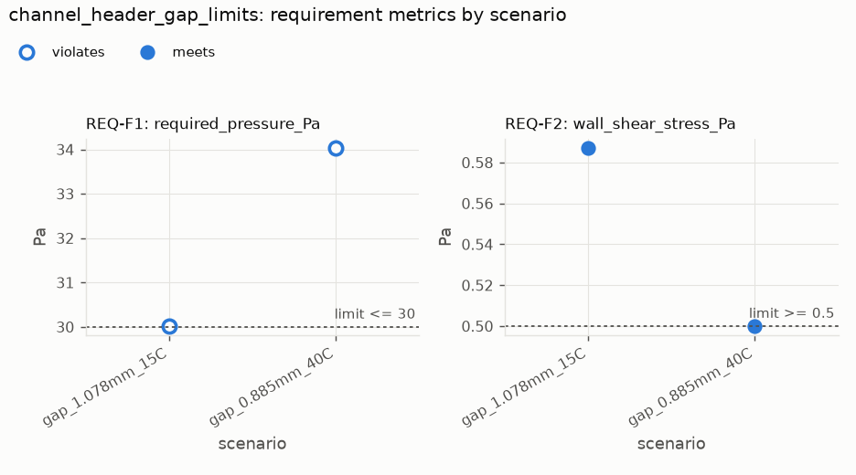
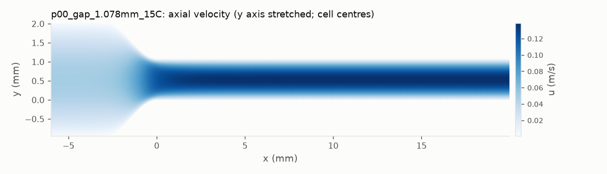
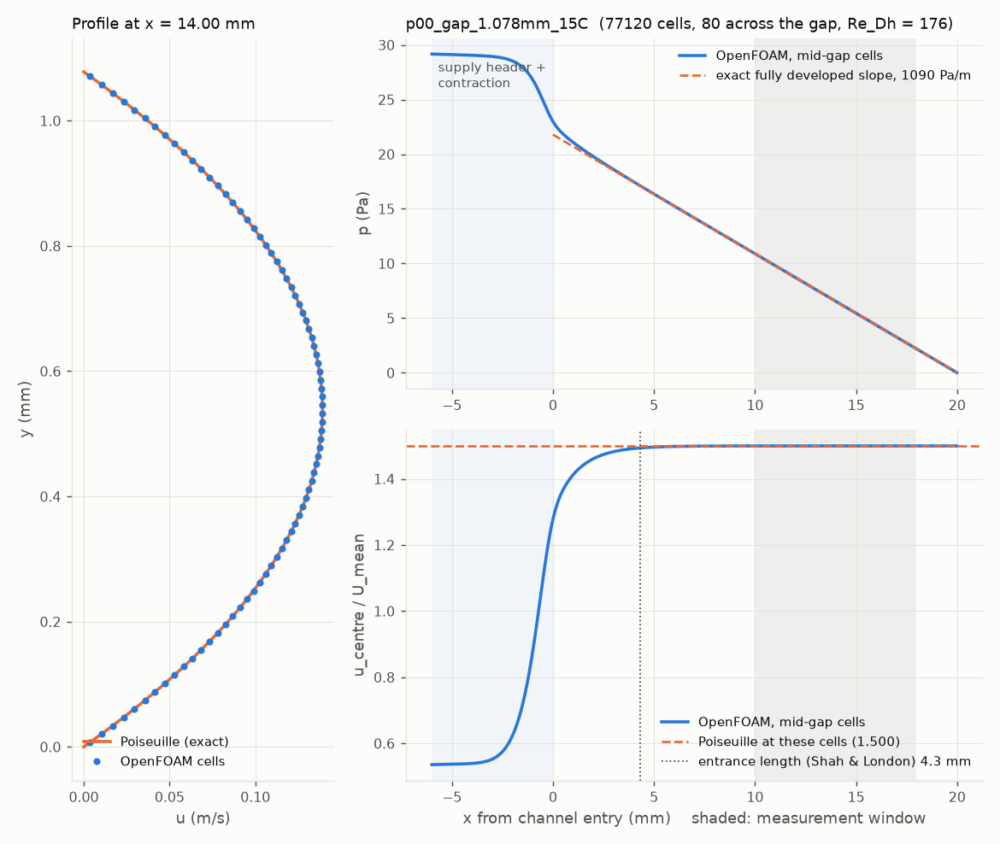
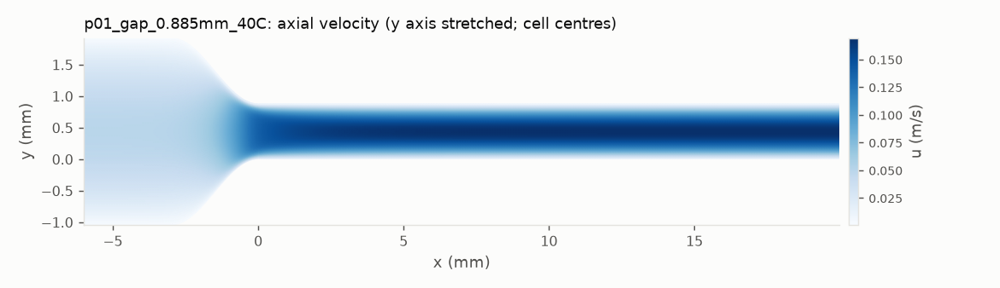
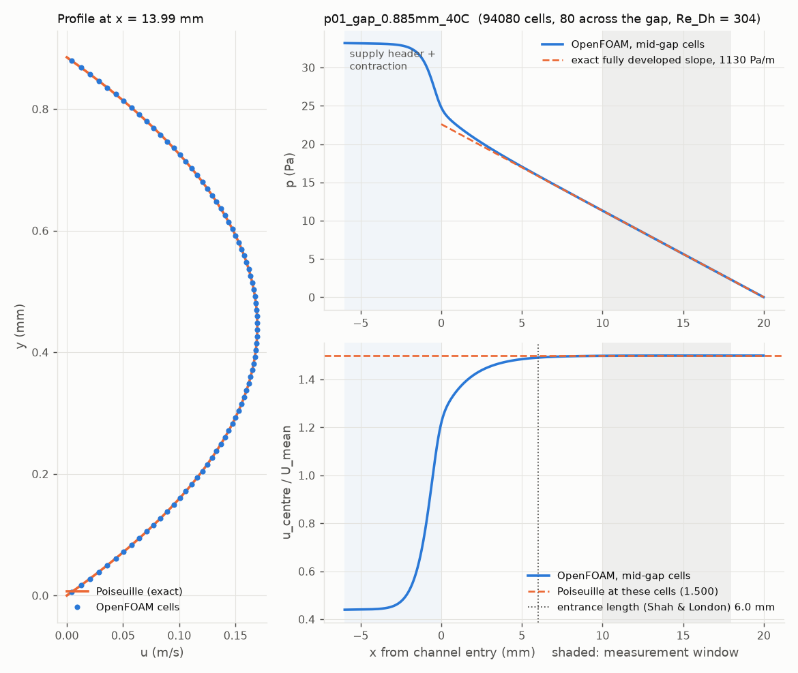

# Engineering review report: channel_header_gap_limits

- **Run:** `20261119-201615_channel_header_gap_limits`
- **Generated:** 2026-11-20T01:17:34+00:00
- **Case file SHA-256:** `76907a8866879b08773517a6fd7ec71e9fd64a8eb6711c8fa05fe1c2f7449892`
- **Environment:** Python 3.14.10, numpy 2.5.5, scipy 1.18.1, matplotlib 3.11.2, cadquery 2.8.0; Windows-11-10.0.26100-SP0
- **Tools:** openfoam_bashrc /opt/openfoam14/etc/bashrc; openfoam_version 14; openfoam_package openfoam14 20261008; linux Ubuntu 22.04.5 LTS
- **Code version:** git `99d983c534224a5e8417e845d1ebe1b0898534fb` (uncommitted changes present)
- **Simulation status:** completed
- **Verification status:** PASS

## Scope

Header-fed parallel-plate channel (as channel_header_tolerance, 80 cells across the gap) at the two gap limits estimated from the tolerance study: 1.078 mm at 15 C (pressure budget) and 0.885 mm at 40 C (wall shear). Confirms or refutes that the requirements leave no feasible gap at a flow rate of 1.0e-4 m^2/s per unit width.

**Assumptions**

- As channel_header_mesh, except the inputs varied below.
- Flow rate per unit width is fixed by the pump: mean velocity = 1.0e-4 / gap (m/s, gap in m).
- Water properties from IAPWS tables: 15 C (999.10 kg/m^3, 1.1375 mPa s), 20 C (998.21, 1.0016), 40 C (992.22, 0.6527).
- Gap is uniform along the channel within each scenario (no taper or waviness).

## Requirements

| ID | Requirement | Metric | Limit |
|---|---|---|---|
| REQ-F1 | Supply pressure required to drive the flow from the supply header through the channel, including the exit loss, shall not exceed 30 Pa (pump budget share). | `required_pressure_Pa` | <= 30 Pa |
| REQ-F2 | Fully developed wall shear stress shall be at least 0.5 Pa (synthetic anti-fouling criterion). | `wall_shear_stress_Pa` | >= 0.5 Pa |

## Summary across points

| Point | scenario | REQ-F1 | REQ-F2 | Checks |
|---|---|---|---|---|
| p00_gap_1.078mm_15C | gap_1.078mm_15C | 30.02 Pa: **FAIL** | 0.5872 Pa: **PASS** | 12/12 PASS |
| p01_gap_0.885mm_40C | gap_0.885mm_40C | 34.04 Pa: **FAIL** | 0.5 Pa: **PASS** | 12/12 PASS |

## Point details

### p00_gap_1.078mm_15C

Parameters: gap_mm = 1.078, length_mm = 20, mean_velocity_m_per_s = 0.09276, density_kg_per_m3 = 999.1, dynamic_viscosity_Pa_s = 0.001138, cells_across_gap = 80, cell_aspect_ratio = 2, window_start_mm = 10, window_end_mm = 18, supply_height_mm = 3, supply_length_mm = 3, contraction_length_mm = 3, scenario = gap_1.078mm_15C

Derived: reynolds_Dh = 175.7, entrance_length_mm = 4.333, pressure_gradient_exact_Pa_per_m = 1090, wall_shear_stress_exact_Pa = 0.5873, pressure_drop_shah_london_Pa = 24.58, pressure_drop_fully_developed_only_Pa = 21.79, total_pressure_drop_reference_Pa = 23.4

| Requirement | Result | Limit | Margin | Verdict | Evidence |
|---|---|---|---|---|---|
| REQ-F1 | 30.02 Pa | <= 30 | -0.0181 | **FAIL** | [point.json](points/p00_gap_1.078mm_15C/point.json) |
| REQ-F2 | 0.5872 Pa | >= 0.5 | 0.0872 | **PASS** | [point.json](points/p00_gap_1.078mm_15C/point.json) |

| Check | Description | Value | Tolerance | Status |
|---|---|---|---|---|
| mesh_quality | checkMesh result (0 = Mesh OK) | 0.00e+00 | 0e+00 | PASS |
| iterative_convergence | max final initial residual / target (inf if SIMPLE did not converge) | 9.88e-01 | 1e+00 | PASS |
| mass_conservation | |Q_out - Q_in| / Q_in (face fluxes at inlet and outlet) | 5.04e-10 | 1e-06 | PASS |
| inlet_flow | |Q_in - U H| / (U H): imposed flow rate | 1.59e-13 | 1e-06 | PASS |
| momentum_balance | |tau_w - (-dp/dx) H/2| / tau_w in the fully developed window | 1.84e-05 | 1e-03 | PASS |
| velocity_profile_reference | max |u_CFD - u_Poiseuille| / u_max at mid-window station | 2.16e-04 | 1e-02 | PASS |
| pressure_gradient_reference | |(-dp/dx)_CFD - 12 mu U/H^2| / exact | 1.89e-04 | 1e-02 | PASS |
| wall_shear_reference | |tau_w,CFD - 6 mu U/H| / exact | 2.08e-04 | 1e-02 | PASS |
| total_pressure_drop_reference | |dp_t,CFD - dp_t,ref| / dp_t,ref; ref = lubrication friction in header and contraction + Shah & London channel from uniform entry (model form) | 4.56e-04 | 1e-01 | PASS |
| laminar (validity) | Re_Dh / laminar limit | 8.78e-02 | 1e+00 | PASS |
| entrance_before_window (validity) | Shah & London entrance length / window start (window must be fully developed) | 4.33e-01 | 1e+00 | PASS |
| fully_developed (validity) | (max - min) / mean centreline velocity across the window | 8.29e-06 | 1e-03 | PASS |

### p01_gap_0.885mm_40C

Parameters: gap_mm = 0.885, length_mm = 20, mean_velocity_m_per_s = 0.113, density_kg_per_m3 = 992.2, dynamic_viscosity_Pa_s = 0.0006527, cells_across_gap = 80, cell_aspect_ratio = 2, window_start_mm = 10, window_end_mm = 18, supply_height_mm = 3, supply_length_mm = 3, contraction_length_mm = 3, scenario = gap_0.885mm_40C

Derived: reynolds_Dh = 304, entrance_length_mm = 6.008, pressure_gradient_exact_Pa_per_m = 1130, wall_shear_stress_exact_Pa = 0.5, pressure_drop_shah_london_Pa = 26.66, pressure_drop_fully_developed_only_Pa = 22.6, total_pressure_drop_reference_Pa = 24.2

| Requirement | Result | Limit | Margin | Verdict | Evidence |
|---|---|---|---|---|---|
| REQ-F1 | 34.04 Pa | <= 30 | -4.04 | **FAIL** | [point.json](points/p01_gap_0.885mm_40C/point.json) |
| REQ-F2 | 0.5 Pa | >= 0.5 | 1.61e-05 | **PASS** | [point.json](points/p01_gap_0.885mm_40C/point.json) |

| Check | Description | Value | Tolerance | Status |
|---|---|---|---|---|
| mesh_quality | checkMesh result (0 = Mesh OK) | 0.00e+00 | 0e+00 | PASS |
| iterative_convergence | max final initial residual / target (inf if SIMPLE did not converge) | 9.90e-01 | 1e+00 | PASS |
| mass_conservation | |Q_out - Q_in| / Q_in (face fluxes at inlet and outlet) | 5.21e-10 | 1e-06 | PASS |
| inlet_flow | |Q_in - U H| / (U H): imposed flow rate | 4.07e-14 | 1e-06 | PASS |
| momentum_balance | |tau_w - (-dp/dx) H/2| / tau_w in the fully developed window | 2.23e-04 | 1e-03 | PASS |
| velocity_profile_reference | max |u_CFD - u_Poiseuille| / u_max at mid-window station | 2.66e-04 | 1e-02 | PASS |
| pressure_gradient_reference | |(-dp/dx)_CFD - 12 mu U/H^2| / exact | 2.36e-04 | 1e-02 | PASS |
| wall_shear_reference | |tau_w,CFD - 6 mu U/H| / exact | 1.30e-05 | 1e-02 | PASS |
| total_pressure_drop_reference | |dp_t,CFD - dp_t,ref| / dp_t,ref; ref = lubrication friction in header and contraction + Shah & London channel from uniform entry (model form) | 2.98e-03 | 1e-01 | PASS |
| laminar (validity) | Re_Dh / laminar limit | 1.52e-01 | 1e+00 | PASS |
| entrance_before_window (validity) | Shah & London entrance length / window start (window must be fully developed) | 6.01e-01 | 1e+00 | PASS |
| fully_developed (validity) | (max - min) / mean centreline velocity across the window | 5.12e-04 | 1e-03 | PASS |

## Limitations

- Synthetic requirement limits and temperature range.
- The two gaps come from scaling estimates; these runs test those estimates, not a full gap search.
- Numerical uncertainty is taken from channel_header_mesh (same mesh resolution).
- No physical test data.
- A converged solver run that matches an analytical reference shows that the equations were solved correctly. It does not show that the equations represent real hardware.

## Engineering acceptance

Pending human review. This report does not accept or reject the design.
