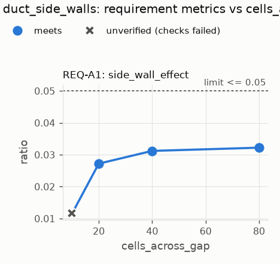
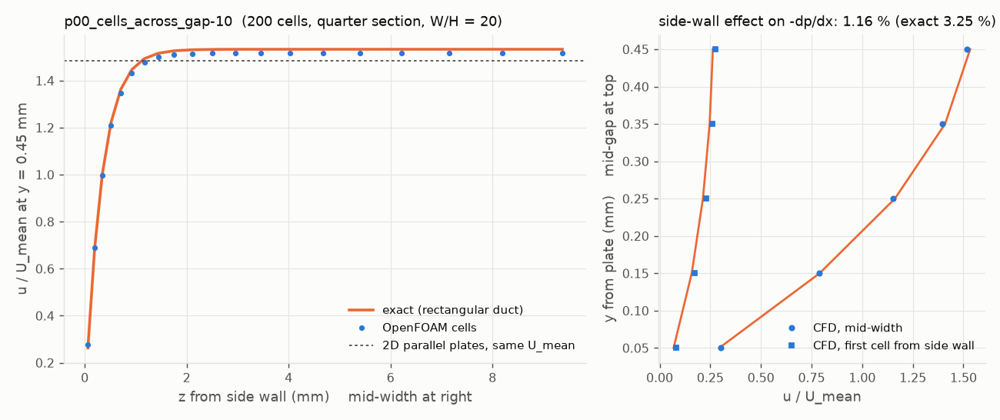
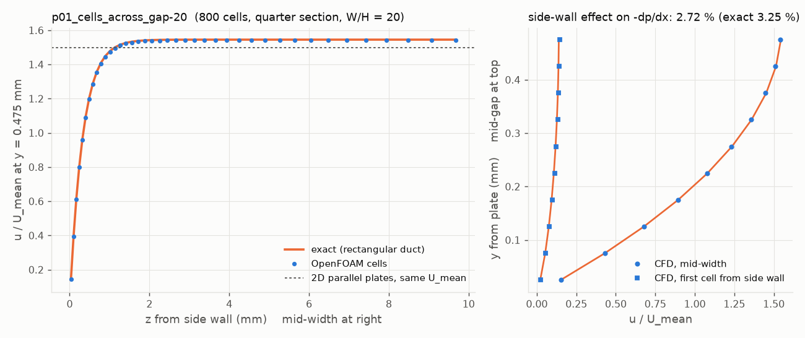
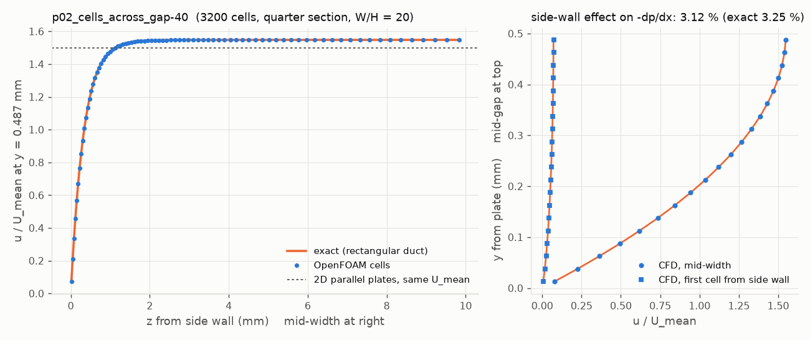
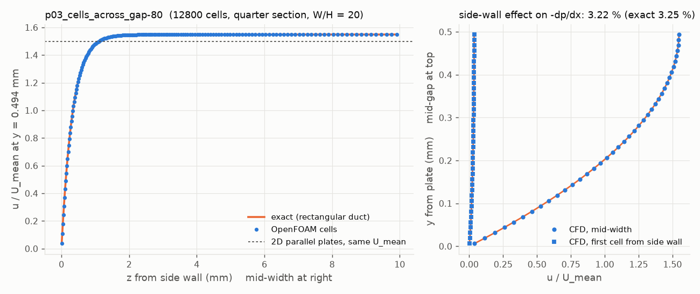

# Engineering review report: duct_side_walls

- **Run:** `20261119-204111_duct_side_walls`
- **Generated:** 2026-11-20T01:59:06+00:00
- **Case file SHA-256:** `3c862c7118d7dcc738d5079bd2277a1168deeee1ae499462bec378828eed63a8`
- **Environment:** Python 3.14.10, numpy 2.5.5, scipy 1.18.1, matplotlib 3.11.2, cadquery 2.8.0; Windows-11-10.0.26100-SP0
- **Tools:** openfoam_bashrc /opt/openfoam14/etc/bashrc; openfoam_version 14; openfoam_package openfoam14 20261008; linux Ubuntu 22.04.5 LTS
- **Code version:** git `99d983c534224a5e8417e845d1ebe1b0898534fb` (uncommitted changes present)
- **Simulation status:** completed
- **Verification status:** FAIL

> **Warning:** verification did not pass for every point. Requirement verdicts marked *(unverified)* are not supported by evidence and must not be used for acceptance.

## Scope

Fully developed laminar water flow (20 C, 0.1 m/s mean) in a 1 mm x 20 mm rectangular duct, i.e. the coolant channel with its side walls. 3D OpenFOAM on a periodic quarter cross-section; mesh refined from 10 to 80 cells across the gap (ratio 2). Quantifies the error of the 2D parallel-plate assumption.

**Assumptions**

- Channel width 20 mm (synthetic; the real width is not specified). The side-wall effect scales roughly with gap / width.
- Fully developed flow (periodic in x): entrance effects are covered by the 2D header model.
- Incompressible, isothermal, Newtonian water at 20 C (IAPWS: rho = 998.21 kg/m^3, mu = 1.0016 mPa s); laminar.
- Symmetric about mid-gap and mid-width (quarter section modelled).

## Requirements

| ID | Requirement | Metric | Limit |
|---|---|---|---|
| REQ-A1 | The 2D parallel-plate assumption is acceptable if side walls change the fully developed pressure gradient by at most 5 %. | `side_wall_effect` | <= 0.05 - |

## Summary across points

| Point | cells_across_gap | REQ-A1 | Checks |
|---|---|---|---|
| p00_cells_across_gap-10 | 10 | 0.01157 -: **PASS (unverified)** | 6/8 FAIL |
| p01_cells_across_gap-20 | 20 | 0.0272 -: **PASS** | 8/8 PASS |
| p02_cells_across_gap-40 | 40 | 0.0312 -: **PASS** | 8/8 PASS |
| p03_cells_across_gap-80 | 80 | 0.0322 -: **PASS** | 8/8 PASS |

## Run-level checks

Checks that use several points together (for example mesh convergence).

| Check | Description | Value | Tolerance | Status |
|---|---|---|---|---|
| discretization_pressure_gradient_Pa_per_m | relative discretization uncertainty of pressure_gradient_Pa_per_m, monotone (R = 0.252): GCI_fine, observed order 1.99, extrapolated 1241.03 | 0.00041 | 0.01 | PASS |

## Point details

### p00_cells_across_gap-10

Parameters: gap_mm = 1, width_mm = 20, mean_velocity_m_per_s = 0.1, density_kg_per_m3 = 998.2, dynamic_viscosity_Pa_s = 0.001002, cells_across_gap = 10, width_cells_per_gap_cell = 2, side_wall_grading = 10

Derived: aspect_ratio_W_over_H = 20, reynolds_Dh_parallel_plates = 199.3, pressure_gradient_2D_Pa_per_m = 1202, pressure_gradient_exact_Pa_per_m = 1241, side_wall_effect_exact = 0.03254

| Requirement | Result | Limit | Margin | Verdict | Evidence |
|---|---|---|---|---|---|
| REQ-A1 | 0.01157 - | <= 0.05 | 0.0384 | **PASS (unverified)** | [point.json](points/p00_cells_across_gap-10/point.json) |

| Check | Description | Value | Tolerance | Status |
|---|---|---|---|---|
| mesh_quality | checkMesh result (0 = Mesh OK) | 0.00e+00 | 0e+00 | PASS |
| ux_residual | final initial residual of Ux (inf if the run did not end) | 1.65e-15 | 1e-06 | PASS |
| pressure_gradient_converged | max relative change of -dp/dx over the last 10 % of iterations | 0.00e+00 | 1e-05 | PASS |
| no_cross_flow | max(|u_y|, |u_z|) / U_mean (exactly 0 for fully developed flow) | 1.98e-15 | 1e-04 | PASS |
| mean_velocity | |U_mean reported by meanVelocityForce - target| / target | 0.00e+00 | 1e-05 | PASS |
| pressure_gradient_reference | |(-dp/dx)_CFD - exact rectangular-duct series| / exact | 2.03e-02 | 1e-02 | FAIL |
| velocity_field_reference | max |u_CFD - u_exact| / u_max over all cells | 1.08e-02 | 1e-02 | FAIL |
| laminar (validity) | Re_Dh (parallel plates, conservative) / laminar limit | 9.97e-02 | 1e+00 | PASS |

### p01_cells_across_gap-20

Parameters: gap_mm = 1, width_mm = 20, mean_velocity_m_per_s = 0.1, density_kg_per_m3 = 998.2, dynamic_viscosity_Pa_s = 0.001002, cells_across_gap = 20, width_cells_per_gap_cell = 2, side_wall_grading = 10

Derived: aspect_ratio_W_over_H = 20, reynolds_Dh_parallel_plates = 199.3, pressure_gradient_2D_Pa_per_m = 1202, pressure_gradient_exact_Pa_per_m = 1241, side_wall_effect_exact = 0.03254

| Requirement | Result | Limit | Margin | Verdict | Evidence |
|---|---|---|---|---|---|
| REQ-A1 | 0.0272 - | <= 0.05 | 0.0228 | **PASS** | [point.json](points/p01_cells_across_gap-20/point.json) |

| Check | Description | Value | Tolerance | Status |
|---|---|---|---|---|
| mesh_quality | checkMesh result (0 = Mesh OK) | 0.00e+00 | 0e+00 | PASS |
| ux_residual | final initial residual of Ux (inf if the run did not end) | 1.89e-15 | 1e-06 | PASS |
| pressure_gradient_converged | max relative change of -dp/dx over the last 10 % of iterations | 0.00e+00 | 1e-05 | PASS |
| no_cross_flow | max(|u_y|, |u_z|) / U_mean (exactly 0 for fully developed flow) | 4.83e-15 | 1e-04 | PASS |
| mean_velocity | |U_mean reported by meanVelocityForce - target| / target | 0.00e+00 | 1e-05 | PASS |
| pressure_gradient_reference | |(-dp/dx)_CFD - exact rectangular-duct series| / exact | 5.17e-03 | 1e-02 | PASS |
| velocity_field_reference | max |u_CFD - u_exact| / u_max over all cells | 3.18e-03 | 1e-02 | PASS |
| laminar (validity) | Re_Dh (parallel plates, conservative) / laminar limit | 9.97e-02 | 1e+00 | PASS |

### p02_cells_across_gap-40

Parameters: gap_mm = 1, width_mm = 20, mean_velocity_m_per_s = 0.1, density_kg_per_m3 = 998.2, dynamic_viscosity_Pa_s = 0.001002, cells_across_gap = 40, width_cells_per_gap_cell = 2, side_wall_grading = 10

Derived: aspect_ratio_W_over_H = 20, reynolds_Dh_parallel_plates = 199.3, pressure_gradient_2D_Pa_per_m = 1202, pressure_gradient_exact_Pa_per_m = 1241, side_wall_effect_exact = 0.03254

| Requirement | Result | Limit | Margin | Verdict | Evidence |
|---|---|---|---|---|---|
| REQ-A1 | 0.0312 - | <= 0.05 | 0.0188 | **PASS** | [point.json](points/p02_cells_across_gap-40/point.json) |

| Check | Description | Value | Tolerance | Status |
|---|---|---|---|---|
| mesh_quality | checkMesh result (0 = Mesh OK) | 0.00e+00 | 0e+00 | PASS |
| ux_residual | final initial residual of Ux (inf if the run did not end) | 4.79e-15 | 1e-06 | PASS |
| pressure_gradient_converged | max relative change of -dp/dx over the last 10 % of iterations | 0.00e+00 | 1e-05 | PASS |
| no_cross_flow | max(|u_y|, |u_z|) / U_mean (exactly 0 for fully developed flow) | 2.34e-14 | 1e-04 | PASS |
| mean_velocity | |U_mean reported by meanVelocityForce - target| / target | 0.00e+00 | 1e-05 | PASS |
| pressure_gradient_reference | |(-dp/dx)_CFD - exact rectangular-duct series| / exact | 1.30e-03 | 1e-02 | PASS |
| velocity_field_reference | max |u_CFD - u_exact| / u_max over all cells | 9.06e-04 | 1e-02 | PASS |
| laminar (validity) | Re_Dh (parallel plates, conservative) / laminar limit | 9.97e-02 | 1e+00 | PASS |

### p03_cells_across_gap-80

Parameters: gap_mm = 1, width_mm = 20, mean_velocity_m_per_s = 0.1, density_kg_per_m3 = 998.2, dynamic_viscosity_Pa_s = 0.001002, cells_across_gap = 80, width_cells_per_gap_cell = 2, side_wall_grading = 10

Derived: aspect_ratio_W_over_H = 20, reynolds_Dh_parallel_plates = 199.3, pressure_gradient_2D_Pa_per_m = 1202, pressure_gradient_exact_Pa_per_m = 1241, side_wall_effect_exact = 0.03254

| Requirement | Result | Limit | Margin | Verdict | Evidence |
|---|---|---|---|---|---|
| REQ-A1 | 0.0322 - | <= 0.05 | 0.0178 | **PASS** | [point.json](points/p03_cells_across_gap-80/point.json) |

| Check | Description | Value | Tolerance | Status |
|---|---|---|---|---|
| mesh_quality | checkMesh result (0 = Mesh OK) | 0.00e+00 | 0e+00 | PASS |
| ux_residual | final initial residual of Ux (inf if the run did not end) | 6.72e-10 | 1e-06 | PASS |
| pressure_gradient_converged | max relative change of -dp/dx over the last 10 % of iterations | 1.63e-08 | 1e-05 | PASS |
| no_cross_flow | max(|u_y|, |u_z|) / U_mean (exactly 0 for fully developed flow) | 1.67e-13 | 1e-04 | PASS |
| mean_velocity | |U_mean reported by meanVelocityForce - target| / target | 0.00e+00 | 1e-05 | PASS |
| pressure_gradient_reference | |(-dp/dx)_CFD - exact rectangular-duct series| / exact | 3.26e-04 | 1e-02 | PASS |
| velocity_field_reference | max |u_CFD - u_exact| / u_max over all cells | 2.41e-04 | 1e-02 | PASS |
| laminar (validity) | Re_Dh (parallel plates, conservative) / laminar limit | 9.97e-02 | 1e+00 | PASS |

## Limitations

- One width only; other widths follow from the verified exact series solution.
- Corner regions of a real channel (fillets, side-wall roughness) are not modelled.
- No physical test data.
- A converged solver run that matches an analytical reference shows that the equations were solved correctly. It does not show that the equations represent real hardware.

## Engineering acceptance

Pending human review. This report does not accept or reject the design.
