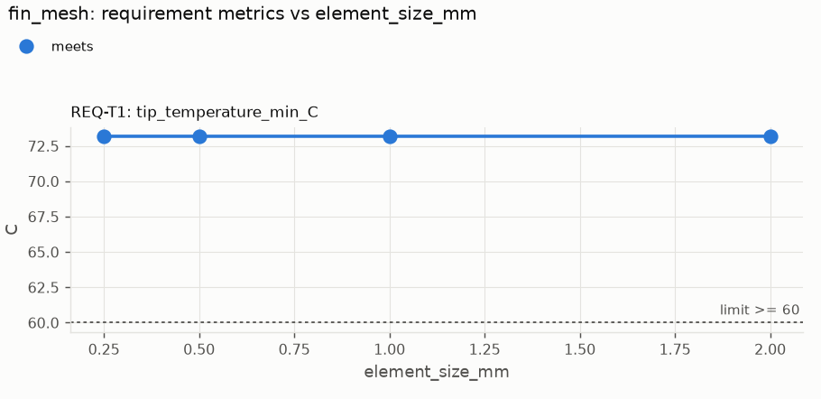
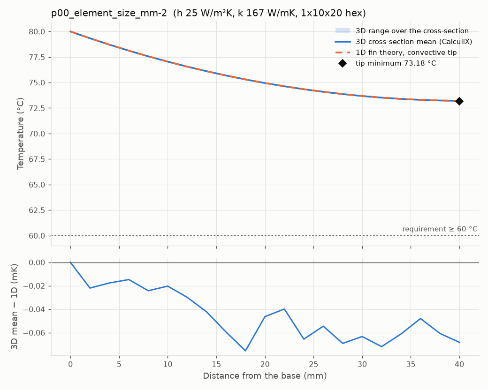
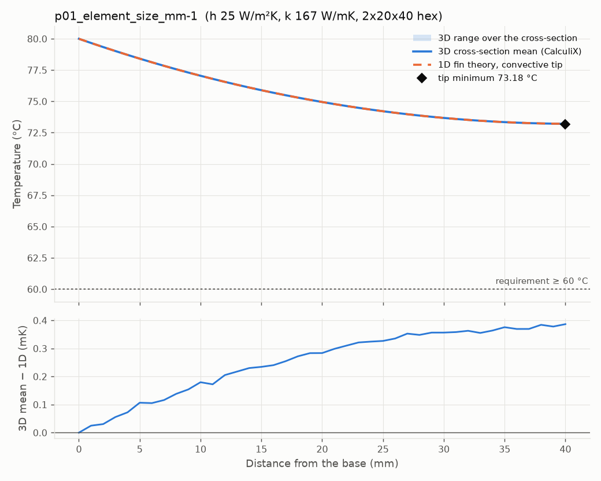
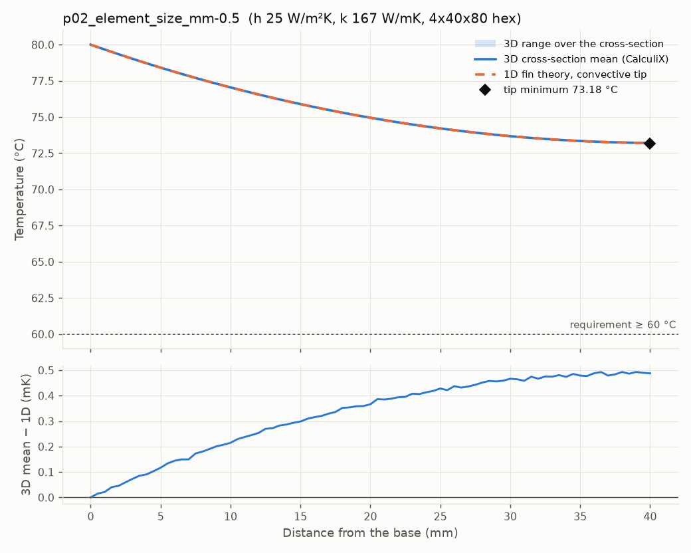
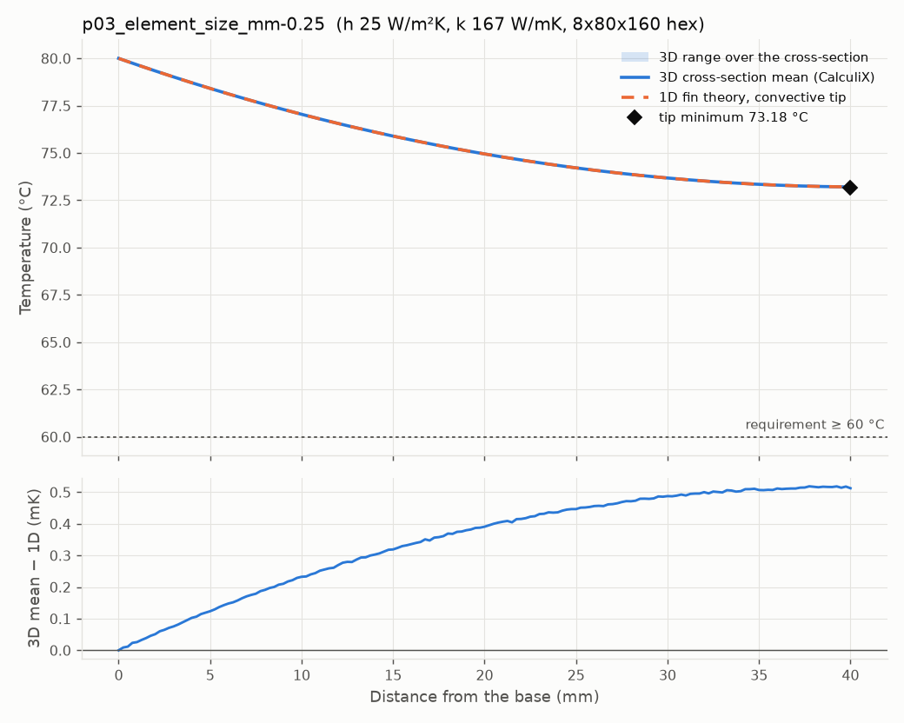

# Engineering review report: fin_mesh

- **Run:** `20261119-221454_fin_mesh`
- **Generated:** 2026-11-20T03:18:48+00:00
- **Case file SHA-256:** `1d93ccd7fdd55165e697bda23266f9f166ec72f1b7ed500c92ec5b93c500fb55`
- **Environment:** Python 3.14.10, numpy 2.5.5, scipy 1.18.1, matplotlib 3.11.2, cadquery 2.8.0; Windows-11-10.0.26100-SP0
- **Tools:** CalculiX This is Version 2.22; ccx ~\AppData\Local\Programs\FreeCAD 1.1\bin\ccx.exe
- **Code version:** git `95e5f565433fe25df4c28f3d79686e00366c7f7d`
- **Simulation status:** completed
- **Verification status:** PASS

## Scope

Straight rectangular 6061-T6 aluminium fin, 40 mm tall, 20 mm wide, 2 mm thick; base held at 80 C, air at 25 C, h = 25 W/m^2K on both faces, both edges and the tip. Steady 3D conduction in CalculiX on a structured hex (C3D8) mesh refined from 2 mm to 0.25 mm elements (ratio 2). Checks the minimum tip temperature against 1D fin theory, an energy balance, and mesh convergence.

**Assumptions**

- Steady state, linear conduction with constant conductivity k = 167 W/mK (6061-T6, ASM Handbook / MatWeb; temper not stated by the user, see fin_tolerance for 150-180 W/mK).
- Base face held at exactly 80 C (user value): no base spreading or contact resistance is modelled; the user's 80 C is taken as the temperature at the fin root.
- Uniform effective heat-transfer coefficient h = 25 W/m^2K on every exposed face, including the tip and the two 2 mm edges, with air at 25 C everywhere (user values). h is treated as the total effective coefficient (convection plus linearised radiation).
- Requirement metric is the MINIMUM temperature on the tip face (its coldest corner), not the tip-face average: 'stays above 60 C' is read as everywhere on the tip; checked: the tip-face minimum is the global minimum of the fin.
- 1D fin theory is a valid independent reference; checked: Biot number h (t/2) / k below 0.1.

## Requirements

| ID | Requirement | Metric | Limit |
|---|---|---|---|
| REQ-T1 | The minimum temperature on the fin tip face shall be at least 60 C (user requirement; the coldest corner of the tip, not the face average). | `tip_temperature_min_C` | >= 60 C |

## Summary across points

| Point | element_size_mm | REQ-T1 | Checks |
|---|---|---|---|
| p00_element_size_mm-2 | 2 | 73.18 C: **PASS** | 6/6 PASS |
| p01_element_size_mm-1 | 1 | 73.18 C: **PASS** | 6/6 PASS |
| p02_element_size_mm-0.5 | 0.5 | 73.18 C: **PASS** | 6/6 PASS |
| p03_element_size_mm-0.25 | 0.25 | 73.18 C: **PASS** | 6/6 PASS |

## Run-level checks

Checks that use several points together (for example mesh convergence).

| Check | Description | Value | Tolerance | Status |
|---|---|---|---|---|
| discretization_tip_excess_min_K | relative discretization uncertainty of tip_excess_min_K, monotone (R = 0.231): GCI_fine, observed order 2.12, extrapolated 48.1813 | 7e-07 | 0.002 | PASS |
| discretization_base_heat_flow_W | relative discretization uncertainty of base_heat_flow_W, monotone (R = 0.252): GCI_fine, observed order 1.99, extrapolated 2.27001 | 1.81e-06 | 0.01 | PASS |

## Point details

### p00_element_size_mm-2

Parameters: thickness_mm = 2, width_mm = 20, length_mm = 40, conductivity_W_per_mK = 167, htc_W_per_m2K = 25, base_temperature_C = 80, air_temperature_C = 25, element_size_mm = 2

Derived: biot_half_thickness = 0.0001497, mL = 0.5133, tip_temperature_1d_C = 73.21, heat_flow_1d_W = 2.27, fin_efficiency_1d = 0.9172, breakeven_htc_1d_W_per_m2K = 95.14

| Requirement | Result | Limit | Margin | Verdict | Evidence |
|---|---|---|---|---|---|
| REQ-T1 | 73.18 C | >= 60 | 13.2 | **PASS** | [point.json](points/p00_element_size_mm-2/point.json) |

| Check | Description | Value | Tolerance | Status |
|---|---|---|---|---|
| energy_balance | |Q_base (RFL + film share at base nodes) - integral h(T - T_air) dA| / Q_conv | 2.35e-08 | 1e-04 | PASS |
| tip_reference | |tip-face mean excess T (3D) - 1D fin theory| / 1D (model form) | 1.42e-06 | 1e-02 | PASS |
| heat_flow_reference | |base heat flow (3D) - 1D fin heat rate| / 1D (model form) | 1.19e-05 | 1e-02 | PASS |
| profile_reference | max over z of |cross-section mean T - T_1D(z)| / (T_base - T_air) | 1.37e-06 | 1e-02 | PASS |
| tip_is_coldest | tip-face minimum - global minimum temperature (K); metric must find the coldest point | 0.00e+00 | 0e+00 | PASS |
| one_d_reference_valid (validity) | Biot number h (t/2) / k (1D fin theory valid well below 0.1) | 1.50e-04 | 1e-01 | PASS |

### p01_element_size_mm-1

Parameters: thickness_mm = 2, width_mm = 20, length_mm = 40, conductivity_W_per_mK = 167, htc_W_per_m2K = 25, base_temperature_C = 80, air_temperature_C = 25, element_size_mm = 1

Derived: biot_half_thickness = 0.0001497, mL = 0.5133, tip_temperature_1d_C = 73.21, heat_flow_1d_W = 2.27, fin_efficiency_1d = 0.9172, breakeven_htc_1d_W_per_m2K = 95.14

| Requirement | Result | Limit | Margin | Verdict | Evidence |
|---|---|---|---|---|---|
| REQ-T1 | 73.18 C | >= 60 | 13.2 | **PASS** | [point.json](points/p01_element_size_mm-1/point.json) |

| Check | Description | Value | Tolerance | Status |
|---|---|---|---|---|
| energy_balance | |Q_base (RFL + film share at base nodes) - integral h(T - T_air) dA| / Q_conv | 1.40e-07 | 1e-04 | PASS |
| tip_reference | |tip-face mean excess T (3D) - 1D fin theory| / 1D (model form) | 8.02e-06 | 1e-02 | PASS |
| heat_flow_reference | |base heat flow (3D) - 1D fin heat rate| / 1D (model form) | 5.59e-05 | 1e-02 | PASS |
| profile_reference | max over z of |cross-section mean T - T_1D(z)| / (T_base - T_air) | 7.03e-06 | 1e-02 | PASS |
| tip_is_coldest | tip-face minimum - global minimum temperature (K); metric must find the coldest point | 0.00e+00 | 0e+00 | PASS |
| one_d_reference_valid (validity) | Biot number h (t/2) / k (1D fin theory valid well below 0.1) | 1.50e-04 | 1e-01 | PASS |

### p02_element_size_mm-0.5

Parameters: thickness_mm = 2, width_mm = 20, length_mm = 40, conductivity_W_per_mK = 167, htc_W_per_m2K = 25, base_temperature_C = 80, air_temperature_C = 25, element_size_mm = 0.5

Derived: biot_half_thickness = 0.0001497, mL = 0.5133, tip_temperature_1d_C = 73.21, heat_flow_1d_W = 2.27, fin_efficiency_1d = 0.9172, breakeven_htc_1d_W_per_m2K = 95.14

| Requirement | Result | Limit | Margin | Verdict | Evidence |
|---|---|---|---|---|---|
| REQ-T1 | 73.18 C | >= 60 | 13.2 | **PASS** | [point.json](points/p02_element_size_mm-0.5/point.json) |

| Check | Description | Value | Tolerance | Status |
|---|---|---|---|---|
| energy_balance | |Q_base (RFL + film share at base nodes) - integral h(T - T_air) dA| / Q_conv | 9.43e-08 | 1e-04 | PASS |
| tip_reference | |tip-face mean excess T (3D) - 1D fin theory| / 1D (model form) | 1.01e-05 | 1e-02 | PASS |
| heat_flow_reference | |base heat flow (3D) - 1D fin heat rate| / 1D (model form) | 7.30e-05 | 1e-02 | PASS |
| profile_reference | max over z of |cross-section mean T - T_1D(z)| / (T_base - T_air) | 8.97e-06 | 1e-02 | PASS |
| tip_is_coldest | tip-face minimum - global minimum temperature (K); metric must find the coldest point | 0.00e+00 | 0e+00 | PASS |
| one_d_reference_valid (validity) | Biot number h (t/2) / k (1D fin theory valid well below 0.1) | 1.50e-04 | 1e-01 | PASS |

### p03_element_size_mm-0.25

Parameters: thickness_mm = 2, width_mm = 20, length_mm = 40, conductivity_W_per_mK = 167, htc_W_per_m2K = 25, base_temperature_C = 80, air_temperature_C = 25, element_size_mm = 0.25

Derived: biot_half_thickness = 0.0001497, mL = 0.5133, tip_temperature_1d_C = 73.21, heat_flow_1d_W = 2.27, fin_efficiency_1d = 0.9172, breakeven_htc_1d_W_per_m2K = 95.14

| Requirement | Result | Limit | Margin | Verdict | Evidence |
|---|---|---|---|---|---|
| REQ-T1 | 73.18 C | >= 60 | 13.2 | **PASS** | [point.json](points/p03_element_size_mm-0.25/point.json) |

| Check | Description | Value | Tolerance | Status |
|---|---|---|---|---|
| energy_balance | |Q_base (RFL + film share at base nodes) - integral h(T - T_air) dA| / Q_conv | 9.61e-08 | 1e-04 | PASS |
| tip_reference | |tip-face mean excess T (3D) - 1D fin theory| / 1D (model form) | 1.06e-05 | 1e-02 | PASS |
| heat_flow_reference | |base heat flow (3D) - 1D fin heat rate| / 1D (model form) | 7.73e-05 | 1e-02 | PASS |
| profile_reference | max over z of |cross-section mean T - T_1D(z)| / (T_base - T_air) | 9.43e-06 | 1e-02 | PASS |
| tip_is_coldest | tip-face minimum - global minimum temperature (K); metric must find the coldest point | 0.00e+00 | 0e+00 | PASS |
| one_d_reference_valid (validity) | Biot number h (t/2) / k (1D fin theory valid well below 0.1) | 1.50e-04 | 1e-01 | PASS |

## Limitations

- Single isolated fin: neighbouring fins, air preheating along the channel, and the variation of h along the fin (natural-convection boundary layer) are not modelled.
- 1D fin theory is a model-form reference (it assumes a uniform cross-section temperature), not an exact solution of the 3D problem.
- No physical test data.
- A converged solver run that matches an analytical reference shows that the equations were solved correctly. It does not show that the equations represent real hardware.

## Engineering acceptance

Pending human review. This report does not accept or reject the design.
