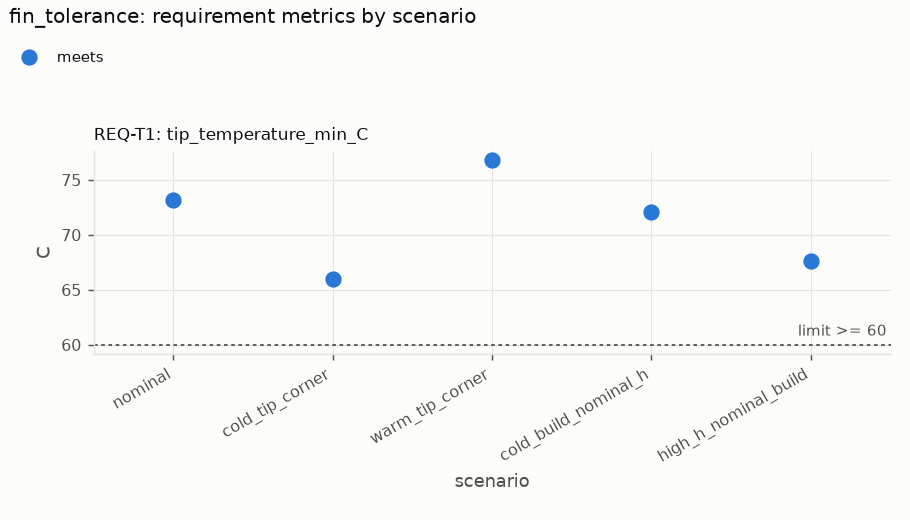
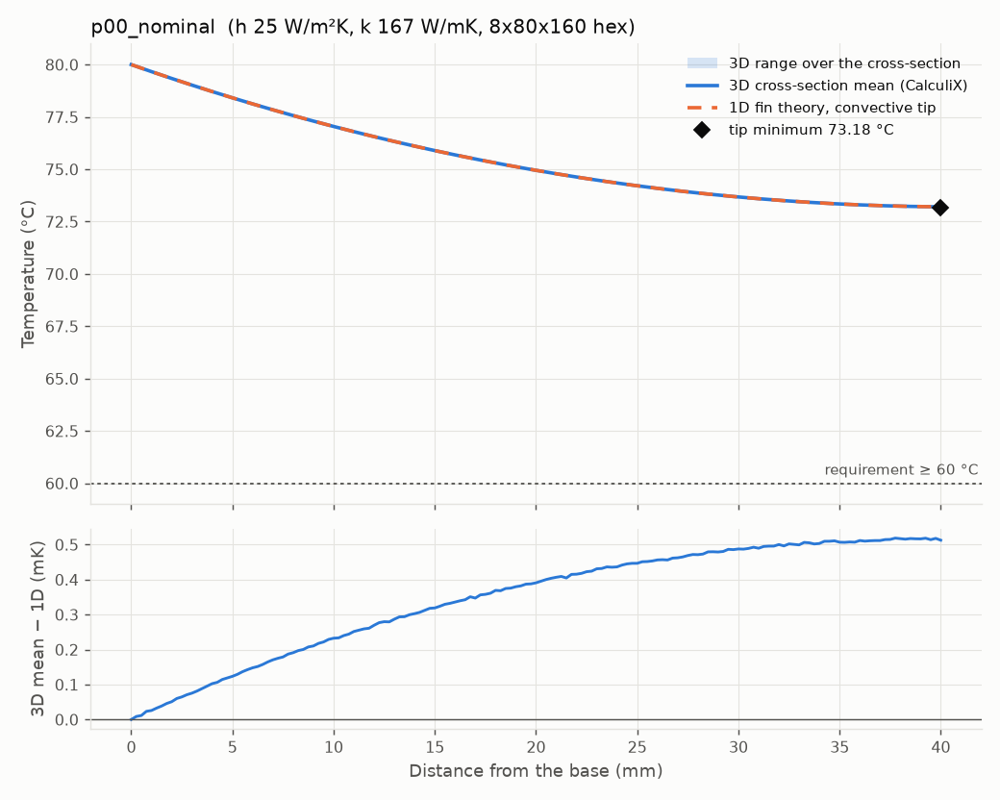
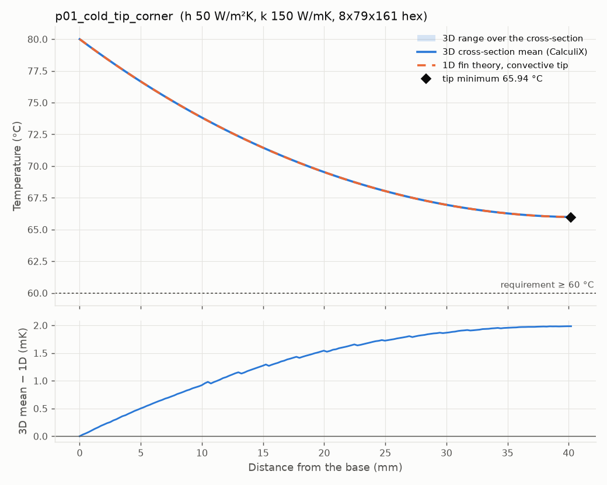
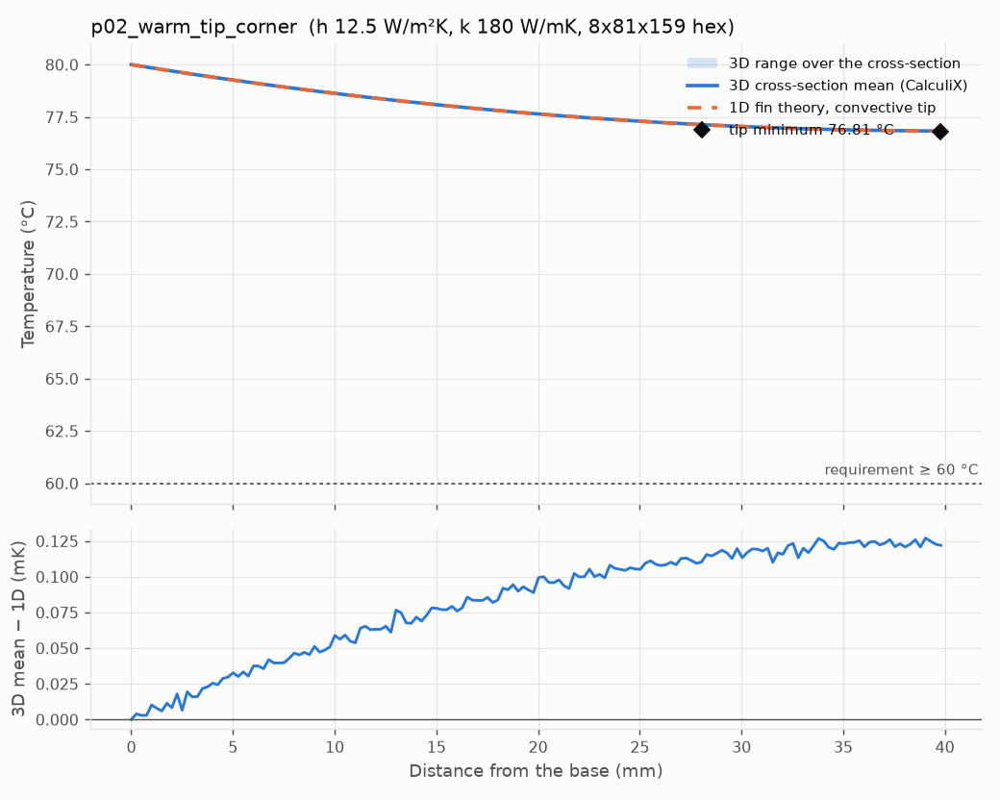
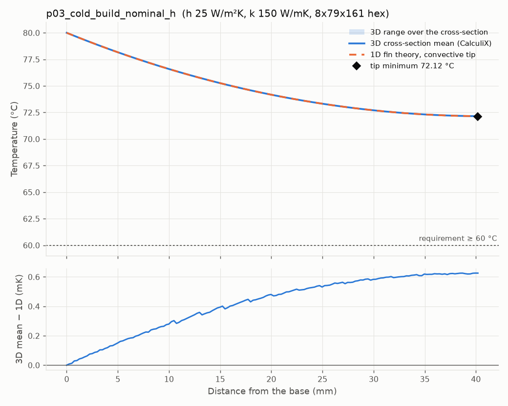
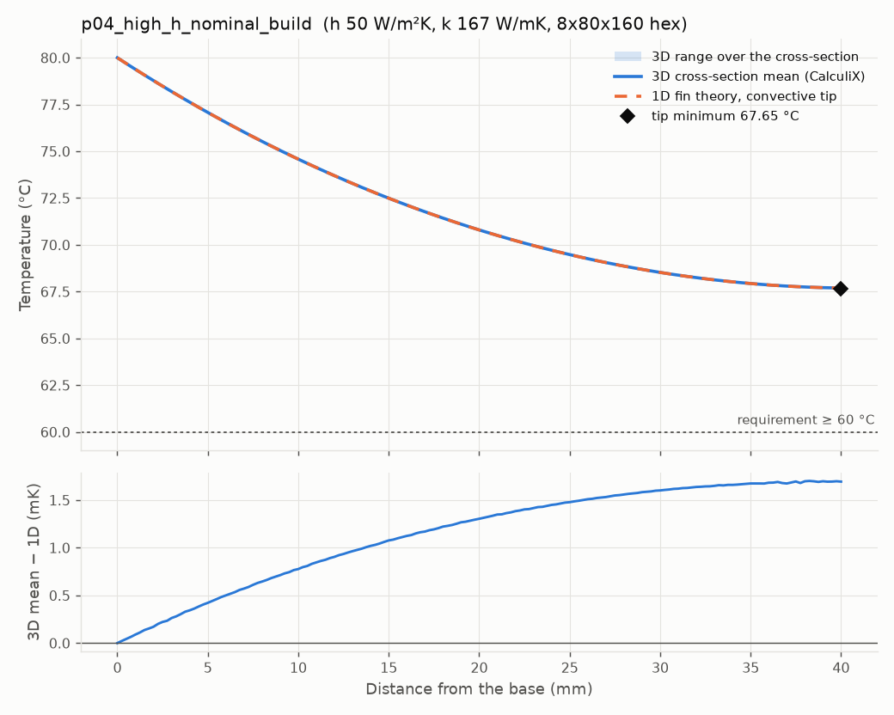

# Engineering review report: fin_tolerance

- **Run:** `20261119-221517_fin_tolerance`
- **Generated:** 2026-11-20T03:18:52+00:00
- **Case file SHA-256:** `59840c51d3d26875e3eeaf53a631bdae7fb4d5595e05eb59be13e809ae5873e5`
- **Environment:** Python 3.14.10, numpy 2.5.5, scipy 1.18.1, matplotlib 3.11.2, cadquery 2.8.0; Windows-11-10.0.26100-SP0
- **Tools:** CalculiX This is Version 2.22; ccx ~\AppData\Local\Programs\FreeCAD 1.1\bin\ccx.exe
- **Code version:** git `95e5f565433fe25df4c28f3d79686e00366c7f7d`
- **Simulation status:** completed
- **Verification status:** PASS

## Scope

Straight rectangular 6061 aluminium fin (nominal 40 x 20 x 2 mm, base 80 C, air 25 C, h 25 W/m^2K) evaluated at the corners of the heat-transfer coefficient range (12.5-50 W/m^2K), conductivity range (150-180 W/mK) and dimensional tolerances, with 3D CalculiX conduction on 0.25 mm hex elements. Finds whether the minimum tip temperature stays at or above 60 C across the ranges.

**Assumptions**

- As fin_mesh, except the inputs varied below.
- h is an effective coefficient (convection plus linearised radiation), uniform over all exposed faces; range 12.5-50 W/m^2K is synthetic (factor 2 on the user's 'about 25').
- Conductivity range 150-180 W/mK covers the 6061 tempers (T6 167, T4 154, O 180); constant within each scenario.
- Dimensional tolerances t +- 0.1 mm, w +- 0.2 mm, L +- 0.2 mm are synthetic.
- Base 80 C and air 25 C are fixed user values.
- 1D fin theory is a valid independent reference; checked: Biot number below 0.1.
- Requirement metric is the minimum tip-face temperature; checked: it is the global minimum of the fin.

## Requirements

| ID | Requirement | Metric | Limit |
|---|---|---|---|
| REQ-T1 | The minimum temperature on the fin tip face shall be at least 60 C (user requirement; the coldest corner of the tip, not the face average). | `tip_temperature_min_C` | >= 60 C |

## Summary across points

| Point | scenario | REQ-T1 | Checks |
|---|---|---|---|
| p00_nominal | nominal | 73.18 C: **PASS** | 6/6 PASS |
| p01_cold_tip_corner | cold_tip_corner | 65.94 C: **PASS** | 6/6 PASS |
| p02_warm_tip_corner | warm_tip_corner | 76.81 C: **PASS** | 6/6 PASS |
| p03_cold_build_nominal_h | cold_build_nominal_h | 72.12 C: **PASS** | 6/6 PASS |
| p04_high_h_nominal_build | high_h_nominal_build | 67.65 C: **PASS** | 6/6 PASS |

## Point details

### p00_nominal

Parameters: thickness_mm = 2, width_mm = 20, length_mm = 40, conductivity_W_per_mK = 167, htc_W_per_m2K = 25, base_temperature_C = 80, air_temperature_C = 25, element_size_mm = 0.25, scenario = nominal

Derived: biot_half_thickness = 0.0001497, mL = 0.5133, tip_temperature_1d_C = 73.21, heat_flow_1d_W = 2.27, fin_efficiency_1d = 0.9172, breakeven_htc_1d_W_per_m2K = 95.14

| Requirement | Result | Limit | Margin | Verdict | Evidence |
|---|---|---|---|---|---|
| REQ-T1 | 73.18 C | >= 60 | 13.2 | **PASS** | [point.json](points/p00_nominal/point.json) |

| Check | Description | Value | Tolerance | Status |
|---|---|---|---|---|
| energy_balance | |Q_base (RFL + film share at base nodes) - integral h(T - T_air) dA| / Q_conv | 9.61e-08 | 1e-04 | PASS |
| tip_reference | |tip-face mean excess T (3D) - 1D fin theory| / 1D (model form) | 1.06e-05 | 1e-02 | PASS |
| heat_flow_reference | |base heat flow (3D) - 1D fin heat rate| / 1D (model form) | 7.73e-05 | 1e-02 | PASS |
| profile_reference | max over z of |cross-section mean T - T_1D(z)| / (T_base - T_air) | 9.43e-06 | 1e-02 | PASS |
| tip_is_coldest | tip-face minimum - global minimum temperature (K); metric must find the coldest point | 0.00e+00 | 0e+00 | PASS |
| one_d_reference_valid (validity) | Biot number h (t/2) / k (1D fin theory valid well below 0.1) | 1.50e-04 | 1e-01 | PASS |

### p01_cold_tip_corner

Parameters: thickness_mm = 1.9, width_mm = 19.8, length_mm = 40.2, conductivity_W_per_mK = 150, htc_W_per_m2K = 50, base_temperature_C = 80, air_temperature_C = 25, element_size_mm = 0.25, scenario = cold_tip_corner

Derived: biot_half_thickness = 0.0003167, mL = 0.7883, tip_temperature_1d_C = 65.98, heat_flow_1d_W = 4.06, fin_efficiency_1d = 0.8282, breakeven_htc_1d_W_per_m2K = 80.85

| Requirement | Result | Limit | Margin | Verdict | Evidence |
|---|---|---|---|---|---|
| REQ-T1 | 65.94 C | >= 60 | 5.94 | **PASS** | [point.json](points/p01_cold_tip_corner/point.json) |

| Check | Description | Value | Tolerance | Status |
|---|---|---|---|---|
| energy_balance | |Q_base (RFL + film share at base nodes) - integral h(T - T_air) dA| / Q_conv | 1.41e-08 | 1e-04 | PASS |
| tip_reference | |tip-face mean excess T (3D) - 1D fin theory| / 1D (model form) | 4.84e-05 | 1e-02 | PASS |
| heat_flow_reference | |base heat flow (3D) - 1D fin heat rate| / 1D (model form) | 1.48e-04 | 1e-02 | PASS |
| profile_reference | max over z of |cross-section mean T - T_1D(z)| / (T_base - T_air) | 3.61e-05 | 1e-02 | PASS |
| tip_is_coldest | tip-face minimum - global minimum temperature (K); metric must find the coldest point | 0.00e+00 | 0e+00 | PASS |
| one_d_reference_valid (validity) | Biot number h (t/2) / k (1D fin theory valid well below 0.1) | 3.17e-04 | 1e-01 | PASS |

### p02_warm_tip_corner

Parameters: thickness_mm = 2.1, width_mm = 20.2, length_mm = 39.8, conductivity_W_per_mK = 180, htc_W_per_m2K = 12.5, base_temperature_C = 80, air_temperature_C = 25, element_size_mm = 0.25, scenario = warm_tip_corner

Derived: biot_half_thickness = 7.292e-05, mL = 0.3401, tip_temperature_1d_C = 76.83, heat_flow_1d_W = 1.201, fin_efficiency_1d = 0.9615, breakeven_htc_1d_W_per_m2K = 108.1

| Requirement | Result | Limit | Margin | Verdict | Evidence |
|---|---|---|---|---|---|
| REQ-T1 | 76.81 C | >= 60 | 16.8 | **PASS** | [point.json](points/p02_warm_tip_corner/point.json) |

| Check | Description | Value | Tolerance | Status |
|---|---|---|---|---|
| energy_balance | |Q_base (RFL + film share at base nodes) - integral h(T - T_air) dA| / Q_conv | 4.06e-08 | 1e-04 | PASS |
| tip_reference | |tip-face mean excess T (3D) - 1D fin theory| / 1D (model form) | 2.35e-06 | 1e-02 | PASS |
| heat_flow_reference | |base heat flow (3D) - 1D fin heat rate| / 1D (model form) | 3.92e-05 | 1e-02 | PASS |
| profile_reference | max over z of |cross-section mean T - T_1D(z)| / (T_base - T_air) | 2.31e-06 | 1e-02 | PASS |
| tip_is_coldest | tip-face minimum - global minimum temperature (K); metric must find the coldest point | 0.00e+00 | 0e+00 | PASS |
| one_d_reference_valid (validity) | Biot number h (t/2) / k (1D fin theory valid well below 0.1) | 7.29e-05 | 1e-01 | PASS |

### p03_cold_build_nominal_h

Parameters: thickness_mm = 1.9, width_mm = 19.8, length_mm = 40.2, conductivity_W_per_mK = 150, htc_W_per_m2K = 25, base_temperature_C = 80, air_temperature_C = 25, element_size_mm = 0.25, scenario = cold_build_nominal_h

Derived: biot_half_thickness = 0.0001583, mL = 0.5574, tip_temperature_1d_C = 72.15, heat_flow_1d_W = 2.216, fin_efficiency_1d = 0.9043, breakeven_htc_1d_W_per_m2K = 80.85

| Requirement | Result | Limit | Margin | Verdict | Evidence |
|---|---|---|---|---|---|
| REQ-T1 | 72.12 C | >= 60 | 12.1 | **PASS** | [point.json](points/p03_cold_build_nominal_h/point.json) |

| Check | Description | Value | Tolerance | Status |
|---|---|---|---|---|
| energy_balance | |Q_base (RFL + film share at base nodes) - integral h(T - T_air) dA| / Q_conv | 1.56e-07 | 1e-04 | PASS |
| tip_reference | |tip-face mean excess T (3D) - 1D fin theory| / 1D (model form) | 1.33e-05 | 1e-02 | PASS |
| heat_flow_reference | |base heat flow (3D) - 1D fin heat rate| / 1D (model form) | 8.07e-05 | 1e-02 | PASS |
| profile_reference | max over z of |cross-section mean T - T_1D(z)| / (T_base - T_air) | 1.14e-05 | 1e-02 | PASS |
| tip_is_coldest | tip-face minimum - global minimum temperature (K); metric must find the coldest point | 0.00e+00 | 0e+00 | PASS |
| one_d_reference_valid (validity) | Biot number h (t/2) / k (1D fin theory valid well below 0.1) | 1.58e-04 | 1e-01 | PASS |

### p04_high_h_nominal_build

Parameters: thickness_mm = 2, width_mm = 20, length_mm = 40, conductivity_W_per_mK = 167, htc_W_per_m2K = 50, base_temperature_C = 80, air_temperature_C = 25, element_size_mm = 0.25, scenario = high_h_nominal_build

Derived: biot_half_thickness = 0.0002994, mL = 0.7259, tip_temperature_1d_C = 67.69, heat_flow_1d_W = 4.205, fin_efficiency_1d = 0.8494, breakeven_htc_1d_W_per_m2K = 95.14

| Requirement | Result | Limit | Margin | Verdict | Evidence |
|---|---|---|---|---|---|
| REQ-T1 | 67.65 C | >= 60 | 7.65 | **PASS** | [point.json](points/p04_high_h_nominal_build/point.json) |

| Check | Description | Value | Tolerance | Status |
|---|---|---|---|---|
| energy_balance | |Q_base (RFL + film share at base nodes) - integral h(T - T_air) dA| / Q_conv | 6.60e-08 | 1e-04 | PASS |
| tip_reference | |tip-face mean excess T (3D) - 1D fin theory| / 1D (model form) | 3.97e-05 | 1e-02 | PASS |
| heat_flow_reference | |base heat flow (3D) - 1D fin heat rate| / 1D (model form) | 1.43e-04 | 1e-02 | PASS |
| profile_reference | max over z of |cross-section mean T - T_1D(z)| / (T_base - T_air) | 3.09e-05 | 1e-02 | PASS |
| tip_is_coldest | tip-face minimum - global minimum temperature (K); metric must find the coldest point | 0.00e+00 | 0e+00 | PASS |
| one_d_reference_valid (validity) | Biot number h (t/2) / k (1D fin theory valid well below 0.1) | 2.99e-04 | 1e-01 | PASS |

## Limitations

- Synthetic input ranges; not from a drawing, a material certificate, or a measured h.
- Corners only: no statistical (e.g. Monte Carlo) combination of the ranges.
- Numerical uncertainty is taken from fin_mesh (same element size).
- Single isolated fin with uniform h: neighbouring fins, air preheating, and the variation of h along the fin are not modelled.
- No physical test data.
- A converged solver run that matches an analytical reference shows that the equations were solved correctly. It does not show that the equations represent real hardware.

## Engineering acceptance

Pending human review. This report does not accept or reject the design.
