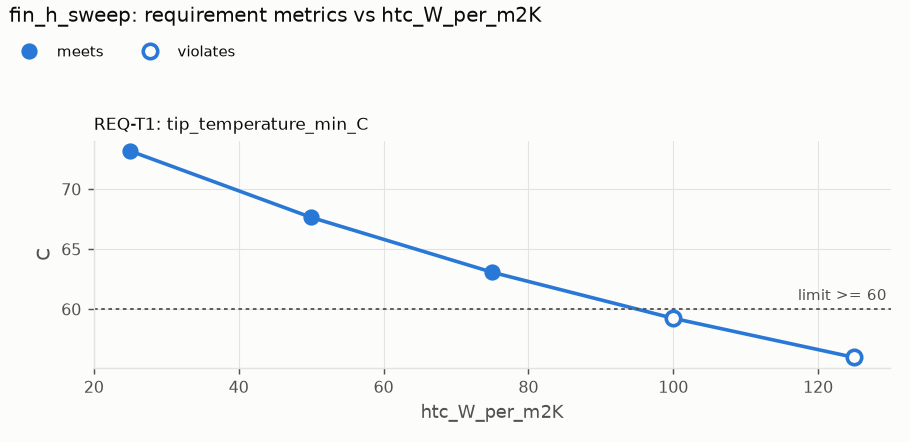
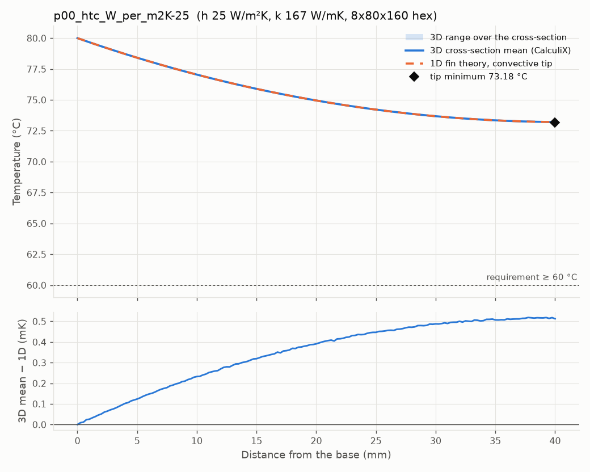
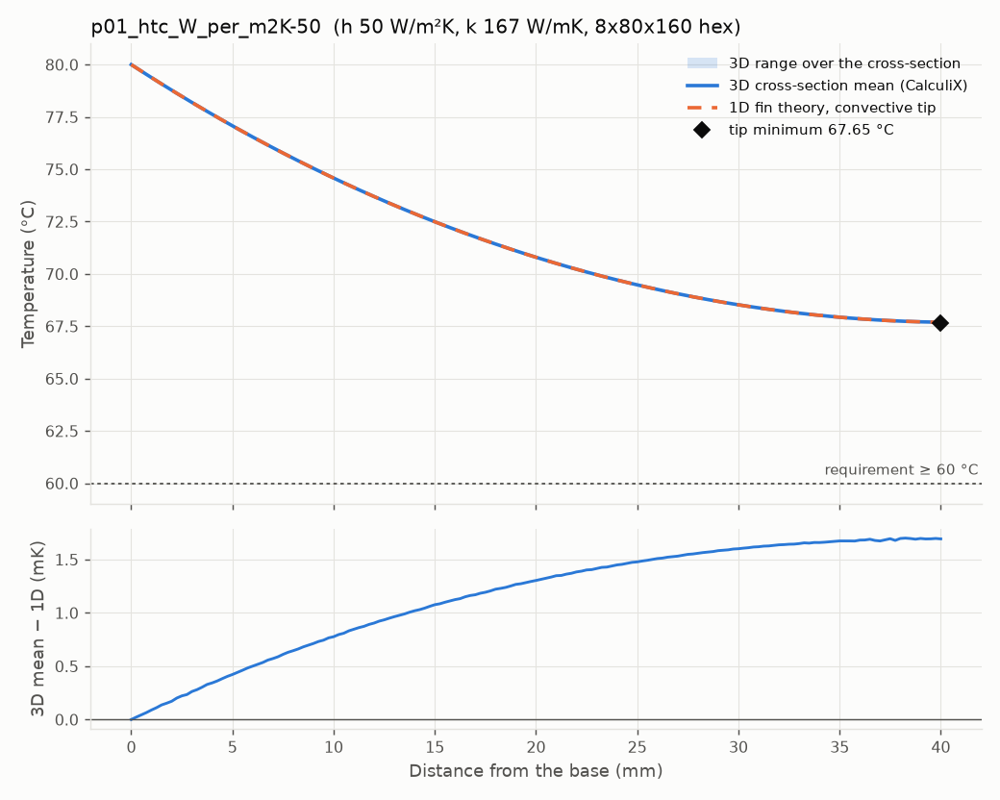
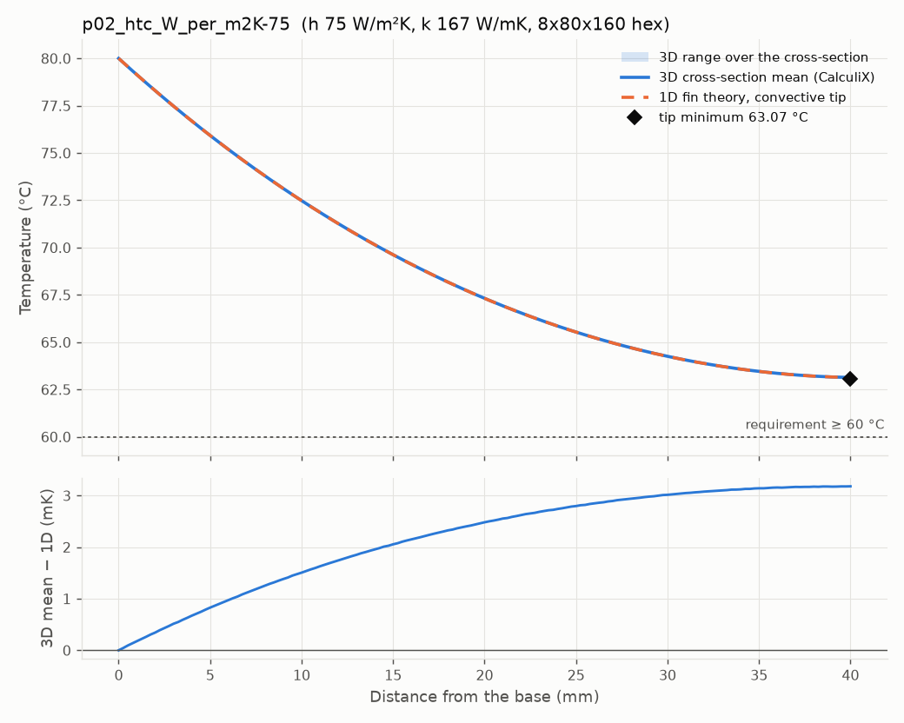
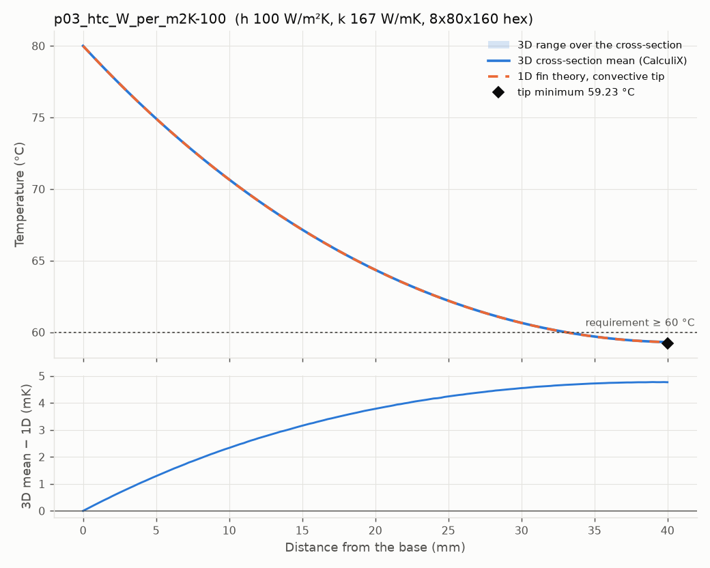
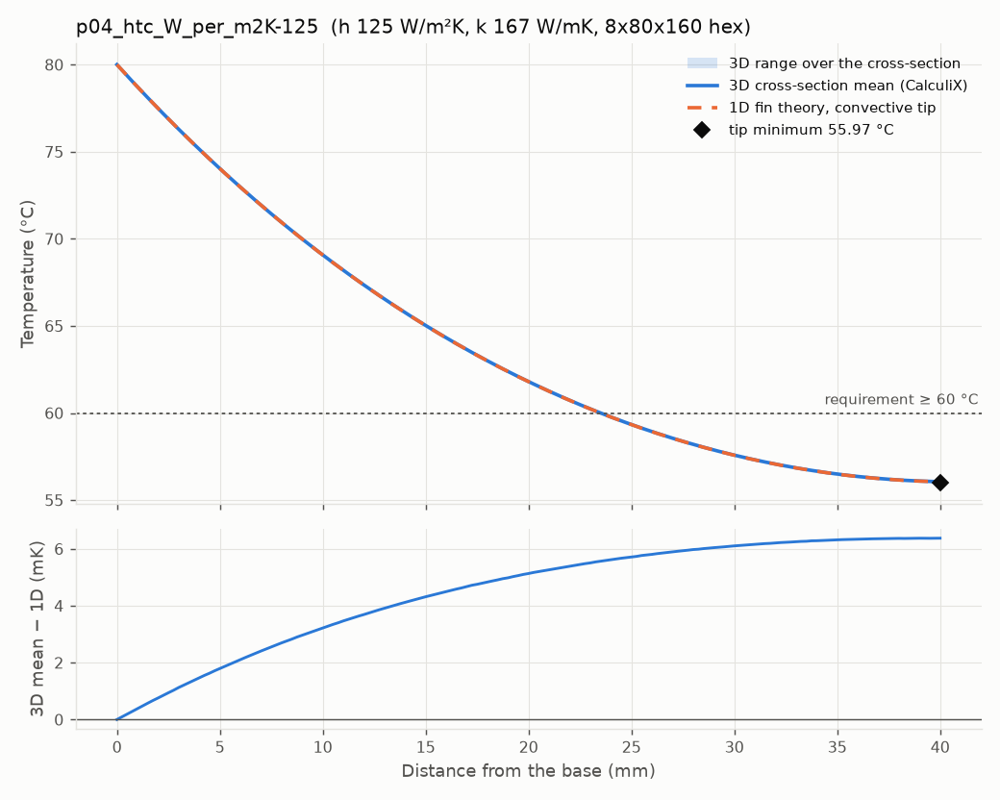

# Engineering review report: fin_h_sweep

- **Run:** `20261119-221655_fin_h_sweep`
- **Generated:** 2026-11-20T03:18:44+00:00
- **Case file SHA-256:** `dba31593b315a0f134d4155a9d778e8445b8ec283dc089369d7036642d4b9f3a`
- **Environment:** Python 3.14.10, numpy 2.5.5, scipy 1.18.1, matplotlib 3.11.2, cadquery 2.8.0; Windows-11-10.0.26100-SP0
- **Tools:** CalculiX This is Version 2.22; ccx C:\Users\mrstego\AppData\Local\Programs\FreeCAD 1.1\bin\ccx.exe
- **Code version:** git `95e5f565433fe25df4c28f3d79686e00366c7f7d`
- **Simulation status:** completed
- **Verification status:** PASS

## Scope

Nominal 6061 aluminium fin (40 x 20 x 2 mm, k 167 W/mK, base 80 C, air 25 C) with the effective heat-transfer coefficient swept from 25 to 125 W/m^2K, 3D CalculiX conduction on 0.25 mm hex elements. Locates the h at which the minimum tip temperature reaches 60 C.

**Assumptions**

- As fin_mesh, except h, which is swept.
- h is an effective coefficient (convection plus linearised radiation), uniform over all exposed faces.
- 1D fin theory is a valid independent reference; checked: Biot number below 0.1.
- Requirement metric is the minimum tip-face temperature; checked: it is the global minimum of the fin.

## Requirements

| ID | Requirement | Metric | Limit |
|---|---|---|---|
| REQ-T1 | The minimum temperature on the fin tip face shall be at least 60 C (user requirement; the coldest corner of the tip, not the face average). | `tip_temperature_min_C` | >= 60 C |

## Summary across points

| Point | htc_W_per_m2K | REQ-T1 | Checks |
|---|---|---|---|
| p00_htc_W_per_m2K-25 | 25 | 73.18 C: **PASS** | 6/6 PASS |
| p01_htc_W_per_m2K-50 | 50 | 67.65 C: **PASS** | 6/6 PASS |
| p02_htc_W_per_m2K-75 | 75 | 63.07 C: **PASS** | 6/6 PASS |
| p03_htc_W_per_m2K-100 | 100 | 59.23 C: **FAIL** | 6/6 PASS |
| p04_htc_W_per_m2K-125 | 125 | 55.97 C: **FAIL** | 6/6 PASS |

## Point details

### p00_htc_W_per_m2K-25

Parameters: thickness_mm = 2, width_mm = 20, length_mm = 40, conductivity_W_per_mK = 167, htc_W_per_m2K = 25, base_temperature_C = 80, air_temperature_C = 25, element_size_mm = 0.25

Derived: biot_half_thickness = 0.0001497, mL = 0.5133, tip_temperature_1d_C = 73.21, heat_flow_1d_W = 2.27, fin_efficiency_1d = 0.9172, breakeven_htc_1d_W_per_m2K = 95.14

| Requirement | Result | Limit | Margin | Verdict | Evidence |
|---|---|---|---|---|---|
| REQ-T1 | 73.18 C | >= 60 | 13.2 | **PASS** | [point.json](points/p00_htc_W_per_m2K-25/point.json) |

| Check | Description | Value | Tolerance | Status |
|---|---|---|---|---|
| energy_balance | |Q_base (RFL + film share at base nodes) - integral h(T - T_air) dA| / Q_conv | 9.61e-08 | 1e-04 | PASS |
| tip_reference | |tip-face mean excess T (3D) - 1D fin theory| / 1D (model form) | 1.06e-05 | 1e-02 | PASS |
| heat_flow_reference | |base heat flow (3D) - 1D fin heat rate| / 1D (model form) | 7.73e-05 | 1e-02 | PASS |
| profile_reference | max over z of |cross-section mean T - T_1D(z)| / (T_base - T_air) | 9.43e-06 | 1e-02 | PASS |
| tip_is_coldest | tip-face minimum - global minimum temperature (K); metric must find the coldest point | 0.00e+00 | 0e+00 | PASS |
| one_d_reference_valid (validity) | Biot number h (t/2) / k (1D fin theory valid well below 0.1) | 1.50e-04 | 1e-01 | PASS |

### p01_htc_W_per_m2K-50

Parameters: thickness_mm = 2, width_mm = 20, length_mm = 40, conductivity_W_per_mK = 167, htc_W_per_m2K = 50, base_temperature_C = 80, air_temperature_C = 25, element_size_mm = 0.25

Derived: biot_half_thickness = 0.0002994, mL = 0.7259, tip_temperature_1d_C = 67.69, heat_flow_1d_W = 4.205, fin_efficiency_1d = 0.8494, breakeven_htc_1d_W_per_m2K = 95.14

| Requirement | Result | Limit | Margin | Verdict | Evidence |
|---|---|---|---|---|---|
| REQ-T1 | 67.65 C | >= 60 | 7.65 | **PASS** | [point.json](points/p01_htc_W_per_m2K-50/point.json) |

| Check | Description | Value | Tolerance | Status |
|---|---|---|---|---|
| energy_balance | |Q_base (RFL + film share at base nodes) - integral h(T - T_air) dA| / Q_conv | 6.60e-08 | 1e-04 | PASS |
| tip_reference | |tip-face mean excess T (3D) - 1D fin theory| / 1D (model form) | 3.97e-05 | 1e-02 | PASS |
| heat_flow_reference | |base heat flow (3D) - 1D fin heat rate| / 1D (model form) | 1.43e-04 | 1e-02 | PASS |
| profile_reference | max over z of |cross-section mean T - T_1D(z)| / (T_base - T_air) | 3.09e-05 | 1e-02 | PASS |
| tip_is_coldest | tip-face minimum - global minimum temperature (K); metric must find the coldest point | 0.00e+00 | 0e+00 | PASS |
| one_d_reference_valid (validity) | Biot number h (t/2) / k (1D fin theory valid well below 0.1) | 2.99e-04 | 1e-01 | PASS |

### p02_htc_W_per_m2K-75

Parameters: thickness_mm = 2, width_mm = 20, length_mm = 40, conductivity_W_per_mK = 167, htc_W_per_m2K = 75, base_temperature_C = 80, air_temperature_C = 25, element_size_mm = 0.25

Derived: biot_half_thickness = 0.0004491, mL = 0.8891, tip_temperature_1d_C = 63.13, heat_flow_1d_W = 5.886, fin_efficiency_1d = 0.7927, breakeven_htc_1d_W_per_m2K = 95.14

| Requirement | Result | Limit | Margin | Verdict | Evidence |
|---|---|---|---|---|---|
| REQ-T1 | 63.07 C | >= 60 | 3.07 | **PASS** | [point.json](points/p02_htc_W_per_m2K-75/point.json) |

| Check | Description | Value | Tolerance | Status |
|---|---|---|---|---|
| energy_balance | |Q_base (RFL + film share at base nodes) - integral h(T - T_air) dA| / Q_conv | 3.18e-08 | 1e-04 | PASS |
| tip_reference | |tip-face mean excess T (3D) - 1D fin theory| / 1D (model form) | 8.34e-05 | 1e-02 | PASS |
| heat_flow_reference | |base heat flow (3D) - 1D fin heat rate| / 1D (model form) | 2.01e-04 | 1e-02 | PASS |
| profile_reference | max over z of |cross-section mean T - T_1D(z)| / (T_base - T_air) | 5.78e-05 | 1e-02 | PASS |
| tip_is_coldest | tip-face minimum - global minimum temperature (K); metric must find the coldest point | 0.00e+00 | 0e+00 | PASS |
| one_d_reference_valid (validity) | Biot number h (t/2) / k (1D fin theory valid well below 0.1) | 4.49e-04 | 1e-01 | PASS |

### p03_htc_W_per_m2K-100

Parameters: thickness_mm = 2, width_mm = 20, length_mm = 40, conductivity_W_per_mK = 167, htc_W_per_m2K = 100, base_temperature_C = 80, air_temperature_C = 25, element_size_mm = 0.25

Derived: biot_half_thickness = 0.0005988, mL = 1.027, tip_temperature_1d_C = 59.3, heat_flow_1d_W = 7.372, fin_efficiency_1d = 0.7446, breakeven_htc_1d_W_per_m2K = 95.14

| Requirement | Result | Limit | Margin | Verdict | Evidence |
|---|---|---|---|---|---|
| REQ-T1 | 59.23 C | >= 60 | -0.765 | **FAIL** | [point.json](points/p03_htc_W_per_m2K-100/point.json) |

| Check | Description | Value | Tolerance | Status |
|---|---|---|---|---|
| energy_balance | |Q_base (RFL + film share at base nodes) - integral h(T - T_air) dA| / Q_conv | 2.69e-08 | 1e-04 | PASS |
| tip_reference | |tip-face mean excess T (3D) - 1D fin theory| / 1D (model form) | 1.39e-04 | 1e-02 | PASS |
| heat_flow_reference | |base heat flow (3D) - 1D fin heat rate| / 1D (model form) | 2.52e-04 | 1e-02 | PASS |
| profile_reference | max over z of |cross-section mean T - T_1D(z)| / (T_base - T_air) | 8.68e-05 | 1e-02 | PASS |
| tip_is_coldest | tip-face minimum - global minimum temperature (K); metric must find the coldest point | 0.00e+00 | 0e+00 | PASS |
| one_d_reference_valid (validity) | Biot number h (t/2) / k (1D fin theory valid well below 0.1) | 5.99e-04 | 1e-01 | PASS |

### p04_htc_W_per_m2K-125

Parameters: thickness_mm = 2, width_mm = 20, length_mm = 40, conductivity_W_per_mK = 167, htc_W_per_m2K = 125, base_temperature_C = 80, air_temperature_C = 25, element_size_mm = 0.25

Derived: biot_half_thickness = 0.0007485, mL = 1.148, tip_temperature_1d_C = 56.05, heat_flow_1d_W = 8.703, fin_efficiency_1d = 0.7032, breakeven_htc_1d_W_per_m2K = 95.14

| Requirement | Result | Limit | Margin | Verdict | Evidence |
|---|---|---|---|---|---|
| REQ-T1 | 55.97 C | >= 60 | -4.03 | **FAIL** | [point.json](points/p04_htc_W_per_m2K-125/point.json) |

| Check | Description | Value | Tolerance | Status |
|---|---|---|---|---|
| energy_balance | |Q_base (RFL + film share at base nodes) - integral h(T - T_air) dA| / Q_conv | 4.85e-08 | 1e-04 | PASS |
| tip_reference | |tip-face mean excess T (3D) - 1D fin theory| / 1D (model form) | 2.05e-04 | 1e-02 | PASS |
| heat_flow_reference | |base heat flow (3D) - 1D fin heat rate| / 1D (model form) | 3.00e-04 | 1e-02 | PASS |
| profile_reference | max over z of |cross-section mean T - T_1D(z)| / (T_base - T_air) | 1.16e-04 | 1e-02 | PASS |
| tip_is_coldest | tip-face minimum - global minimum temperature (K); metric must find the coldest point | 0.00e+00 | 0e+00 | PASS |
| one_d_reference_valid (validity) | Biot number h (t/2) / k (1D fin theory valid well below 0.1) | 7.49e-04 | 1e-01 | PASS |

## Limitations

- h values above about 50 W/m^2K imply forced air; at those speeds the variation of h along the fin and between fins matters more than here.
- Numerical uncertainty is taken from fin_mesh (same element size).
- No physical test data.
- A converged solver run that matches an analytical reference shows that the equations were solved correctly. It does not show that the equations represent real hardware.

## Engineering acceptance

Pending human review. This report does not accept or reject the design.
