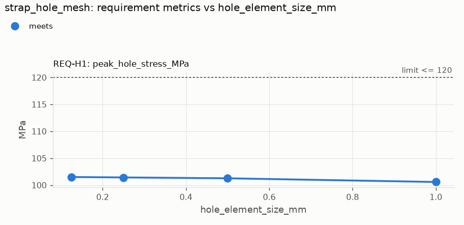
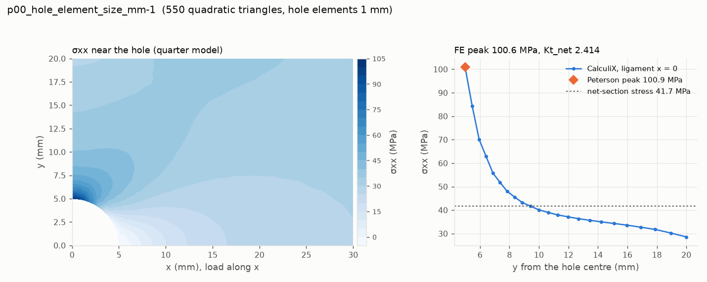
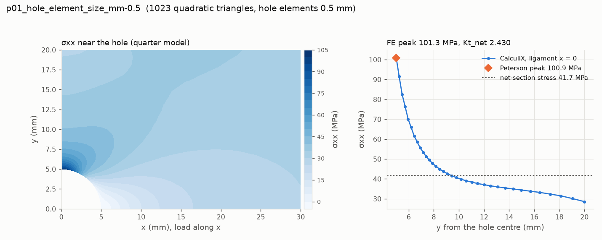
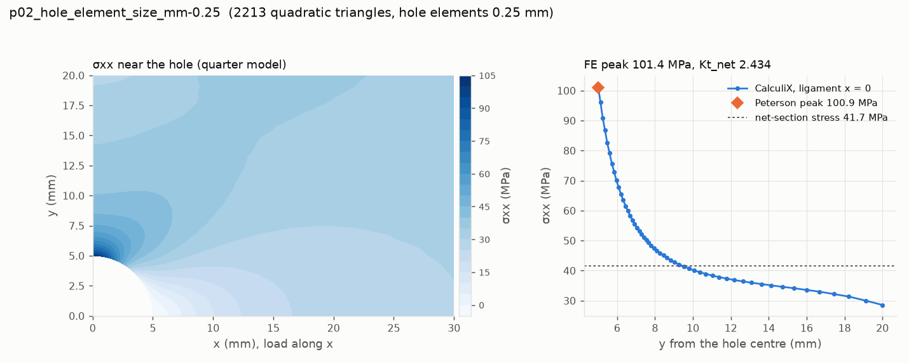
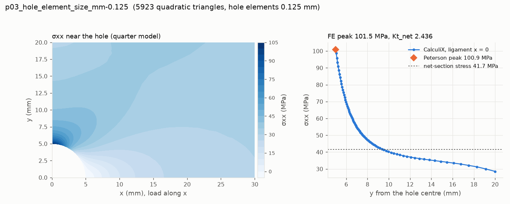

# Engineering review report: strap_hole_mesh

- **Run:** `20261119-235201_strap_hole_mesh`
- **Generated:** 2026-11-20T04:52:50+00:00
- **Case file SHA-256:** `b57506f158e33c9a22a3443e002a4638a2f78484532a9b09bb0f67eed9bd0406`
- **Environment:** Python 3.14.10, numpy 2.5.5, scipy 1.18.1, matplotlib 3.11.2, cadquery 2.8.0; Windows-11-10.0.26100-SP0
- **Tools:** cadquery 2.8.0; gmsh 4.15.0; CalculiX This is Version 2.22
- **Code version:** git `653793470cdf750913428eada38657403760a23e` (uncommitted changes present)
- **Simulation status:** completed
- **Verification status:** PASS

## Scope

6061-T6 aluminium strap, 160 x 40 x 4 mm, with a 10 mm central cable hole, under a 5 kN axial service load. Quarter model by symmetry, plane stress. Mesh refined at the hole from 1.0 to 0.125 mm (ratio 2). Checks the peak hole-edge stress against Peterson and its mesh convergence.

**Assumptions**

- Linear elastic, isotropic 6061-T6 (E = 68.9 GPa, nu = 0.33); checked: peak stress below the 276 MPa yield strength.
- Plane stress: the 4 mm plate is thin relative to its width; through-thickness stress variation at the hole is neglected (a few percent at t/d = 0.4).
- Load applied as a uniform tensile traction on the strap end, 70 mm from the hole edge; checked: the stress there is uniform.
- Hole drilled smooth and exactly central (quarter symmetry).
- The 120 MPa allowable is a synthetic fatigue-based limit for the hole edge, not taken from a standard.

## Requirements

| ID | Requirement | Metric | Limit |
|---|---|---|---|
| REQ-H1 | Peak stress at the hole edge under the 5 kN service load shall not exceed 120 MPa (synthetic fatigue allowable). | `peak_hole_stress_MPa` | <= 120 MPa |

## Summary across points

| Point | hole_element_size_mm | REQ-H1 | Checks |
|---|---|---|---|
| p00_hole_element_size_mm-1 | 1 | 100.6 MPa: **PASS** | 7/7 PASS |
| p01_hole_element_size_mm-0.5 | 0.5 | 101.3 MPa: **PASS** | 7/7 PASS |
| p02_hole_element_size_mm-0.25 | 0.25 | 101.4 MPa: **PASS** | 7/7 PASS |
| p03_hole_element_size_mm-0.125 | 0.125 | 101.5 MPa: **PASS** | 7/7 PASS |

## Run-level checks

Checks that use several points together (for example mesh convergence).

| Check | Description | Value | Tolerance | Status |
|---|---|---|---|---|
| discretization_kt_net | relative discretization uncertainty of kt_net, monotone (R = 0.472): GCI_fine, observed order 1.08, extrapolated 2.43773 | 0.000837 | 0.01 | PASS |
| discretization_peak_hole_stress_MPa | relative discretization uncertainty of peak_hole_stress_MPa, monotone (R = 0.472): GCI_fine, observed order 1.08, extrapolated 101.572 | 0.000837 | 0.01 | PASS |

## Point details

### p00_hole_element_size_mm-1

Parameters: length_mm = 160, width_mm = 40, thickness_mm = 4, hole_diameter_mm = 10, axial_load_N = 5000, youngs_modulus_MPa = 6.89e+04, poisson_ratio = 0.33, yield_strength_MPa = 276, hole_element_size_mm = 1, far_element_size_mm = 4

Derived: d_over_W = 0.25, gross_stress_MPa = 31.25, net_stress_MPa = 41.67, kt_net_peterson = 2.422, peak_stress_peterson_MPa = 100.9, end_distance_over_width = 1.875, face_area_closed_form_mm2 = 1580

| Requirement | Result | Limit | Margin | Verdict | Evidence |
|---|---|---|---|---|---|
| REQ-H1 | 100.6 MPa | <= 120 | 19.4 | **PASS** | [point.json](points/p00_hole_element_size_mm-1/point.json) |

| Check | Description | Value | Tolerance | Status |
|---|---|---|---|---|
| cad_area | |face area from CadQuery - closed form| / closed form | 1.44e-16 | 1e-09 | PASS |
| applied_load | |load written to the deck - F/2| / (F/2) | 0.00e+00 | 1e-06 | PASS |
| equilibrium | |reaction on the x = 0 symmetry edge + F/2| / (F/2) | 0.00e+00 | 1e-06 | PASS |
| ligament_force | |t * integral of sigma_xx across the ligament - F/2| / (F/2) | 1.60e-03 | 1e-02 | PASS |
| far_field_uniform | max |sigma_xx at the loaded end - gross stress| / gross | 1.60e-05 | 1e-03 | PASS |
| kt_reference | |Kt_net FE - Peterson| / Peterson (model form) | 3.45e-03 | 2e-02 | PASS |
| linear_material (validity) | peak hole-edge stress / yield strength | 3.64e-01 | 1e+00 | PASS |

### p01_hole_element_size_mm-0.5

Parameters: length_mm = 160, width_mm = 40, thickness_mm = 4, hole_diameter_mm = 10, axial_load_N = 5000, youngs_modulus_MPa = 6.89e+04, poisson_ratio = 0.33, yield_strength_MPa = 276, hole_element_size_mm = 0.5, far_element_size_mm = 4

Derived: d_over_W = 0.25, gross_stress_MPa = 31.25, net_stress_MPa = 41.67, kt_net_peterson = 2.422, peak_stress_peterson_MPa = 100.9, end_distance_over_width = 1.875, face_area_closed_form_mm2 = 1580

| Requirement | Result | Limit | Margin | Verdict | Evidence |
|---|---|---|---|---|---|
| REQ-H1 | 101.3 MPa | <= 120 | 18.7 | **PASS** | [point.json](points/p01_hole_element_size_mm-0.5/point.json) |

| Check | Description | Value | Tolerance | Status |
|---|---|---|---|---|
| cad_area | |face area from CadQuery - closed form| / closed form | 1.44e-16 | 1e-09 | PASS |
| applied_load | |load written to the deck - F/2| / (F/2) | 0.00e+00 | 1e-06 | PASS |
| equilibrium | |reaction on the x = 0 symmetry edge + F/2| / (F/2) | 0.00e+00 | 1e-06 | PASS |
| ligament_force | |t * integral of sigma_xx across the ligament - F/2| / (F/2) | 2.95e-04 | 1e-02 | PASS |
| far_field_uniform | max |sigma_xx at the loaded end - gross stress| / gross | 1.60e-05 | 1e-03 | PASS |
| kt_reference | |Kt_net FE - Peterson| / Peterson (model form) | 3.33e-03 | 2e-02 | PASS |
| linear_material (validity) | peak hole-edge stress / yield strength | 3.67e-01 | 1e+00 | PASS |

### p02_hole_element_size_mm-0.25

Parameters: length_mm = 160, width_mm = 40, thickness_mm = 4, hole_diameter_mm = 10, axial_load_N = 5000, youngs_modulus_MPa = 6.89e+04, poisson_ratio = 0.33, yield_strength_MPa = 276, hole_element_size_mm = 0.25, far_element_size_mm = 4

Derived: d_over_W = 0.25, gross_stress_MPa = 31.25, net_stress_MPa = 41.67, kt_net_peterson = 2.422, peak_stress_peterson_MPa = 100.9, end_distance_over_width = 1.875, face_area_closed_form_mm2 = 1580

| Requirement | Result | Limit | Margin | Verdict | Evidence |
|---|---|---|---|---|---|
| REQ-H1 | 101.4 MPa | <= 120 | 18.6 | **PASS** | [point.json](points/p02_hole_element_size_mm-0.25/point.json) |

| Check | Description | Value | Tolerance | Status |
|---|---|---|---|---|
| cad_area | |face area from CadQuery - closed form| / closed form | 1.44e-16 | 1e-09 | PASS |
| applied_load | |load written to the deck - F/2| / (F/2) | 0.00e+00 | 1e-06 | PASS |
| equilibrium | |reaction on the x = 0 symmetry edge + F/2| / (F/2) | 0.00e+00 | 1e-06 | PASS |
| ligament_force | |t * integral of sigma_xx across the ligament - F/2| / (F/2) | 9.78e-05 | 1e-02 | PASS |
| far_field_uniform | max |sigma_xx at the loaded end - gross stress| / gross | 1.60e-05 | 1e-03 | PASS |
| kt_reference | |Kt_net FE - Peterson| / Peterson (model form) | 4.92e-03 | 2e-02 | PASS |
| linear_material (validity) | peak hole-edge stress / yield strength | 3.67e-01 | 1e+00 | PASS |

### p03_hole_element_size_mm-0.125

Parameters: length_mm = 160, width_mm = 40, thickness_mm = 4, hole_diameter_mm = 10, axial_load_N = 5000, youngs_modulus_MPa = 6.89e+04, poisson_ratio = 0.33, yield_strength_MPa = 276, hole_element_size_mm = 0.125, far_element_size_mm = 4

Derived: d_over_W = 0.25, gross_stress_MPa = 31.25, net_stress_MPa = 41.67, kt_net_peterson = 2.422, peak_stress_peterson_MPa = 100.9, end_distance_over_width = 1.875, face_area_closed_form_mm2 = 1580

| Requirement | Result | Limit | Margin | Verdict | Evidence |
|---|---|---|---|---|---|
| REQ-H1 | 101.5 MPa | <= 120 | 18.5 | **PASS** | [point.json](points/p03_hole_element_size_mm-0.125/point.json) |

| Check | Description | Value | Tolerance | Status |
|---|---|---|---|---|
| cad_area | |face area from CadQuery - closed form| / closed form | 1.44e-16 | 1e-09 | PASS |
| applied_load | |load written to the deck - F/2| / (F/2) | 0.00e+00 | 1e-06 | PASS |
| equilibrium | |reaction on the x = 0 symmetry edge + F/2| / (F/2) | 0.00e+00 | 1e-06 | PASS |
| ligament_force | |t * integral of sigma_xx across the ligament - F/2| / (F/2) | 2.54e-04 | 1e-02 | PASS |
| far_field_uniform | max |sigma_xx at the loaded end - gross stress| / gross | 1.60e-05 | 1e-03 | PASS |
| kt_reference | |Kt_net FE - Peterson| / Peterson (model form) | 5.68e-03 | 2e-02 | PASS |
| linear_material (validity) | peak hole-edge stress / yield strength | 3.68e-01 | 1e+00 | PASS |

## Limitations

- Synthetic geometry, load, and allowable.
- Peterson's Kt is a curve fit to classical solutions, a model-form reference (expected within about 1-2 %), not exact.
- No hole-edge surface finish, burrs, or residual stress; no physical test data.
- A converged solver run that matches an analytical reference shows that the equations were solved correctly. It does not show that the equations represent real hardware.

## Engineering acceptance

Pending human review. This report does not accept or reject the design.
