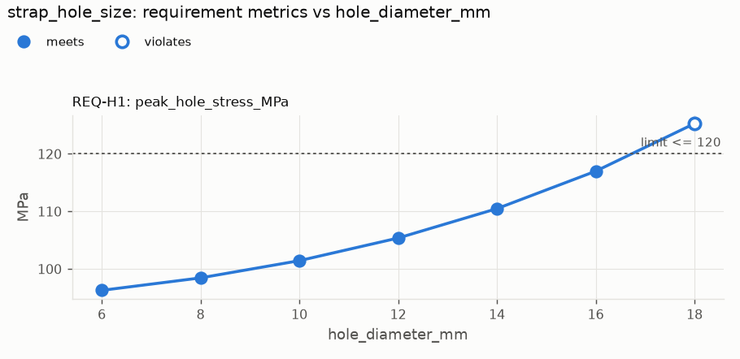
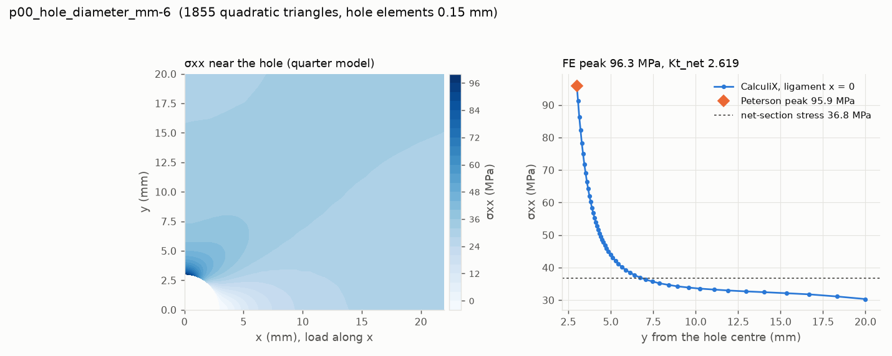
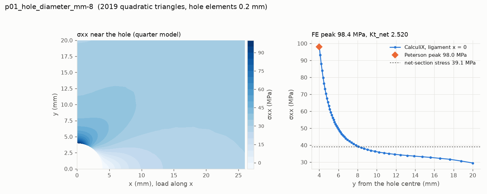
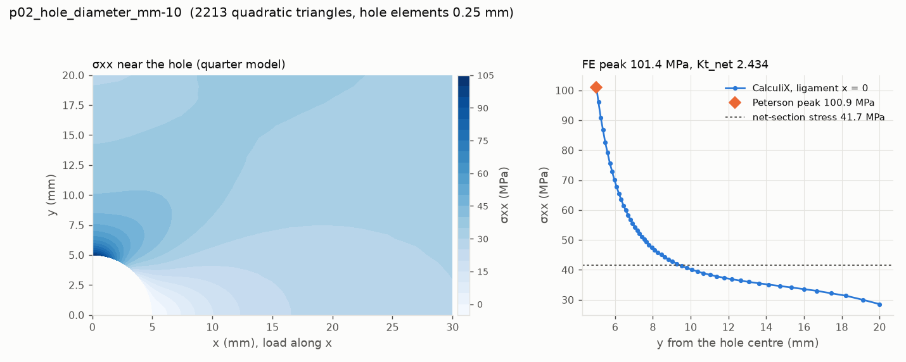
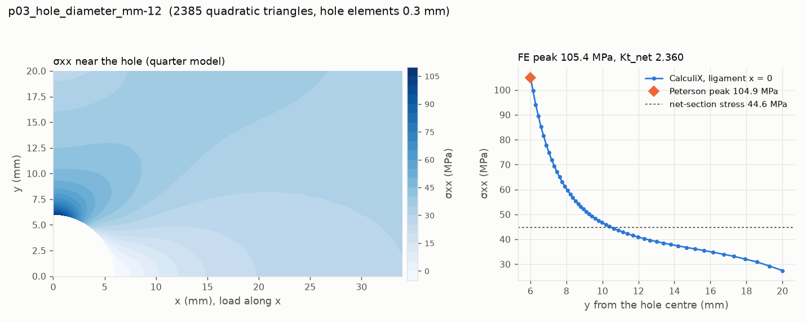
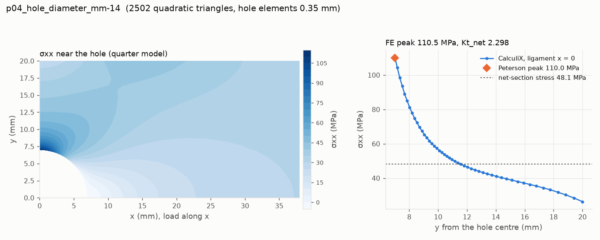
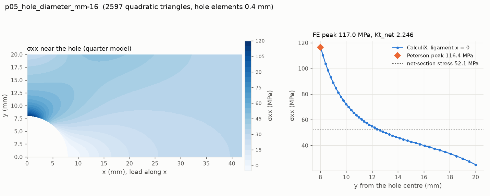
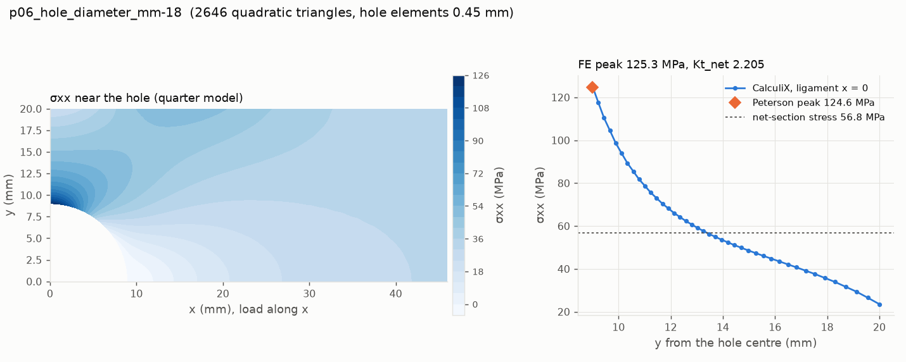

# Engineering review report: strap_hole_size

- **Run:** `20261119-235211_strap_hole_size`
- **Generated:** 2026-11-20T04:53:00+00:00
- **Case file SHA-256:** `e503185b5bf54e535566f410156c9a47c1082891c945cc5af34da5f3a4151942`
- **Environment:** Python 3.14.10, numpy 2.5.5, scipy 1.18.1, matplotlib 3.11.2, cadquery 2.8.0; Windows-11-10.0.26100-SP0
- **Tools:** cadquery 2.8.0; gmsh 4.15.0; CalculiX This is Version 2.22
- **Code version:** git `653793470cdf750913428eada38657403760a23e` (uncommitted changes present)
- **Simulation status:** completed
- **Verification status:** PASS

## Scope

6061-T6 aluminium strap, 160 x 40 x 4 mm, 5 kN axial service load, central cable hole swept from 6 to 18 mm. Finds the largest hole that keeps the peak hole-edge stress within 120 MPa.

**Assumptions**

- Linear elastic, isotropic 6061-T6 (E = 68.9 GPa, nu = 0.33); checked: peak stress below the 276 MPa yield strength.
- Plane stress; through-thickness variation at the hole neglected.
- Uniform end traction 70 mm or more from the hole; checked: the stress there is uniform.
- Hole smooth and central (quarter symmetry).
- The 120 MPa allowable is synthetic.

## Requirements

| ID | Requirement | Metric | Limit |
|---|---|---|---|
| REQ-H1 | Peak stress at the hole edge under the 5 kN service load shall not exceed 120 MPa (synthetic fatigue allowable). | `peak_hole_stress_MPa` | <= 120 MPa |

## Summary across points

| Point | hole_diameter_mm | REQ-H1 | Checks |
|---|---|---|---|
| p00_hole_diameter_mm-6 | 6 | 96.27 MPa: **PASS** | 7/7 PASS |
| p01_hole_diameter_mm-8 | 8 | 98.44 MPa: **PASS** | 7/7 PASS |
| p02_hole_diameter_mm-10 | 10 | 101.4 MPa: **PASS** | 7/7 PASS |
| p03_hole_diameter_mm-12 | 12 | 105.4 MPa: **PASS** | 7/7 PASS |
| p04_hole_diameter_mm-14 | 14 | 110.5 MPa: **PASS** | 7/7 PASS |
| p05_hole_diameter_mm-16 | 16 | 117 MPa: **PASS** | 7/7 PASS |
| p06_hole_diameter_mm-18 | 18 | 125.3 MPa: **FAIL** | 7/7 PASS |

## Point details

### p00_hole_diameter_mm-6

Parameters: length_mm = 160, width_mm = 40, thickness_mm = 4, hole_diameter_mm = 6, axial_load_N = 5000, youngs_modulus_MPa = 6.89e+04, poisson_ratio = 0.33, yield_strength_MPa = 276, hole_element_size_mm = 0.25, hole_element_ratio = 0.025, far_element_size_mm = 4

Derived: d_over_W = 0.15, gross_stress_MPa = 31.25, net_stress_MPa = 36.76, kt_net_peterson = 2.608, peak_stress_peterson_MPa = 95.87, end_distance_over_width = 1.925, face_area_closed_form_mm2 = 1593

| Requirement | Result | Limit | Margin | Verdict | Evidence |
|---|---|---|---|---|---|
| REQ-H1 | 96.27 MPa | <= 120 | 23.7 | **PASS** | [point.json](points/p00_hole_diameter_mm-6/point.json) |

| Check | Description | Value | Tolerance | Status |
|---|---|---|---|---|
| cad_area | |face area from CadQuery - closed form| / closed form | 1.43e-16 | 1e-09 | PASS |
| applied_load | |load written to the deck - F/2| / (F/2) | 0.00e+00 | 1e-06 | PASS |
| equilibrium | |reaction on the x = 0 symmetry edge + F/2| / (F/2) | 0.00e+00 | 1e-06 | PASS |
| ligament_force | |t * integral of sigma_xx across the ligament - F/2| / (F/2) | 2.90e-04 | 1e-02 | PASS |
| far_field_uniform | max |sigma_xx at the loaded end - gross stress| / gross | 1.28e-05 | 1e-03 | PASS |
| kt_reference | |Kt_net FE - Peterson| / Peterson (model form) | 4.15e-03 | 2e-02 | PASS |
| linear_material (validity) | peak hole-edge stress / yield strength | 3.49e-01 | 1e+00 | PASS |

### p01_hole_diameter_mm-8

Parameters: length_mm = 160, width_mm = 40, thickness_mm = 4, hole_diameter_mm = 8, axial_load_N = 5000, youngs_modulus_MPa = 6.89e+04, poisson_ratio = 0.33, yield_strength_MPa = 276, hole_element_size_mm = 0.25, hole_element_ratio = 0.025, far_element_size_mm = 4

Derived: d_over_W = 0.2, gross_stress_MPa = 31.25, net_stress_MPa = 39.06, kt_net_peterson = 2.508, peak_stress_peterson_MPa = 97.98, end_distance_over_width = 1.9, face_area_closed_form_mm2 = 1587

| Requirement | Result | Limit | Margin | Verdict | Evidence |
|---|---|---|---|---|---|
| REQ-H1 | 98.44 MPa | <= 120 | 21.6 | **PASS** | [point.json](points/p01_hole_diameter_mm-8/point.json) |

| Check | Description | Value | Tolerance | Status |
|---|---|---|---|---|
| cad_area | |face area from CadQuery - closed form| / closed form | 0.00e+00 | 1e-09 | PASS |
| applied_load | |load written to the deck - F/2| / (F/2) | 0.00e+00 | 1e-06 | PASS |
| equilibrium | |reaction on the x = 0 symmetry edge + F/2| / (F/2) | 0.00e+00 | 1e-06 | PASS |
| ligament_force | |t * integral of sigma_xx across the ligament - F/2| / (F/2) | 3.23e-04 | 1e-02 | PASS |
| far_field_uniform | max |sigma_xx at the loaded end - gross stress| / gross | 1.28e-05 | 1e-03 | PASS |
| kt_reference | |Kt_net FE - Peterson| / Peterson (model form) | 4.70e-03 | 2e-02 | PASS |
| linear_material (validity) | peak hole-edge stress / yield strength | 3.57e-01 | 1e+00 | PASS |

### p02_hole_diameter_mm-10

Parameters: length_mm = 160, width_mm = 40, thickness_mm = 4, hole_diameter_mm = 10, axial_load_N = 5000, youngs_modulus_MPa = 6.89e+04, poisson_ratio = 0.33, yield_strength_MPa = 276, hole_element_size_mm = 0.25, hole_element_ratio = 0.025, far_element_size_mm = 4

Derived: d_over_W = 0.25, gross_stress_MPa = 31.25, net_stress_MPa = 41.67, kt_net_peterson = 2.422, peak_stress_peterson_MPa = 100.9, end_distance_over_width = 1.875, face_area_closed_form_mm2 = 1580

| Requirement | Result | Limit | Margin | Verdict | Evidence |
|---|---|---|---|---|---|
| REQ-H1 | 101.4 MPa | <= 120 | 18.6 | **PASS** | [point.json](points/p02_hole_diameter_mm-10/point.json) |

| Check | Description | Value | Tolerance | Status |
|---|---|---|---|---|
| cad_area | |face area from CadQuery - closed form| / closed form | 1.44e-16 | 1e-09 | PASS |
| applied_load | |load written to the deck - F/2| / (F/2) | 0.00e+00 | 1e-06 | PASS |
| equilibrium | |reaction on the x = 0 symmetry edge + F/2| / (F/2) | 0.00e+00 | 1e-06 | PASS |
| ligament_force | |t * integral of sigma_xx across the ligament - F/2| / (F/2) | 9.78e-05 | 1e-02 | PASS |
| far_field_uniform | max |sigma_xx at the loaded end - gross stress| / gross | 1.60e-05 | 1e-03 | PASS |
| kt_reference | |Kt_net FE - Peterson| / Peterson (model form) | 4.92e-03 | 2e-02 | PASS |
| linear_material (validity) | peak hole-edge stress / yield strength | 3.67e-01 | 1e+00 | PASS |

### p03_hole_diameter_mm-12

Parameters: length_mm = 160, width_mm = 40, thickness_mm = 4, hole_diameter_mm = 12, axial_load_N = 5000, youngs_modulus_MPa = 6.89e+04, poisson_ratio = 0.33, yield_strength_MPa = 276, hole_element_size_mm = 0.25, hole_element_ratio = 0.025, far_element_size_mm = 4

Derived: d_over_W = 0.3, gross_stress_MPa = 31.25, net_stress_MPa = 44.64, kt_net_peterson = 2.349, peak_stress_peterson_MPa = 104.9, end_distance_over_width = 1.85, face_area_closed_form_mm2 = 1572

| Requirement | Result | Limit | Margin | Verdict | Evidence |
|---|---|---|---|---|---|
| REQ-H1 | 105.4 MPa | <= 120 | 14.6 | **PASS** | [point.json](points/p03_hole_diameter_mm-12/point.json) |

| Check | Description | Value | Tolerance | Status |
|---|---|---|---|---|
| cad_area | |face area from CadQuery - closed form| / closed form | 1.45e-16 | 1e-09 | PASS |
| applied_load | |load written to the deck - F/2| / (F/2) | 0.00e+00 | 1e-06 | PASS |
| equilibrium | |reaction on the x = 0 symmetry edge + F/2| / (F/2) | 0.00e+00 | 1e-06 | PASS |
| ligament_force | |t * integral of sigma_xx across the ligament - F/2| / (F/2) | 1.89e-06 | 1e-02 | PASS |
| far_field_uniform | max |sigma_xx at the loaded end - gross stress| / gross | 1.92e-05 | 1e-03 | PASS |
| kt_reference | |Kt_net FE - Peterson| / Peterson (model form) | 4.72e-03 | 2e-02 | PASS |
| linear_material (validity) | peak hole-edge stress / yield strength | 3.82e-01 | 1e+00 | PASS |

### p04_hole_diameter_mm-14

Parameters: length_mm = 160, width_mm = 40, thickness_mm = 4, hole_diameter_mm = 14, axial_load_N = 5000, youngs_modulus_MPa = 6.89e+04, poisson_ratio = 0.33, yield_strength_MPa = 276, hole_element_size_mm = 0.25, hole_element_ratio = 0.025, far_element_size_mm = 4

Derived: d_over_W = 0.35, gross_stress_MPa = 31.25, net_stress_MPa = 48.08, kt_net_peterson = 2.287, peak_stress_peterson_MPa = 110, end_distance_over_width = 1.825, face_area_closed_form_mm2 = 1562

| Requirement | Result | Limit | Margin | Verdict | Evidence |
|---|---|---|---|---|---|
| REQ-H1 | 110.5 MPa | <= 120 | 9.53 | **PASS** | [point.json](points/p04_hole_diameter_mm-14/point.json) |

| Check | Description | Value | Tolerance | Status |
|---|---|---|---|---|
| cad_area | |face area from CadQuery - closed form| / closed form | 1.46e-16 | 1e-09 | PASS |
| applied_load | |load written to the deck - F/2| / (F/2) | 0.00e+00 | 1e-06 | PASS |
| equilibrium | |reaction on the x = 0 symmetry edge + F/2| / (F/2) | 1.82e-16 | 1e-06 | PASS |
| ligament_force | |t * integral of sigma_xx across the ligament - F/2| / (F/2) | 2.05e-04 | 1e-02 | PASS |
| far_field_uniform | max |sigma_xx at the loaded end - gross stress| / gross | 2.24e-05 | 1e-03 | PASS |
| kt_reference | |Kt_net FE - Peterson| / Peterson (model form) | 4.63e-03 | 2e-02 | PASS |
| linear_material (validity) | peak hole-edge stress / yield strength | 4.00e-01 | 1e+00 | PASS |

### p05_hole_diameter_mm-16

Parameters: length_mm = 160, width_mm = 40, thickness_mm = 4, hole_diameter_mm = 16, axial_load_N = 5000, youngs_modulus_MPa = 6.89e+04, poisson_ratio = 0.33, yield_strength_MPa = 276, hole_element_size_mm = 0.25, hole_element_ratio = 0.025, far_element_size_mm = 4

Derived: d_over_W = 0.4, gross_stress_MPa = 31.25, net_stress_MPa = 52.08, kt_net_peterson = 2.236, peak_stress_peterson_MPa = 116.4, end_distance_over_width = 1.8, face_area_closed_form_mm2 = 1550

| Requirement | Result | Limit | Margin | Verdict | Evidence |
|---|---|---|---|---|---|
| REQ-H1 | 117 MPa | <= 120 | 3.01 | **PASS** | [point.json](points/p05_hole_diameter_mm-16/point.json) |

| Check | Description | Value | Tolerance | Status |
|---|---|---|---|---|
| cad_area | |face area from CadQuery - closed form| / closed form | 1.47e-16 | 1e-09 | PASS |
| applied_load | |load written to the deck - F/2| / (F/2) | 0.00e+00 | 1e-06 | PASS |
| equilibrium | |reaction on the x = 0 symmetry edge + F/2| / (F/2) | 0.00e+00 | 1e-06 | PASS |
| ligament_force | |t * integral of sigma_xx across the ligament - F/2| / (F/2) | 2.81e-04 | 1e-02 | PASS |
| far_field_uniform | max |sigma_xx at the loaded end - gross stress| / gross | 4.48e-05 | 1e-03 | PASS |
| kt_reference | |Kt_net FE - Peterson| / Peterson (model form) | 4.69e-03 | 2e-02 | PASS |
| linear_material (validity) | peak hole-edge stress / yield strength | 4.24e-01 | 1e+00 | PASS |

### p06_hole_diameter_mm-18

Parameters: length_mm = 160, width_mm = 40, thickness_mm = 4, hole_diameter_mm = 18, axial_load_N = 5000, youngs_modulus_MPa = 6.89e+04, poisson_ratio = 0.33, yield_strength_MPa = 276, hole_element_size_mm = 0.25, hole_element_ratio = 0.025, far_element_size_mm = 4

Derived: d_over_W = 0.45, gross_stress_MPa = 31.25, net_stress_MPa = 56.82, kt_net_peterson = 2.193, peak_stress_peterson_MPa = 124.6, end_distance_over_width = 1.775, face_area_closed_form_mm2 = 1536

| Requirement | Result | Limit | Margin | Verdict | Evidence |
|---|---|---|---|---|---|
| REQ-H1 | 125.3 MPa | <= 120 | -5.26 | **FAIL** | [point.json](points/p06_hole_diameter_mm-18/point.json) |

| Check | Description | Value | Tolerance | Status |
|---|---|---|---|---|
| cad_area | |face area from CadQuery - closed form| / closed form | 1.48e-16 | 1e-09 | PASS |
| applied_load | |load written to the deck - F/2| / (F/2) | 0.00e+00 | 1e-06 | PASS |
| equilibrium | |reaction on the x = 0 symmetry edge + F/2| / (F/2) | 0.00e+00 | 1e-06 | PASS |
| ligament_force | |t * integral of sigma_xx across the ligament - F/2| / (F/2) | 2.71e-04 | 1e-02 | PASS |
| far_field_uniform | max |sigma_xx at the loaded end - gross stress| / gross | 4.48e-05 | 1e-03 | PASS |
| kt_reference | |Kt_net FE - Peterson| / Peterson (model form) | 5.20e-03 | 2e-02 | PASS |
| linear_material (validity) | peak hole-edge stress / yield strength | 4.54e-01 | 1e+00 | PASS |

## Limitations

- Synthetic geometry, load, and allowable.
- Peterson's Kt is a model-form reference.
- No physical test data.
- A converged solver run that matches an analytical reference shows that the equations were solved correctly. It does not show that the equations represent real hardware.

## Engineering acceptance

Pending human review. This report does not accept or reject the design.
